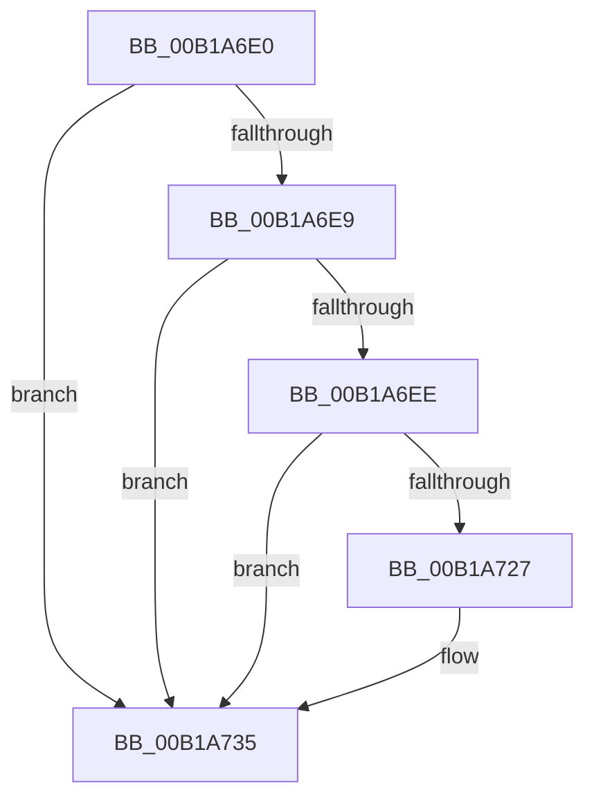

# sub_00B1A6E0

- RVA: `0x00B1A6E0`–`0x00B1A73F` (길이 `95` bytes)
- VA: `0x0000000140B1A6E0`
- 실행 섹션: `PAGE`
- PDB 이름 있음: `아니요`; PDB Function 태그: `아니요`
- unwind 정보 RVA: `0x000825D0`
- 디코드: `21`개 명령, `95/95` bytes 표시
- 미해석 바이트: `0` (있으면 어셈블리에 `.byte`로 보존)

> 이 문서는 커널 이미지의 기계어와 PDB 기호를 분석해 생성했습니다. 4번과 5번은 함수 원형과 자료형을 바이너리 사용 방식에서 추정한 C 해석이며 원본 소스 복구 결과는 아닙니다.

## 1. Dependencies

- 직접 호출 지점: **2**; 고유 호출 대상: **2**
- 직접 호출자로 확인된 함수: **0**
- RIP 상대 이미지 참조: **2**

### Outgoing calls
- `0x00B1A71E` → [ObReferenceObjectByHandle](../86/ObReferenceObjectByHandle_function_00868DB0.md) (function, `0x00868DB0`)
- `0x00B1A730` → [ObfDereferenceObject](../../text/2F/ObfDereferenceObject_function_002F9350.md) (function, `0x002F9350`)

### Direct callers
- 이 함수 시작 RVA로 연결되는 직접 call은 확인되지 않았습니다. 간접 호출은 완전히 역산할 수 없습니다.

### Static image references
- `0x00B1A6E0` → RVA `0x00FD8008` (`PAGEDATA`; read)
- `0x00B1A6FE` → RVA `0x00FC6AC0` (`ALMOSTRO`; read)

## 2. Other-region calls and transfers

- 다른 실행 섹션으로 향하는 call: **1**
  - `0x00B1A730` → [ObfDereferenceObject](../../text/2F/ObfDereferenceObject_function_002F9350.md) (`PAGE` → `.text`)
- call이 아닌 외부 분기/꼬리 이동: **1**
  - `0x00B1A73A` → [NtEnumerateKey + 0x2E5](../8B/NtEnumerateKey_function_008B1F70.md) (`tail-transfer`)

## 3. Assembly (complete function range)

```asm
00B1A6E0  4C 39 35 21 D9 4B 00            cmp qword ptr [rip + 0x4bd921], r14
00B1A6E7  74 4C                           je 0x140b1a735
00B1A6E9  48 85 FF                        test rdi, rdi
00B1A6EC  74 47                           je 0x140b1a735
00B1A6EE  65 48 8B 04 25 88 01 00 00      mov rax, qword ptr gs:[0x188]
00B1A6F7  44 8A 88 32 02 00 00            mov r9b, byte ptr [rax + 0x232]
00B1A6FE  4C 8B 05 BB C3 4A 00            mov r8, qword ptr [rip + 0x4ac3bb]
00B1A705  4C 21 74 24 50                  and qword ptr [rsp + 0x50], r14
00B1A70A  4C 21 74 24 28                  and qword ptr [rsp + 0x28], r14
00B1A70F  48 8D 44 24 50                  lea rax, [rsp + 0x50]
00B1A714  48 89 44 24 20                  mov qword ptr [rsp + 0x20], rax
00B1A719  33 D2                           xor edx, edx
00B1A71B  48 8B CF                        mov rcx, rdi
00B1A71E  E8 8D E6 D4 FF                  call 0x140868db0
00B1A723  85 C0                           test eax, eax
00B1A725  78 0E                           js 0x140b1a735
00B1A727  48 8B 4C 24 50                  mov rcx, qword ptr [rsp + 0x50]
00B1A72C  4C 8B 71 08                     mov r14, qword ptr [rcx + 8]
00B1A730  E8 1B EC 7D FF                  call 0x1402f9350
00B1A735  BF 0D 00 00 C0                  mov edi, 0xc000000d
00B1A73A  E9 16 7B D9 FF                  jmp 0x1408b2255
```

## 4. C-style interpretation (structured pseudocode)

```c
__int64 __fastcall sub_00B1A6E0(__int64 a1, int a2, __int64 a3, __int64 a4, __int64 a5, __int64 a6, __int64 a7, __int64 a8, __int64 a9, __int64 a10)
{
    __int64 result;
    __int64 v_r14;
    unsigned __int64 v_stack_p20;

    if ((*(unsigned __int64 *)(v_rip + 4970785)) == v_r14) goto loc_00B1A735;
    if (v_rdi == 0) goto loc_00B1A735;
    v_stack_p20 = a10;
    a2 = 0;
    result = ObReferenceObjectByHandle(v_rdi, a2, *(unsigned __int64 *)(v_rip + 4899771), *(unsigned __int8 *)(*(unsigned __int64 *)(gs_base + (0 + 392)) + 562));
    if (!(sign_flag)) {
        a1 = a10;
        v_r14 = *(unsigned __int64 *)(a1 + 8);
        result = ObfDereferenceObject(a1, a2, *(unsigned __int64 *)(v_rip + 4899771), *(unsigned __int8 *)(*(unsigned __int64 *)(gs_base + (0 + 392)) + 562));
    }
}
```

## 5. (Beta) C Style

```c
int64_t sub_00B1A6E0(int64_t Arg1, int32_t Arg2, int64_t Arg3, int64_t Arg4, int64_t Arg5, uint64_t Arg6, uint64_t Arg7, uint64_t Arg8, uint64_t Arg9, void *Arg10)
{
    uint8_t *arg10 = (uint8_t *)Arg10;

    int64_t result;
    int64_t local_r14;
    uint64_t v_stack_p20;

    if ((*(uint64_t *)(v_rip + 0x4BD921)) == local_r14) goto loc_00B1A735;
    if (local_rdi == 0) goto loc_00B1A735;
    v_stack_p20 = Arg10;
    Arg2 = 0;
    result = ObReferenceObjectByHandle(local_rdi, Arg2, *(uint64_t *)(v_rip + 0x4AC3BB), *(uint8_t *)(*(uint64_t *)(gs_base + (0 + 0x188)) + 0x232));
    if (!(sign_flag)) {
        Arg1 = Arg10;
        local_r14 = *(uint64_t *)(Arg1 + 0x8);
        result = ObfDereferenceObject(Arg1, Arg2, *(uint64_t *)(v_rip + 0x4AC3BB), *(uint8_t *)(*(uint64_t *)(gs_base + (0 + 0x188)) + 0x232));
    }
}
```

### 관측된 메모리 오프셋

구조체 형식이 확인되지 않은 접근은 인자 기준의 오프셋으로만 기록했습니다.

| 기준 인자 | 오프셋 표현 | 폭 (bit) | 접근 |
|---|---:|---:|---|
| `Arg10` | `+ 0x8` | `64` | `R` |

## 6. Execution-region graph

[열기: 2D/3D 그래프와 함수 탐색 컨트롤 패널](../../../control-panel.html?section=page&rva=0x00B1A6E0&view=graph)

- 2D 그래프는 위에서 아래로 흐르고, 3D 그래프는 빈 공간을 드래그해 회전합니다. Shift+드래그는 이동, 휠은 확대·축소, 함수 노드 선택은 대상 보고서 이동입니다.

### Static fallback


