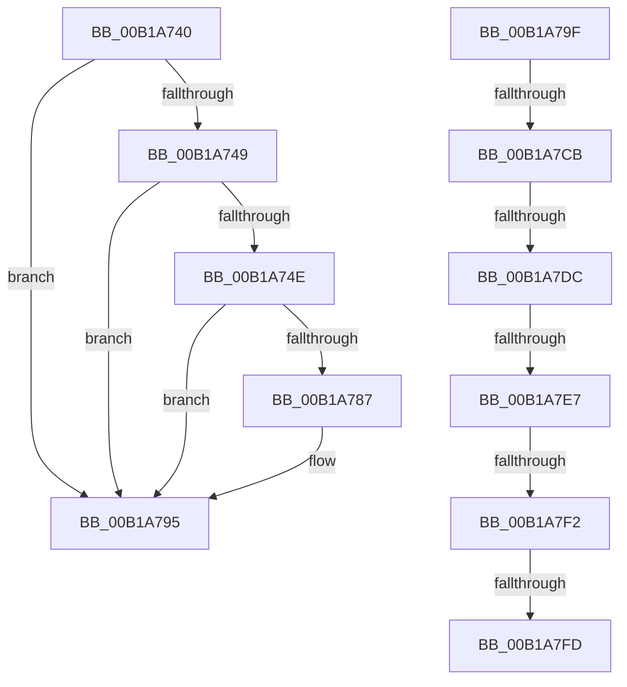

# sub_00B1A740

- RVA: `0x00B1A740`–`0x00B1A802` (길이 `194` bytes)
- VA: `0x0000000140B1A740`
- 실행 섹션: `PAGE`
- PDB 이름 있음: `아니요`; PDB Function 태그: `아니요`
- unwind 정보 RVA: `0x00082704`
- 디코드: `40`개 명령, `194/194` bytes 표시
- 미해석 바이트: `0` (있으면 어셈블리에 `.byte`로 보존)

> 이 문서는 커널 이미지의 기계어와 PDB 기호를 분석해 생성했습니다. 4번과 5번은 함수 원형과 자료형을 바이너리 사용 방식에서 추정한 C 해석이며 원본 소스 복구 결과는 아닙니다.

## 1. Dependencies

- 직접 호출 지점: **3**; 고유 호출 대상: **3**
- 직접 호출자로 확인된 함수: **0**
- RIP 상대 이미지 참조: **3**

### Outgoing calls
- `0x00B1A77E` → [ObReferenceObjectByHandle](../86/ObReferenceObjectByHandle_function_00868DB0.md) (function, `0x00868DB0`)
- `0x00B1A790` → [ObfDereferenceObject](../../text/2F/ObfDereferenceObject_function_002F9350.md) (function, `0x002F9350`)
- `0x00B1A7BC` → [KeExpandKernelStackAndCallout](../../text/46/KeExpandKernelStackAndCallout_function_004675F0.md) (function, `0x004675F0`)

### Direct callers
- 이 함수 시작 RVA로 연결되는 직접 call은 확인되지 않았습니다. 간접 호출은 완전히 역산할 수 없습니다.

### Static image references
- `0x00B1A740` → RVA `0x00FD8008` (`PAGEDATA`; read)
- `0x00B1A75E` → RVA `0x00FC6AC0` (`ALMOSTRO`; read)
- `0x00B1A7B5` → RVA `0x00A19D70` (`CmQueryValueKeyCallout`; read)

## 2. Other-region calls and transfers

- 다른 실행 섹션으로 향하는 call: **2**
  - `0x00B1A790` → [ObfDereferenceObject](../../text/2F/ObfDereferenceObject_function_002F9350.md) (`PAGE` → `.text`)
  - `0x00B1A7BC` → [KeExpandKernelStackAndCallout](../../text/46/KeExpandKernelStackAndCallout_function_004675F0.md) (`PAGE` → `.text`)
- call이 아닌 외부 분기/꼬리 이동: **7**
  - `0x00B1A79A` → [NtQueryValueKey + 0x505](../8B/NtQueryValueKey_function_008B2A00.md) (`tail-transfer`)
  - `0x00B1A7C5` → [NtQueryValueKey + 0x6C6](../8B/NtQueryValueKey_function_008B2A00.md) (`tail-transfer`)
  - `0x00B1A7D6` → [NtQueryValueKey + 0x4AD](../8B/NtQueryValueKey_function_008B2A00.md) (`tail-transfer`)
  - `0x00B1A7E1` → [NtQueryValueKey + 0x4AD](../8B/NtQueryValueKey_function_008B2A00.md) (`tail-transfer`)
  - `0x00B1A7EC` → [NtQueryValueKey + 0x4AD](../8B/NtQueryValueKey_function_008B2A00.md) (`tail-transfer`)
  - `0x00B1A7F7` → [NtQueryValueKey + 0x6C6](../8B/NtQueryValueKey_function_008B2A00.md) (`tail-transfer`)
  - `0x00B1A7FD` → [NtQueryValueKey + 0x46B](../8B/NtQueryValueKey_function_008B2A00.md) (`tail-transfer`)

## 3. Assembly (complete function range)

```asm
00B1A740  48 39 1D C1 D8 4B 00            cmp qword ptr [rip + 0x4bd8c1], rbx
00B1A747  74 4C                           je 0x140b1a795
00B1A749  48 85 FF                        test rdi, rdi
00B1A74C  74 47                           je 0x140b1a795
00B1A74E  65 48 8B 04 25 88 01 00 00      mov rax, qword ptr gs:[0x188]
00B1A757  44 8A 88 32 02 00 00            mov r9b, byte ptr [rax + 0x232]
00B1A75E  4C 8B 05 5B C3 4A 00            mov r8, qword ptr [rip + 0x4ac35b]
00B1A765  48 89 5C 24 78                  mov qword ptr [rsp + 0x78], rbx
00B1A76A  48 89 5C 24 28                  mov qword ptr [rsp + 0x28], rbx
00B1A76F  48 8D 44 24 78                  lea rax, [rsp + 0x78]
00B1A774  48 89 44 24 20                  mov qword ptr [rsp + 0x20], rax
00B1A779  33 D2                           xor edx, edx
00B1A77B  48 8B CF                        mov rcx, rdi
00B1A77E  E8 2D E6 D4 FF                  call 0x140868db0
00B1A783  85 C0                           test eax, eax
00B1A785  78 0E                           js 0x140b1a795
00B1A787  48 8B 4C 24 78                  mov rcx, qword ptr [rsp + 0x78]
00B1A78C  4C 8B 61 08                     mov r12, qword ptr [rcx + 8]
00B1A790  E8 BB EB 7D FF                  call 0x1402f9350
00B1A795  BF 0D 00 00 C0                  mov edi, 0xc000000d
00B1A79A  E9 66 87 D9 FF                  jmp 0x1408b2f05
00B1A79F  48 89 8C 24 B8 00 00 00         mov qword ptr [rsp + 0xb8], rcx
00B1A7A7  41 B8 00 48 00 00               mov r8d, 0x4800
00B1A7AD  48 8D 94 24 B0 00 00 00         lea rdx, [rsp + 0xb0]
00B1A7B5  48 8D 0D B4 F5 EF FF            lea rcx, [rip - 0x100a4c]
00B1A7BC  E8 2F CE 94 FF                  call 0x1404675f0
00B1A7C1  8B F8                           mov edi, eax
00B1A7C3  85 C0                           test eax, eax
00B1A7C5  0F 88 FB 88 D9 FF               js 0x1408b30c6
00B1A7CB  8B 84 24 B0 00 00 00            mov eax, dword ptr [rsp + 0xb0]
00B1A7D2  8B F8                           mov edi, eax
00B1A7D4  85 C0                           test eax, eax
00B1A7D6  0F 89 D1 86 D9 FF               jns 0x1408b2ead
00B1A7DC  3D 23 00 00 C0                  cmp eax, 0xc0000023
00B1A7E1  0F 84 C6 86 D9 FF               je 0x1408b2ead
00B1A7E7  3D 05 00 00 80                  cmp eax, 0x80000005
00B1A7EC  0F 84 BB 86 D9 FF               je 0x1408b2ead
00B1A7F2  3D 34 00 00 C0                  cmp eax, 0xc0000034
00B1A7F7  0F 85 C9 88 D9 FF               jne 0x1408b30c6
00B1A7FD  E9 69 86 D9 FF                  jmp 0x1408b2e6b
```

## 4. C-style interpretation (structured pseudocode)

```c
__int64 __fastcall sub_00B1A740(__int64 a1, int a2, __int64 a3, __int64 a4, __int64 a5, __int64 a6, __int64 a7, __int64 a8, __int64 a9, __int64 a10, __int64 a11, __int64 a12, __int64 a13, __int64 a14, __int64 a15)
{
    __int64 result;
    __int64 v_r12;
    unsigned __int64 v_stack_p20;
    unsigned __int64 v_stack_p28;
    unsigned __int64 v_stack_p78;
    unsigned __int64 v_stack_pB0;
    unsigned __int64 v_stack_pB8;

    if ((*(unsigned __int64 *)(v_rip + 4970689)) == v_rbx) goto loc_00B1A795;
    if (v_rdi == 0) goto loc_00B1A795;
    v_stack_p78 = v_rbx;
    v_stack_p28 = v_rbx;
    v_stack_p20 = a15;
    a2 = 0;
    result = ObReferenceObjectByHandle(v_rdi, a2, *(unsigned __int64 *)(v_rip + 4899675), *(unsigned __int8 *)(*(unsigned __int64 *)(gs_base + (0 + 392)) + 562));
    if (!(sign_flag)) {
        a1 = a15;
        v_r12 = *(unsigned __int64 *)(a1 + 8);
        result = ObfDereferenceObject(a1, a2, *(unsigned __int64 *)(v_rip + 4899675), *(unsigned __int8 *)(*(unsigned __int64 *)(gs_base + (0 + 392)) + 562));
    }
}
```

## 5. (Beta) C Style

```c
int64_t sub_00B1A740(int64_t Arg1, int32_t Arg2, int64_t Arg3, int64_t Arg4, uint64_t Arg5, uint64_t Arg6, uint64_t Arg7, uint64_t Arg8, uint64_t Arg9, uint64_t Arg10, uint64_t Arg11, uint64_t Arg12, uint64_t Arg13, uint64_t Arg14, void *Arg15)
{
    uint8_t *arg15 = (uint8_t *)Arg15;

    int64_t result;
    int64_t local_r12;
    uint64_t v_stack_p20;
    uint64_t v_stack_p28;
    uint64_t v_stack_p78;
    uint64_t v_stack_pB0;
    uint64_t v_stack_pB8;

    if ((*(uint64_t *)(v_rip + 0x4BD8C1)) == local_rbx) goto loc_00B1A795;
    if (local_rdi == 0) goto loc_00B1A795;
    v_stack_p78 = local_rbx;
    v_stack_p28 = local_rbx;
    v_stack_p20 = Arg15;
    Arg2 = 0;
    result = ObReferenceObjectByHandle(local_rdi, Arg2, *(uint64_t *)(v_rip + 0x4AC35B), *(uint8_t *)(*(uint64_t *)(gs_base + (0 + 0x188)) + 0x232));
    if (!(sign_flag)) {
        Arg1 = Arg15;
        local_r12 = *(uint64_t *)(Arg1 + 0x8);
        result = ObfDereferenceObject(Arg1, Arg2, *(uint64_t *)(v_rip + 0x4AC35B), *(uint8_t *)(*(uint64_t *)(gs_base + (0 + 0x188)) + 0x232));
    }
}
```

### 관측된 메모리 오프셋

구조체 형식이 확인되지 않은 접근은 인자 기준의 오프셋으로만 기록했습니다.

| 기준 인자 | 오프셋 표현 | 폭 (bit) | 접근 |
|---|---:|---:|---|
| `Arg15` | `+ 0x8` | `64` | `R` |

## 6. Execution-region graph

[열기: 2D/3D 그래프와 함수 탐색 컨트롤 패널](../../../control-panel.html?section=page&rva=0x00B1A740&view=graph)

- 2D 그래프는 위에서 아래로 흐르고, 3D 그래프는 빈 공간을 드래그해 회전합니다. Shift+드래그는 이동, 휠은 확대·축소, 함수 노드 선택은 대상 보고서 이동입니다.

### Static fallback


