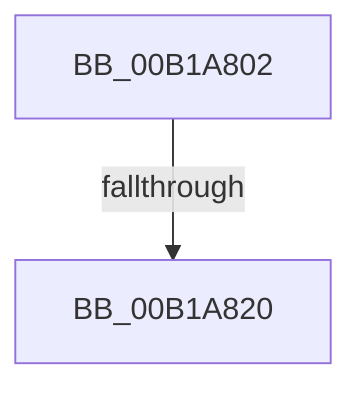

# sub_00B1A802

- RVA: `0x00B1A802`–`0x00B1A8D1` (길이 `207` bytes)
- VA: `0x0000000140B1A802`
- 실행 섹션: `PAGE`
- PDB 이름 있음: `아니요`; PDB Function 태그: `아니요`
- unwind 정보 RVA: `0x00082764`
- 디코드: `41`개 명령, `207/207` bytes 표시
- 미해석 바이트: `0` (있으면 어셈블리에 `.byte`로 보존)

> 이 문서는 커널 이미지의 기계어와 PDB 기호를 분석해 생성했습니다. 4번과 5번은 함수 원형과 자료형을 바이너리 사용 방식에서 추정한 C 해석이며 원본 소스 복구 결과는 아닙니다.

## 1. Dependencies

- 직접 호출 지점: **2**; 고유 호출 대상: **2**
- 직접 호출자로 확인된 함수: **0**
- RIP 상대 이미지 참조: **2**

### Outgoing calls
- `0x00B1A813` → [tlgKeywordOn](../../text/42/tlgKeywordOn_function_0042EAA0.md) (function, `0x0042EAA0`)
- `0x00B1A8C6` → [tlgWriteTransfer_EtwWriteTransfer](../../text/42/tlgWriteTransfer_EtwWriteTransfer_function_004260E0.md) (function, `0x004260E0`)

### Direct callers
- 이 함수 시작 RVA로 연결되는 직접 call은 확인되지 않았습니다. 간접 호출은 완전히 역산할 수 없습니다.

### Static image references
- `0x00B1A80C` → RVA `0x00E074A0` (`.data`; read)
- `0x00B1A835` → RVA `0x00048873` (`.rdata`; read)

## 2. Other-region calls and transfers

- 다른 실행 섹션으로 향하는 call: **2**
  - `0x00B1A813` → [tlgKeywordOn](../../text/42/tlgKeywordOn_function_0042EAA0.md) (`PAGE` → `.text`)
  - `0x00B1A8C6` → [tlgWriteTransfer_EtwWriteTransfer](../../text/42/tlgWriteTransfer_EtwWriteTransfer_function_004260E0.md) (`PAGE` → `.text`)
- call이 아닌 외부 분기/꼬리 이동: **2**
  - `0x00B1A81A` → [ObpParseSymbolicLinkEx + 0x431](../8B/ObpParseSymbolicLinkEx_function_008B35C0.md) (`tail-transfer`)
  - `0x00B1A8CC` → [ObpParseSymbolicLinkEx + 0x431](../8B/ObpParseSymbolicLinkEx_function_008B35C0.md) (`tail-transfer`)

## 3. Assembly (complete function range)

```asm
00B1A802  48 BA 00 00 00 00 00 40 00 00   movabs rdx, 0x400000000000
00B1A80C  48 8D 0D 8D CC 2E 00            lea rcx, [rip + 0x2ecc8d]
00B1A813  E8 88 42 91 FF                  call 0x14042eaa0
00B1A818  84 C0                           test al, al
00B1A81A  0F 84 D1 91 D9 FF               je 0x1408b39f1
00B1A820  33 C9                           xor ecx, ecx
00B1A822  48 C7 45 D8 02 00 00 00         mov qword ptr [rbp - 0x28], 2
00B1A82A  48 8D 45 E8                     lea rax, [rbp - 0x18]
00B1A82E  89 4D EC                        mov dword ptr [rbp - 0x14], ecx
00B1A831  48 89 45 D0                     mov qword ptr [rbp - 0x30], rax
00B1A835  48 8D 15 37 E0 52 FF            lea rdx, [rip - 0xad1fc9]
00B1A83C  49 8B 40 08                     mov rax, qword ptr [r8 + 8]
00B1A840  48 8D 0D 59 CC 2E 00            lea rcx, [rip + 0x2ecc59]
00B1A847  48 89 45 E0                     mov qword ptr [rbp - 0x20], rax
00B1A84B  45 33 C9                        xor r9d, r9d
00B1A84E  41 0F B7 00                     movzx eax, word ptr [r8]
00B1A852  45 33 C0                        xor r8d, r8d
00B1A855  89 45 E8                        mov dword ptr [rbp - 0x18], eax
00B1A858  8B 43 24                        mov eax, dword ptr [rbx + 0x24]
00B1A85B  89 44 24 50                     mov dword ptr [rsp + 0x50], eax
00B1A85F  48 8D 44 24 50                  lea rax, [rsp + 0x50]
00B1A864  48 89 45 F0                     mov qword ptr [rbp - 0x10], rax
00B1A868  48 8D 44 24 58                  lea rax, [rsp + 0x58]
00B1A86D  48 89 45 00                     mov qword ptr [rbp], rax
00B1A871  48 8D 44 24 32                  lea rax, [rsp + 0x32]
00B1A876  48 89 45 10                     mov qword ptr [rbp + 0x10], rax
00B1A87A  48 8D 44 24 40                  lea rax, [rsp + 0x40]
00B1A87F  48 89 45 20                     mov qword ptr [rbp + 0x20], rax
00B1A883  48 8D 45 B0                     lea rax, [rbp - 0x50]
00B1A887  48 89 44 24 28                  mov qword ptr [rsp + 0x28], rax
00B1A88C  C7 44 24 20 08 00 00 00         mov dword ptr [rsp + 0x20], 8
00B1A894  48 C7 45 F8 04 00 00 00         mov qword ptr [rbp - 8], 4
00B1A89C  89 7C 24 58                     mov dword ptr [rsp + 0x58], edi
00B1A8A0  48 C7 45 08 04 00 00 00         mov qword ptr [rbp + 8], 4
00B1A8A8  44 88 74 24 32                  mov byte ptr [rsp + 0x32], r14b
00B1A8AD  48 C7 45 18 01 00 00 00         mov qword ptr [rbp + 0x18], 1
00B1A8B5  48 C7 44 24 40 00 00 00 01      mov qword ptr [rsp + 0x40], 0x1000000
00B1A8BE  48 C7 45 28 08 00 00 00         mov qword ptr [rbp + 0x28], 8
00B1A8C6  E8 15 B8 90 FF                  call 0x1404260e0
00B1A8CB  90                              nop
00B1A8CC  E9 20 91 D9 FF                  jmp 0x1408b39f1
```

## 4. C-style interpretation (structured pseudocode)

```c
__int64 __fastcall sub_00B1A802(__int64 a1, __int64 a2, __int64 a3, int a4, __int64 a5, __int64 a6, __int64 a7, __int64 a8, __int64 a9, __int64 a10, __int64 a11)
{
    __int64 result;
    unsigned int v_stack_p20;
    unsigned __int64 v_stack_p28;
    unsigned __int64 v_stack_p32;
    unsigned __int64 v_stack_p40;
    unsigned int v_stack_p50;
    unsigned int v_stack_p58;

    result = tlgKeywordOn(v_rip + 3067021, a2, a3, a4);
    a1 = 0;
    *(unsigned __int64 *)(v_rbp - 40) = 2;
    *(unsigned int *)(v_rbp - 20) = 0;
    *(unsigned __int64 *)(v_rbp - 48) = v_rbp - 24;
    *(unsigned __int64 *)(v_rbp - 32) = *(unsigned __int64 *)(a3 + 8);
    a4 = 0;
    a3 = 0;
    *(unsigned int *)(v_rbp - 24) = (unsigned int)(*(unsigned __int16 *)(a3));
    v_stack_p50 = (unsigned int)((unsigned int)(*(unsigned int *)(v_rbx + 36)));
    *(unsigned __int64 *)(v_rbp - 16) = a10;
    *(unsigned __int64 *)(v_rbp) = a11;
    *(unsigned __int64 *)(v_rbp + 16) = v_stack_p32;
    *(unsigned __int64 *)(v_rbp + 32) = a8;
    v_stack_p28 = v_rbp - 80;
    v_stack_p20 = 8;
    *(unsigned __int64 *)(v_rbp - 8) = 4;
    v_stack_p58 = (unsigned int)(v_rdi);
    *(unsigned __int64 *)(v_rbp + 8) = 4;
    v_stack_p32 = (unsigned __int8)(v_r14);
    *(unsigned __int64 *)(v_rbp + 24) = 1;
    v_stack_p40 = 0x1000000ULL;
    *(unsigned __int64 *)(v_rbp + 40) = 8;
    result = tlgWriteTransfer_EtwWriteTransfer(v_rip + 3066969, v_rip - 11345865, a3, a4);
}
```

## 5. (Beta) C Style

```c
int64_t sub_00B1A802(int64_t Arg1, int64_t Arg2, int64_t Arg3, int32_t Arg4, uint64_t Arg5, uint64_t Arg6, uint64_t Arg7, int64_t Arg8, uint64_t Arg9, int64_t Arg10, int64_t Arg11)
{
    int64_t result;
    uint32_t v_stack_p20;
    uint64_t v_stack_p28;
    uint64_t v_stack_p32;
    uint64_t v_stack_p40;
    uint32_t v_stack_p50;
    uint32_t v_stack_p58;

    result = tlgKeywordOn(v_rip + 3067021, Arg2, Arg3, Arg4);
    Arg1 = 0;
    *(uint64_t *)(local_rbp - 0x28) = 2;
    *(uint32_t *)(local_rbp - 0x14) = 0;
    *(uint64_t *)(local_rbp - 0x30) = local_rbp - 24;
    *(uint64_t *)(local_rbp - 0x20) = *(uint64_t *)(Arg3 + 0x8);
    Arg4 = 0;
    Arg3 = 0;
    *(uint32_t *)(local_rbp - 0x18) = (uint32_t)(*(uint16_t *)(Arg3));
    v_stack_p50 = (uint32_t)((uint32_t)(*(uint32_t *)(local_rbx + 0x24)));
    *(uint64_t *)(local_rbp - 0x10) = Arg10;
    *(uint64_t *)(local_rbp) = Arg11;
    *(uint64_t *)(local_rbp + 0x10) = v_stack_p32;
    *(uint64_t *)(local_rbp + 0x20) = Arg8;
    v_stack_p28 = local_rbp - 80;
    v_stack_p20 = 8;
    *(uint64_t *)(local_rbp - 0x8) = 4;
    v_stack_p58 = (uint32_t)(local_rdi);
    *(uint64_t *)(local_rbp + 0x8) = 4;
    v_stack_p32 = (uint8_t)(local_r14);
    *(uint64_t *)(local_rbp + 0x18) = 1;
    v_stack_p40 = 0x1000000ULL;
    *(uint64_t *)(local_rbp + 0x28) = 8;
    result = tlgWriteTransfer_EtwWriteTransfer(v_rip + 3066969, v_rip - 11345865, Arg3, Arg4);
}
```

## 6. Execution-region graph

[열기: 2D/3D 그래프와 함수 탐색 컨트롤 패널](../../../control-panel.html?section=page&rva=0x00B1A802&view=graph)

- 2D 그래프는 위에서 아래로 흐르고, 3D 그래프는 빈 공간을 드래그해 회전합니다. Shift+드래그는 이동, 휠은 확대·축소, 함수 노드 선택은 대상 보고서 이동입니다.

### Static fallback


