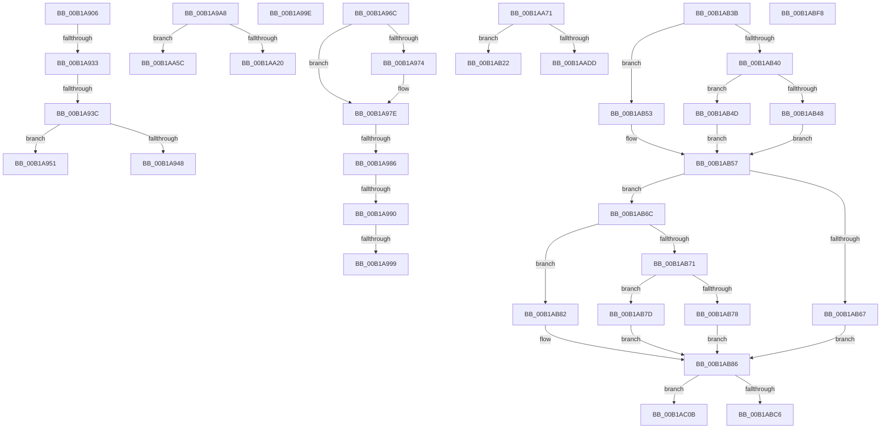

# sub_00B1A906

- RVA: `0x00B1A906`–`0x00B1AC14` (길이 `782` bytes)
- VA: `0x0000000140B1A906`
- 실행 섹션: `PAGE`
- PDB 이름 있음: `아니요`; PDB Function 태그: `아니요`
- unwind 정보 RVA: `0x00082F98`
- 디코드: `205`개 명령, `782/782` bytes 표시
- 미해석 바이트: `0` (있으면 어셈블리에 `.byte`로 보존)

> 이 문서는 커널 이미지의 기계어와 PDB 기호를 분석해 생성했습니다. 4번과 5번은 함수 원형과 자료형을 바이너리 사용 방식에서 추정한 C 해석이며 원본 소스 복구 결과는 아닙니다.

## 1. Dependencies

- 직접 호출 지점: **3**; 고유 호출 대상: **1**
- 직접 호출자로 확인된 함수: **0**
- RIP 상대 이미지 참조: **0**

### Outgoing calls
- `0x00B1AA15` → [RtlpComputeMergedAcl](../AC/RtlpComputeMergedAcl_function_00AC9B34.md) (function, `0x00AC9B34`)
- `0x00B1AAD2` → [RtlpComputeMergedAcl](../AC/RtlpComputeMergedAcl_function_00AC9B34.md) (function, `0x00AC9B34`)
- `0x00B1ABBB` → [RtlpComputeMergedAcl](../AC/RtlpComputeMergedAcl_function_00AC9B34.md) (function, `0x00AC9B34`)

### Direct callers
- 이 함수 시작 RVA로 연결되는 직접 call은 확인되지 않았습니다. 간접 호출은 완전히 역산할 수 없습니다.

### Static image references
- 디코드된 RIP-relative 메모리 참조가 없습니다.

## 2. Other-region calls and transfers

- 다른 실행 섹션으로 향하는 call: **0**
- call이 아닌 외부 분기/꼬리 이동: **16**
  - `0x00B1A92D` → [sub_008BB534 + 0x184](../8B/Unknown_function_008BB534.md) (`tail-transfer`)
  - `0x00B1A936` → [sub_008BB534 + 0x184](../8B/Unknown_function_008BB534.md) (`tail-transfer`)
  - `0x00B1A94C` → [sub_008BB534 + 0x184](../8B/Unknown_function_008BB534.md) (`tail-transfer`)
  - `0x00B1A967` → [sub_008BB534 + 0x184](../8B/Unknown_function_008BB534.md) (`tail-transfer`)
  - `0x00B1A980` → [sub_008BC3C4 + 0x2C5](../8B/Unknown_function_008BC3C4.md) (`tail-transfer`)
  - `0x00B1A98A` → [sub_008BC3C4 + 0x2C5](../8B/Unknown_function_008BC3C4.md) (`tail-transfer`)
  - `0x00B1A993` → [sub_008BC3C4 + 0x2C5](../8B/Unknown_function_008BC3C4.md) (`tail-transfer`)
  - `0x00B1A999` → [sub_008BBC01 + 0x250](../8B/Unknown_function_008BBC01.md) (`tail-transfer`)
  - `0x00B1A9A3` → [sub_008BBC01 + 0x25D](../8B/Unknown_function_008BBC01.md) (`tail-transfer`)
  - `0x00B1AA57` → [sub_008BBC01 + 0x4B5](../8B/Unknown_function_008BBC01.md) (`tail-transfer`)
  - `0x00B1AA6C` → [sub_008BC3C4 + 0x209](../8B/Unknown_function_008BC3C4.md) (`tail-transfer`)
  - `0x00B1AB1D` → [sub_008BBC01 + 0x502](../8B/Unknown_function_008BBC01.md) (`tail-transfer`)
  - `0x00B1AB36` → [sub_008BC3C4 + 0x20D](../8B/Unknown_function_008BC3C4.md) (`tail-transfer`)
  - `0x00B1ABF3` → [sub_008BB9AC + 0x11C](../8B/Unknown_function_008BB9AC.md) (`tail-transfer`)
  - `0x00B1AC06` → [sub_008BC25B + 0x80](../8B/Unknown_function_008BC25B.md) (`tail-transfer`)
  - `0x00B1AC0F` → [sub_008BC3C4 + 0x205](../8B/Unknown_function_008BC3C4.md) (`tail-transfer`)

## 3. Assembly (complete function range)

```asm
00B1A906  41 81 CE FF 01 00 00            or r14d, 0x1ff
00B1A90D  41 8B C6                        mov eax, r14d
00B1A910  0F BA F0 07                     btr eax, 7
00B1A914  45 85 C0                        test r8d, r8d
00B1A917  41 0F 45 C6                     cmovne eax, r14d
00B1A91B  44 8B F0                        mov r14d, eax
00B1A91E  41 0F BA F6 08                  btr r14d, 8
00B1A923  45 85 C9                        test r9d, r9d
00B1A926  44 0F 45 F0                     cmovne r14d, eax
00B1A92A  4D 85 FF                        test r15, r15
00B1A92D  0F 85 85 0D DA FF               jne 0x1408bb6b8
00B1A933  48 85 F6                        test rsi, rsi
00B1A936  0F 85 7C 0D DA FF               jne 0x1408bb6b8
00B1A93C  41 81 E6 07 FE FF FF            and r14d, 0xfffffe07
00B1A943  F6 C2 10                        test dl, 0x10
00B1A946  74 09                           je 0x140b1a951
00B1A948  41 83 CE 08                     or r14d, 8
00B1A94C  E9 67 0D DA FF                  jmp 0x1408bb6b8
00B1A951  66 0F BA E2 0B                  bt dx, 0xb
00B1A956  45 0F B6 DB                     movzx r11d, r11b
00B1A95A  B8 01 00 00 00                  mov eax, 1
00B1A95F  44 0F 42 D8                     cmovb r11d, eax
00B1A963  44 89 5D C8                     mov dword ptr [rbp - 0x38], r11d
00B1A967  E9 4C 0D DA FF                  jmp 0x1408bb6b8
00B1A96C  8B 4A 02                        mov ecx, dword ptr [rdx + 2]
00B1A96F  2B 4D 68                        sub ecx, dword ptr [rbp + 0x68]
00B1A972  75 0A                           jne 0x140b1a97e
00B1A974  0F B7 4A 06                     movzx ecx, word ptr [rdx + 6]
00B1A978  0F B7 45 6C                     movzx eax, word ptr [rbp + 0x6c]
00B1A97C  2B C8                           sub ecx, eax
00B1A97E  85 C9                           test ecx, ecx
00B1A980  0F 85 03 1D DA FF               jne 0x1408bc689
00B1A986  80 7A 01 01                     cmp byte ptr [rdx + 1], 1
00B1A98A  0F 85 F9 1C DA FF               jne 0x1408bc689
00B1A990  39 4A 08                        cmp dword ptr [rdx + 8], ecx
00B1A993  0F 85 F0 1C DA FF               jne 0x1408bc689
00B1A999  E9 B3 14 DA FF                  jmp 0x1408bbe51
00B1A99E  BB 22 00 00 C0                  mov ebx, 0xc0000022
00B1A9A3  E9 B6 14 DA FF                  jmp 0x1408bbe5e
00B1A9A8  48 8B 45 B8                     mov rax, qword ptr [rbp - 0x48]
00B1A9AC  44 8B CA                        mov r9d, edx
00B1A9AF  4C 8B 44 24 78                  mov r8, qword ptr [rsp + 0x78]
00B1A9B4  41 D1 E9                        shr r9d, 1
00B1A9B7  41 83 E1 18                     and r9d, 0x18
00B1A9BB  48 8B 00                        mov rax, qword ptr [rax]
00B1A9BE  0F B7 48 02                     movzx ecx, word ptr [rax + 2]
00B1A9C2  B8 00 08 00 00                  mov eax, 0x800
00B1A9C7  23 D0                           and edx, eax
00B1A9C9  44 0B CA                        or r9d, edx
00B1A9CC  8B D1                           mov edx, ecx
00B1A9CE  23 C8                           and ecx, eax
00B1A9D0  D1 EA                           shr edx, 1
00B1A9D2  83 E2 18                        and edx, 0x18
00B1A9D5  41 D1 E9                        shr r9d, 1
00B1A9D8  0B D1                           or edx, ecx
00B1A9DA  48 8D 44 24 60                  lea rax, [rsp + 0x60]
00B1A9DF  48 89 44 24 48                  mov qword ptr [rsp + 0x48], rax
00B1A9E4  49 8B CF                        mov rcx, r15
00B1A9E7  48 8D 45 18                     lea rax, [rbp + 0x18]
00B1A9EB  D1 EA                           shr edx, 1
00B1A9ED  48 89 44 24 40                  mov qword ptr [rsp + 0x40], rax
00B1A9F2  48 8B 45 C0                     mov rax, qword ptr [rbp - 0x40]
00B1A9F6  C7 44 24 38 02 00 00 00         mov dword ptr [rsp + 0x38], 2
00B1A9FE  48 89 44 24 30                  mov qword ptr [rsp + 0x30], rax
00B1AA03  48 8B 45 80                     mov rax, qword ptr [rbp - 0x80]
00B1AA07  48 89 44 24 28                  mov qword ptr [rsp + 0x28], rax
00B1AA0C  48 8B 45 88                     mov rax, qword ptr [rbp - 0x78]
00B1AA10  48 89 44 24 20                  mov qword ptr [rsp + 0x20], rax
00B1AA15  E8 1A F1 FA FF                  call 0x140ac9b34
00B1AA1A  8B D8                           mov ebx, eax
00B1AA1C  85 C0                           test eax, eax
00B1AA1E  78 3C                           js 0x140b1aa5c
00B1AA20  8B 44 24 60                     mov eax, dword ptr [rsp + 0x60]
00B1AA24  BB 00 0A 00 00                  mov ebx, 0xa00
00B1AA29  4C 8B 5D 18                     mov r11, qword ptr [rbp + 0x18]
00B1AA2D  44 8B C8                        mov r9d, eax
00B1AA30  41 83 E1 08                     and r9d, 8
00B1AA34  C6 44 24 6B 01                  mov byte ptr [rsp + 0x6b], 1
00B1AA39  41 83 C9 04                     or r9d, 4
00B1AA3D  4C 89 5D 90                     mov qword ptr [rbp - 0x70], r11
00B1AA41  45 03 C9                        add r9d, r9d
00B1AA44  25 00 14 00 00                  and eax, 0x1400
00B1AA49  44 0B C8                        or r9d, eax
00B1AA4C  45 03 C9                        add r9d, r9d
00B1AA4F  44 0B CE                        or r9d, esi
00B1AA52  44 89 4C 24 54                  mov dword ptr [rsp + 0x54], r9d
00B1AA57  E9 5A 16 DA FF                  jmp 0x1408bc0b6
00B1AA5C  4C 8B 75 18                     mov r14, qword ptr [rbp + 0x18]
00B1AA60  48 8B 75 68                     mov rsi, qword ptr [rbp + 0x68]
00B1AA64  4C 8B 7D 98                     mov r15, qword ptr [rbp - 0x68]
00B1AA68  4C 8B 65 A0                     mov r12, qword ptr [rbp - 0x60]
00B1AA6C  E9 5C 1B DA FF                  jmp 0x1408bc5cd
00B1AA71  48 8B 45 B8                     mov rax, qword ptr [rbp - 0x48]
00B1AA75  44 8B CA                        mov r9d, edx
00B1AA78  41 23 D4                        and edx, r12d
00B1AA7B  41 D1 E9                        shr r9d, 1
00B1AA7E  41 83 E1 18                     and r9d, 0x18
00B1AA82  44 0B CA                        or r9d, edx
00B1AA85  48 8B 00                        mov rax, qword ptr [rax]
00B1AA88  41 D1 E9                        shr r9d, 1
00B1AA8B  0F B7 48 02                     movzx ecx, word ptr [rax + 2]
00B1AA8F  48 8D 44 24 60                  lea rax, [rsp + 0x60]
00B1AA94  48 89 44 24 48                  mov qword ptr [rsp + 0x48], rax
00B1AA99  8B D1                           mov edx, ecx
00B1AA9B  D1 EA                           shr edx, 1
00B1AA9D  48 8D 45 20                     lea rax, [rbp + 0x20]
00B1AAA1  48 89 44 24 40                  mov qword ptr [rsp + 0x40], rax
00B1AAA6  83 E2 18                        and edx, 0x18
00B1AAA9  48 8B 45 C0                     mov rax, qword ptr [rbp - 0x40]
00B1AAAD  41 23 CC                        and ecx, r12d
00B1AAB0  C7 44 24 38 02 00 00 00         mov dword ptr [rsp + 0x38], 2
00B1AAB8  0B D1                           or edx, ecx
00B1AABA  48 89 44 24 30                  mov qword ptr [rsp + 0x30], rax
00B1AABF  49 8B CF                        mov rcx, r15
00B1AAC2  48 8B 45 88                     mov rax, qword ptr [rbp - 0x78]
00B1AAC6  D1 EA                           shr edx, 1
00B1AAC8  48 89 7C 24 28                  mov qword ptr [rsp + 0x28], rdi
00B1AACD  48 89 44 24 20                  mov qword ptr [rsp + 0x20], rax
00B1AAD2  E8 5D F0 FA FF                  call 0x140ac9b34
00B1AAD7  8B D8                           mov ebx, eax
00B1AAD9  85 C0                           test eax, eax
00B1AADB  78 45                           js 0x140b1ab22
00B1AADD  8B 44 24 60                     mov eax, dword ptr [rsp + 0x60]
00B1AAE1  BB 00 0A 00 00                  mov ebx, 0xa00
00B1AAE6  4C 8B 45 20                     mov r8, qword ptr [rbp + 0x20]
00B1AAEA  44 8B C8                        mov r9d, eax
00B1AAED  4C 8B 54 24 78                  mov r10, qword ptr [rsp + 0x78]
00B1AAF2  41 83 E1 08                     and r9d, 8
00B1AAF6  4C 8B 5D 90                     mov r11, qword ptr [rbp - 0x70]
00B1AAFA  41 83 C9 04                     or r9d, 4
00B1AAFE  45 03 C9                        add r9d, r9d
00B1AB01  C6 44 24 6C 01                  mov byte ptr [rsp + 0x6c], 1
00B1AB06  25 00 14 00 00                  and eax, 0x1400
00B1AB0B  4C 89 45 A8                     mov qword ptr [rbp - 0x58], r8
00B1AB0F  44 0B C8                        or r9d, eax
00B1AB12  45 03 C9                        add r9d, r9d
00B1AB15  44 0B CE                        or r9d, esi
00B1AB18  44 89 4C 24 54                  mov dword ptr [rsp + 0x54], r9d
00B1AB1D  E9 E1 15 DA FF                  jmp 0x1408bc103
00B1AB22  48 8B 7D 20                     mov rdi, qword ptr [rbp + 0x20]
00B1AB26  48 8B 75 68                     mov rsi, qword ptr [rbp + 0x68]
00B1AB2A  4C 8B 75 90                     mov r14, qword ptr [rbp - 0x70]
00B1AB2E  4C 8B 7D 98                     mov r15, qword ptr [rbp - 0x68]
00B1AB32  4C 8B 65 A0                     mov r12, qword ptr [rbp - 0x60]
00B1AB36  E9 96 1A DA FF                  jmp 0x1408bc5d1
00B1AB3B  66 85 C9                        test cx, cx
00B1AB3E  79 13                           jns 0x140b1ab53
00B1AB40  41 8B 45 10                     mov eax, dword ptr [r13 + 0x10]
00B1AB44  85 C0                           test eax, eax
00B1AB46  75 05                           jne 0x140b1ab4d
00B1AB48  4D 8B C1                        mov r8, r9
00B1AB4B  EB 0A                           jmp 0x140b1ab57
00B1AB4D  4E 8D 04 28                     lea r8, [rax + r13]
00B1AB51  EB 04                           jmp 0x140b1ab57
00B1AB53  4D 8B 45 20                     mov r8, qword ptr [r13 + 0x20]
00B1AB57  48 8B 45 B8                     mov rax, qword ptr [rbp - 0x48]
00B1AB5B  48 8B 00                        mov rax, qword ptr [rax]
00B1AB5E  0F B7 50 02                     movzx edx, word ptr [rax + 2]
00B1AB62  F6 C2 04                        test dl, 4
00B1AB65  75 05                           jne 0x140b1ab6c
00B1AB67  49 8B C9                        mov rcx, r9
00B1AB6A  EB 1A                           jmp 0x140b1ab86
00B1AB6C  66 85 D2                        test dx, dx
00B1AB6F  79 11                           jns 0x140b1ab82
00B1AB71  8B 48 10                        mov ecx, dword ptr [rax + 0x10]
00B1AB74  85 C9                           test ecx, ecx
00B1AB76  75 05                           jne 0x140b1ab7d
00B1AB78  49 8B C9                        mov rcx, r9
00B1AB7B  EB 09                           jmp 0x140b1ab86
00B1AB7D  48 03 C8                        add rcx, rax
00B1AB80  EB 04                           jmp 0x140b1ab86
00B1AB82  48 8B 48 20                     mov rcx, qword ptr [rax + 0x20]
00B1AB86  45 0F B7 4D 02                  movzx r9d, word ptr [r13 + 2]
00B1AB8B  48 8D 44 24 60                  lea rax, [rsp + 0x60]
00B1AB90  48 89 44 24 48                  mov qword ptr [rsp + 0x48], rax
00B1AB95  45 23 CB                        and r9d, r11d
00B1AB98  48 8D 45 E8                     lea rax, [rbp - 0x18]
00B1AB9C  41 23 D3                        and edx, r11d
00B1AB9F  48 89 44 24 40                  mov qword ptr [rsp + 0x40], rax
00B1ABA4  C7 44 24 38 01 00 00 00         mov dword ptr [rsp + 0x38], 1
00B1ABAC  48 89 5C 24 30                  mov qword ptr [rsp + 0x30], rbx
00B1ABB1  48 89 7C 24 28                  mov qword ptr [rsp + 0x28], rdi
00B1ABB6  4C 89 54 24 20                  mov qword ptr [rsp + 0x20], r10
00B1ABBB  E8 74 EF FA FF                  call 0x140ac9b34
00B1ABC0  8B D8                           mov ebx, eax
00B1ABC2  85 C0                           test eax, eax
00B1ABC4  78 45                           js 0x140b1ac0b
00B1ABC6  44 8B 74 24 54                  mov r14d, dword ptr [rsp + 0x54]
00B1ABCB  4C 8B 7D E8                     mov r15, qword ptr [rbp - 0x18]
00B1ABCF  8B 44 24 60                     mov eax, dword ptr [rsp + 0x60]
00B1ABD3  4D 8B E7                        mov r12, r15
00B1ABD6  4C 8B 55 88                     mov r10, qword ptr [rbp - 0x78]
00B1ABDA  25 08 14 00 00                  and eax, 0x1408
00B1ABDF  83 C8 04                        or eax, 4
00B1ABE2  C6 44 24 59 01                  mov byte ptr [rsp + 0x59], 1
00B1ABE7  44 0B F0                        or r14d, eax
00B1ABEA  4C 89 7D F8                     mov qword ptr [rbp - 8], r15
00B1ABEE  44 89 74 24 54                  mov dword ptr [rsp + 0x54], r14d
00B1ABF3  E9 D0 0E DA FF                  jmp 0x1408bbac8
00B1ABF8  C6 44 24 50 00                  mov byte ptr [rsp + 0x50], 0
00B1ABFD  C6 44 24 59 01                  mov byte ptr [rsp + 0x59], 1
00B1AC02  48 89 5D F8                     mov qword ptr [rbp - 8], rbx
00B1AC06  E9 D0 16 DA FF                  jmp 0x1408bc2db
00B1AC0B  48 8B 75 68                     mov rsi, qword ptr [rbp + 0x68]
00B1AC0F  E9 B5 19 DA FF                  jmp 0x1408bc5c9
```

## 4. C-style interpretation (structured pseudocode)

```c
__int64 __fastcall sub_00B1A906(__int64 a1, __int64 a2, int a3, int a4)
{
    __int64 result;
    __int64 v_r11;
    __int64 v_r14;
    unsigned __int64 v_stack_p20;
    unsigned __int64 v_stack_p28;
    unsigned __int64 v_stack_p30;
    unsigned int v_stack_p38;
    unsigned __int64 v_stack_p40;
    unsigned __int64 v_stack_p48;
    unsigned __int8 v_stack_p50;
    unsigned int v_stack_p54;
    unsigned __int8 v_stack_p59;
    unsigned __int64 v_stack_p60;
    unsigned __int8 v_stack_p6B;
    unsigned __int8 v_stack_p6C;
    unsigned __int64 v_stack_p78;

    v_r14 = (unsigned int)((v_r14) | (511));
    result = (unsigned int)((unsigned int)(v_r14));
    if (a3 != 0) { result = (unsigned int)(v_r14); }
    v_r14 = (unsigned int)((unsigned int)(result));
    if (a4 != 0) { v_r14 = (unsigned int)(result); }
    v_r14 = (unsigned int)((v_r14) & (0xFFFFFE07ULL));
    if ((((unsigned __int8)(a2)) & (16)) == 0) goto loc_00B1A951;
    v_r14 = (unsigned int)((v_r14) | (8));
loc_00B1A951:
    v_r11 = (unsigned __int8)(v_r11);
    if (condition_is_below) { v_r11 = 1; }
    *(unsigned int *)(v_rbp - 56) = (unsigned int)(v_r11);
}
```

## 5. (Beta) C Style

```c
int64_t sub_00B1A906(int64_t Arg1, int64_t Arg2, int32_t Arg3, int32_t Arg4)
{
    int64_t result;
    int64_t local_r11;
    int64_t local_r14;
    uint64_t v_stack_p20;
    uint64_t v_stack_p28;
    uint64_t v_stack_p30;
    uint32_t v_stack_p38;
    uint64_t v_stack_p40;
    uint64_t v_stack_p48;
    uint8_t v_stack_p50;
    uint32_t v_stack_p54;
    uint8_t v_stack_p59;
    uint64_t v_stack_p60;
    uint8_t v_stack_p6B;
    uint8_t v_stack_p6C;
    uint64_t v_stack_p78;

    local_r14 = (uint32_t)((local_r14) | (511));
    result = (uint32_t)((uint32_t)(local_r14));
    if (Arg3 != 0) { result = (uint32_t)(local_r14); }
    local_r14 = (uint32_t)((uint32_t)(result));
    if (Arg4 != 0) { local_r14 = (uint32_t)(result); }
    local_r14 = (uint32_t)((local_r14) & (0xFFFFFE07ULL));
    if ((((uint8_t)(Arg2)) & (16)) == 0) goto loc_00B1A951;
    local_r14 = (uint32_t)((local_r14) | (8));
loc_00B1A951:
    local_r11 = (uint8_t)(local_r11);
    if (condition_is_below) { local_r11 = 1; }
    *(uint32_t *)(local_rbp - 0x38) = (uint32_t)(local_r11);
}
```

## 6. Execution-region graph

[열기: 2D/3D 그래프와 함수 탐색 컨트롤 패널](../../../control-panel.html?section=page&rva=0x00B1A906&view=graph)

- 2D 그래프는 위에서 아래로 흐르고, 3D 그래프는 빈 공간을 드래그해 회전합니다. Shift+드래그는 이동, 휠은 확대·축소, 함수 노드 선택은 대상 보고서 이동입니다.

### Static fallback


