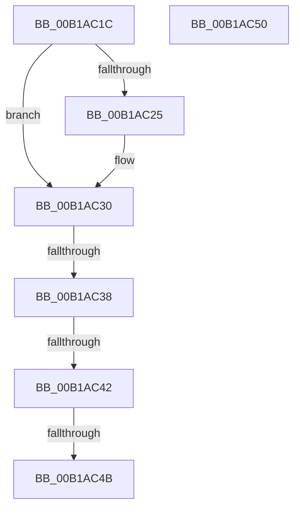

# sub_00B1AC1C

- RVA: `0x00B1AC1C`–`0x00B1AC5A` (길이 `62` bytes)
- VA: `0x0000000140B1AC1C`
- 실행 섹션: `PAGE`
- PDB 이름 있음: `아니요`; PDB Function 태그: `아니요`
- unwind 정보 RVA: `0x00083030`
- 디코드: `15`개 명령, `62/62` bytes 표시
- 미해석 바이트: `0` (있으면 어셈블리에 `.byte`로 보존)

> 이 문서는 커널 이미지의 기계어와 PDB 기호를 분석해 생성했습니다. 4번과 5번은 함수 원형과 자료형을 바이너리 사용 방식에서 추정한 C 해석이며 원본 소스 복구 결과는 아닙니다.

## 1. Dependencies

- 직접 호출 지점: **0**; 고유 호출 대상: **0**
- 직접 호출자로 확인된 함수: **0**
- RIP 상대 이미지 참조: **0**

### Outgoing calls
- 직접 디코드된 call 명령이 없습니다.

### Direct callers
- 이 함수 시작 RVA로 연결되는 직접 call은 확인되지 않았습니다. 간접 호출은 완전히 역산할 수 없습니다.

### Static image references
- 디코드된 RIP-relative 메모리 참조가 없습니다.

## 2. Other-region calls and transfers

- 다른 실행 섹션으로 향하는 call: **0**
- call이 아닌 외부 분기/꼬리 이동: **5**
  - `0x00B1AC32` → [RtlpValidFilterAclSubjectContext + 0x7A](../8B/RtlpValidFilterAclSubjectContext_function_008BCE60.md) (`tail-transfer`)
  - `0x00B1AC3C` → [RtlpValidFilterAclSubjectContext + 0x7A](../8B/RtlpValidFilterAclSubjectContext_function_008BCE60.md) (`tail-transfer`)
  - `0x00B1AC45` → [RtlpValidFilterAclSubjectContext + 0x7A](../8B/RtlpValidFilterAclSubjectContext_function_008BCE60.md) (`tail-transfer`)
  - `0x00B1AC4B` → [RtlpValidFilterAclSubjectContext + 0x4B](../8B/RtlpValidFilterAclSubjectContext_function_008BCE60.md) (`tail-transfer`)
  - `0x00B1AC55` → [RtlpValidFilterAclSubjectContext + 0x58](../8B/RtlpValidFilterAclSubjectContext_function_008BCE60.md) (`tail-transfer`)

## 3. Assembly (complete function range)

```asm
00B1AC1C  8B 50 0A                        mov edx, dword ptr [rax + 0xa]
00B1AC1F  2B 54 24 28                     sub edx, dword ptr [rsp + 0x28]
00B1AC23  75 0B                           jne 0x140b1ac30
00B1AC25  0F B7 50 0E                     movzx edx, word ptr [rax + 0xe]
00B1AC29  0F B7 4C 24 2C                  movzx ecx, word ptr [rsp + 0x2c]
00B1AC2E  2B D1                           sub edx, ecx
00B1AC30  85 D2                           test edx, edx
00B1AC32  0F 85 A2 22 DA FF               jne 0x1408bceda
00B1AC38  80 78 09 01                     cmp byte ptr [rax + 9], 1
00B1AC3C  0F 85 98 22 DA FF               jne 0x1408bceda
00B1AC42  39 50 10                        cmp dword ptr [rax + 0x10], edx
00B1AC45  0F 85 8F 22 DA FF               jne 0x1408bceda
00B1AC4B  E9 5B 22 DA FF                  jmp 0x1408bceab
00B1AC50  B8 22 00 00 C0                  mov eax, 0xc0000022
00B1AC55  E9 5E 22 DA FF                  jmp 0x1408bceb8
```

## 4. C-style interpretation (structured pseudocode)

```c
__int64 __fastcall sub_00B1AC1C(__int64 a1, __int64 a2, __int64 a3, __int64 a4, unsigned int a5)
{
    unsigned __int16 v_stack_p2C;

    a2 = (unsigned int)(((unsigned int)(*(unsigned int *)(result + 10))) - (a5));
    if (!(condition_is_not_equal)) {
        a2 = *(unsigned __int16 *)(result + 14);
        a1 = v_stack_p2C;
        a2 = (unsigned int)((a2) - ((unsigned int)(a1)));
    }
}
```

## 5. (Beta) C Style

```c
int64_t sub_00B1AC1C(int64_t Arg1, int64_t Arg2, int64_t Arg3, int64_t Arg4, uint32_t Arg5)
{
    uint16_t v_stack_p2C;

    Arg2 = (uint32_t)(((uint32_t)(*(uint32_t *)(result + 0xA))) - (Arg5));
    if (!(condition_is_not_equal)) {
        Arg2 = *(uint16_t *)(result + 0xE);
        Arg1 = v_stack_p2C;
        Arg2 = (uint32_t)((Arg2) - ((uint32_t)(Arg1)));
    }
}
```

## 6. Execution-region graph

[열기: 2D/3D 그래프와 함수 탐색 컨트롤 패널](../../../control-panel.html?section=page&rva=0x00B1AC1C&view=graph)

- 2D 그래프는 위에서 아래로 흐르고, 3D 그래프는 빈 공간을 드래그해 회전합니다. Shift+드래그는 이동, 휠은 확대·축소, 함수 노드 선택은 대상 보고서 이동입니다.

### Static fallback


