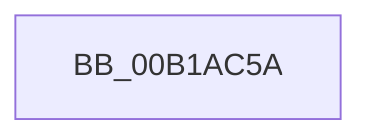

# sub_00B1AC5A

- RVA: `0x00B1AC5A`–`0x00B1AC7F` (길이 `37` bytes)
- VA: `0x0000000140B1AC5A`
- 실행 섹션: `PAGE`
- PDB 이름 있음: `아니요`; PDB Function 태그: `아니요`
- unwind 정보 RVA: `0x0008305C`
- 디코드: `10`개 명령, `37/37` bytes 표시
- 미해석 바이트: `0` (있으면 어셈블리에 `.byte`로 보존)

> 이 문서는 커널 이미지의 기계어와 PDB 기호를 분석해 생성했습니다. 4번과 5번은 함수 원형과 자료형을 바이너리 사용 방식에서 추정한 C 해석이며 원본 소스 복구 결과는 아닙니다.

## 1. Dependencies

- 직접 호출 지점: **4**; 고유 호출 대상: **4**
- 직접 호출자로 확인된 함수: **0**
- RIP 상대 이미지 참조: **0**

### Outgoing calls
- `0x00B1AC5D` → [ExfReleasePushLock](../../text/26/ExfReleasePushLock_function_002638D0.md) (function, `0x002638D0`)
- `0x00B1AC65` → [KeAbPostRelease](../../text/2E/KeAbPostRelease_function_002E1600.md) (function, `0x002E1600`)
- `0x00B1AC6A` → [KeLeaveCriticalRegion](../../text/25/KeLeaveCriticalRegion_function_0025D8B0.md) (function, `0x0025D8B0`)
- `0x00B1AC74` → [ExFreePoolWithTag](../../poolcode/B8/ExFreePoolWithTag_function_00B82870.md) (function, `0x00B82870`)

### Direct callers
- 이 함수 시작 RVA로 연결되는 직접 call은 확인되지 않았습니다. 간접 호출은 완전히 역산할 수 없습니다.

### Static image references
- 디코드된 RIP-relative 메모리 참조가 없습니다.

## 2. Other-region calls and transfers

- 다른 실행 섹션으로 향하는 call: **4**
  - `0x00B1AC5D` → [ExfReleasePushLock](../../text/26/ExfReleasePushLock_function_002638D0.md) (`PAGE` → `.text`)
  - `0x00B1AC65` → [KeAbPostRelease](../../text/2E/KeAbPostRelease_function_002E1600.md) (`PAGE` → `.text`)
  - `0x00B1AC6A` → [KeLeaveCriticalRegion](../../text/25/KeLeaveCriticalRegion_function_0025D8B0.md) (`PAGE` → `.text`)
  - `0x00B1AC74` → [ExFreePoolWithTag](../../poolcode/B8/ExFreePoolWithTag_function_00B82870.md) (`PAGE` → `POOLCODE`)
- call이 아닌 외부 분기/꼬리 이동: **1**
  - `0x00B1AC7A` → [ObpSetObjectAuditInfo + 0xE1](../8B/ObpSetObjectAuditInfo_function_008BD1F8.md) (`tail-transfer`)

## 3. Assembly (complete function range)

```asm
00B1AC5A  48 8B CB                        mov rcx, rbx
00B1AC5D  E8 6E 8C 74 FF                  call 0x1402638d0
00B1AC62  48 8B CB                        mov rcx, rbx
00B1AC65  E8 96 69 7C FF                  call 0x1402e1600
00B1AC6A  E8 41 2C 74 FF                  call 0x14025d8b0
00B1AC6F  33 D2                           xor edx, edx
00B1AC71  48 8B CE                        mov rcx, rsi
00B1AC74  E8 F7 7B 06 00                  call 0x140b82870
00B1AC79  90                              nop
00B1AC7A  E9 5A 26 DA FF                  jmp 0x1408bd2d9
```

## 4. C-style interpretation (structured pseudocode)

```c
__int64 __fastcall sub_00B1AC5A(__int64 a1, int a2)
{
    __int64 result;

    result = ExfReleasePushLock(v_rbx, a2, a3, a4);
    result = KeAbPostRelease(v_rbx, a2, a3, a4);
    result = KeLeaveCriticalRegion(v_rbx, a2, a3, a4);
    a2 = 0;
    result = ExFreePoolWithTag(v_rsi, a2, a3, a4);
}
```

## 5. (Beta) C Style

```c
int64_t sub_00B1AC5A(int64_t Arg1, int32_t Arg2)
{
    int64_t result;

    result = ExfReleasePushLock(local_rbx, Arg2, a3, a4);
    result = KeAbPostRelease(local_rbx, Arg2, a3, a4);
    result = KeLeaveCriticalRegion(local_rbx, Arg2, a3, a4);
    Arg2 = 0;
    result = ExFreePoolWithTag(local_rsi, Arg2, a3, a4);
}
```

## 6. Execution-region graph

[열기: 2D/3D 그래프와 함수 탐색 컨트롤 패널](../../../control-panel.html?section=page&rva=0x00B1AC5A&view=graph)

- 2D 그래프는 위에서 아래로 흐르고, 3D 그래프는 빈 공간을 드래그해 회전합니다. Shift+드래그는 이동, 휠은 확대·축소, 함수 노드 선택은 대상 보고서 이동입니다.

### Static fallback


