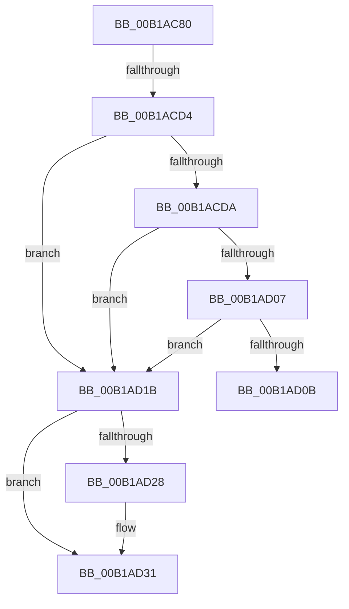

# sub_00B1AC80

- RVA: `0x00B1AC80`–`0x00B1AD3C` (길이 `188` bytes)
- VA: `0x0000000140B1AC80`
- 실행 섹션: `PAGE`
- PDB 이름 있음: `아니요`; PDB Function 태그: `아니요`
- unwind 정보 RVA: `0x000830F8`
- 디코드: `49`개 명령, `188/188` bytes 표시
- 미해석 바이트: `0` (있으면 어셈블리에 `.byte`로 보존)

> 이 문서는 커널 이미지의 기계어와 PDB 기호를 분석해 생성했습니다. 4번과 5번은 함수 원형과 자료형을 바이너리 사용 방식에서 추정한 C 해석이며 원본 소스 복구 결과는 아닙니다.

## 1. Dependencies

- 직접 호출 지점: **4**; 고유 호출 대상: **3**
- 직접 호출자로 확인된 함수: **0**
- RIP 상대 이미지 참조: **2**

### Outgoing calls
- `0x00B1ACC7` → [ZwCreateKey](../../text/6A/ZwCreateKey_function_006AD470.md) (function, `0x006AD470`)
- `0x00B1ACF2` → `ext-ms-win-ntos-stateseparation-l1-1-0.dll!ExpInitializeStateSeparationPhase2` (import, 간접 대상; import `ext-ms-win-ntos-stateseparation-l1-1-0.dll!ExpInitializeStateSeparationPhase2`)
- `0x00B1AD0F` → [ZwClose](../../text/6A/ZwClose_function_006AD2B0.md) (function, `0x006AD2B0`)
- `0x00B1AD2C` → [ZwClose](../../text/6A/ZwClose_function_006AD2B0.md) (function, `0x006AD2B0`)

### Direct callers
- 이 함수 시작 RVA로 연결되는 직접 call은 확인되지 않았습니다. 간접 호출은 완전히 역산할 수 없습니다.

### Static image references
- `0x00B1ACDA` → RVA `0x00EEFB6C` (`.data`; read)
- `0x00B1ACF2` → RVA `0x00151370` (`ext-ms-win-ntos-stateseparation-l1-1-0.dll!ExpInitializeStateSeparationPhase2 (IAT)`; read)

## 2. Other-region calls and transfers

- 다른 실행 섹션으로 향하는 call: **3**
  - `0x00B1ACC7` → [ZwCreateKey](../../text/6A/ZwCreateKey_function_006AD470.md) (`PAGE` → `.text`)
  - `0x00B1AD0F` → [ZwClose](../../text/6A/ZwClose_function_006AD2B0.md) (`PAGE` → `.text`)
  - `0x00B1AD2C` → [ZwClose](../../text/6A/ZwClose_function_006AD2B0.md) (`PAGE` → `.text`)
- call이 아닌 외부 분기/꼬리 이동: **3**
  - `0x00B1ACCE` → [ExpWnfGetNameStoreRegistryRoot + 0x64](../8B/ExpWnfGetNameStoreRegistryRoot_function_008BDB00.md) (`tail-transfer`)
  - `0x00B1AD16` → [ExpWnfGetNameStoreRegistryRoot + 0x64](../8B/ExpWnfGetNameStoreRegistryRoot_function_008BDB00.md) (`tail-transfer`)
  - `0x00B1AD37` → [ExpWnfGetNameStoreRegistryRoot + 0x62](../8B/ExpWnfGetNameStoreRegistryRoot_function_008BDB00.md) (`tail-transfer`)

## 3. Assembly (complete function range)

```asm
00B1AC80  48 03 C7                        add rax, rdi
00B1AC83  4C 8D 45 D0                     lea r8, [rbp - 0x30]
00B1AC87  33 C9                           xor ecx, ecx
00B1AC89  48 89 45 E0                     mov qword ptr [rbp - 0x20], rax
00B1AC8D  39 4C 37 2C                     cmp dword ptr [rdi + rsi + 0x2c], ecx
00B1AC91  8B 44 37 28                     mov eax, dword ptr [rdi + rsi + 0x28]
00B1AC95  0F 95 C1                        setne cl
00B1AC98  F7 D8                           neg eax
00B1AC9A  48 8D 45 20                     lea rax, [rbp + 0x20]
00B1AC9E  1B D2                           sbb edx, edx
00B1ACA0  48 89 44 24 30                  mov qword ptr [rsp + 0x30], rax
00B1ACA5  89 4C 24 28                     mov dword ptr [rsp + 0x28], ecx
00B1ACA9  81 E2 DA FF F2 FF               and edx, 0xfff2ffda
00B1ACAF  48 83 64 24 20 00               and qword ptr [rsp + 0x20], 0
00B1ACB5  48 8D 4D 30                     lea rcx, [rbp + 0x30]
00B1ACB9  81 C2 3F 00 0F 00               add edx, 0xf003f
00B1ACBF  45 33 C9                        xor r9d, r9d
00B1ACC2  F3 0F 7F 45 F0                  movdqu xmmword ptr [rbp - 0x10], xmm0
00B1ACC7  E8 A4 27 B9 FF                  call 0x1406ad470
00B1ACCC  85 C0                           test eax, eax
00B1ACCE  0F 88 90 2E DA FF               js 0x1408bdb64
00B1ACD4  83 7D 20 01                     cmp dword ptr [rbp + 0x20], 1
00B1ACD8  75 41                           jne 0x140b1ad1b
00B1ACDA  83 3D 8B 4E 3D 00 00            cmp dword ptr [rip + 0x3d4e8b], 0
00B1ACE1  4C 8D 47 18                     lea r8, [rdi + 0x18]
00B1ACE5  48 8D 57 08                     lea rdx, [rdi + 8]
00B1ACE9  0F 95 C1                        setne cl
00B1ACEC  4C 03 C6                        add r8, rsi
00B1ACEF  48 03 D6                        add rdx, rsi
00B1ACF2  48 FF 15 77 66 63 FF            call qword ptr [rip - 0x9c9989]
00B1ACF9  0F 1F 44 00 00                  nop dword ptr [rax + rax]
00B1ACFE  8B F8                           mov edi, eax
00B1AD00  3D BB 00 00 C0                  cmp eax, 0xc00000bb
00B1AD05  74 14                           je 0x140b1ad1b
00B1AD07  85 C0                           test eax, eax
00B1AD09  79 10                           jns 0x140b1ad1b
00B1AD0B  48 8B 4D 30                     mov rcx, qword ptr [rbp + 0x30]
00B1AD0F  E8 9C 25 B9 FF                  call 0x1406ad2b0
00B1AD14  8B C7                           mov eax, edi
00B1AD16  E9 49 2E DA FF                  jmp 0x1408bdb64
00B1AD1B  48 8B 4D 30                     mov rcx, qword ptr [rbp + 0x30]
00B1AD1F  33 C0                           xor eax, eax
00B1AD21  F0 48 0F B1 0B                  lock cmpxchg qword ptr [rbx], rcx
00B1AD26  74 09                           je 0x140b1ad31
00B1AD28  48 8B 4D 30                     mov rcx, qword ptr [rbp + 0x30]
00B1AD2C  E8 7F 25 B9 FF                  call 0x1406ad2b0
00B1AD31  48 8B 03                        mov rax, qword ptr [rbx]
00B1AD34  49 89 06                        mov qword ptr [r14], rax
00B1AD37  E9 26 2E DA FF                  jmp 0x1408bdb62
```

## 4. C-style interpretation (structured pseudocode)

```c
__int64 __fastcall sub_00B1AC80(int a1, int a2, __int64 a3, int a4)
{
    __int64 result;
    unsigned __int64 v_stack_p20;
    unsigned int v_stack_p28;
    unsigned __int64 v_stack_p30;

    result = (result) + (v_rdi);
    a1 = 0;
    *(unsigned __int64 *)(v_rbp - 32) = result;
    a1 = ((*(unsigned int *)(v_rdi + v_rsi * 1 + 44)) != 0) ? 1 : 0;
    result = (unsigned int)(-((unsigned int)(*(unsigned int *)(v_rdi + v_rsi * 1 + 40))));
    v_stack_p30 = v_rbp + 32;
    v_stack_p28 = a1;
    a2 = (unsigned int)((a2) & (0xFFF2FFDAULL));
    a2 = (unsigned int)((a2) + (0xF003FULL));
    a4 = 0;
    *(unsigned __int64 *)(v_rbp - 16) = v_xmm0;
    result = ZwCreateKey(v_rbp + 48, a2, v_rbp - 48, a4);
    if ((*(unsigned int *)(v_rbp + 32)) != 1) goto loc_00B1AD1B;
    a1 = ((*(unsigned int *)(v_rip + 4017803)) != 0) ? 1 : 0;
    a3 = (v_rdi + 24) + (v_rsi);
    a2 = (v_rdi + 8) + (v_rsi);
    result = ext_ms_win_ntos_stateseparation_l1_1_0_dll_ExpInitializeStateSeparationPhase2(a1, a2, a3, a4);
    if (((unsigned int)(result)) == 0xC00000BBULL) goto loc_00B1AD1B;
    if (!sign_flag) goto loc_00B1AD1B;
    result = ZwClose(*(unsigned __int64 *)(v_rbp + 48), a2, a3, a4);
loc_00B1AD1B:
    result = 0;
    if (!(condition_is_equal)) {
        a1 = *(unsigned __int64 *)(v_rbp + 48);
        result = ZwClose(a1, a2, a3, a4);
    }
    *(unsigned __int64 *)(v_r14) = *(unsigned __int64 *)(v_rbx);
}
```

## 5. (Beta) C Style

```c
int64_t sub_00B1AC80(int32_t Arg1, int32_t Arg2, int64_t Arg3, int32_t Arg4)
{
    int64_t result;
    uint64_t v_stack_p20;
    uint32_t v_stack_p28;
    uint64_t v_stack_p30;

    result = (result) + (local_rdi);
    Arg1 = 0;
    *(uint64_t *)(local_rbp - 0x20) = result;
    Arg1 = ((*(uint32_t *)(local_rdi + local_rsi * 1 + 0x2C)) != 0) ? 1 : 0;
    result = (uint32_t)(-((uint32_t)(*(uint32_t *)(local_rdi + local_rsi * 1 + 0x28))));
    v_stack_p30 = local_rbp + 32;
    v_stack_p28 = Arg1;
    Arg2 = (uint32_t)((Arg2) & (0xFFF2FFDAULL));
    Arg2 = (uint32_t)((Arg2) + (0xF003FULL));
    Arg4 = 0;
    *(uint64_t *)(local_rbp - 0x10) = v_xmm0;
    result = ZwCreateKey(local_rbp + 48, Arg2, local_rbp - 48, Arg4);
    if ((*(uint32_t *)(local_rbp + 0x20)) != 1) goto loc_00B1AD1B;
    Arg1 = ((*(uint32_t *)(v_rip + 0x3D4E8B)) != 0) ? 1 : 0;
    Arg3 = (local_rdi + 24) + (local_rsi);
    Arg2 = (local_rdi + 8) + (local_rsi);
    result = kernel_indirect_call(Arg1, Arg2, Arg3, Arg4);
    if (((uint32_t)(result)) == 0xC00000BBULL) goto loc_00B1AD1B;
    if (!sign_flag) goto loc_00B1AD1B;
    result = ZwClose(*(uint64_t *)(local_rbp + 0x30), Arg2, Arg3, Arg4);
loc_00B1AD1B:
    result = 0;
    if (!(condition_is_equal)) {
        Arg1 = *(uint64_t *)(local_rbp + 0x30);
        result = ZwClose(Arg1, Arg2, Arg3, Arg4);
    }
    *(uint64_t *)(local_r14) = *(uint64_t *)(local_rbx);
}
```

## 6. Execution-region graph

[열기: 2D/3D 그래프와 함수 탐색 컨트롤 패널](../../../control-panel.html?section=page&rva=0x00B1AC80&view=graph)

- 2D 그래프는 위에서 아래로 흐르고, 3D 그래프는 빈 공간을 드래그해 회전합니다. Shift+드래그는 이동, 휠은 확대·축소, 함수 노드 선택은 대상 보고서 이동입니다.

### Static fallback


