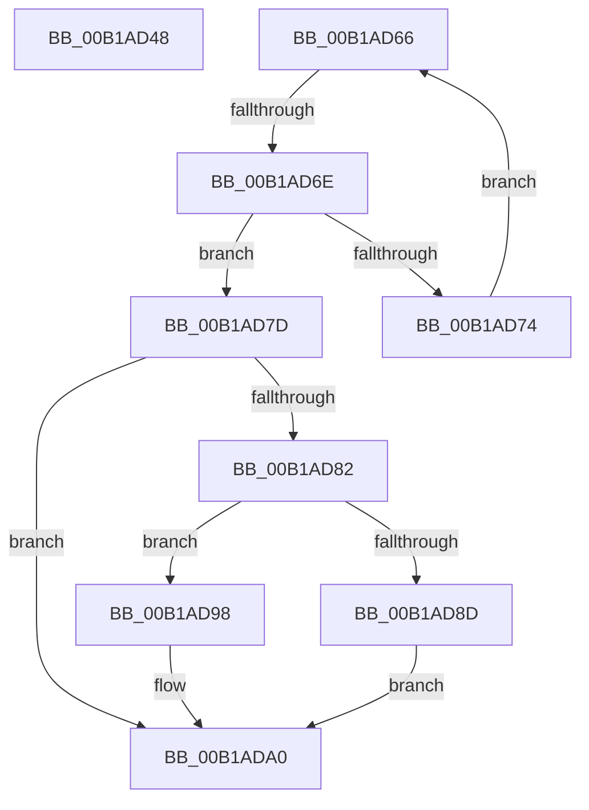

# sub_00B1AD48

- RVA: `0x00B1AD48`–`0x00B1ADAA` (길이 `98` bytes)
- VA: `0x0000000140B1AD48`
- 실행 섹션: `PAGE`
- PDB 이름 있음: `아니요`; PDB Function 태그: `아니요`
- unwind 정보 RVA: `0x0008322C`
- 디코드: `25`개 명령, `98/98` bytes 표시
- 미해석 바이트: `0` (있으면 어셈블리에 `.byte`로 보존)

> 이 문서는 커널 이미지의 기계어와 PDB 기호를 분석해 생성했습니다. 4번과 5번은 함수 원형과 자료형을 바이너리 사용 방식에서 추정한 C 해석이며 원본 소스 복구 결과는 아닙니다.

## 1. Dependencies

- 직접 호출 지점: **1**; 고유 호출 대상: **1**
- 직접 호출자로 확인된 함수: **0**
- RIP 상대 이미지 참조: **0**

### Outgoing calls
- `0x00B1AD57` → [RtlpQueryRegistryDirect](../8B/RtlpQueryRegistryDirect_function_008BEBD4.md) (function, `0x008BEBD4`)

### Direct callers
- 이 함수 시작 RVA로 연결되는 직접 call은 확인되지 않았습니다. 간접 호출은 완전히 역산할 수 없습니다.

### Static image references
- 디코드된 RIP-relative 메모리 참조가 없습니다.

## 2. Other-region calls and transfers

- 다른 실행 섹션으로 향하는 call: **0**
- call이 아닌 외부 분기/꼬리 이동: **3**
  - `0x00B1AD61` → [RtlpCallQueryRegistryRoutine + 0x2D5](../8B/RtlpCallQueryRegistryRoutine_function_008BE844.md) (`tail-transfer`)
  - `0x00B1AD68` → [RtlpCallQueryRegistryRoutine + 0xAF](../8B/RtlpCallQueryRegistryRoutine_function_008BE844.md) (`tail-transfer`)
  - `0x00B1ADA5` → [RtlpCallQueryRegistryRoutine + 0xE4](../8B/RtlpCallQueryRegistryRoutine_function_008BE844.md) (`tail-transfer`)

## 3. Assembly (complete function range)

```asm
00B1AD48  4D 8B 4E 18                     mov r9, qword ptr [r14 + 0x18]
00B1AD4C  44 8B C5                        mov r8d, ebp
00B1AD4F  48 8B D7                        mov rdx, rdi
00B1AD52  B9 01 00 00 00                  mov ecx, 1
00B1AD57  E8 78 3E DA FF                  call 0x1408bebd4
00B1AD5C  49 83 46 18 10                  add qword ptr [r14 + 0x18], 0x10
00B1AD61  E9 B3 3D DA FF                  jmp 0x1408beb19
00B1AD66  85 C0                           test eax, eax
00B1AD68  0F 84 85 3B DA FF               je 0x1408be8f3
00B1AD6E  66 83 39 25                     cmp word ptr [rcx], 0x25
00B1AD72  74 09                           je 0x140b1ad7d
00B1AD74  48 83 C1 02                     add rcx, 2
00B1AD78  83 C0 FE                        add eax, -2
00B1AD7B  EB E9                           jmp 0x140b1ad66
00B1AD7D  45 85 E4                        test r12d, r12d
00B1AD80  7E 1E                           jle 0x140b1ada0
00B1AD82  49 63 C4                        movsxd rax, r12d
00B1AD85  48 3D FE FF 00 00               cmp rax, 0xfffe
00B1AD8B  77 0B                           ja 0x140b1ad98
00B1AD8D  48 D1 E8                        shr rax, 1
00B1AD90  66 41 89 5C 40 FE               mov word ptr [r8 + rax*2 - 2], bx
00B1AD96  EB 08                           jmp 0x140b1ada0
00B1AD98  66 41 89 98 FC FF 00 00         mov word ptr [r8 + 0xfffc], bx
00B1ADA0  B8 0D 00 00 C0                  mov eax, 0xc000000d
00B1ADA5  E9 7E 3B DA FF                  jmp 0x1408be928
```

## 4. C-style interpretation (structured pseudocode)

```c
__int64 __fastcall sub_00B1AD48(void)
{
    __int64 result;

    result = RtlpQueryRegistryDirect(1, v_rdi, (unsigned int)((unsigned int)(v_rbp)), *(unsigned __int64 *)(v_r14 + 24));
}
```

## 5. (Beta) C Style

```c
void sub_00B1AD48(void)
{
    int64_t result;

    result = RtlpQueryRegistryDirect(1, local_rdi, (uint32_t)((uint32_t)(local_rbp)), *(uint64_t *)(local_r14 + 0x18));
}
```

## 6. Execution-region graph

[열기: 2D/3D 그래프와 함수 탐색 컨트롤 패널](../../../control-panel.html?section=page&rva=0x00B1AD48&view=graph)

- 2D 그래프는 위에서 아래로 흐르고, 3D 그래프는 빈 공간을 드래그해 회전합니다. Shift+드래그는 이동, 휠은 확대·축소, 함수 노드 선택은 대상 보고서 이동입니다.

### Static fallback


