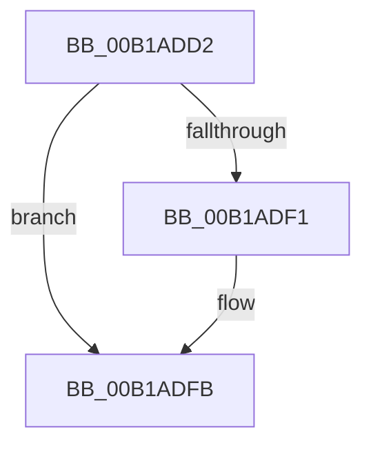

# sub_00B1ADD2

- RVA: `0x00B1ADD2`–`0x00B1AE15` (길이 `67` bytes)
- VA: `0x0000000140B1ADD2`
- 실행 섹션: `PAGE`
- PDB 이름 있음: `아니요`; PDB Function 태그: `아니요`
- unwind 정보 RVA: `0x00083328`
- 디코드: `16`개 명령, `67/67` bytes 표시
- 미해석 바이트: `0` (있으면 어셈블리에 `.byte`로 보존)

> 이 문서는 커널 이미지의 기계어와 PDB 기호를 분석해 생성했습니다. 4번과 5번은 함수 원형과 자료형을 바이너리 사용 방식에서 추정한 C 해석이며 원본 소스 복구 결과는 아닙니다.

## 1. Dependencies

- 직접 호출 지점: **4**; 고유 호출 대상: **3**
- 직접 호출자로 확인된 함수: **0**
- RIP 상대 이미지 참조: **0**

### Outgoing calls
- `0x00B1ADD5` → [KeAbPostRelease](../../text/2E/KeAbPostRelease_function_002E1600.md) (function, `0x002E1600`)
- `0x00B1ADE3` → [ObDereferenceSecurityDescriptor](../87/ObDereferenceSecurityDescriptor_function_008740A0.md) (function, `0x008740A0`)
- `0x00B1ADF6` → [ExFreePoolWithTag](../../poolcode/B8/ExFreePoolWithTag_function_00B82870.md) (function, `0x00B82870`)
- `0x00B1AE03` → [ExFreePoolWithTag](../../poolcode/B8/ExFreePoolWithTag_function_00B82870.md) (function, `0x00B82870`)

### Direct callers
- 이 함수 시작 RVA로 연결되는 직접 call은 확인되지 않았습니다. 간접 호출은 완전히 역산할 수 없습니다.

### Static image references
- 디코드된 RIP-relative 메모리 참조가 없습니다.

## 2. Other-region calls and transfers

- 다른 실행 섹션으로 향하는 call: **3**
  - `0x00B1ADD5` → [KeAbPostRelease](../../text/2E/KeAbPostRelease_function_002E1600.md) (`PAGE` → `.text`)
  - `0x00B1ADF6` → [ExFreePoolWithTag](../../poolcode/B8/ExFreePoolWithTag_function_00B82870.md) (`PAGE` → `POOLCODE`)
  - `0x00B1AE03` → [ExFreePoolWithTag](../../poolcode/B8/ExFreePoolWithTag_function_00B82870.md) (`PAGE` → `POOLCODE`)
- call이 아닌 외부 분기/꼬리 이동: **1**
  - `0x00B1AE10` → [ExpWnfCreateNameInstance + 0x24B](../8B/ExpWnfCreateNameInstance_function_008BF590.md) (`tail-transfer`)

## 3. Assembly (complete function range)

```asm
00B1ADD2  48 8B CE                        mov rcx, rsi
00B1ADD5  E8 26 68 7C FF                  call 0x1402e1600
00B1ADDA  49 8B 0C 24                     mov rcx, qword ptr [r12]
00B1ADDE  BA 01 00 00 00                  mov edx, 1
00B1ADE3  E8 B8 92 D5 FF                  call 0x1408740a0
00B1ADE8  48 8B 4F 58                     mov rcx, qword ptr [rdi + 0x58]
00B1ADEC  48 85 C9                        test rcx, rcx
00B1ADEF  74 0A                           je 0x140b1adfb
00B1ADF1  BA 57 6E 66 20                  mov edx, 0x20666e57
00B1ADF6  E8 75 7A 06 00                  call 0x140b82870
00B1ADFB  BA 57 6E 66 20                  mov edx, 0x20666e57
00B1AE00  48 8B CF                        mov rcx, rdi
00B1AE03  E8 68 7A 06 00                  call 0x140b82870
00B1AE08  48 8B 44 24 70                  mov rax, qword ptr [rsp + 0x70]
00B1AE0D  48 89 28                        mov qword ptr [rax], rbp
00B1AE10  E9 C6 49 DA FF                  jmp 0x1408bf7db
```

## 4. C-style interpretation (structured pseudocode)

```c
__int64 __fastcall sub_00B1ADD2(__int64 a1, __int64 a2, __int64 a3, __int64 a4, __int64 a5, __int64 a6, __int64 a7, __int64 a8, __int64 a9, __int64 a10, __int64 a11, __int64 a12, __int64 a13, __int64 a14)
{
    __int64 result;

    result = KeAbPostRelease(v_rsi, a2, a3, a4);
    result = ObDereferenceSecurityDescriptor(*(unsigned __int64 *)(v_r12), 1, a3, a4);
    if (*(unsigned __int64 *)(v_rdi + 88) != 0) {
        a2 = 0x20666E57ULL;
        result = ExFreePoolWithTag(*(unsigned __int64 *)(v_rdi + 88), a2, a3, a4);
    }
    result = ExFreePoolWithTag(v_rdi, (unsigned int)(0x20666E57ULL), a3, a4);
    *(unsigned __int64 *)(a14) = v_rbp;
}
```

## 5. (Beta) C Style

```c
int64_t sub_00B1ADD2(int64_t Arg1, int64_t Arg2, int64_t Arg3, int64_t Arg4, uint64_t Arg5, uint64_t Arg6, uint64_t Arg7, uint64_t Arg8, uint64_t Arg9, uint64_t Arg10, uint64_t Arg11, uint64_t Arg12, uint64_t Arg13, void *Arg14)
{
    uint8_t *arg14 = (uint8_t *)Arg14;

    int64_t result;

    result = KeAbPostRelease(local_rsi, Arg2, Arg3, Arg4);
    result = ObDereferenceSecurityDescriptor(*(uint64_t *)(local_r12), 1, Arg3, Arg4);
    if (*(uint64_t *)(local_rdi + 0x58) != 0) {
        Arg2 = 0x20666E57ULL;
        result = ExFreePoolWithTag(*(uint64_t *)(local_rdi + 0x58), Arg2, Arg3, Arg4);
    }
    result = ExFreePoolWithTag(local_rdi, (uint32_t)(0x20666E57ULL), Arg3, Arg4);
    *(uint64_t *)(arg14) = local_rbp;
}
```

### 관측된 메모리 오프셋

구조체 형식이 확인되지 않은 접근은 인자 기준의 오프셋으로만 기록했습니다.

| 기준 인자 | 오프셋 표현 | 폭 (bit) | 접근 |
|---|---:|---:|---|
| `Arg14` | `+ 0x0` | `64` | `W` |

## 6. Execution-region graph

[열기: 2D/3D 그래프와 함수 탐색 컨트롤 패널](../../../control-panel.html?section=page&rva=0x00B1ADD2&view=graph)

- 2D 그래프는 위에서 아래로 흐르고, 3D 그래프는 빈 공간을 드래그해 회전합니다. Shift+드래그는 이동, 휠은 확대·축소, 함수 노드 선택은 대상 보고서 이동입니다.

### Static fallback


