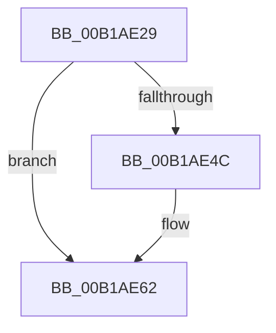

# sub_00B1AE29

- RVA: `0x00B1AE29`–`0x00B1AE6C` (길이 `67` bytes)
- VA: `0x0000000140B1AE29`
- 실행 섹션: `PAGE`
- PDB 이름 있음: `아니요`; PDB Function 태그: `아니요`
- unwind 정보 RVA: `0x000833E4`
- 디코드: `15`개 명령, `67/67` bytes 표시
- 미해석 바이트: `0` (있으면 어셈블리에 `.byte`로 보존)

> 이 문서는 커널 이미지의 기계어와 PDB 기호를 분석해 생성했습니다. 4번과 5번은 함수 원형과 자료형을 바이너리 사용 방식에서 추정한 C 해석이며 원본 소스 복구 결과는 아닙니다.

## 1. Dependencies

- 직접 호출 지점: **2**; 고유 호출 대상: **2**
- 직접 호출자로 확인된 함수: **0**
- RIP 상대 이미지 참조: **0**

### Outgoing calls
- `0x00B1AE38` → [KeAbPreAcquire](../../text/21/KeAbPreAcquire_function_00210230.md) (function, `0x00210230`)
- `0x00B1AE5D` → [ExfAcquirePushLockExclusiveEx](../../text/20/ExfAcquirePushLockExclusiveEx_function_0020FC90.md) (function, `0x0020FC90`)

### Direct callers
- 이 함수 시작 RVA로 연결되는 직접 call은 확인되지 않았습니다. 간접 호출은 완전히 역산할 수 없습니다.

### Static image references
- 디코드된 RIP-relative 메모리 참조가 없습니다.

## 2. Other-region calls and transfers

- 다른 실행 섹션으로 향하는 call: **2**
  - `0x00B1AE38` → [KeAbPreAcquire](../../text/21/KeAbPreAcquire_function_00210230.md) (`PAGE` → `.text`)
  - `0x00B1AE5D` → [ExfAcquirePushLockExclusiveEx](../../text/20/ExfAcquirePushLockExclusiveEx_function_0020FC90.md) (`PAGE` → `.text`)
- call이 아닌 외부 분기/꼬리 이동: **1**
  - `0x00B1AE6A` → [sub_00B1AE6C + 0x4](Unknown_function_00B1AE6C.md) (`tail-transfer`)

## 3. Assembly (complete function range)

```asm
00B1AE29  4C 89 74 24 58                  mov qword ptr [rsp + 0x58], r14
00B1AE2E  33 D2                           xor edx, edx
00B1AE30  66 FF 88 E4 01 00 00            dec word ptr [rax + 0x1e4]
00B1AE37  90                              nop
00B1AE38  E8 F3 53 6F FF                  call 0x140210230
00B1AE3D  F0 49 0F BA AD 98 02 00 00 00   lock bts qword ptr [r13 + 0x298], 0
00B1AE47  48 8B E8                        mov rbp, rax
00B1AE4A  73 16                           jae 0x140b1ae62
00B1AE4C  4D 8D 85 98 02 00 00            lea r8, [r13 + 0x298]
00B1AE53  48 8B D0                        mov rdx, rax
00B1AE56  49 8D 8D 98 02 00 00            lea rcx, [r13 + 0x298]
00B1AE5D  E8 2E 4E 6F FF                  call 0x14020fc90
00B1AE62  4C 8B 74 24 58                  mov r14, qword ptr [rsp + 0x58]
00B1AE67  48 85 ED                        test rbp, rbp
00B1AE6A  74 04                           je 0x140b1ae70
```

## 4. C-style interpretation (structured pseudocode)

```c
__int64 __fastcall sub_00B1AE29(__int64 a1, int a2, __int64 a3, __int64 a4, __int64 a5, __int64 a6, __int64 a7, __int64 a8, __int64 a9, __int64 a10, __int64 a11)
{
    __int64 result;
    unsigned __int64 v_stack_p58;

    v_stack_p58 = v_r14;
    a2 = 0;
    result = KeAbPreAcquire(a1, a2, a3, a4);
    if (!(condition_is_above_or_equal)) {
        a3 = v_r13 + 664;
        a2 = result;
        a1 = v_r13 + 664;
        result = ExfAcquirePushLockExclusiveEx(a1, a2, a3, a4);
    }
}
```

## 5. (Beta) C Style

```c
int64_t sub_00B1AE29(int64_t Arg1, int32_t Arg2, int64_t Arg3, int64_t Arg4, uint64_t Arg5, uint64_t Arg6, uint64_t Arg7, uint64_t Arg8, uint64_t Arg9, uint64_t Arg10, int64_t Arg11)
{
    int64_t result;
    uint64_t v_stack_p58;

    v_stack_p58 = local_r14;
    Arg2 = 0;
    result = KeAbPreAcquire(Arg1, Arg2, Arg3, Arg4);
    if (!(condition_is_above_or_equal)) {
        Arg3 = local_r13 + 664;
        Arg2 = result;
        Arg1 = local_r13 + 664;
        result = ExfAcquirePushLockExclusiveEx(Arg1, Arg2, Arg3, Arg4);
    }
}
```

## 6. Execution-region graph

[열기: 2D/3D 그래프와 함수 탐색 컨트롤 패널](../../../control-panel.html?section=page&rva=0x00B1AE29&view=graph)

- 2D 그래프는 위에서 아래로 흐르고, 3D 그래프는 빈 공간을 드래그해 회전합니다. Shift+드래그는 이동, 휠은 확대·축소, 함수 노드 선택은 대상 보고서 이동입니다.

### Static fallback


