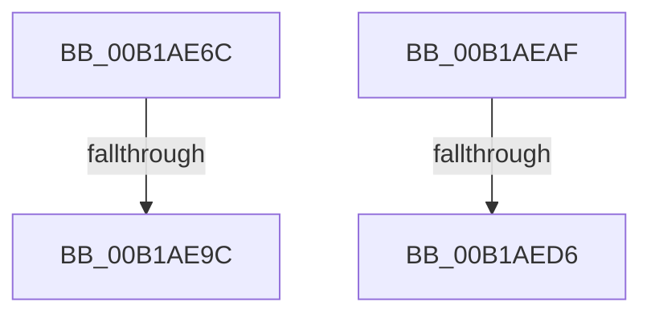

# sub_00B1AE6C

- RVA: `0x00B1AE6C`–`0x00B1AEE4` (길이 `120` bytes)
- VA: `0x0000000140B1AE6C`
- 실행 섹션: `PAGE`
- PDB 이름 있음: `아니요`; PDB Function 태그: `아니요`
- unwind 정보 RVA: `0x000833F8`
- 디코드: `26`개 명령, `120/120` bytes 표시
- 미해석 바이트: `0` (있으면 어셈블리에 `.byte`로 보존)

> 이 문서는 커널 이미지의 기계어와 PDB 기호를 분석해 생성했습니다. 4번과 5번은 함수 원형과 자료형을 바이너리 사용 방식에서 추정한 C 해석이며 원본 소스 복구 결과는 아닙니다.

## 1. Dependencies

- 직접 호출 지점: **4**; 고유 호출 대상: **4**
- 직접 호출자로 확인된 함수: **0**
- RIP 상대 이미지 참조: **0**

### Outgoing calls
- `0x00B1AEB2` → [ExfReleasePushLock](../../text/26/ExfReleasePushLock_function_002638D0.md) (function, `0x002638D0`)
- `0x00B1AEBA` → [KeAbPostRelease](../../text/2E/KeAbPostRelease_function_002E1600.md) (function, `0x002E1600`)
- `0x00B1AEC8` → [KeLeaveCriticalRegionThread](../../text/25/KeLeaveCriticalRegionThread_function_0025EFF0.md) (function, `0x0025EFF0`)
- `0x00B1AED9` → [EtwpUnreferenceGuidEntry](../8C/EtwpUnreferenceGuidEntry_function_008C3320.md) (function, `0x008C3320`)

### Direct callers
- 이 함수 시작 RVA로 연결되는 직접 call은 확인되지 않았습니다. 간접 호출은 완전히 역산할 수 없습니다.

### Static image references
- 디코드된 RIP-relative 메모리 참조가 없습니다.

## 2. Other-region calls and transfers

- 다른 실행 섹션으로 향하는 call: **3**
  - `0x00B1AEB2` → [ExfReleasePushLock](../../text/26/ExfReleasePushLock_function_002638D0.md) (`PAGE` → `.text`)
  - `0x00B1AEBA` → [KeAbPostRelease](../../text/2E/KeAbPostRelease_function_002E1600.md) (`PAGE` → `.text`)
  - `0x00B1AEC8` → [KeLeaveCriticalRegionThread](../../text/25/KeLeaveCriticalRegionThread_function_0025EFF0.md) (`PAGE` → `.text`)
- call이 아닌 외부 분기/꼬리 이동: **4**
  - `0x00B1AE96` → [sub_008BFCE3 + 0x92](../8B/Unknown_function_008BFCE3.md) (`tail-transfer`)
  - `0x00B1AEAA` → [sub_008BFCE3 + 0x18](../8B/Unknown_function_008BFCE3.md) (`tail-transfer`)
  - `0x00B1AED0` → [sub_008BFCE3 + 0xED](../8B/Unknown_function_008BFCE3.md) (`tail-transfer`)
  - `0x00B1AEDF` → [sub_008BFE54 + 0xAB](../8B/Unknown_function_008BFE54.md) (`tail-transfer`)

## 3. Assembly (complete function range)

```asm
00B1AE6C  C6 45 0A 01                     mov byte ptr [rbp + 0xa], 1
00B1AE70  65 48 8B 04 25 88 01 00 00      mov rax, qword ptr gs:[0x188]
00B1AE79  49 8D 4D 10                     lea rcx, [r13 + 0x10]
00B1AE7D  49 89 85 A0 02 00 00            mov qword ptr [r13 + 0x2a0], rax
00B1AE84  49 8D 47 10                     lea rax, [r15 + 0x10]
00B1AE88  4D 89 AF 90 02 00 00            mov qword ptr [r15 + 0x290], r13
00B1AE8F  48 8B 11                        mov rdx, qword ptr [rcx]
00B1AE92  48 39 4A 08                     cmp qword ptr [rdx + 8], rcx
00B1AE96  0F 85 D9 4E DA FF               jne 0x1408bfd75
00B1AE9C  48 89 10                        mov qword ptr [rax], rdx
00B1AE9F  48 89 48 08                     mov qword ptr [rax + 8], rcx
00B1AEA3  48 89 42 08                     mov qword ptr [rdx + 8], rax
00B1AEA7  48 89 01                        mov qword ptr [rcx], rax
00B1AEAA  E9 4C 4E DA FF                  jmp 0x1408bfcfb
00B1AEAF  48 8B CF                        mov rcx, rdi
00B1AEB2  E8 19 8A 74 FF                  call 0x1402638d0
00B1AEB7  48 8B CF                        mov rcx, rdi
00B1AEBA  E8 41 67 7C FF                  call 0x1402e1600
00B1AEBF  65 48 8B 0C 25 88 01 00 00      mov rcx, qword ptr gs:[0x188]
00B1AEC8  E8 23 41 74 FF                  call 0x14025eff0
00B1AECD  4D 85 FF                        test r15, r15
00B1AED0  0F 84 FA 4E DA FF               je 0x1408bfdd0
00B1AED6  49 8B CD                        mov rcx, r13
00B1AED9  E8 42 84 DA FF                  call 0x1408c3320
00B1AEDE  90                              nop
00B1AEDF  E9 1B 50 DA FF                  jmp 0x1408bfeff
```

## 4. C-style interpretation (structured pseudocode)

```c
__int64 __fastcall sub_00B1AE6C(void)
{
    *(unsigned __int8 *)(v_rbp + 10) = 1;
    *(unsigned __int64 *)(v_r13 + 672) = *(unsigned __int64 *)(gs_base + (0 + 392));
    *(unsigned __int64 *)(v_r15 + 656) = v_r13;
    *(unsigned __int64 *)(v_r15 + 16) = *(unsigned __int64 *)(v_r13 + 16);
    *(unsigned __int64 *)(v_r15 + 16 + 8) = v_r13 + 16;
    *(unsigned __int64 *)(*(unsigned __int64 *)(v_r13 + 16) + 8) = v_r15 + 16;
    *(unsigned __int64 *)(v_r13 + 16) = v_r15 + 16;
}
```

## 5. (Beta) C Style

```c
void sub_00B1AE6C(void)
{
    *(uint8_t *)(local_rbp + 0xA) = 1;
    *(uint64_t *)(local_r13 + 0x2A0) = *(uint64_t *)(gs_base + (0 + 0x188));
    *(uint64_t *)(local_r15 + 0x290) = local_r13;
    *(uint64_t *)(local_r15 + 0x10) = *(uint64_t *)(local_r13 + 0x10);
    *(uint64_t *)(local_r15 + 0x10 + 0x8) = local_r13 + 16;
    *(uint64_t *)(*(uint64_t *)(local_r13 + 0x10) + 0x8) = local_r15 + 16;
    *(uint64_t *)(local_r13 + 0x10) = local_r15 + 16;
}
```

## 6. Execution-region graph

[열기: 2D/3D 그래프와 함수 탐색 컨트롤 패널](../../../control-panel.html?section=page&rva=0x00B1AE6C&view=graph)

- 2D 그래프는 위에서 아래로 흐르고, 3D 그래프는 빈 공간을 드래그해 회전합니다. Shift+드래그는 이동, 휠은 확대·축소, 함수 노드 선택은 대상 보고서 이동입니다.

### Static fallback


