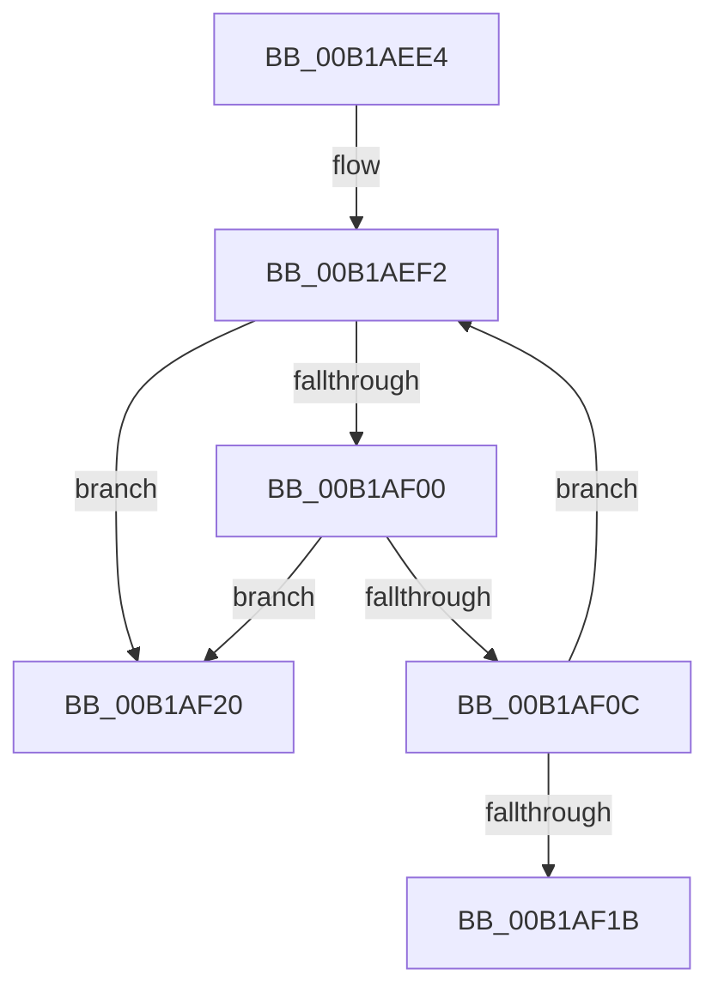

# sub_00B1AEE4

- RVA: `0x00B1AEE4`–`0x00B1AF31` (길이 `77` bytes)
- VA: `0x0000000140B1AEE4`
- 실행 섹션: `PAGE`
- PDB 이름 있음: `아니요`; PDB Function 태그: `아니요`
- unwind 정보 RVA: `0x000834B4`
- 디코드: `20`개 명령, `77/77` bytes 표시
- 미해석 바이트: `0` (있으면 어셈블리에 `.byte`로 보존)

> 이 문서는 커널 이미지의 기계어와 PDB 기호를 분석해 생성했습니다. 4번과 5번은 함수 원형과 자료형을 바이너리 사용 방식에서 추정한 C 해석이며 원본 소스 복구 결과는 아닙니다.

## 1. Dependencies

- 직접 호출 지점: **1**; 고유 호출 대상: **1**
- 직접 호출자로 확인된 함수: **0**
- RIP 상대 이미지 참조: **0**

### Outgoing calls
- `0x00B1AF26` → [ObDereferenceSecurityDescriptor](../87/ObDereferenceSecurityDescriptor_function_008740A0.md) (function, `0x008740A0`)

### Direct callers
- 이 함수 시작 RVA로 연결되는 직접 call은 확인되지 않았습니다. 간접 호출은 완전히 역산할 수 없습니다.

### Static image references
- 디코드된 RIP-relative 메모리 참조가 없습니다.

## 2. Other-region calls and transfers

- 다른 실행 섹션으로 향하는 call: **0**
- call이 아닌 외부 분기/꼬리 이동: **2**
  - `0x00B1AF1B` → [EtwpReferenceLoggerSecurityDescriptor + 0x62](../8C/EtwpReferenceLoggerSecurityDescriptor_function_008C0810.md) (`tail-transfer`)
  - `0x00B1AF2C` → [EtwpReferenceLoggerSecurityDescriptor + 0x62](../8C/EtwpReferenceLoggerSecurityDescriptor_function_008C0810.md) (`tail-transfer`)

## 3. Assembly (complete function range)

```asm
00B1AEE4  0F 0D 8F 10 03 00 00            prefetchw byte ptr [rdi + 0x310]
00B1AEEB  48 8B 87 10 03 00 00            mov rax, qword ptr [rdi + 0x310]
00B1AEF2  48 8B C8                        mov rcx, rax
00B1AEF5  49 23 C8                        and rcx, r8
00B1AEF8  49 03 C8                        add rcx, r8
00B1AEFB  49 3B C8                        cmp rcx, r8
00B1AEFE  77 20                           ja 0x140b1af20
00B1AF00  48 8B C8                        mov rcx, rax
00B1AF03  48 83 E1 F0                     and rcx, 0xfffffffffffffff0
00B1AF07  48 3B D9                        cmp rbx, rcx
00B1AF0A  75 14                           jne 0x140b1af20
00B1AF0C  48 8D 48 0F                     lea rcx, [rax + 0xf]
00B1AF10  F0 48 0F B1 8F 10 03 00 00      lock cmpxchg qword ptr [rdi + 0x310], rcx
00B1AF19  75 D7                           jne 0x140b1aef2
00B1AF1B  E9 52 59 DA FF                  jmp 0x1408c0872
00B1AF20  41 8B D0                        mov edx, r8d
00B1AF23  48 8B CB                        mov rcx, rbx
00B1AF26  E8 75 91 D5 FF                  call 0x1408740a0
00B1AF2B  90                              nop
00B1AF2C  E9 41 59 DA FF                  jmp 0x1408c0872
```

## 4. C-style interpretation (structured pseudocode)

```c
__int64 __fastcall sub_00B1AEE4(__int64 a1, __int64 a2, __int64 a3)
{
    __int64 result;

loc_00B1AEF2:
    a1 = (*(unsigned __int64 *)(v_rdi + 784)) & (a3);
    a1 = (a1) + (a3);
    if (a1 > a3) goto loc_00B1AF20;
    a1 = (*(unsigned __int64 *)(v_rdi + 784)) & (-16);
    if (v_rbx != a1) goto loc_00B1AF20;
    if (v_rbx != a1) goto loc_00B1AEF2;
loc_00B1AF20:
    result = ObDereferenceSecurityDescriptor(v_rbx, (unsigned int)((unsigned int)(a3)), a3, a4);
}
```

## 5. (Beta) C Style

```c
int64_t sub_00B1AEE4(int64_t Arg1, int64_t Arg2, int64_t Arg3)
{
    int64_t result;

loc_00B1AEF2:
    Arg1 = (*(uint64_t *)(local_rdi + 0x310)) & (Arg3);
    Arg1 = (Arg1) + (Arg3);
    if (Arg1 > Arg3) goto loc_00B1AF20;
    Arg1 = (*(uint64_t *)(local_rdi + 0x310)) & (-16);
    if (local_rbx != Arg1) goto loc_00B1AF20;
    if (local_rbx != Arg1) goto loc_00B1AEF2;
loc_00B1AF20:
    result = ObDereferenceSecurityDescriptor(local_rbx, (uint32_t)((uint32_t)(Arg3)), Arg3, a4);
}
```

## 6. Execution-region graph

[열기: 2D/3D 그래프와 함수 탐색 컨트롤 패널](../../../control-panel.html?section=page&rva=0x00B1AEE4&view=graph)

- 2D 그래프는 위에서 아래로 흐르고, 3D 그래프는 빈 공간을 드래그해 회전합니다. Shift+드래그는 이동, 휠은 확대·축소, 함수 노드 선택은 대상 보고서 이동입니다.

### Static fallback


