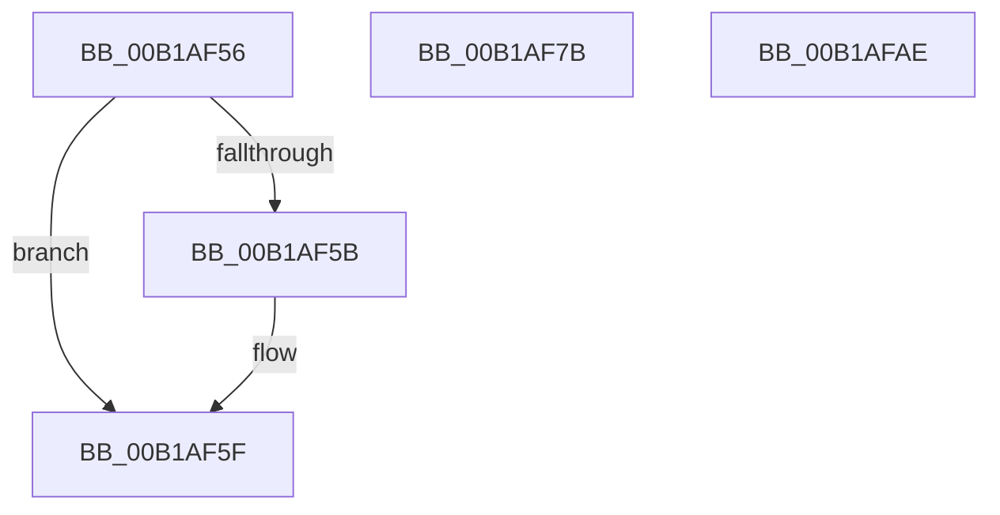

# sub_00B1AF56

- RVA: `0x00B1AF56`–`0x00B1AFD2` (길이 `124` bytes)
- VA: `0x0000000140B1AF56`
- 실행 섹션: `PAGE`
- PDB 이름 있음: `아니요`; PDB Function 태그: `아니요`
- unwind 정보 RVA: `0x0008377C`
- 디코드: `28`개 명령, `124/124` bytes 표시
- 미해석 바이트: `0` (있으면 어셈블리에 `.byte`로 보존)

> 이 문서는 커널 이미지의 기계어와 PDB 기호를 분석해 생성했습니다. 4번과 5번은 함수 원형과 자료형을 바이너리 사용 방식에서 추정한 C 해석이며 원본 소스 복구 결과는 아닙니다.

## 1. Dependencies

- 직접 호출 지점: **4**; 고유 호출 대상: **4**
- 직접 호출자로 확인된 함수: **0**
- RIP 상대 이미지 참조: **0**

### Outgoing calls
- `0x00B1AFA3` → [EtwpApplyScopeFilters](../8C/EtwpApplyScopeFilters_function_008C3470.md) (function, `0x008C3470`)
- `0x00B1AFB1` → [ExfReleasePushLock](../../text/26/ExfReleasePushLock_function_002638D0.md) (function, `0x002638D0`)
- `0x00B1AFB9` → [KeAbPostRelease](../../text/2E/KeAbPostRelease_function_002E1600.md) (function, `0x002E1600`)
- `0x00B1AFC7` → [KeLeaveCriticalRegionThread](../../text/25/KeLeaveCriticalRegionThread_function_0025EFF0.md) (function, `0x0025EFF0`)

### Direct callers
- 이 함수 시작 RVA로 연결되는 직접 call은 확인되지 않았습니다. 간접 호출은 완전히 역산할 수 없습니다.

### Static image references
- 디코드된 RIP-relative 메모리 참조가 없습니다.

## 2. Other-region calls and transfers

- 다른 실행 섹션으로 향하는 call: **3**
  - `0x00B1AFB1` → [ExfReleasePushLock](../../text/26/ExfReleasePushLock_function_002638D0.md) (`PAGE` → `.text`)
  - `0x00B1AFB9` → [KeAbPostRelease](../../text/2E/KeAbPostRelease_function_002E1600.md) (`PAGE` → `.text`)
  - `0x00B1AFC7` → [KeLeaveCriticalRegionThread](../../text/25/KeLeaveCriticalRegionThread_function_0025EFF0.md) (`PAGE` → `.text`)
- call이 아닌 외부 분기/꼬리 이동: **3**
  - `0x00B1AF76` → [sub_008C2328 + 0x199](../8C/Unknown_function_008C2328.md) (`tail-transfer`)
  - `0x00B1AFA9` → [sub_008C28B0 + 0x1C8](../8C/Unknown_function_008C28B0.md) (`tail-transfer`)
  - `0x00B1AFCD` → [sub_008C2328 + 0x531](../8C/Unknown_function_008C2328.md) (`tail-transfer`)

## 3. Assembly (complete function range)

```asm
00B1AF56  48 85 F6                        test rsi, rsi
00B1AF59  74 04                           je 0x140b1af5f
00B1AF5B  C6 46 0A 01                     mov byte ptr [rsi + 0xa], 1
00B1AF5F  65 48 8B 0C 25 88 01 00 00      mov rcx, qword ptr gs:[0x188]
00B1AF68  49 8B 87 90 02 00 00            mov rax, qword ptr [r15 + 0x290]
00B1AF6F  48 89 88 A0 02 00 00            mov qword ptr [rax + 0x2a0], rcx
00B1AF76  E9 46 75 DA FF                  jmp 0x1408c24c1
00B1AF7B  41 0F B7 45 68                  movzx eax, word ptr [r13 + 0x68]
00B1AF80  41 B1 01                        mov r9b, 1
00B1AF83  41 0F B6 55 62                  movzx edx, byte ptr [r13 + 0x62]
00B1AF88  45 33 C0                        xor r8d, r8d
00B1AF8B  66 89 44 24 54                  mov word ptr [rsp + 0x54], ax
00B1AF90  49 8B CD                        mov rcx, r13
00B1AF93  C0 EA 03                        shr dl, 3
00B1AF96  48 8D 44 24 54                  lea rax, [rsp + 0x54]
00B1AF9B  80 E2 01                        and dl, 1
00B1AF9E  48 89 44 24 20                  mov qword ptr [rsp + 0x20], rax
00B1AFA3  E8 C8 84 DA FF                  call 0x1408c3470
00B1AFA8  90                              nop
00B1AFA9  E9 CA 7A DA FF                  jmp 0x1408c2a78
00B1AFAE  48 8B CF                        mov rcx, rdi
00B1AFB1  E8 1A 89 74 FF                  call 0x1402638d0
00B1AFB6  48 8B CF                        mov rcx, rdi
00B1AFB9  E8 42 66 7C FF                  call 0x1402e1600
00B1AFBE  65 48 8B 0C 25 88 01 00 00      mov rcx, qword ptr gs:[0x188]
00B1AFC7  E8 24 40 74 FF                  call 0x14025eff0
00B1AFCC  90                              nop
00B1AFCD  E9 87 78 DA FF                  jmp 0x1408c2859
```

## 4. C-style interpretation (structured pseudocode)

```c
__int64 __fastcall sub_00B1AF56(__int64 a1, __int64 a2, int a3)
{
    unsigned __int64 v_stack_p20;
    unsigned __int16 v_stack_p54;

    if (v_rsi != 0) {
        *(unsigned __int8 *)(v_rsi + 10) = 1;
    }
    *(unsigned __int64 *)(*(unsigned __int64 *)(v_r15 + 656) + 672) = *(unsigned __int64 *)(gs_base + (0 + 392));
}
```

## 5. (Beta) C Style

```c
int64_t sub_00B1AF56(int64_t Arg1, int64_t Arg2, int32_t Arg3)
{
    uint64_t v_stack_p20;
    uint16_t v_stack_p54;

    if (local_rsi != 0) {
        *(uint8_t *)(local_rsi + 0xA) = 1;
    }
    *(uint64_t *)(*(uint64_t *)(local_r15 + 0x290) + 0x2A0) = *(uint64_t *)(gs_base + (0 + 0x188));
}
```

## 6. Execution-region graph

[열기: 2D/3D 그래프와 함수 탐색 컨트롤 패널](../../../control-panel.html?section=page&rva=0x00B1AF56&view=graph)

- 2D 그래프는 위에서 아래로 흐르고, 3D 그래프는 빈 공간을 드래그해 회전합니다. Shift+드래그는 이동, 휠은 확대·축소, 함수 노드 선택은 대상 보고서 이동입니다.

### Static fallback


