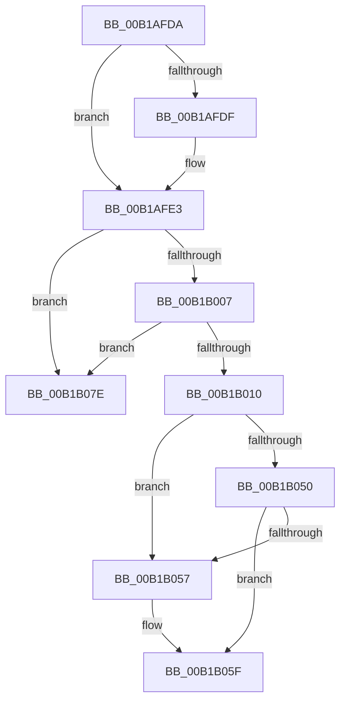

# sub_00B1AFDA

- RVA: `0x00B1AFDA`–`0x00B1B085` (길이 `171` bytes)
- VA: `0x0000000140B1AFDA`
- 실행 섹션: `PAGE`
- PDB 이름 있음: `아니요`; PDB Function 태그: `아니요`
- unwind 정보 RVA: `0x000839AC`
- 디코드: `41`개 명령, `171/171` bytes 표시
- 미해석 바이트: `0` (있으면 어셈블리에 `.byte`로 보존)

> 이 문서는 커널 이미지의 기계어와 PDB 기호를 분석해 생성했습니다. 4번과 5번은 함수 원형과 자료형을 바이너리 사용 방식에서 추정한 C 해석이며 원본 소스 복구 결과는 아닙니다.

## 1. Dependencies

- 직접 호출 지점: **4**; 고유 호출 대상: **4**
- 직접 호출자로 확인된 함수: **0**
- RIP 상대 이미지 참조: **0**

### Outgoing calls
- `0x00B1B05A` → [ExfReleasePushLock](../../text/26/ExfReleasePushLock_function_002638D0.md) (function, `0x002638D0`)
- `0x00B1B062` → [KeAbPostRelease](../../text/2E/KeAbPostRelease_function_002E1600.md) (function, `0x002E1600`)
- `0x00B1B067` → [KeLeaveCriticalRegion](../../text/25/KeLeaveCriticalRegion_function_0025D8B0.md) (function, `0x0025D8B0`)
- `0x00B1B073` → [EtwpUnreferenceGuidEntry](../8C/EtwpUnreferenceGuidEntry_function_008C3320.md) (function, `0x008C3320`)

### Direct callers
- 이 함수 시작 RVA로 연결되는 직접 call은 확인되지 않았습니다. 간접 호출은 완전히 역산할 수 없습니다.

### Static image references
- 디코드된 RIP-relative 메모리 참조가 없습니다.

## 2. Other-region calls and transfers

- 다른 실행 섹션으로 향하는 call: **3**
  - `0x00B1B05A` → [ExfReleasePushLock](../../text/26/ExfReleasePushLock_function_002638D0.md) (`PAGE` → `.text`)
  - `0x00B1B062` → [KeAbPostRelease](../../text/2E/KeAbPostRelease_function_002E1600.md) (`PAGE` → `.text`)
  - `0x00B1B067` → [KeLeaveCriticalRegion](../../text/25/KeLeaveCriticalRegion_function_0025D8B0.md) (`PAGE` → `.text`)
- call이 아닌 외부 분기/꼬리 이동: **1**
  - `0x00B1B079` → [EtwpFreeGuidEntry + 0x2B](../8C/EtwpFreeGuidEntry_function_008C42E4.md) (`tail-transfer`)

## 3. Assembly (complete function range)

```asm
00B1AFDA  48 85 F6                        test rsi, rsi
00B1AFDD  74 04                           je 0x140b1afe3
00B1AFDF  C6 46 0A 01                     mov byte ptr [rsi + 0xa], 1
00B1AFE3  65 48 8B 0C 25 88 01 00 00      mov rcx, qword ptr gs:[0x188]
00B1AFEC  48 8B 83 90 02 00 00            mov rax, qword ptr [rbx + 0x290]
00B1AFF3  48 89 88 A0 02 00 00            mov qword ptr [rax + 0x2a0], rcx
00B1AFFA  48 8D 43 10                     lea rax, [rbx + 0x10]
00B1AFFE  48 8B 10                        mov rdx, qword ptr [rax]
00B1B001  48 39 42 08                     cmp qword ptr [rdx + 8], rax
00B1B005  75 77                           jne 0x140b1b07e
00B1B007  48 8B 48 08                     mov rcx, qword ptr [rax + 8]
00B1B00B  48 39 01                        cmp qword ptr [rcx], rax
00B1B00E  75 6E                           jne 0x140b1b07e
00B1B010  48 89 11                        mov qword ptr [rcx], rdx
00B1B013  48 89 4A 08                     mov qword ptr [rdx + 8], rcx
00B1B017  48 8B 83 90 02 00 00            mov rax, qword ptr [rbx + 0x290]
00B1B01E  48 89 A8 A0 02 00 00            mov qword ptr [rax + 0x2a0], rbp
00B1B025  48 8B BB 90 02 00 00            mov rdi, qword ptr [rbx + 0x290]
00B1B02C  48 81 C7 98 02 00 00            add rdi, 0x298
00B1B033  0F 0D 0F                        prefetchw byte ptr [rdi]
00B1B036  48 8B 07                        mov rax, qword ptr [rdi]
00B1B039  48 8B C8                        mov rcx, rax
00B1B03C  48 83 E1 F0                     and rcx, 0xfffffffffffffff0
00B1B040  48 83 F9 10                     cmp rcx, 0x10
00B1B044  48 8D 50 F0                     lea rdx, [rax - 0x10]
00B1B048  48 0F 46 D5                     cmovbe rdx, rbp
00B1B04C  A8 02                           test al, 2
00B1B04E  75 07                           jne 0x140b1b057
00B1B050  F0 48 0F B1 17                  lock cmpxchg qword ptr [rdi], rdx
00B1B055  74 08                           je 0x140b1b05f
00B1B057  48 8B CF                        mov rcx, rdi
00B1B05A  E8 71 88 74 FF                  call 0x1402638d0
00B1B05F  48 8B CF                        mov rcx, rdi
00B1B062  E8 99 65 7C FF                  call 0x1402e1600
00B1B067  E8 44 28 74 FF                  call 0x14025d8b0
00B1B06C  48 8B 8B 90 02 00 00            mov rcx, qword ptr [rbx + 0x290]
00B1B073  E8 A8 82 DA FF                  call 0x1408c3320
00B1B078  90                              nop
00B1B079  E9 91 92 DA FF                  jmp 0x1408c430f
00B1B07E  B9 03 00 00 00                  mov ecx, 3
00B1B083  CD 29                           int 0x29
```

## 4. C-style interpretation (structured pseudocode)

```c
__int64 __fastcall sub_00B1AFDA(void)
{
    __int64 result;
    __int64 v_rdi;

    if (v_rsi != 0) {
        *(unsigned __int8 *)(v_rsi + 10) = 1;
    }
    *(unsigned __int64 *)(*(unsigned __int64 *)(v_rbx + 656) + 672) = *(unsigned __int64 *)(gs_base + (0 + 392));
    if ((*(unsigned __int64 *)(*(unsigned __int64 *)(v_rbx + 16) + 8)) != (v_rbx + 16)) goto loc_00B1B07E;
    if ((*(unsigned __int64 *)(*(unsigned __int64 *)(v_rbx + 16 + 8))) != (v_rbx + 16)) goto loc_00B1B07E;
    *(unsigned __int64 *)(*(unsigned __int64 *)(v_rbx + 16 + 8)) = *(unsigned __int64 *)(v_rbx + 16);
    *(unsigned __int64 *)(*(unsigned __int64 *)(v_rbx + 16) + 8) = *(unsigned __int64 *)(v_rbx + 16 + 8);
    *(unsigned __int64 *)(*(unsigned __int64 *)(v_rbx + 656) + 672) = v_rbp;
    v_rdi = (*(unsigned __int64 *)(v_rbx + 656)) + (664);
    a1 = (*(unsigned __int64 *)(v_rdi)) & (-16);
    a2 = *(unsigned __int64 *)(v_rdi) - 16;
    if (a1 <= 16) { a2 = v_rbp; }
    if ((((unsigned __int8)(*(unsigned __int64 *)(v_rdi))) & (2)) != 0) goto loc_00B1B057;
    result = *(unsigned __int64 *)(v_rdi);
    if ((((unsigned __int8)(*(unsigned __int64 *)(v_rdi))) & (2)) != 0) {
        a1 = v_rdi;
        result = ExfReleasePushLock(a1, a2, a3, a4);
    }
    result = KeAbPostRelease(v_rdi, a2, a3, a4);
    result = KeLeaveCriticalRegion(v_rdi, a2, a3, a4);
    result = EtwpUnreferenceGuidEntry(*(unsigned __int64 *)(v_rbx + 656), a2, a3, a4);
loc_00B1B07E:
    return result;
}
```

## 5. (Beta) C Style

```c
void sub_00B1AFDA(void)
{
    int64_t result;
    int64_t local_rdi;

    if (local_rsi != 0) {
        *(uint8_t *)(local_rsi + 0xA) = 1;
    }
    *(uint64_t *)(*(uint64_t *)(local_rbx + 0x290) + 0x2A0) = *(uint64_t *)(gs_base + (0 + 0x188));
    if ((*(uint64_t *)(*(uint64_t *)(local_rbx + 0x10) + 0x8)) != (local_rbx + 16)) goto loc_00B1B07E;
    if ((*(uint64_t *)(*(uint64_t *)(local_rbx + 0x10 + 0x8))) != (local_rbx + 16)) goto loc_00B1B07E;
    *(uint64_t *)(*(uint64_t *)(local_rbx + 0x10 + 0x8)) = *(uint64_t *)(local_rbx + 0x10);
    *(uint64_t *)(*(uint64_t *)(local_rbx + 0x10) + 0x8) = *(uint64_t *)(local_rbx + 0x10 + 0x8);
    *(uint64_t *)(*(uint64_t *)(local_rbx + 0x290) + 0x2A0) = local_rbp;
    local_rdi = (*(uint64_t *)(local_rbx + 0x290)) + (664);
    a1 = (*(uint64_t *)(local_rdi)) & (-16);
    a2 = *(uint64_t *)(local_rdi) - 16;
    if (a1 <= 16) { a2 = local_rbp; }
    if ((((uint8_t)(*(uint64_t *)(local_rdi))) & (2)) != 0) goto loc_00B1B057;
    result = *(uint64_t *)(local_rdi);
    if ((((uint8_t)(*(uint64_t *)(local_rdi))) & (2)) != 0) {
        a1 = local_rdi;
        result = ExfReleasePushLock(a1, a2, a3, a4);
    }
    result = KeAbPostRelease(local_rdi, a2, a3, a4);
    result = KeLeaveCriticalRegion(local_rdi, a2, a3, a4);
    result = EtwpUnreferenceGuidEntry(*(uint64_t *)(local_rbx + 0x290), a2, a3, a4);
loc_00B1B07E:
    return result;
}
```

## 6. Execution-region graph

[열기: 2D/3D 그래프와 함수 탐색 컨트롤 패널](../../../control-panel.html?section=page&rva=0x00B1AFDA&view=graph)

- 2D 그래프는 위에서 아래로 흐르고, 3D 그래프는 빈 공간을 드래그해 회전합니다. Shift+드래그는 이동, 휠은 확대·축소, 함수 노드 선택은 대상 보고서 이동입니다.

### Static fallback


