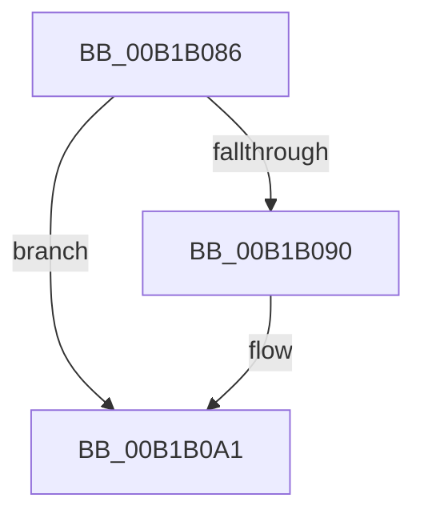

# sub_00B1B086

- RVA: `0x00B1B086`–`0x00B1B0BE` (길이 `56` bytes)
- VA: `0x0000000140B1B086`
- 실행 섹션: `PAGE`
- PDB 이름 있음: `아니요`; PDB Function 태그: `아니요`
- unwind 정보 RVA: `0x00083FA4`
- 디코드: `15`개 명령, `56/56` bytes 표시
- 미해석 바이트: `0` (있으면 어셈블리에 `.byte`로 보존)

> 이 문서는 커널 이미지의 기계어와 PDB 기호를 분석해 생성했습니다. 4번과 5번은 함수 원형과 자료형을 바이너리 사용 방식에서 추정한 C 해석이며 원본 소스 복구 결과는 아닙니다.

## 1. Dependencies

- 직접 호출 지점: **2**; 고유 호출 대상: **2**
- 직접 호출자로 확인된 함수: **0**
- RIP 상대 이미지 참조: **0**

### Outgoing calls
- `0x00B1B099` → [RtlLengthSecurityDescriptor](../8B/RtlLengthSecurityDescriptor_function_008BC870.md) (function, `0x008BC870`)
- `0x00B1B0B3` → [RtlpQueryRegistryValues](../8C/RtlpQueryRegistryValues_function_008C9050.md) (function, `0x008C9050`)

### Direct callers
- 이 함수 시작 RVA로 연결되는 직접 call은 확인되지 않았습니다. 간접 호출은 완전히 역산할 수 없습니다.

### Static image references
- 디코드된 RIP-relative 메모리 참조가 없습니다.

## 2. Other-region calls and transfers

- 다른 실행 섹션으로 향하는 call: **0**
- call이 아닌 외부 분기/꼬리 이동: **1**
  - `0x00B1B0B9` → [WmipGetGuidSecurityDescriptor + 0xFC](../8C/WmipGetGuidSecurityDescriptor_function_008C7B4C.md) (`tail-transfer`)

## 3. Assembly (complete function range)

```asm
00B1B086  48 8B 4C 24 48                  mov rcx, qword ptr [rsp + 0x48]
00B1B08B  48 85 C9                        test rcx, rcx
00B1B08E  74 11                           je 0x140b1b0a1
00B1B090  48 8D 44 24 48                  lea rax, [rsp + 0x48]
00B1B095  48 89 45 C0                     mov qword ptr [rbp - 0x40], rax
00B1B099  E8 D2 17 DA FF                  call 0x1408bc870
00B1B09E  89 45 C8                        mov dword ptr [rbp - 0x38], eax
00B1B0A1  45 33 C9                        xor r9d, r9d
00B1B0A4  C6 44 24 28 01                  mov byte ptr [rsp + 0x28], 1
00B1B0A9  4C 8D 44 24 60                  lea r8, [rsp + 0x60]
00B1B0AE  48 8B D7                        mov rdx, rdi
00B1B0B1  33 C9                           xor ecx, ecx
00B1B0B3  E8 98 DF DA FF                  call 0x1408c9050
00B1B0B8  90                              nop
00B1B0B9  E9 8A CB DA FF                  jmp 0x1408c7c48
```

## 4. C-style interpretation (structured pseudocode)

```c
__int64 __fastcall sub_00B1B086(__int64 a1, __int64 a2, __int64 a3, int a4, __int64 a5, __int64 a6, __int64 a7, __int64 a8, __int64 a9, __int64 a10, __int64 a11, __int64 a12)
{
    __int64 result;
    unsigned __int8 v_stack_p28;

    if (a9 != 0) {
        result = a9;
        *(unsigned __int64 *)(v_rbp - 64) = result;
        result = RtlLengthSecurityDescriptor(a9, a2, a3, a4);
        *(unsigned int *)(v_rbp - 56) = (unsigned int)(result);
    }
    a4 = 0;
    v_stack_p28 = 1;
    a1 = 0;
    result = RtlpQueryRegistryValues(a1, v_rdi, a12, a4);
}
```

## 5. (Beta) C Style

```c
int64_t sub_00B1B086(int64_t Arg1, int64_t Arg2, int64_t Arg3, int32_t Arg4, uint64_t Arg5, uint64_t Arg6, uint64_t Arg7, uint64_t Arg8, int64_t Arg9, uint64_t Arg10, uint64_t Arg11, int64_t Arg12)
{
    int64_t result;
    uint8_t v_stack_p28;

    if (Arg9 != 0) {
        result = Arg9;
        *(uint64_t *)(local_rbp - 0x40) = result;
        result = RtlLengthSecurityDescriptor(Arg9, Arg2, Arg3, Arg4);
        *(uint32_t *)(local_rbp - 0x38) = (uint32_t)(result);
    }
    Arg4 = 0;
    v_stack_p28 = 1;
    Arg1 = 0;
    result = RtlpQueryRegistryValues(Arg1, local_rdi, Arg12, Arg4);
}
```

## 6. Execution-region graph

[열기: 2D/3D 그래프와 함수 탐색 컨트롤 패널](../../../control-panel.html?section=page&rva=0x00B1B086&view=graph)

- 2D 그래프는 위에서 아래로 흐르고, 3D 그래프는 빈 공간을 드래그해 회전합니다. Shift+드래그는 이동, 휠은 확대·축소, 함수 노드 선택은 대상 보고서 이동입니다.

### Static fallback


