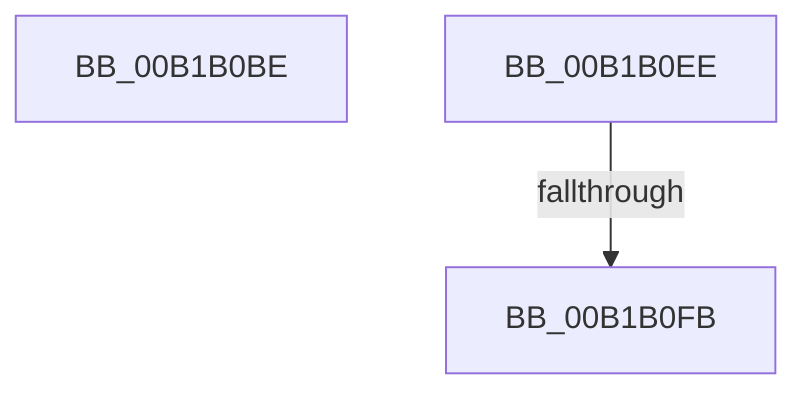

# sub_00B1B0BE

- RVA: `0x00B1B0BE`–`0x00B1B106` (길이 `72` bytes)
- VA: `0x0000000140B1B0BE`
- 실행 섹션: `PAGE`
- PDB 이름 있음: `아니요`; PDB Function 태그: `아니요`
- unwind 정보 RVA: `0x00084044`
- 디코드: `17`개 명령, `72/72` bytes 표시
- 미해석 바이트: `0` (있으면 어셈블리에 `.byte`로 보존)

> 이 문서는 커널 이미지의 기계어와 PDB 기호를 분석해 생성했습니다. 4번과 5번은 함수 원형과 자료형을 바이너리 사용 방식에서 추정한 C 해석이며 원본 소스 복구 결과는 아닙니다.

## 1. Dependencies

- 직접 호출 지점: **2**; 고유 호출 대상: **2**
- 직접 호출자로 확인된 함수: **0**
- RIP 상대 이미지 참조: **2**

### Outgoing calls
- `0x00B1B0D2` → [EtwpCheckGuidAccess](../8C/EtwpCheckGuidAccess_function_008C697C.md) (function, `0x008C697C`)
- `0x00B1B0FB` → [ObfDereferenceObject](../../text/2F/ObfDereferenceObject_function_002F9350.md) (function, `0x002F9350`)

### Direct callers
- 이 함수 시작 RVA로 연결되는 직접 call은 확인되지 않았습니다. 간접 호출은 완전히 역산할 수 없습니다.

### Static image references
- `0x00B1B0C3` → RVA `0x0002B0C0` (`.rdata`; read)
- `0x00B1B0D7` → RVA `0x00011380` (`.rdata`; read)

## 2. Other-region calls and transfers

- 다른 실행 섹션으로 향하는 call: **1**
  - `0x00B1B0FB` → [ObfDereferenceObject](../../text/2F/ObfDereferenceObject_function_002F9350.md) (`PAGE` → `.text`)
- call이 아닌 외부 분기/꼬리 이동: **3**
  - `0x00B1B0E9` → [EtwpNotifyGuid + 0x88](../8C/EtwpNotifyGuid_function_008C8110.md) (`tail-transfer`)
  - `0x00B1B0F5` → [EtwpNotifyGuid + 0xCB](../8C/EtwpNotifyGuid_function_008C8110.md) (`tail-transfer`)
  - `0x00B1B101` → [EtwpNotifyGuid + 0xCB](../8C/EtwpNotifyGuid_function_008C8110.md) (`tail-transfer`)

## 3. Assembly (complete function range)

```asm
00B1B0BE  BB 80 00 00 00                  mov ebx, 0x80
00B1B0C3  48 8D 0D F6 FF 50 FF            lea rcx, [rip - 0xaf000a]
00B1B0CA  8B D3                           mov edx, ebx
00B1B0CC  45 33 C0                        xor r8d, r8d
00B1B0CF  41 8B F4                        mov esi, r12d
00B1B0D2  E8 A5 B8 DA FF                  call 0x1408c697c
00B1B0D7  0F 10 05 A2 62 4F FF            movups xmm0, xmmword ptr [rip - 0xb09d5e]
00B1B0DE  C1 E8 1F                        shr eax, 0x1f
00B1B0E1  89 45 87                        mov dword ptr [rbp - 0x79], eax
00B1B0E4  F3 0F 7F 47 28                  movdqu xmmword ptr [rdi + 0x28], xmm0
00B1B0E9  E9 AA D0 DA FF                  jmp 0x1408c8198
00B1B0EE  48 8B 4D 9F                     mov rcx, qword ptr [rbp - 0x61]
00B1B0F2  48 85 C9                        test rcx, rcx
00B1B0F5  0F 84 E0 D0 DA FF               je 0x1408c81db
00B1B0FB  E8 50 E2 7D FF                  call 0x1402f9350
00B1B100  90                              nop
00B1B101  E9 D5 D0 DA FF                  jmp 0x1408c81db
```

## 4. C-style interpretation (structured pseudocode)

```c
__int64 __fastcall sub_00B1B0BE(__int64 a1, __int64 a2, int a3)
{
    __int64 result;

    a3 = 0;
    result = EtwpCheckGuidAccess(v_rip - 11468810, 128, a3, a4);
    result = (unsigned int)((result) >> (31));
    *(unsigned int *)(v_rbp - 121) = (unsigned int)(result);
    *(unsigned __int64 *)(v_rdi + 40) = v_xmm0;
}
```

## 5. (Beta) C Style

```c
int64_t sub_00B1B0BE(int64_t Arg1, int64_t Arg2, int32_t Arg3)
{
    int64_t result;

    Arg3 = 0;
    result = EtwpCheckGuidAccess(v_rip - 11468810, 128, Arg3, a4);
    result = (uint32_t)((result) >> (31));
    *(uint32_t *)(local_rbp - 0x79) = (uint32_t)(result);
    *(uint64_t *)(local_rdi + 0x28) = v_xmm0;
}
```

## 6. Execution-region graph

[열기: 2D/3D 그래프와 함수 탐색 컨트롤 패널](../../../control-panel.html?section=page&rva=0x00B1B0BE&view=graph)

- 2D 그래프는 위에서 아래로 흐르고, 3D 그래프는 빈 공간을 드래그해 회전합니다. Shift+드래그는 이동, 휠은 확대·축소, 함수 노드 선택은 대상 보고서 이동입니다.

### Static fallback


