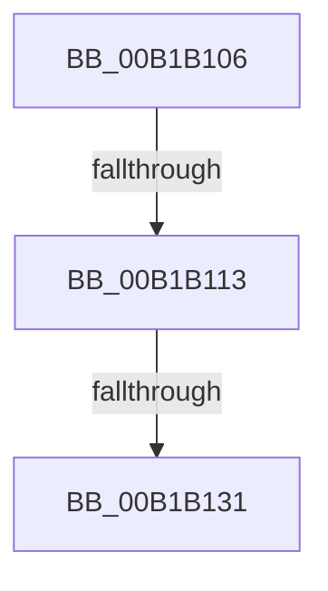

# sub_00B1B106

- RVA: `0x00B1B106`–`0x00B1B1BD` (길이 `183` bytes)
- VA: `0x0000000140B1B106`
- 실행 섹션: `PAGE`
- PDB 이름 있음: `아니요`; PDB Function 태그: `아니요`
- unwind 정보 RVA: `0x0008407C`
- 디코드: `36`개 명령, `183/183` bytes 표시
- 미해석 바이트: `0` (있으면 어셈블리에 `.byte`로 보존)

> 이 문서는 커널 이미지의 기계어와 PDB 기호를 분석해 생성했습니다. 4번과 5번은 함수 원형과 자료형을 바이너리 사용 방식에서 추정한 C 해석이며 원본 소스 복구 결과는 아닙니다.

## 1. Dependencies

- 직접 호출 지점: **2**; 고유 호출 대상: **2**
- 직접 호출자로 확인된 함수: **0**
- RIP 상대 이미지 참조: **2**

### Outgoing calls
- `0x00B1B124` → [tlgKeywordOn](../../text/42/tlgKeywordOn_function_0042EAA0.md) (function, `0x0042EAA0`)
- `0x00B1B1B2` → [tlgWriteTransfer_EtwWriteTransfer](../../text/42/tlgWriteTransfer_EtwWriteTransfer_function_004260E0.md) (function, `0x004260E0`)

### Direct callers
- 이 함수 시작 RVA로 연결되는 직접 call은 확인되지 않았습니다. 간접 호출은 완전히 역산할 수 없습니다.

### Static image references
- `0x00B1B106` → RVA `0x00E09168` (`.data`; read)
- `0x00B1B19A` → RVA `0x00055412` (`.rdata`; read)

## 2. Other-region calls and transfers

- 다른 실행 섹션으로 향하는 call: **2**
  - `0x00B1B124` → [tlgKeywordOn](../../text/42/tlgKeywordOn_function_0042EAA0.md) (`PAGE` → `.text`)
  - `0x00B1B1B2` → [tlgWriteTransfer_EtwWriteTransfer](../../text/42/tlgWriteTransfer_EtwWriteTransfer_function_004260E0.md) (`PAGE` → `.text`)
- call이 아닌 외부 분기/꼬리 이동: **3**
  - `0x00B1B10D` → [EtwpSendDataBlock + 0x58](../8C/EtwpSendDataBlock_function_008C8530.md) (`tail-transfer`)
  - `0x00B1B12B` → [EtwpSendDataBlock + 0x58](../8C/EtwpSendDataBlock_function_008C8530.md) (`tail-transfer`)
  - `0x00B1B1B8` → [EtwpSendDataBlock + 0x58](../8C/EtwpSendDataBlock_function_008C8530.md) (`tail-transfer`)

## 3. Assembly (complete function range)

```asm
00B1B106  83 3D 5B E0 2E 00 05            cmp dword ptr [rip + 0x2ee05b], 5
00B1B10D  0F 86 75 D4 DA FF               jbe 0x1408c8588
00B1B113  48 BA 00 08 00 00 00 20 00 00   movabs rdx, 0x200000000800
00B1B11D  48 8D 0D 44 E0 2E 00            lea rcx, [rip + 0x2ee044]
00B1B124  E8 77 39 91 FF                  call 0x14042eaa0
00B1B129  84 C0                           test al, al
00B1B12B  0F 84 57 D4 DA FF               je 0x1408c8588
00B1B131  B8 00 00 00 81                  mov eax, 0x81000000
00B1B136  48 C7 45 EF 08 00 00 00         mov qword ptr [rbp - 0x11], 8
00B1B13E  48 89 45 97                     mov qword ptr [rbp - 0x69], rax
00B1B142  48 8D 0D 1F E0 2E 00            lea rcx, [rip + 0x2ee01f]
00B1B149  48 8D 45 97                     lea rax, [rbp - 0x69]
00B1B14D  48 C7 45 FF 08 00 00 00         mov qword ptr [rbp - 1], 8
00B1B155  48 89 45 E7                     mov qword ptr [rbp - 0x19], rax
00B1B159  45 33 C9                        xor r9d, r9d
00B1B15C  48 B8 4B 59 86 38 D6 C5 6D 34   movabs rax, 0x346dc5d63886594b
00B1B166  48 C7 45 0F 10 00 00 00         mov qword ptr [rbp + 0xf], 0x10
00B1B16E  49 F7 E8                        imul r8
00B1B171  45 33 C0                        xor r8d, r8d
00B1B174  48 C1 FA 0B                     sar rdx, 0xb
00B1B178  48 8B C2                        mov rax, rdx
00B1B17B  48 C1 E8 3F                     shr rax, 0x3f
00B1B17F  48 03 D0                        add rdx, rax
00B1B182  48 8D 45 9F                     lea rax, [rbp - 0x61]
00B1B186  48 89 45 F7                     mov qword ptr [rbp - 9], rax
00B1B18A  48 8B 46 20                     mov rax, qword ptr [rsi + 0x20]
00B1B18E  48 83 C0 28                     add rax, 0x28
00B1B192  48 89 55 9F                     mov qword ptr [rbp - 0x61], rdx
00B1B196  48 89 45 07                     mov qword ptr [rbp + 7], rax
00B1B19A  48 8D 15 71 A2 53 FF            lea rdx, [rip - 0xac5d8f]
00B1B1A1  48 8D 45 C7                     lea rax, [rbp - 0x39]
00B1B1A5  48 89 44 24 28                  mov qword ptr [rsp + 0x28], rax
00B1B1AA  C7 44 24 20 05 00 00 00         mov dword ptr [rsp + 0x20], 5
00B1B1B2  E8 29 AF 90 FF                  call 0x1404260e0
00B1B1B7  90                              nop
00B1B1B8  E9 CB D3 DA FF                  jmp 0x1408c8588
```

## 4. C-style interpretation (structured pseudocode)

```c
__int64 __fastcall sub_00B1B106(__int64 a1, __int64 a2, __int64 a3, int a4)
{
    __int64 result;
    unsigned int v_stack_p20;
    unsigned __int64 v_stack_p28;

    result = tlgKeywordOn(v_rip + 3072068, a2, a3, a4);
    *(unsigned __int64 *)(v_rbp - 17) = 8;
    *(unsigned __int64 *)(v_rbp - 105) = (unsigned int)(0x81000000ULL);
    *(unsigned __int64 *)(v_rbp - 1) = 8;
    *(unsigned __int64 *)(v_rbp - 25) = v_rbp - 105;
    a4 = 0;
    *(unsigned __int64 *)(v_rbp + 15) = 16;
    a3 = 0;
    a2 = (a2) >> (11);
    result = (a2) >> (63);
    a2 = (a2) + (result);
    *(unsigned __int64 *)(v_rbp - 9) = v_rbp - 97;
    result = (*(unsigned __int64 *)(v_rsi + 32)) + (40);
    *(unsigned __int64 *)(v_rbp - 97) = a2;
    *(unsigned __int64 *)(v_rbp + 7) = result;
    v_stack_p28 = v_rbp - 57;
    v_stack_p20 = 5;
    result = tlgWriteTransfer_EtwWriteTransfer(v_rip + 3072031, v_rip - 11296143, a3, a4);
}
```

## 5. (Beta) C Style

```c
int64_t sub_00B1B106(int64_t Arg1, int64_t Arg2, int64_t Arg3, int32_t Arg4)
{
    int64_t result;
    uint32_t v_stack_p20;
    uint64_t v_stack_p28;

    result = tlgKeywordOn(v_rip + 3072068, Arg2, Arg3, Arg4);
    *(uint64_t *)(local_rbp - 0x11) = 8;
    *(uint64_t *)(local_rbp - 0x69) = (uint32_t)(0x81000000ULL);
    *(uint64_t *)(local_rbp - 0x1) = 8;
    *(uint64_t *)(local_rbp - 0x19) = local_rbp - 105;
    Arg4 = 0;
    *(uint64_t *)(local_rbp + 0xF) = 16;
    Arg3 = 0;
    Arg2 = (Arg2) >> (11);
    result = (Arg2) >> (63);
    Arg2 = (Arg2) + (result);
    *(uint64_t *)(local_rbp - 0x9) = local_rbp - 97;
    result = (*(uint64_t *)(local_rsi + 0x20)) + (40);
    *(uint64_t *)(local_rbp - 0x61) = Arg2;
    *(uint64_t *)(local_rbp + 0x7) = result;
    v_stack_p28 = local_rbp - 57;
    v_stack_p20 = 5;
    result = tlgWriteTransfer_EtwWriteTransfer(v_rip + 3072031, v_rip - 11296143, Arg3, Arg4);
}
```

## 6. Execution-region graph

[열기: 2D/3D 그래프와 함수 탐색 컨트롤 패널](../../../control-panel.html?section=page&rva=0x00B1B106&view=graph)

- 2D 그래프는 위에서 아래로 흐르고, 3D 그래프는 빈 공간을 드래그해 회전합니다. Shift+드래그는 이동, 휠은 확대·축소, 함수 노드 선택은 대상 보고서 이동입니다.

### Static fallback


