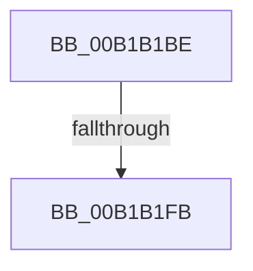

# sub_00B1B1BE

- RVA: `0x00B1B1BE`–`0x00B1B202` (길이 `68` bytes)
- VA: `0x0000000140B1B1BE`
- 실행 섹션: `PAGE`
- PDB 이름 있음: `아니요`; PDB Function 태그: `아니요`
- unwind 정보 RVA: `0x000840E4`
- 디코드: `19`개 명령, `68/68` bytes 표시
- 미해석 바이트: `0` (있으면 어셈블리에 `.byte`로 보존)

> 이 문서는 커널 이미지의 기계어와 PDB 기호를 분석해 생성했습니다. 4번과 5번은 함수 원형과 자료형을 바이너리 사용 방식에서 추정한 C 해석이며 원본 소스 복구 결과는 아닙니다.

## 1. Dependencies

- 직접 호출 지점: **3**; 고유 호출 대상: **3**
- 직접 호출자로 확인된 함수: **0**
- RIP 상대 이미지 참조: **0**

### Outgoing calls
- `0x00B1B1C1` → [MiReferenceControlAreaFile](../../text/43/MiReferenceControlAreaFile_function_00431554.md) (function, `0x00431554`)
- `0x00B1B1E1` → [PsBlockNonCetBinaries](../78/PsBlockNonCetBinaries_function_00781140.md) (function, `0x00781140`)
- `0x00B1B1EE` → [MiDereferenceControlAreaFile](../../text/43/MiDereferenceControlAreaFile_function_004345E0.md) (function, `0x004345E0`)

### Direct callers
- 이 함수 시작 RVA로 연결되는 직접 call은 확인되지 않았습니다. 간접 호출은 완전히 역산할 수 없습니다.

### Static image references
- 디코드된 RIP-relative 메모리 참조가 없습니다.

## 2. Other-region calls and transfers

- 다른 실행 섹션으로 향하는 call: **2**
  - `0x00B1B1C1` → [MiReferenceControlAreaFile](../../text/43/MiReferenceControlAreaFile_function_00431554.md) (`PAGE` → `.text`)
  - `0x00B1B1EE` → [MiDereferenceControlAreaFile](../../text/43/MiDereferenceControlAreaFile_function_004345E0.md) (`PAGE` → `.text`)
- call이 아닌 외부 분기/꼬리 이동: **2**
  - `0x00B1B1F5` → [MiAllowImageMap + 0x7D](../8C/MiAllowImageMap_function_008C8B10.md) (`tail-transfer`)
  - `0x00B1B1FD` → [MiAllowImageMap + 0xA0](../8C/MiAllowImageMap_function_008C8B10.md) (`tail-transfer`)

## 3. Assembly (complete function range)

```asm
00B1B1BE  49 8B CC                        mov rcx, r12
00B1B1C1  E8 8E 63 91 FF                  call 0x140431554
00B1B1C6  49 8B 0C 24                     mov rcx, qword ptr [r12]
00B1B1CA  44 8A C7                        mov r8b, dil
00B1B1CD  48 8B D8                        mov rbx, rax
00B1B1D0  4C 8D 48 58                     lea r9, [rax + 0x58]
00B1B1D4  48 8B 51 38                     mov rdx, qword ptr [rcx + 0x38]
00B1B1D8  49 8B CF                        mov rcx, r15
00B1B1DB  8A 52 4C                        mov dl, byte ptr [rdx + 0x4c]
00B1B1DE  41 22 D6                        and dl, r14b
00B1B1E1  E8 5A 5F C6 FF                  call 0x140781140
00B1B1E6  48 8B D3                        mov rdx, rbx
00B1B1E9  49 8B CC                        mov rcx, r12
00B1B1EC  8B F8                           mov edi, eax
00B1B1EE  E8 ED 93 91 FF                  call 0x1404345e0
00B1B1F3  85 FF                           test edi, edi
00B1B1F5  0F 89 92 D9 DA FF               jns 0x1408c8b8d
00B1B1FB  8B C7                           mov eax, edi
00B1B1FD  E9 AE D9 DA FF                  jmp 0x1408c8bb0
```

## 4. C-style interpretation (structured pseudocode)

```c
__int64 __fastcall sub_00B1B1BE(void)
{
    __int64 result;

    result = MiReferenceControlAreaFile(v_r12, a2, a3, a4);
    a2 = (unsigned __int8)((*(unsigned __int8 *)(*(unsigned __int64 *)(*(unsigned __int64 *)(v_r12) + 56) + 76)) & ((unsigned __int8)(v_r14)));
    result = PsBlockNonCetBinaries(v_r15, a2, (unsigned __int8)(v_rdi), result + 88);
    result = MiDereferenceControlAreaFile(v_r12, result, (unsigned __int8)(v_rdi), result + 88);
}
```

## 5. (Beta) C Style

```c
void sub_00B1B1BE(void)
{
    int64_t result;

    result = MiReferenceControlAreaFile(local_r12, a2, a3, a4);
    a2 = (uint8_t)((*(uint8_t *)(*(uint64_t *)(*(uint64_t *)(local_r12) + 0x38) + 0x4C)) & ((uint8_t)(local_r14)));
    result = PsBlockNonCetBinaries(local_r15, a2, (uint8_t)(local_rdi), result + 88);
    result = MiDereferenceControlAreaFile(local_r12, result, (uint8_t)(local_rdi), result + 88);
}
```

## 6. Execution-region graph

[열기: 2D/3D 그래프와 함수 탐색 컨트롤 패널](../../../control-panel.html?section=page&rva=0x00B1B1BE&view=graph)

- 2D 그래프는 위에서 아래로 흐르고, 3D 그래프는 빈 공간을 드래그해 회전합니다. Shift+드래그는 이동, 휠은 확대·축소, 함수 노드 선택은 대상 보고서 이동입니다.

### Static fallback


