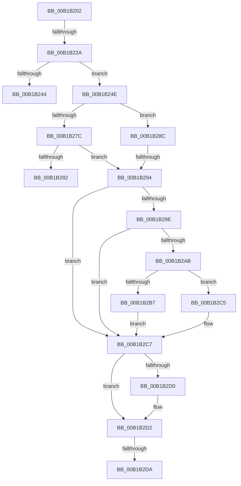

# sub_00B1B202

- RVA: `0x00B1B202`–`0x00B1B2E3` (길이 `225` bytes)
- VA: `0x0000000140B1B202`
- 실행 섹션: `PAGE`
- PDB 이름 있음: `아니요`; PDB Function 태그: `아니요`
- unwind 정보 RVA: `0x00084124`
- 디코드: `63`개 명령, `225/225` bytes 표시
- 미해석 바이트: `0` (있으면 어셈블리에 `.byte`로 보존)

> 이 문서는 커널 이미지의 기계어와 PDB 기호를 분석해 생성했습니다. 4번과 5번은 함수 원형과 자료형을 바이너리 사용 방식에서 추정한 C 해석이며 원본 소스 복구 결과는 아닙니다.

## 1. Dependencies

- 직접 호출 지점: **3**; 고유 호출 대상: **3**
- 직접 호출자로 확인된 함수: **0**
- RIP 상대 이미지 참조: **1**

### Outgoing calls
- `0x00B1B217` → [RtlInitUnicodeString](../../text/42/RtlInitUnicodeString_function_0042A780.md) (function, `0x0042A780`)
- `0x00B1B237` → [ExAllocatePool2](../../poolcode/B8/ExAllocatePool2_function_00B820F0.md) (function, `0x00B820F0`)
- `0x00B1B26C` → [ZwQueryValueKey](../../text/6A/ZwQueryValueKey_function_006AD3B0.md) (function, `0x006AD3B0`)

### Direct callers
- 이 함수 시작 RVA로 연결되는 직접 call은 확인되지 않았습니다. 간접 호출은 완전히 역산할 수 없습니다.

### Static image references
- `0x00B1B202` → RVA `0x00B056B0` (` ?? ::NNGAKEGL::`string'`; read)

## 2. Other-region calls and transfers

- 다른 실행 섹션으로 향하는 call: **3**
  - `0x00B1B217` → [RtlInitUnicodeString](../../text/42/RtlInitUnicodeString_function_0042A780.md) (`PAGE` → `.text`)
  - `0x00B1B237` → [ExAllocatePool2](../../poolcode/B8/ExAllocatePool2_function_00B820F0.md) (`PAGE` → `POOLCODE`)
  - `0x00B1B26C` → [ZwQueryValueKey](../../text/6A/ZwQueryValueKey_function_006AD3B0.md) (`PAGE` → `.text`)
- call이 아닌 외부 분기/꼬리 이동: **6**
  - `0x00B1B224` → [RtlGetPersistedStateLocation + 0x8A](../8C/RtlGetPersistedStateLocation_function_008C8DE0.md) (`tail-transfer`)
  - `0x00B1B249` → [RtlGetPersistedStateLocation + 0x8F](../8C/RtlGetPersistedStateLocation_function_008C8DE0.md) (`tail-transfer`)
  - `0x00B1B287` → [RtlGetPersistedStateLocation + 0x8F](../8C/RtlGetPersistedStateLocation_function_008C8DE0.md) (`tail-transfer`)
  - `0x00B1B28E` → [RtlGetPersistedStateLocation + 0x8F](../8C/RtlGetPersistedStateLocation_function_008C8DE0.md) (`tail-transfer`)
  - `0x00B1B2D4` → [RtlGetPersistedStateLocation + 0x8F](../8C/RtlGetPersistedStateLocation_function_008C8DE0.md) (`tail-transfer`)
  - `0x00B1B2DE` → [RtlGetPersistedStateLocation + 0xEF](../8C/RtlGetPersistedStateLocation_function_008C8DE0.md) (`tail-transfer`)

## 3. Assembly (complete function range)

```asm
00B1B202  48 8D 05 A7 A4 FE FF            lea rax, [rip - 0x15b59]
00B1B209  48 85 F6                        test rsi, rsi
00B1B20C  48 8D 4D C0                     lea rcx, [rbp - 0x40]
00B1B210  48 0F 44 F0                     cmove rsi, rax
00B1B214  48 8B D6                        mov rdx, rsi
00B1B217  E8 64 F5 90 FF                  call 0x14042a780
00B1B21C  8B 75 58                        mov esi, dword ptr [rbp + 0x58]
00B1B21F  8D 5E 10                        lea ebx, [rsi + 0x10]
00B1B222  3B DE                           cmp ebx, esi
00B1B224  0F 82 40 DC DA FF               jb 0x1408c8e6a
00B1B22A  8B D3                           mov edx, ebx
00B1B22C  B9 00 01 00 00                  mov ecx, 0x100
00B1B231  41 B8 73 73 65 70               mov r8d, 0x70657373
00B1B237  E8 B4 6E 06 00                  call 0x140b820f0
00B1B23C  48 8B F8                        mov rdi, rax
00B1B23F  48 85 C0                        test rax, rax
00B1B242  75 0A                           jne 0x140b1b24e
00B1B244  BB 17 00 00 C0                  mov ebx, 0xc0000017
00B1B249  E9 21 DC DA FF                  jmp 0x1408c8e6f
00B1B24E  48 8B 4D B8                     mov rcx, qword ptr [rbp - 0x48]
00B1B252  48 8D 45 48                     lea rax, [rbp + 0x48]
00B1B256  48 89 44 24 28                  mov qword ptr [rsp + 0x28], rax
00B1B25B  48 8D 55 C0                     lea rdx, [rbp - 0x40]
00B1B25F  4C 8B CF                        mov r9, rdi
00B1B262  89 5C 24 20                     mov dword ptr [rsp + 0x20], ebx
00B1B266  41 B8 02 00 00 00               mov r8d, 2
00B1B26C  E8 3F 21 B9 FF                  call 0x1406ad3b0
00B1B271  8B D8                           mov ebx, eax
00B1B273  BA 05 00 00 80                  mov edx, 0x80000005
00B1B278  85 C0                           test eax, eax
00B1B27A  78 10                           js 0x140b1b28c
00B1B27C  83 7F 04 01                     cmp dword ptr [rdi + 4], 1
00B1B280  74 12                           je 0x140b1b294
00B1B282  BB 24 00 00 C0                  mov ebx, 0xc0000024
00B1B287  E9 E3 DB DA FF                  jmp 0x1408c8e6f
00B1B28C  3B C2                           cmp eax, edx
00B1B28E  0F 85 DB DB DA FF               jne 0x1408c8e6f
00B1B294  8B 4F 08                        mov ecx, dword ptr [rdi + 8]
00B1B297  89 4D 48                        mov dword ptr [rbp + 0x48], ecx
00B1B29A  85 C0                           test eax, eax
00B1B29C  78 29                           js 0x140b1b2c7
00B1B29E  8B C1                           mov eax, ecx
00B1B2A0  48 D1 E8                        shr rax, 1
00B1B2A3  66 44 39 6C 47 0A               cmp word ptr [rdi + rax*2 + 0xa], r13w
00B1B2A9  74 1C                           je 0x140b1b2c7
00B1B2AB  8D 41 02                        lea eax, [rcx + 2]
00B1B2AE  89 45 48                        mov dword ptr [rbp + 0x48], eax
00B1B2B1  8B C8                           mov ecx, eax
00B1B2B3  3B F0                           cmp esi, eax
00B1B2B5  72 0E                           jb 0x140b1b2c5
00B1B2B7  48 D1 E8                        shr rax, 1
00B1B2BA  66 44 89 6C 47 0A               mov word ptr [rdi + rax*2 + 0xa], r13w
00B1B2C0  8B 4D 48                        mov ecx, dword ptr [rbp + 0x48]
00B1B2C3  EB 02                           jmp 0x140b1b2c7
00B1B2C5  8B DA                           mov ebx, edx
00B1B2C7  48 8B 45 60                     mov rax, qword ptr [rbp + 0x60]
00B1B2CB  48 85 C0                        test rax, rax
00B1B2CE  74 02                           je 0x140b1b2d2
00B1B2D0  89 08                           mov dword ptr [rax], ecx
00B1B2D2  85 DB                           test ebx, ebx
00B1B2D4  0F 88 95 DB DA FF               js 0x1408c8e6f
00B1B2DA  48 8D 57 0C                     lea rdx, [rdi + 0xc]
00B1B2DE  E9 EC DB DA FF                  jmp 0x1408c8ecf
```

## 4. C-style interpretation (structured pseudocode)

```c
__int64 __fastcall sub_00B1B202(void)
{
    __int64 result;
    __int64 v_rsi;
    unsigned int v_stack_p20;
    unsigned __int64 v_stack_p28;

    if (v_rsi == 0) { v_rsi = v_rip - 88921; }
    result = RtlInitUnicodeString(v_rbp - 64, v_rsi, a3, a4);
    result = ExAllocatePool2(256, (unsigned int)((unsigned int)((unsigned int)(*(unsigned int *)(v_rbp + 88)) + 16)), (unsigned int)(0x70657373ULL), a4);
    if (result != 0) goto loc_00B1B24E;
loc_00B1B24E:
    v_stack_p28 = v_rbp + 72;
    v_stack_p20 = (unsigned int)((unsigned int)(0xC0000017ULL));
    result = ZwQueryValueKey(*(unsigned __int64 *)(v_rbp - 72), v_rbp - 64, 2, result);
    if (sign_flag) goto loc_00B1B28C;
    if ((*(unsigned int *)(result + 4)) == 1) goto loc_00B1B294;
loc_00B1B28C:
loc_00B1B294:
    *(unsigned int *)(v_rbp + 72) = (unsigned int)((unsigned int)(*(unsigned int *)(result + 8)));
    if (sign_flag) goto loc_00B1B2C7;
    result = ((unsigned int)((unsigned int)((unsigned int)(*(unsigned int *)(result + 8))))) >> (1);
    if ((*(unsigned __int16 *)(result + result * 2 + 10)) == ((unsigned __int16)(v_r13))) goto loc_00B1B2C7;
    *(unsigned int *)(v_rbp + 72) = (unsigned int)((unsigned int)(*(unsigned int *)(result + 8)) + 2);
    if (((unsigned int)((unsigned int)(*(unsigned int *)(v_rbp + 88)))) < ((unsigned int)((unsigned int)(*(unsigned int *)(result + 8)) + 2))) goto loc_00B1B2C5;
    result = ((unsigned int)(*(unsigned int *)(result + 8)) + 2) >> (1);
    *(unsigned __int16 *)(result + result * 2 + 10) = (unsigned __int16)(v_r13);
    goto loc_00B1B2C7;
loc_00B1B2C5:
loc_00B1B2C7:
    if (*(unsigned __int64 *)(v_rbp + 96) != 0) {
        *(unsigned int *)(*(unsigned __int64 *)(v_rbp + 96)) = (unsigned int)((unsigned int)(*(unsigned int *)(v_rbp + 72)));
    }
}
```

## 5. (Beta) C Style

```c
void sub_00B1B202(void)
{
    int64_t result;
    int64_t local_rsi;
    uint32_t v_stack_p20;
    uint64_t v_stack_p28;

    if (local_rsi == 0) { local_rsi = v_rip - 88921; }
    result = RtlInitUnicodeString(local_rbp - 64, local_rsi, a3, a4);
    result = ExAllocatePool2(256, (uint32_t)((uint32_t)((uint32_t)(*(uint32_t *)(local_rbp + 0x58)) + 16)), (uint32_t)(0x70657373ULL), a4);
    if (result != 0) goto loc_00B1B24E;
loc_00B1B24E:
    v_stack_p28 = local_rbp + 72;
    v_stack_p20 = (uint32_t)((uint32_t)(0xC0000017ULL));
    result = ZwQueryValueKey(*(uint64_t *)(local_rbp - 0x48), local_rbp - 64, 2, result);
    if (sign_flag) goto loc_00B1B28C;
    if ((*(uint32_t *)(result + 0x4)) == 1) goto loc_00B1B294;
loc_00B1B28C:
loc_00B1B294:
    *(uint32_t *)(local_rbp + 0x48) = (uint32_t)((uint32_t)(*(uint32_t *)(result + 0x8)));
    if (sign_flag) goto loc_00B1B2C7;
    result = ((uint32_t)((uint32_t)((uint32_t)(*(uint32_t *)(result + 0x8))))) >> (1);
    if ((*(uint16_t *)(result + result * 2 + 0xA)) == ((uint16_t)(local_r13))) goto loc_00B1B2C7;
    *(uint32_t *)(local_rbp + 0x48) = (uint32_t)((uint32_t)(*(uint32_t *)(result + 0x8)) + 2);
    if (((uint32_t)((uint32_t)(*(uint32_t *)(local_rbp + 0x58)))) < ((uint32_t)((uint32_t)(*(uint32_t *)(result + 0x8)) + 2))) goto loc_00B1B2C5;
    result = ((uint32_t)(*(uint32_t *)(result + 0x8)) + 2) >> (1);
    *(uint16_t *)(result + result * 2 + 0xA) = (uint16_t)(local_r13);
    goto loc_00B1B2C7;
loc_00B1B2C5:
loc_00B1B2C7:
    if (*(uint64_t *)(local_rbp + 0x60) != 0) {
        *(uint32_t *)(*(uint64_t *)(local_rbp + 0x60)) = (uint32_t)((uint32_t)(*(uint32_t *)(local_rbp + 0x48)));
    }
}
```

## 6. Execution-region graph

[열기: 2D/3D 그래프와 함수 탐색 컨트롤 패널](../../../control-panel.html?section=page&rva=0x00B1B202&view=graph)

- 2D 그래프는 위에서 아래로 흐르고, 3D 그래프는 빈 공간을 드래그해 회전합니다. Shift+드래그는 이동, 휠은 확대·축소, 함수 노드 선택은 대상 보고서 이동입니다.

### Static fallback


