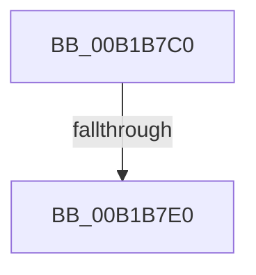

# sub_00B1B7C0

- RVA: `0x00B1B7C0`–`0x00B1B831` (길이 `113` bytes)
- VA: `0x0000000140B1B7C0`
- 실행 섹션: `PAGE`
- PDB 이름 있음: `아니요`; PDB Function 태그: `아니요`
- unwind 정보 RVA: `0x00084578`
- 디코드: `26`개 명령, `113/113` bytes 표시
- 미해석 바이트: `0` (있으면 어셈블리에 `.byte`로 보존)

> 이 문서는 커널 이미지의 기계어와 PDB 기호를 분석해 생성했습니다. 4번과 5번은 함수 원형과 자료형을 바이너리 사용 방식에서 추정한 C 해석이며 원본 소스 복구 결과는 아닙니다.

## 1. Dependencies

- 직접 호출 지점: **4**; 고유 호출 대상: **4**
- 직접 호출자로 확인된 함수: **0**
- RIP 상대 이미지 참조: **2**

### Outgoing calls
- `0x00B1B7D3` → [EtwProviderEnabled](../../text/3B/EtwProviderEnabled_function_003BA250.md) (function, `0x003BA250`)
- `0x00B1B7EC` → [EtwpTiFillProcessIdentity](../../text/3B/EtwpTiFillProcessIdentity_function_003B8F30.md) (function, `0x003B8F30`)
- `0x00B1B804` → [EtwpTiFillThreadIdentity](../../text/47/EtwpTiFillThreadIdentity_function_00471C1C.md) (function, `0x00471C1C`)
- `0x00B1B826` → [EtwWrite](../../text/41/EtwWrite_function_0041C720.md) (function, `0x0041C720`)

### Direct callers
- 이 함수 시작 RVA로 연결되는 직접 call은 확인되지 않았습니다. 간접 호출은 완전히 역산할 수 없습니다.

### Static image references
- `0x00B1B7C0` → RVA `0x00EFFA30` (`.data`; read)
- `0x00B1B810` → RVA `0x000113B0` (`.rdata`; read)

## 2. Other-region calls and transfers

- 다른 실행 섹션으로 향하는 call: **4**
  - `0x00B1B7D3` → [EtwProviderEnabled](../../text/3B/EtwProviderEnabled_function_003BA250.md) (`PAGE` → `.text`)
  - `0x00B1B7EC` → [EtwpTiFillProcessIdentity](../../text/3B/EtwpTiFillProcessIdentity_function_003B8F30.md) (`PAGE` → `.text`)
  - `0x00B1B804` → [EtwpTiFillThreadIdentity](../../text/47/EtwpTiFillThreadIdentity_function_00471C1C.md) (`PAGE` → `.text`)
  - `0x00B1B826` → [EtwWrite](../../text/41/EtwWrite_function_0041C720.md) (`PAGE` → `.text`)
- call이 아닌 외부 분기/꼬리 이동: **2**
  - `0x00B1B7DA` → [PsImpersonateClient + 0x262](../8C/PsImpersonateClient_function_008CBE10.md) (`tail-transfer`)
  - `0x00B1B82C` → [PsImpersonateClient + 0x262](../8C/PsImpersonateClient_function_008CBE10.md) (`tail-transfer`)

## 3. Assembly (complete function range)

```asm
00B1B7C0  48 8B 0D 69 42 3E 00            mov rcx, qword ptr [rip + 0x3e4269]
00B1B7C7  33 D2                           xor edx, edx
00B1B7C9  49 B8 00 00 00 00 80 00 00 00   movabs r8, 0x8000000000
00B1B7D3  E8 78 EA 89 FF                  call 0x1403ba250
00B1B7D8  84 C0                           test al, al
00B1B7DA  0F 84 92 08 DB FF               je 0x1408cc072
00B1B7E0  4C 8D 44 24 60                  lea r8, [rsp + 0x60]
00B1B7E5  48 8B D6                        mov rdx, rsi
00B1B7E8  48 8D 4D D0                     lea rcx, [rbp - 0x30]
00B1B7EC  E8 3F D7 89 FF                  call 0x1403b8f30
00B1B7F1  8B C8                           mov ecx, eax
00B1B7F3  48 8B D7                        mov rdx, rdi
00B1B7F6  44 8B C8                        mov r9d, eax
00B1B7F9  48 8D 45 D0                     lea rax, [rbp - 0x30]
00B1B7FD  48 C1 E1 04                     shl rcx, 4
00B1B801  48 03 C8                        add rcx, rax
00B1B804  E8 13 64 95 FF                  call 0x140471c1c
00B1B809  48 8B 0D 20 42 3E 00            mov rcx, qword ptr [rip + 0x3e4220]
00B1B810  48 8D 15 99 5B 4F FF            lea rdx, [rip - 0xb0a467]
00B1B817  44 03 C8                        add r9d, eax
00B1B81A  45 33 C0                        xor r8d, r8d
00B1B81D  48 8D 45 D0                     lea rax, [rbp - 0x30]
00B1B821  48 89 44 24 20                  mov qword ptr [rsp + 0x20], rax
00B1B826  E8 F5 0E 90 FF                  call 0x14041c720
00B1B82B  90                              nop
00B1B82C  E9 41 08 DB FF                  jmp 0x1408cc072
```

## 4. C-style interpretation (structured pseudocode)

```c
__int64 __fastcall sub_00B1B7C0(__int64 a1, int a2, __int64 a3, __int64 a4, __int64 a5, __int64 a6, __int64 a7, __int64 a8, __int64 a9, __int64 a10, __int64 a11, __int64 a12)
{
    __int64 result;
    unsigned __int64 v_stack_p20;

    a2 = 0;
    result = EtwProviderEnabled(*(unsigned __int64 *)(v_rip + 4080233), a2, a3, a4);
    result = EtwpTiFillProcessIdentity(v_rbp - 48, v_rsi, a12, a4);
    a1 = ((unsigned int)((unsigned int)(result))) << (4);
    a1 = (a1) + (v_rbp - 48);
    result = EtwpTiFillThreadIdentity(a1, v_rdi, a12, (unsigned int)((unsigned int)(result)));
    a4 = (unsigned int)(((unsigned int)((unsigned int)(result))) + ((unsigned int)(result)));
    a3 = 0;
    v_stack_p20 = v_rbp - 48;
    result = EtwWrite(*(unsigned __int64 *)(v_rip + 4080160), v_rip - 11576423, a3, a4);
}
```

## 5. (Beta) C Style

```c
int64_t sub_00B1B7C0(int64_t Arg1, int32_t Arg2, int64_t Arg3, int64_t Arg4, uint64_t Arg5, uint64_t Arg6, uint64_t Arg7, uint64_t Arg8, uint64_t Arg9, uint64_t Arg10, uint64_t Arg11, int64_t Arg12)
{
    int64_t result;
    uint64_t v_stack_p20;

    Arg2 = 0;
    result = EtwProviderEnabled(*(uint64_t *)(v_rip + 0x3E4269), Arg2, Arg3, Arg4);
    result = EtwpTiFillProcessIdentity(local_rbp - 48, local_rsi, Arg12, Arg4);
    Arg1 = ((uint32_t)((uint32_t)(result))) << (4);
    Arg1 = (Arg1) + (local_rbp - 48);
    result = EtwpTiFillThreadIdentity(Arg1, local_rdi, Arg12, (uint32_t)((uint32_t)(result)));
    Arg4 = (uint32_t)(((uint32_t)((uint32_t)(result))) + ((uint32_t)(result)));
    Arg3 = 0;
    v_stack_p20 = local_rbp - 48;
    result = EtwWrite(*(uint64_t *)(v_rip + 0x3E4220), v_rip - 11576423, Arg3, Arg4);
}
```

## 6. Execution-region graph

[열기: 2D/3D 그래프와 함수 탐색 컨트롤 패널](../../../control-panel.html?section=page&rva=0x00B1B7C0&view=graph)

- 2D 그래프는 위에서 아래로 흐르고, 3D 그래프는 빈 공간을 드래그해 회전합니다. Shift+드래그는 이동, 휠은 확대·축소, 함수 노드 선택은 대상 보고서 이동입니다.

### Static fallback


