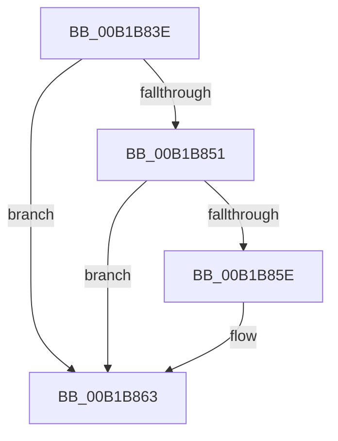

# sub_00B1B83E

- RVA: `0x00B1B83E`–`0x00B1B86D` (길이 `47` bytes)
- VA: `0x0000000140B1B83E`
- 실행 섹션: `PAGE`
- PDB 이름 있음: `아니요`; PDB Function 태그: `아니요`
- unwind 정보 RVA: `0x0008484C`
- 디코드: `12`개 명령, `47/47` bytes 표시
- 미해석 바이트: `0` (있으면 어셈블리에 `.byte`로 보존)

> 이 문서는 커널 이미지의 기계어와 PDB 기호를 분석해 생성했습니다. 4번과 5번은 함수 원형과 자료형을 바이너리 사용 방식에서 추정한 C 해석이며 원본 소스 복구 결과는 아닙니다.

## 1. Dependencies

- 직접 호출 지점: **2**; 고유 호출 대상: **2**
- 직접 호출자로 확인된 함수: **0**
- RIP 상대 이미지 참조: **0**

### Outgoing calls
- `0x00B1B841` → [KeAbPostRelease](../../text/2E/KeAbPostRelease_function_002E1600.md) (function, `0x002E1600`)
- `0x00B1B85E` → [KiCheckForKernelApcDelivery](../../text/2E/KiCheckForKernelApcDelivery_function_002E2C80.md) (function, `0x002E2C80`)

### Direct callers
- 이 함수 시작 RVA로 연결되는 직접 call은 확인되지 않았습니다. 간접 호출은 완전히 역산할 수 없습니다.

### Static image references
- 디코드된 RIP-relative 메모리 참조가 없습니다.

## 2. Other-region calls and transfers

- 다른 실행 섹션으로 향하는 call: **2**
  - `0x00B1B841` → [KeAbPostRelease](../../text/2E/KeAbPostRelease_function_002E1600.md) (`PAGE` → `.text`)
  - `0x00B1B85E` → [KiCheckForKernelApcDelivery](../../text/2E/KiCheckForKernelApcDelivery_function_002E2C80.md) (`PAGE` → `.text`)
- call이 아닌 외부 분기/꼬리 이동: **1**
  - `0x00B1B868` → [MmCommitSessionMappedView + 0x17B](../8C/MmCommitSessionMappedView_function_008CEA60.md) (`tail-transfer`)

## 3. Assembly (complete function range)

```asm
00B1B83E  48 8B CD                        mov rcx, rbp
00B1B841  E8 BA 5D 7C FF                  call 0x1402e1600
00B1B846  90                              nop
00B1B847  66 44 01 BB E6 01 00 00         add word ptr [rbx + 0x1e6], r15w
00B1B84F  75 12                           jne 0x140b1b863
00B1B851  48 8D 83 98 00 00 00            lea rax, [rbx + 0x98]
00B1B858  90                              nop
00B1B859  48 39 00                        cmp qword ptr [rax], rax
00B1B85C  74 05                           je 0x140b1b863
00B1B85E  E8 1D 74 7C FF                  call 0x1402e2c80
00B1B863  B8 21 00 00 C0                  mov eax, 0xc0000021
00B1B868  E9 6E 33 DB FF                  jmp 0x1408cebdb
```

## 4. C-style interpretation (structured pseudocode)

```c
__int64 __fastcall sub_00B1B83E(void)
{
    __int64 result;

    result = KeAbPostRelease(v_rbp, a2, a3, a4);
    if (condition_is_not_equal) goto loc_00B1B863;
    result = v_rbx + 152;
    if ((*(unsigned __int64 *)(v_rbx + 152)) != (v_rbx + 152)) {
        result = KiCheckForKernelApcDelivery(v_rbp, a2, a3, a4);
    }
}
```

## 5. (Beta) C Style

```c
void sub_00B1B83E(void)
{
    int64_t result;

    result = KeAbPostRelease(local_rbp, a2, a3, a4);
    if (condition_is_not_equal) goto loc_00B1B863;
    result = local_rbx + 152;
    if ((*(uint64_t *)(local_rbx + 0x98)) != (local_rbx + 152)) {
        result = KiCheckForKernelApcDelivery(local_rbp, a2, a3, a4);
    }
}
```

## 6. Execution-region graph

[열기: 2D/3D 그래프와 함수 탐색 컨트롤 패널](../../../control-panel.html?section=page&rva=0x00B1B83E&view=graph)

- 2D 그래프는 위에서 아래로 흐르고, 3D 그래프는 빈 공간을 드래그해 회전합니다. Shift+드래그는 이동, 휠은 확대·축소, 함수 노드 선택은 대상 보고서 이동입니다.

### Static fallback


