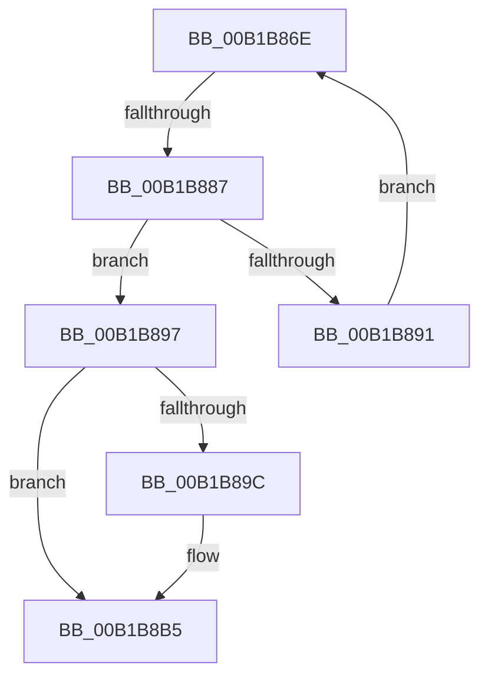

# sub_00B1B86E

- RVA: `0x00B1B86E`–`0x00B1B8C2` (길이 `84` bytes)
- VA: `0x0000000140B1B86E`
- 실행 섹션: `PAGE`
- PDB 이름 있음: `아니요`; PDB Function 태그: `아니요`
- unwind 정보 RVA: `0x00084878`
- 디코드: `20`개 명령, `84/84` bytes 표시
- 미해석 바이트: `0` (있으면 어셈블리에 `.byte`로 보존)

> 이 문서는 커널 이미지의 기계어와 PDB 기호를 분석해 생성했습니다. 4번과 5번은 함수 원형과 자료형을 바이너리 사용 방식에서 추정한 C 해석이며 원본 소스 복구 결과는 아닙니다.

## 1. Dependencies

- 직접 호출 지점: **2**; 고유 호출 대상: **2**
- 직접 호출자로 확인된 함수: **0**
- RIP 상대 이미지 참조: **0**

### Outgoing calls
- `0x00B1B87A` → [MiAddViewsForSection](../../text/32/MiAddViewsForSection_function_00324990.md) (function, `0x00324990`)
- `0x00B1B8AD` → [MiGetProtoPteAddress](../../text/32/MiGetProtoPteAddress_function_0032E970.md) (function, `0x0032E970`)

### Direct callers
- 이 함수 시작 RVA로 연결되는 직접 call은 확인되지 않았습니다. 간접 호출은 완전히 역산할 수 없습니다.

### Static image references
- 디코드된 RIP-relative 메모리 참조가 없습니다.

## 2. Other-region calls and transfers

- 다른 실행 섹션으로 향하는 call: **2**
  - `0x00B1B87A` → [MiAddViewsForSection](../../text/32/MiAddViewsForSection_function_00324990.md) (`PAGE` → `.text`)
  - `0x00B1B8AD` → [MiGetProtoPteAddress](../../text/32/MiGetProtoPteAddress_function_0032E970.md) (`PAGE` → `.text`)
- call이 아닌 외부 분기/꼬리 이동: **2**
  - `0x00B1B881` → [MiCommitPagefileBackedSection + 0xF0](../8C/MiCommitPagefileBackedSection_function_008CECC0.md) (`tail-transfer`)
  - `0x00B1B8BD` → [MiCommitPagefileBackedSection + 0xA6](../8C/MiCommitPagefileBackedSection_function_008CECC0.md) (`tail-transfer`)

## 3. Assembly (complete function range)

```asm
00B1B86E  BA 01 00 00 00                  mov edx, 1
00B1B873  48 8B CB                        mov rcx, rbx
00B1B876  44 8D 42 07                     lea r8d, [rdx + 7]
00B1B87A  E8 11 91 80 FF                  call 0x140324990
00B1B87F  85 C0                           test eax, eax
00B1B881  0F 88 29 35 DB FF               js 0x1408cedb0
00B1B887  48 3B 9C 24 A0 00 00 00         cmp rbx, qword ptr [rsp + 0xa0]
00B1B88F  74 06                           je 0x140b1b897
00B1B891  48 8B 5B 10                     mov rbx, qword ptr [rbx + 0x10]
00B1B895  EB D7                           jmp 0x140b1b86e
00B1B897  48 85 ED                        test rbp, rbp
00B1B89A  75 19                           jne 0x140b1b8b5
00B1B89C  4C 8D 8C 24 98 00 00 00         lea r9, [rsp + 0x98]
00B1B8A4  45 33 C0                        xor r8d, r8d
00B1B8A7  49 8B D7                        mov rdx, r15
00B1B8AA  48 8B CE                        mov rcx, rsi
00B1B8AD  E8 BE 30 81 FF                  call 0x14032e970
00B1B8B2  48 8B E8                        mov rbp, rax
00B1B8B5  48 8B 9C 24 A8 00 00 00         mov rbx, qword ptr [rsp + 0xa8]
00B1B8BD  E9 A4 34 DB FF                  jmp 0x1408ced66
```

## 4. C-style interpretation (structured pseudocode)

```c
__int64 __fastcall sub_00B1B86E(__int64 a1, __int64 a2, __int64 a3, __int64 a4, __int64 a5, __int64 a6, __int64 a7, __int64 a8, __int64 a9, __int64 a10, __int64 a11, __int64 a12, __int64 a13, __int64 a14, __int64 a15, __int64 a16, __int64 a17, __int64 a18, __int64 a19, __int64 a20, __int64 a21)
{
    __int64 result;
    __int64 v_rbp;

    result = MiAddViewsForSection(v_rbx, 1, 1 + 7, a4);
    if (v_rbx == a20) goto loc_00B1B897;
    goto loc_00B1B86E;
loc_00B1B897:
    if (v_rbp == 0) {
        a4 = a19;
        a3 = 0;
        a2 = v_r15;
        a1 = v_rsi;
        result = MiGetProtoPteAddress(a1, a2, a3, a4);
        v_rbp = result;
    }
}
```

## 5. (Beta) C Style

```c
int64_t sub_00B1B86E(int64_t Arg1, int64_t Arg2, int64_t Arg3, int64_t Arg4, uint64_t Arg5, uint64_t Arg6, uint64_t Arg7, uint64_t Arg8, uint64_t Arg9, uint64_t Arg10, uint64_t Arg11, uint64_t Arg12, uint64_t Arg13, uint64_t Arg14, uint64_t Arg15, uint64_t Arg16, uint64_t Arg17, uint64_t Arg18, int64_t Arg19, int64_t Arg20, int64_t Arg21)
{
    int64_t result;
    int64_t local_rbp;

    result = MiAddViewsForSection(local_rbx, 1, 1 + 7, Arg4);
    if (local_rbx == Arg20) goto loc_00B1B897;
    goto loc_00B1B86E;
loc_00B1B897:
    if (local_rbp == 0) {
        Arg4 = Arg19;
        Arg3 = 0;
        Arg2 = local_r15;
        Arg1 = local_rsi;
        result = MiGetProtoPteAddress(Arg1, Arg2, Arg3, Arg4);
        local_rbp = result;
    }
}
```

## 6. Execution-region graph

[열기: 2D/3D 그래프와 함수 탐색 컨트롤 패널](../../../control-panel.html?section=page&rva=0x00B1B86E&view=graph)

- 2D 그래프는 위에서 아래로 흐르고, 3D 그래프는 빈 공간을 드래그해 회전합니다. Shift+드래그는 이동, 휠은 확대·축소, 함수 노드 선택은 대상 보고서 이동입니다.

### Static fallback


