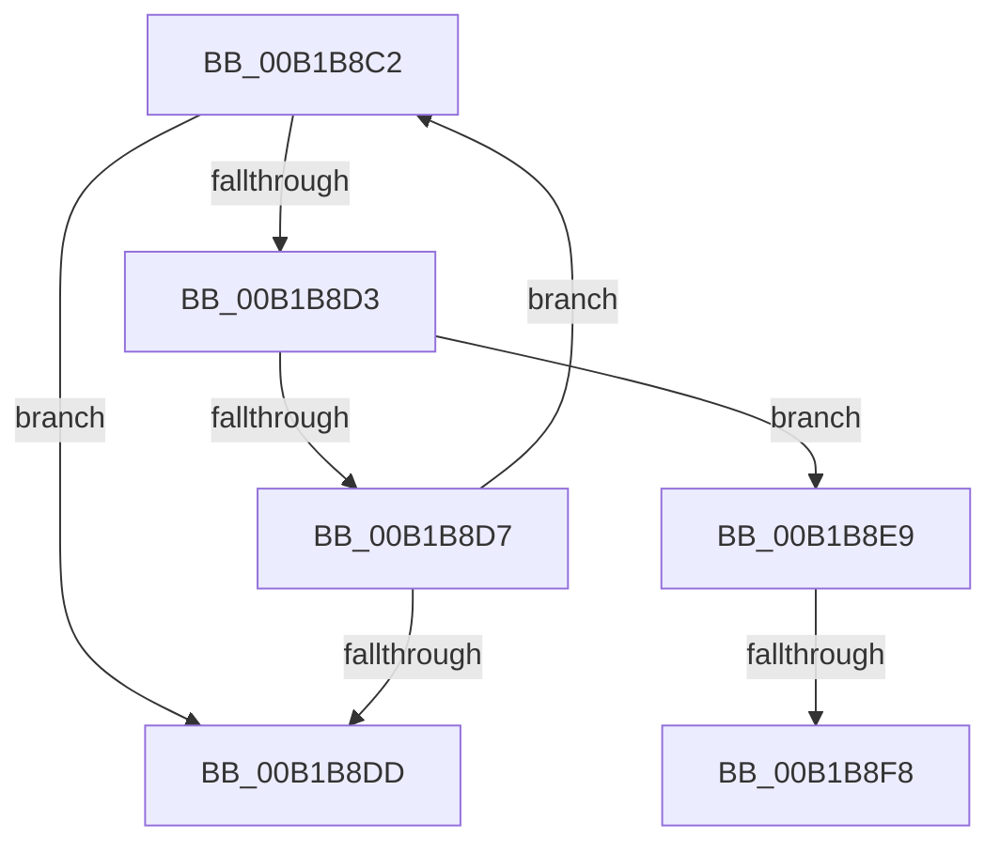

# sub_00B1B8C2

- RVA: `0x00B1B8C2`–`0x00B1B8FF` (길이 `61` bytes)
- VA: `0x0000000140B1B8C2`
- 실행 섹션: `PAGE`
- PDB 이름 있음: `아니요`; PDB Function 태그: `아니요`
- unwind 정보 RVA: `0x000849F8`
- 디코드: `19`개 명령, `61/61` bytes 표시
- 미해석 바이트: `0` (있으면 어셈블리에 `.byte`로 보존)

> 이 문서는 커널 이미지의 기계어와 PDB 기호를 분석해 생성했습니다. 4번과 5번은 함수 원형과 자료형을 바이너리 사용 방식에서 추정한 C 해석이며 원본 소스 복구 결과는 아닙니다.

## 1. Dependencies

- 직접 호출 지점: **1**; 고유 호출 대상: **1**
- 직접 호출자로 확인된 함수: **0**
- RIP 상대 이미지 참조: **0**

### Outgoing calls
- `0x00B1B8CA` → [MI_READ_PTE_LOCK_FREE](../../text/28/MI_READ_PTE_LOCK_FREE_function_002828A0.md) (function, `0x002828A0`)

### Direct callers
- 이 함수 시작 RVA로 연결되는 직접 call은 확인되지 않았습니다. 간접 호출은 완전히 역산할 수 없습니다.

### Static image references
- 디코드된 RIP-relative 메모리 참조가 없습니다.

## 2. Other-region calls and transfers

- 다른 실행 섹션으로 향하는 call: **1**
  - `0x00B1B8CA` → [MI_READ_PTE_LOCK_FREE](../../text/28/MI_READ_PTE_LOCK_FREE_function_002828A0.md) (`PAGE` → `.text`)
- call이 아닌 외부 분기/꼬리 이동: **3**
  - `0x00B1B8E4` → [MiMapProcessExecutable + 0xD2](../8C/MiMapProcessExecutable_function_008CFDB4.md) (`tail-transfer`)
  - `0x00B1B8F2` → [MiMapProcessExecutable + 0xD2](../8C/MiMapProcessExecutable_function_008CFDB4.md) (`tail-transfer`)
  - `0x00B1B8FA` → [MiMapProcessExecutable + 0xD2](../8C/MiMapProcessExecutable_function_008CFDB4.md) (`tail-transfer`)

## 3. Assembly (complete function range)

```asm
00B1B8C2  4A 8B 4C F5 07                  mov rcx, qword ptr [rbp + r14*8 + 7]
00B1B8C7  49 FF CE                        dec r14
00B1B8CA  E8 D1 6F 76 FF                  call 0x1402828a0
00B1B8CF  A8 01                           test al, 1
00B1B8D1  74 0A                           je 0x140b1b8dd
00B1B8D3  84 C0                           test al, al
00B1B8D5  78 12                           js 0x140b1b8e9
00B1B8D7  49 83 FE 01                     cmp r14, 1
00B1B8DB  75 E5                           jne 0x140b1b8c2
00B1B8DD  8B 03                           mov eax, dword ptr [rbx]
00B1B8DF  83 E0 EF                        and eax, 0xffffffef
00B1B8E2  89 03                           mov dword ptr [rbx], eax
00B1B8E4  E9 9D 45 DB FF                  jmp 0x1408cfe86
00B1B8E9  8B 03                           mov eax, dword ptr [rbx]
00B1B8EB  BF 01 00 00 00                  mov edi, 1
00B1B8F0  A8 20                           test al, 0x20
00B1B8F2  0F 85 8E 45 DB FF               jne 0x1408cfe86
00B1B8F8  33 FF                           xor edi, edi
00B1B8FA  E9 87 45 DB FF                  jmp 0x1408cfe86
```

## 4. C-style interpretation (structured pseudocode)

```c
__int64 __fastcall sub_00B1B8C2(void)
{
    __int64 result;
    __int64 v_r14;
    __int64 v_rdi;

    v_r14 = (v_r14) - 1;
    result = MI_READ_PTE_LOCK_FREE(*(unsigned __int64 *)(v_rbp + v_r14 * 8 + 7), a2, a3, a4);
    if ((((unsigned __int8)(result)) & (1)) == 0) goto loc_00B1B8DD;
    if (sign_flag) goto loc_00B1B8E9;
    if (v_r14 != 1) goto loc_00B1B8C2;
loc_00B1B8DD:
    result = (unsigned int)(((unsigned int)(*(unsigned int *)(v_rbx))) & (0xFFFFFFEFULL));
    *(unsigned int *)(v_rbx) = (unsigned int)(result);
loc_00B1B8E9:
    v_rdi = 0;
}
```

## 5. (Beta) C Style

```c
void sub_00B1B8C2(void)
{
    int64_t result;
    int64_t local_r14;
    int64_t local_rdi;

    local_r14 = (local_r14) - 1;
    result = MI_READ_PTE_LOCK_FREE(*(uint64_t *)(local_rbp + local_r14 * 8 + 0x7), a2, a3, a4);
    if ((((uint8_t)(result)) & (1)) == 0) goto loc_00B1B8DD;
    if (sign_flag) goto loc_00B1B8E9;
    if (local_r14 != 1) goto loc_00B1B8C2;
loc_00B1B8DD:
    result = (uint32_t)(((uint32_t)(*(uint32_t *)(local_rbx))) & (0xFFFFFFEFULL));
    *(uint32_t *)(local_rbx) = (uint32_t)(result);
loc_00B1B8E9:
    local_rdi = 0;
}
```

## 6. Execution-region graph

[열기: 2D/3D 그래프와 함수 탐색 컨트롤 패널](../../../control-panel.html?section=page&rva=0x00B1B8C2&view=graph)

- 2D 그래프는 위에서 아래로 흐르고, 3D 그래프는 빈 공간을 드래그해 회전합니다. Shift+드래그는 이동, 휠은 확대·축소, 함수 노드 선택은 대상 보고서 이동입니다.

### Static fallback


