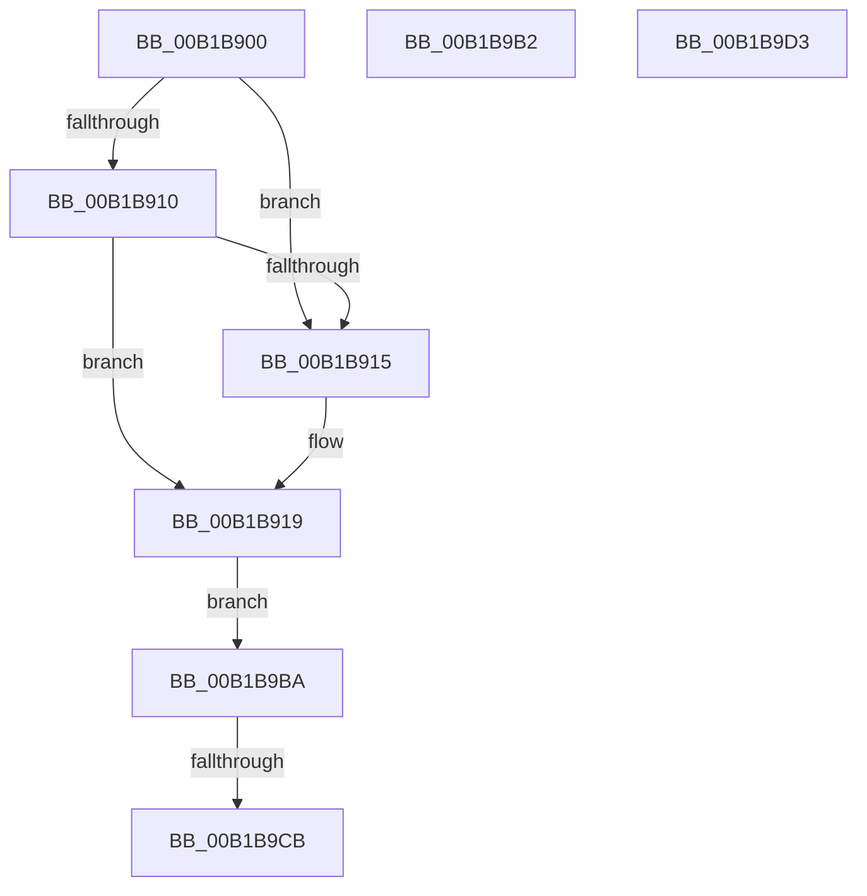

# sub_00B1B900

- RVA: `0x00B1B900`–`0x00B1B9DE` (길이 `222` bytes)
- VA: `0x0000000140B1B900`
- 실행 섹션: `PAGE`
- PDB 이름 있음: `아니요`; PDB Function 태그: `아니요`
- unwind 정보 RVA: `0x00084E0C`
- 디코드: `52`개 명령, `222/222` bytes 표시
- 미해석 바이트: `0` (있으면 어셈블리에 `.byte`로 보존)

> 이 문서는 커널 이미지의 기계어와 PDB 기호를 분석해 생성했습니다. 4번과 5번은 함수 원형과 자료형을 바이너리 사용 방식에서 추정한 C 해석이며 원본 소스 복구 결과는 아닙니다.

## 1. Dependencies

- 직접 호출 지점: **0**; 고유 호출 대상: **0**
- 직접 호출자로 확인된 함수: **0**
- RIP 상대 이미지 참조: **0**

### Outgoing calls
- 직접 디코드된 call 명령이 없습니다.

### Direct callers
- 이 함수 시작 RVA로 연결되는 직접 call은 확인되지 않았습니다. 간접 호출은 완전히 역산할 수 없습니다.

### Static image references
- 디코드된 RIP-relative 메모리 참조가 없습니다.

## 2. Other-region calls and transfers

- 다른 실행 섹션으로 향하는 call: **0**
- call이 아닌 외부 분기/꼬리 이동: **4**
  - `0x00B1B9B5` → [WbValidateHeapExecuteCallArguments + 0x1F8](../8D/WbValidateHeapExecuteCallArguments_function_008D2C50.md) (`tail-transfer`)
  - `0x00B1B9C5` → [WbValidateHeapExecuteCallArguments + 0x212](../8D/WbValidateHeapExecuteCallArguments_function_008D2C50.md) (`tail-transfer`)
  - `0x00B1B9CE` → [WbValidateHeapExecuteCallArguments + 0x15B](../8D/WbValidateHeapExecuteCallArguments_function_008D2C50.md) (`tail-transfer`)
  - `0x00B1B9D9` → [WbValidateHeapExecuteCallArguments + 0x1E7](../8D/WbValidateHeapExecuteCallArguments_function_008D2C50.md) (`tail-transfer`)

## 3. Assembly (complete function range)

```asm
00B1B900  48 8B 46 08                     mov rax, qword ptr [rsi + 8]
00B1B904  48 8D 88 F8 00 00 00            lea rcx, [rax + 0xf8]
00B1B90B  49 3B C9                        cmp rcx, r9
00B1B90E  77 05                           ja 0x140b1b915
00B1B910  48 3B C8                        cmp rcx, rax
00B1B913  73 04                           jae 0x140b1b919
00B1B915  41 0F B6 01                     movzx eax, byte ptr [r9]
00B1B919  48 8B 46 08                     mov rax, qword ptr [rsi + 8]
00B1B91D  0F 10 00                        movups xmm0, xmmword ptr [rax]
00B1B920  41 0F 11 00                     movups xmmword ptr [r8], xmm0
00B1B924  0F 10 48 10                     movups xmm1, xmmword ptr [rax + 0x10]
00B1B928  41 0F 11 48 10                  movups xmmword ptr [r8 + 0x10], xmm1
00B1B92D  0F 10 40 20                     movups xmm0, xmmword ptr [rax + 0x20]
00B1B931  41 0F 11 40 20                  movups xmmword ptr [r8 + 0x20], xmm0
00B1B936  0F 10 48 30                     movups xmm1, xmmword ptr [rax + 0x30]
00B1B93A  41 0F 11 48 30                  movups xmmword ptr [r8 + 0x30], xmm1
00B1B93F  0F 10 40 40                     movups xmm0, xmmword ptr [rax + 0x40]
00B1B943  41 0F 11 40 40                  movups xmmword ptr [r8 + 0x40], xmm0
00B1B948  0F 10 48 50                     movups xmm1, xmmword ptr [rax + 0x50]
00B1B94C  41 0F 11 48 50                  movups xmmword ptr [r8 + 0x50], xmm1
00B1B951  0F 10 40 60                     movups xmm0, xmmword ptr [rax + 0x60]
00B1B955  41 0F 11 40 60                  movups xmmword ptr [r8 + 0x60], xmm0
00B1B95A  49 83 E8 80                     sub r8, -0x80
00B1B95E  0F 10 48 70                     movups xmm1, xmmword ptr [rax + 0x70]
00B1B962  41 0F 11 48 F0                  movups xmmword ptr [r8 - 0x10], xmm1
00B1B967  48 83 E8 80                     sub rax, -0x80
00B1B96B  0F 10 00                        movups xmm0, xmmword ptr [rax]
00B1B96E  41 0F 11 00                     movups xmmword ptr [r8], xmm0
00B1B972  0F 10 48 10                     movups xmm1, xmmword ptr [rax + 0x10]
00B1B976  41 0F 11 48 10                  movups xmmword ptr [r8 + 0x10], xmm1
00B1B97B  0F 10 40 20                     movups xmm0, xmmword ptr [rax + 0x20]
00B1B97F  41 0F 11 40 20                  movups xmmword ptr [r8 + 0x20], xmm0
00B1B984  0F 10 48 30                     movups xmm1, xmmword ptr [rax + 0x30]
00B1B988  41 0F 11 48 30                  movups xmmword ptr [r8 + 0x30], xmm1
00B1B98D  0F 10 40 40                     movups xmm0, xmmword ptr [rax + 0x40]
00B1B991  41 0F 11 40 40                  movups xmmword ptr [r8 + 0x40], xmm0
00B1B996  0F 10 48 50                     movups xmm1, xmmword ptr [rax + 0x50]
00B1B99A  41 0F 11 48 50                  movups xmmword ptr [r8 + 0x50], xmm1
00B1B99F  0F 10 40 60                     movups xmm0, xmmword ptr [rax + 0x60]
00B1B9A3  41 0F 11 40 60                  movups xmmword ptr [r8 + 0x60], xmm0
00B1B9A8  48 8B 40 70                     mov rax, qword ptr [rax + 0x70]
00B1B9AC  49 89 40 70                     mov qword ptr [r8 + 0x70], rax
00B1B9B0  EB 08                           jmp 0x140b1b9ba
00B1B9B2  44 8B F0                        mov r14d, eax
00B1B9B5  E9 8E 74 DB FF                  jmp 0x1408d2e48
00B1B9BA  44 8B 4B 48                     mov r9d, dword ptr [rbx + 0x48]
00B1B9BE  41 F7 C1 FF FF FF 0F            test r9d, 0xfffffff
00B1B9C5  0F 86 97 74 DB FF               jbe 0x1408d2e62
00B1B9CB  8B 53 08                        mov edx, dword ptr [rbx + 8]
00B1B9CE  E9 D8 73 DB FF                  jmp 0x1408d2dab
00B1B9D3  89 93 24 01 00 00               mov dword ptr [rbx + 0x124], edx
00B1B9D9  E9 59 74 DB FF                  jmp 0x1408d2e37
```

## 4. C-style interpretation (structured pseudocode)

```c
__int64 __fastcall sub_00B1B900(__int64 a1, __int64 a2, __int64 a3, __int64 a4)
{
    __int64 result;

    if ((*(unsigned __int64 *)(v_rsi + 8) + 248) > a4) goto loc_00B1B915;
    result = *(unsigned __int64 *)(v_rsi + 8);
    if ((*(unsigned __int64 *)(v_rsi + 8) + 248) < (*(unsigned __int64 *)(v_rsi + 8))) {
        result = *(unsigned __int8 *)(a4);
    }
    *(unsigned __int64 *)(a3) = v_xmm0;
    *(unsigned __int64 *)(a3 + 16) = v_xmm1;
    *(unsigned __int64 *)(a3 + 32) = v_xmm0;
    *(unsigned __int64 *)(a3 + 48) = v_xmm1;
    *(unsigned __int64 *)(a3 + 64) = v_xmm0;
    *(unsigned __int64 *)(a3 + 80) = v_xmm1;
    *(unsigned __int64 *)(a3 + 96) = v_xmm0;
    a3 = (a3) - (-128);
    *(unsigned __int64 *)(a3 - 16) = v_xmm1;
    result = (*(unsigned __int64 *)(v_rsi + 8)) - (-128);
    *(unsigned __int64 *)(a3) = v_xmm0;
    *(unsigned __int64 *)(a3 + 16) = v_xmm1;
    *(unsigned __int64 *)(a3 + 32) = v_xmm0;
    *(unsigned __int64 *)(a3 + 48) = v_xmm1;
    *(unsigned __int64 *)(a3 + 64) = v_xmm0;
    *(unsigned __int64 *)(a3 + 80) = v_xmm1;
    *(unsigned __int64 *)(a3 + 96) = v_xmm0;
    *(unsigned __int64 *)(a3 + 112) = *(unsigned __int64 *)(result + 112);
    goto loc_00B1B9BA;
loc_00B1B9BA:
}
```

## 5. (Beta) C Style

```c
int64_t sub_00B1B900(int64_t Arg1, int64_t Arg2, void *Arg3, void *Arg4)
{
    uint8_t *arg3 = (uint8_t *)Arg3;
    uint8_t *arg4 = (uint8_t *)Arg4;

    int64_t result;

    if ((*(uint64_t *)(local_rsi + 0x8) + 248) > Arg4) goto loc_00B1B915;
    result = *(uint64_t *)(local_rsi + 0x8);
    if ((*(uint64_t *)(local_rsi + 0x8) + 248) < (*(uint64_t *)(local_rsi + 0x8))) {
        result = *(uint8_t *)(arg4);
    }
    *(uint64_t *)(arg3) = v_xmm0;
    *(uint64_t *)(arg3 + 0x10) = v_xmm1;
    *(uint64_t *)(arg3 + 0x20) = v_xmm0;
    *(uint64_t *)(arg3 + 0x30) = v_xmm1;
    *(uint64_t *)(arg3 + 0x40) = v_xmm0;
    *(uint64_t *)(arg3 + 0x50) = v_xmm1;
    *(uint64_t *)(arg3 + 0x60) = v_xmm0;
    Arg3 = (Arg3) - (-128);
    *(uint64_t *)(arg3 - 0x10) = v_xmm1;
    result = (*(uint64_t *)(local_rsi + 0x8)) - (-128);
    *(uint64_t *)(arg3) = v_xmm0;
    *(uint64_t *)(arg3 + 0x10) = v_xmm1;
    *(uint64_t *)(arg3 + 0x20) = v_xmm0;
    *(uint64_t *)(arg3 + 0x30) = v_xmm1;
    *(uint64_t *)(arg3 + 0x40) = v_xmm0;
    *(uint64_t *)(arg3 + 0x50) = v_xmm1;
    *(uint64_t *)(arg3 + 0x60) = v_xmm0;
    *(uint64_t *)(arg3 + 0x70) = *(uint64_t *)(result + 0x70);
    goto loc_00B1B9BA;
loc_00B1B9BA:
}
```

### 관측된 메모리 오프셋

구조체 형식이 확인되지 않은 접근은 인자 기준의 오프셋으로만 기록했습니다.

| 기준 인자 | 오프셋 표현 | 폭 (bit) | 접근 |
|---|---:|---:|---|
| `Arg3` | `- 0x10` | `128` | `R` |
| `Arg3` | `+ 0x0` | `128` | `R` |
| `Arg3` | `+ 0x10` | `128` | `R` |
| `Arg3` | `+ 0x20` | `128` | `R` |
| `Arg3` | `+ 0x30` | `128` | `R` |
| `Arg3` | `+ 0x40` | `128` | `R` |
| `Arg3` | `+ 0x50` | `128` | `R` |
| `Arg3` | `+ 0x60` | `128` | `R` |
| `Arg3` | `+ 0x70` | `64` | `W` |
| `Arg4` | `+ 0x0` | `8` | `R` |

## 6. Execution-region graph

[열기: 2D/3D 그래프와 함수 탐색 컨트롤 패널](../../../control-panel.html?section=page&rva=0x00B1B900&view=graph)

- 2D 그래프는 위에서 아래로 흐르고, 3D 그래프는 빈 공간을 드래그해 회전합니다. Shift+드래그는 이동, 휠은 확대·축소, 함수 노드 선택은 대상 보고서 이동입니다.

### Static fallback


