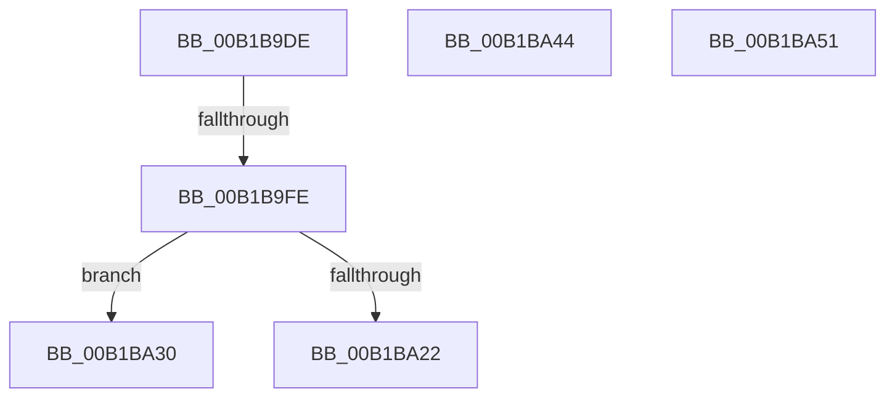

# sub_00B1B9DE

- RVA: `0x00B1B9DE`–`0x00B1BA61` (길이 `131` bytes)
- VA: `0x0000000140B1B9DE`
- 실행 섹션: `PAGE`
- PDB 이름 있음: `아니요`; PDB Function 태그: `아니요`
- unwind 정보 RVA: `0x00085128`
- 디코드: `32`개 명령, `131/131` bytes 표시
- 미해석 바이트: `0` (있으면 어셈블리에 `.byte`로 보존)

> 이 문서는 커널 이미지의 기계어와 PDB 기호를 분석해 생성했습니다. 4번과 5번은 함수 원형과 자료형을 바이너리 사용 방식에서 추정한 C 해석이며 원본 소스 복구 결과는 아닙니다.

## 1. Dependencies

- 직접 호출 지점: **4**; 고유 호출 대상: **4**
- 직접 호출자로 확인된 함수: **0**
- RIP 상대 이미지 참조: **0**

### Outgoing calls
- `0x00B1B9EB` → [sub_008D1C2C](../8D/Unknown_function_008D1C2C.md) (function, `0x008D1C2C`)
- `0x00B1BA13` → [IoAllocateMdl](../../text/29/IoAllocateMdl_function_0029EBF0.md) (function, `0x0029EBF0`)
- `0x00B1BA35` → [MmProbeAndLockPagesPrivate](../../text/48/MmProbeAndLockPagesPrivate_function_0048ED68.md) (function, `0x0048ED68`)
- `0x00B1BA56` → [IoFreeMdl](../../text/29/IoFreeMdl_function_0029EA80.md) (function, `0x0029EA80`)

### Direct callers
- 이 함수 시작 RVA로 연결되는 직접 call은 확인되지 않았습니다. 간접 호출은 완전히 역산할 수 없습니다.

### Static image references
- 디코드된 RIP-relative 메모리 참조가 없습니다.

## 2. Other-region calls and transfers

- 다른 실행 섹션으로 향하는 call: **3**
  - `0x00B1BA13` → [IoAllocateMdl](../../text/29/IoAllocateMdl_function_0029EBF0.md) (`PAGE` → `.text`)
  - `0x00B1BA35` → [MmProbeAndLockPagesPrivate](../../text/48/MmProbeAndLockPagesPrivate_function_0048ED68.md) (`PAGE` → `.text`)
  - `0x00B1BA56` → [IoFreeMdl](../../text/29/IoFreeMdl_function_0029EA80.md) (`PAGE` → `.text`)
- call이 아닌 외부 분기/꼬리 이동: **5**
  - `0x00B1B9F8` → [WbCreateHeapExecutedBlock + 0x6E1](../8D/WbCreateHeapExecutedBlock_function_008D4BE8.md) (`tail-transfer`)
  - `0x00B1BA2B` → [WbCreateHeapExecutedBlock + 0x6E1](../8D/WbCreateHeapExecutedBlock_function_008D4BE8.md) (`tail-transfer`)
  - `0x00B1BA3F` → [WbCreateHeapExecutedBlock + 0x15F](../8D/WbCreateHeapExecutedBlock_function_008D4BE8.md) (`tail-transfer`)
  - `0x00B1BA4C` → [WbCreateHeapExecutedBlock + 0x6E1](../8D/WbCreateHeapExecutedBlock_function_008D4BE8.md) (`tail-transfer`)
  - `0x00B1BA5C` → [WbCreateHeapExecutedBlock + 0x733](../8D/WbCreateHeapExecutedBlock_function_008D4BE8.md) (`tail-transfer`)

## 3. Assembly (complete function range)

```asm
00B1B9DE  48 8D 4E 10                     lea rcx, [rsi + 0x10]
00B1B9E2  41 BC F8 00 00 00               mov r12d, 0xf8
00B1B9E8  41 8B D4                        mov edx, r12d
00B1B9EB  E8 3C 62 DB FF                  call 0x1408d1c2c
00B1B9F0  8B D8                           mov ebx, eax
00B1B9F2  89 44 24 40                     mov dword ptr [rsp + 0x40], eax
00B1B9F6  85 C0                           test eax, eax
00B1B9F8  0F 88 CB 98 DB FF               js 0x1408d52c9
00B1B9FE  48 89 7C 24 20                  mov qword ptr [rsp + 0x20], rdi
00B1BA03  45 33 C9                        xor r9d, r9d
00B1BA06  45 33 C0                        xor r8d, r8d
00B1BA09  41 8B D4                        mov edx, r12d
00B1BA0C  48 8B 8E 48 01 00 00            mov rcx, qword ptr [rsi + 0x148]
00B1BA13  E8 D8 31 78 FF                  call 0x14029ebf0
00B1BA18  48 89 44 24 60                  mov qword ptr [rsp + 0x60], rax
00B1BA1D  48 85 C0                        test rax, rax
00B1BA20  75 0E                           jne 0x140b1ba30
00B1BA22  BB 17 00 00 C0                  mov ebx, 0xc0000017
00B1BA27  89 5C 24 40                     mov dword ptr [rsp + 0x40], ebx
00B1BA2B  E9 99 98 DB FF                  jmp 0x1408d52c9
00B1BA30  48 8B 4C 24 60                  mov rcx, qword ptr [rsp + 0x60]
00B1BA35  E8 2E 33 97 FF                  call 0x14048ed68
00B1BA3A  44 89 74 24 58                  mov dword ptr [rsp + 0x58], r14d
00B1BA3F  E9 03 93 DB FF                  jmp 0x1408d4d47
00B1BA44  8B D8                           mov ebx, eax
00B1BA46  89 44 24 40                     mov dword ptr [rsp + 0x40], eax
00B1BA4A  33 FF                           xor edi, edi
00B1BA4C  E9 78 98 DB FF                  jmp 0x1408d52c9
00B1BA51  48 8B 4C 24 78                  mov rcx, qword ptr [rsp + 0x78]
00B1BA56  E8 25 30 78 FF                  call 0x14029ea80
00B1BA5B  90                              nop
00B1BA5C  E9 BA 98 DB FF                  jmp 0x1408d531b
```

## 4. C-style interpretation (structured pseudocode)

```c
__int64 __fastcall sub_00B1B9DE(__int64 a1, __int64 a2, int a3, int a4, __int64 a5, __int64 a6, __int64 a7, __int64 a8, __int64 a9, __int64 a10, __int64 a11, __int64 a12)
{
    __int64 result;
    unsigned __int64 v_stack_p20;
    unsigned int v_stack_p40;
    unsigned int v_stack_p58;
    unsigned __int64 v_stack_p60;
    unsigned __int64 v_stack_p78;

    result = sub_008D1C2C(v_rsi + 16, 248, a3, a4);
    v_stack_p40 = (unsigned int)(result);
    v_stack_p20 = v_rdi;
    a4 = 0;
    a3 = 0;
    result = IoAllocateMdl(*(unsigned __int64 *)(v_rsi + 328), 248, a3, a4);
    v_stack_p60 = result;
    if (result != 0) goto loc_00B1BA30;
    v_stack_p40 = (unsigned int)((unsigned int)(0xC0000017ULL));
loc_00B1BA30:
    result = MmProbeAndLockPagesPrivate(a12, 248, a3, a4);
    v_stack_p58 = (unsigned int)(v_r14);
}
```

## 5. (Beta) C Style

```c
int64_t sub_00B1B9DE(int64_t Arg1, int64_t Arg2, int32_t Arg3, int32_t Arg4, uint64_t Arg5, uint64_t Arg6, uint64_t Arg7, uint64_t Arg8, uint64_t Arg9, uint64_t Arg10, uint64_t Arg11, int64_t Arg12)
{
    int64_t result;
    uint64_t v_stack_p20;
    uint32_t v_stack_p40;
    uint32_t v_stack_p58;
    uint64_t v_stack_p60;
    uint64_t v_stack_p78;

    result = sub_008D1C2C(local_rsi + 16, 248, Arg3, Arg4);
    v_stack_p40 = (uint32_t)(result);
    v_stack_p20 = local_rdi;
    Arg4 = 0;
    Arg3 = 0;
    result = IoAllocateMdl(*(uint64_t *)(local_rsi + 0x148), 248, Arg3, Arg4);
    v_stack_p60 = result;
    if (result != 0) goto loc_00B1BA30;
    v_stack_p40 = (uint32_t)((uint32_t)(0xC0000017ULL));
loc_00B1BA30:
    result = MmProbeAndLockPagesPrivate(Arg12, 248, Arg3, Arg4);
    v_stack_p58 = (uint32_t)(local_r14);
}
```

## 6. Execution-region graph

[열기: 2D/3D 그래프와 함수 탐색 컨트롤 패널](../../../control-panel.html?section=page&rva=0x00B1B9DE&view=graph)

- 2D 그래프는 위에서 아래로 흐르고, 3D 그래프는 빈 공간을 드래그해 회전합니다. Shift+드래그는 이동, 휠은 확대·축소, 함수 노드 선택은 대상 보고서 이동입니다.

### Static fallback


