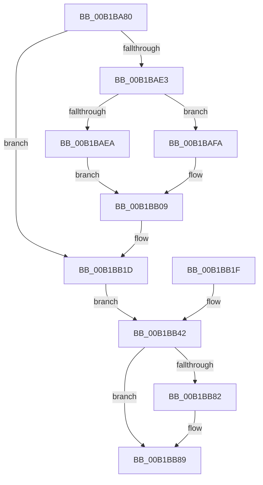

# sub_00B1BA80

- RVA: `0x00B1BA80`–`0x00B1BBA0` (길이 `288` bytes)
- VA: `0x0000000140B1BA80`
- 실행 섹션: `PAGE`
- PDB 이름 있음: `아니요`; PDB Function 태그: `아니요`
- unwind 정보 RVA: `0x00085244`
- 디코드: `54`개 명령, `288/288` bytes 표시
- 미해석 바이트: `0` (있으면 어셈블리에 `.byte`로 보존)

> 이 문서는 커널 이미지의 기계어와 PDB 기호를 분석해 생성했습니다. 4번과 5번은 함수 원형과 자료형을 바이너리 사용 방식에서 추정한 C 해석이며 원본 소스 복구 결과는 아닙니다.

## 1. Dependencies

- 직접 호출 지점: **6**; 고유 호출 대상: **6**
- 직접 호출자로 확인된 함수: **0**
- RIP 상대 이미지 참조: **0**

### Outgoing calls
- `0x00B1BA8E` → [memset](../../text/6C/memset_function_006C6C40.md) (function, `0x006C6C40`)
- `0x00B1BA9A` → [DbgkpSectionToFileHandle](../A9/DbgkpSectionToFileHandle_function_00A9AE08.md) (function, `0x00A9AE08`)
- `0x00B1BAD6` → [RtlImageNtHeader](../../text/44/RtlImageNtHeader_function_00443B60.md) (function, `0x00443B60`)
- `0x00B1BB70` → [DbgkpSendApiMessage](../A7/DbgkpSendApiMessage_function_00A79458.md) (function, `0x00A79458`)
- `0x00B1BB84` → [ObCloseHandle](../8A/ObCloseHandle_function_008A1870.md) (function, `0x008A1870`)
- `0x00B1BB95` → [DbgkSendSystemDllMessages](../A1/DbgkSendSystemDllMessages_function_00A10C04.md) (function, `0x00A10C04`)

### Direct callers
- 이 함수 시작 RVA로 연결되는 직접 call은 확인되지 않았습니다. 간접 호출은 완전히 역산할 수 없습니다.

### Static image references
- 디코드된 RIP-relative 메모리 참조가 없습니다.

## 2. Other-region calls and transfers

- 다른 실행 섹션으로 향하는 call: **2**
  - `0x00B1BA8E` → [memset](../../text/6C/memset_function_006C6C40.md) (`PAGE` → `.text`)
  - `0x00B1BAD6` → [RtlImageNtHeader](../../text/44/RtlImageNtHeader_function_00443B60.md) (`PAGE` → `.text`)
- call이 아닌 외부 분기/꼬리 이동: **1**
  - `0x00B1BB9B` → [DbgkCreateThread + 0x320](../8D/DbgkCreateThread_function_008D5E34.md) (`tail-transfer`)

## 3. Assembly (complete function range)

```asm
00B1BA80  33 D2                           xor edx, edx
00B1BA82  44 8D 42 60                     lea r8d, [rdx + 0x60]
00B1BA86  48 8D 8C 24 90 00 00 00         lea rcx, [rsp + 0x90]
00B1BA8E  E8 AD B1 BA FF                  call 0x1406c6c40
00B1BA93  48 8B 8F A8 02 00 00            mov rcx, qword ptr [rdi + 0x2a8]
00B1BA9A  E8 69 F3 F7 FF                  call 0x140a9ae08
00B1BA9F  48 89 84 24 C8 00 00 00         mov qword ptr [rsp + 0xc8], rax
00B1BAA7  48 8B 87 B0 02 00 00            mov rax, qword ptr [rdi + 0x2b0]
00B1BAAE  48 89 84 24 D0 00 00 00         mov qword ptr [rsp + 0xd0], rax
00B1BAB6  48 83 A4 24 E8 00 00 00 00      and qword ptr [rsp + 0xe8], 0
00B1BABF  83 A4 24 D8 00 00 00 00         and dword ptr [rsp + 0xd8], 0
00B1BAC7  83 A4 24 DC 00 00 00 00         and dword ptr [rsp + 0xdc], 0
00B1BACF  48 8B 8F B0 02 00 00            mov rcx, qword ptr [rdi + 0x2b0]
00B1BAD6  E8 85 80 92 FF                  call 0x140443b60
00B1BADB  48 8B D0                        mov rdx, rax
00B1BADE  48 85 C0                        test rax, rax
00B1BAE1  74 3A                           je 0x140b1bb1d
00B1BAE3  80 7C 24 20 00                  cmp byte ptr [rsp + 0x20], 0
00B1BAE8  74 10                           je 0x140b1bafa
00B1BAEA  8B 48 34                        mov ecx, dword ptr [rax + 0x34]
00B1BAED  03 48 28                        add ecx, dword ptr [rax + 0x28]
00B1BAF0  48 89 8C 24 E8 00 00 00         mov qword ptr [rsp + 0xe8], rcx
00B1BAF8  EB 0F                           jmp 0x140b1bb09
00B1BAFA  8B 40 28                        mov eax, dword ptr [rax + 0x28]
00B1BAFD  48 03 42 30                     add rax, qword ptr [rdx + 0x30]
00B1BB01  48 89 84 24 E8 00 00 00         mov qword ptr [rsp + 0xe8], rax
00B1BB09  8B 42 0C                        mov eax, dword ptr [rdx + 0xc]
00B1BB0C  89 84 24 D8 00 00 00            mov dword ptr [rsp + 0xd8], eax
00B1BB13  8B 42 10                        mov eax, dword ptr [rdx + 0x10]
00B1BB16  89 84 24 DC 00 00 00            mov dword ptr [rsp + 0xdc], eax
00B1BB1D  EB 23                           jmp 0x140b1bb42
00B1BB1F  48 83 A4 24 E8 00 00 00 00      and qword ptr [rsp + 0xe8], 0
00B1BB28  83 A4 24 D8 00 00 00 00         and dword ptr [rsp + 0xd8], 0
00B1BB30  83 A4 24 DC 00 00 00 00         and dword ptr [rsp + 0xdc], 0
00B1BB38  48 8B 7C 24 38                  mov rdi, qword ptr [rsp + 0x38]
00B1BB3D  4C 8B 74 24 40                  mov r14, qword ptr [rsp + 0x40]
00B1BB42  C7 84 24 90 00 00 00 38 00 60 00  mov dword ptr [rsp + 0x90], 0x600038
00B1BB4D  C7 84 24 94 00 00 00 08 00 00 00  mov dword ptr [rsp + 0x94], 8
00B1BB58  C7 84 24 B8 00 00 00 02 00 00 00  mov dword ptr [rsp + 0xb8], 2
00B1BB63  4C 8D 84 24 90 00 00 00         lea r8, [rsp + 0x90]
00B1BB6B  33 D2                           xor edx, edx
00B1BB6D  48 8B CF                        mov rcx, rdi
00B1BB70  E8 E3 D8 F5 FF                  call 0x140a79458
00B1BB75  48 8B 8C 24 C8 00 00 00         mov rcx, qword ptr [rsp + 0xc8]
00B1BB7D  48 85 C9                        test rcx, rcx
00B1BB80  74 07                           je 0x140b1bb89
00B1BB82  33 D2                           xor edx, edx
00B1BB84  E8 E7 5C D8 FF                  call 0x1408a1870
00B1BB89  4C 8D 84 24 90 00 00 00         lea r8, [rsp + 0x90]
00B1BB91  33 D2                           xor edx, edx
00B1BB93  33 C9                           xor ecx, ecx
00B1BB95  E8 6A 50 EF FF                  call 0x140a10c04
00B1BB9A  90                              nop
00B1BB9B  E9 B4 A5 DB FF                  jmp 0x1408d6154
```

## 4. C-style interpretation (structured pseudocode)

```c
__int64 __fastcall sub_00B1BA80(__int64 a1, int a2, __int64 a3, __int64 a4, __int64 a5, __int64 a6, __int64 a7, __int64 a8, __int64 a9, __int64 a10, __int64 a11, __int64 a12, __int64 a13, __int64 a14, __int64 a15, __int64 a16, __int64 a17, __int64 a18, __int64 a19, __int64 a20, __int64 a21, __int64 a22, __int64 a23, __int64 a24, __int64 a25, __int64 a26, unsigned int a27, __int64 a28, __int64 a29)
{
    __int64 result;
    unsigned __int8 v_stack_p20;
    unsigned __int64 v_stack_p38;
    unsigned __int64 v_stack_p40;
    unsigned int v_stack_p90;
    unsigned int v_stack_p94;
    unsigned int v_stack_pB8;
    unsigned __int64 v_stack_pC8;
    unsigned __int64 v_stack_pD0;
    unsigned int v_stack_pD8;
    unsigned int v_stack_pDC;
    unsigned __int64 v_stack_pE8;

    a2 = 0;
    result = memset(a18, a2, a2 + 96, a4);
    result = DbgkpSectionToFileHandle(*(unsigned __int64 *)(v_rdi + 680), a2, a2 + 96, a4);
    v_stack_pC8 = result;
    v_stack_pD0 = *(unsigned __int64 *)(v_rdi + 688);
    result = RtlImageNtHeader(*(unsigned __int64 *)(v_rdi + 688), a2, a2 + 96, a4);
    if (result == 0) goto loc_00B1BB1D;
    if (v_stack_p20 == 0) goto loc_00B1BAFA;
    a1 = (unsigned int)(((unsigned int)(*(unsigned int *)(result + 52))) + (*(unsigned int *)(result + 40)));
    v_stack_pE8 = a1;
    goto loc_00B1BB09;
loc_00B1BAFA:
    result = ((unsigned int)(*(unsigned int *)(result + 40))) + (*(unsigned __int64 *)(result + 48));
    v_stack_pE8 = result;
loc_00B1BB09:
    v_stack_pD8 = (unsigned int)((unsigned int)(*(unsigned int *)(result + 12)));
    v_stack_pDC = (unsigned int)((unsigned int)(*(unsigned int *)(result + 16)));
loc_00B1BB1D:
    goto loc_00B1BB42;
loc_00B1BB42:
    v_stack_p90 = 0x600038ULL;
    v_stack_p94 = 8;
    v_stack_pB8 = 2;
    a2 = 0;
    result = DbgkpSendApiMessage(v_rdi, a2, a18, a4);
    if (a25 != 0) {
        a2 = 0;
        result = ObCloseHandle(a25, a2, a18, a4);
    }
    a2 = 0;
    a1 = 0;
    result = DbgkSendSystemDllMessages(a1, a2, a18, a4);
}
```

## 5. (Beta) C Style

```c
int64_t sub_00B1BA80(int64_t Arg1, int32_t Arg2, int64_t Arg3, int64_t Arg4, uint64_t Arg5, uint64_t Arg6, uint64_t Arg7, uint64_t Arg8, uint64_t Arg9, uint64_t Arg10, uint64_t Arg11, uint64_t Arg12, uint64_t Arg13, uint64_t Arg14, uint64_t Arg15, uint64_t Arg16, uint64_t Arg17, int64_t Arg18, uint64_t Arg19, uint64_t Arg20, uint64_t Arg21, uint64_t Arg22, uint64_t Arg23, uint64_t Arg24, int64_t Arg25, uint64_t Arg26, uint32_t Arg27, uint64_t Arg28, int64_t Arg29)
{
    int64_t result;
    uint8_t v_stack_p20;
    uint64_t v_stack_p38;
    uint64_t v_stack_p40;
    uint32_t v_stack_p90;
    uint32_t v_stack_p94;
    uint32_t v_stack_pB8;
    uint64_t v_stack_pC8;
    uint64_t v_stack_pD0;
    uint32_t v_stack_pD8;
    uint32_t v_stack_pDC;
    uint64_t v_stack_pE8;

    Arg2 = 0;
    result = memset(Arg18, Arg2, Arg2 + 96, Arg4);
    result = DbgkpSectionToFileHandle(*(uint64_t *)(local_rdi + 0x2A8), Arg2, Arg2 + 96, Arg4);
    v_stack_pC8 = result;
    v_stack_pD0 = *(uint64_t *)(local_rdi + 0x2B0);
    result = RtlImageNtHeader(*(uint64_t *)(local_rdi + 0x2B0), Arg2, Arg2 + 96, Arg4);
    if (result == 0) goto loc_00B1BB1D;
    if (v_stack_p20 == 0) goto loc_00B1BAFA;
    Arg1 = (uint32_t)(((uint32_t)(*(uint32_t *)(result + 0x34))) + (*(uint32_t *)(result + 0x28)));
    v_stack_pE8 = Arg1;
    goto loc_00B1BB09;
loc_00B1BAFA:
    result = ((uint32_t)(*(uint32_t *)(result + 0x28))) + (*(uint64_t *)(result + 0x30));
    v_stack_pE8 = result;
loc_00B1BB09:
    v_stack_pD8 = (uint32_t)((uint32_t)(*(uint32_t *)(result + 0xC)));
    v_stack_pDC = (uint32_t)((uint32_t)(*(uint32_t *)(result + 0x10)));
loc_00B1BB1D:
    goto loc_00B1BB42;
loc_00B1BB42:
    v_stack_p90 = 0x600038ULL;
    v_stack_p94 = 8;
    v_stack_pB8 = 2;
    Arg2 = 0;
    result = DbgkpSendApiMessage(local_rdi, Arg2, Arg18, Arg4);
    if (Arg25 != 0) {
        Arg2 = 0;
        result = ObCloseHandle(Arg25, Arg2, Arg18, Arg4);
    }
    Arg2 = 0;
    Arg1 = 0;
    result = DbgkSendSystemDllMessages(Arg1, Arg2, Arg18, Arg4);
}
```

## 6. Execution-region graph

[열기: 2D/3D 그래프와 함수 탐색 컨트롤 패널](../../../control-panel.html?section=page&rva=0x00B1BA80&view=graph)

- 2D 그래프는 위에서 아래로 흐르고, 3D 그래프는 빈 공간을 드래그해 회전합니다. Shift+드래그는 이동, 휠은 확대·축소, 함수 노드 선택은 대상 보고서 이동입니다.

### Static fallback


