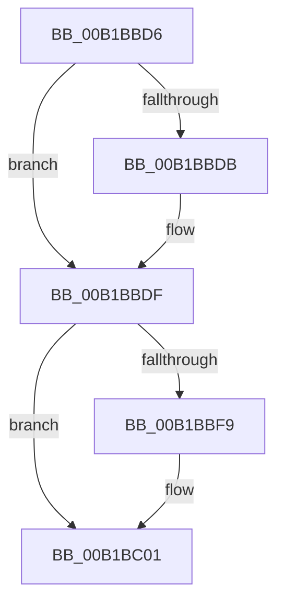

# sub_00B1BBD6

- RVA: `0x00B1BBD6`–`0x00B1BC17` (길이 `65` bytes)
- VA: `0x0000000140B1BBD6`
- 실행 섹션: `PAGE`
- PDB 이름 있음: `아니요`; PDB Function 태그: `아니요`
- unwind 정보 RVA: `0x00085368`
- 디코드: `18`개 명령, `65/65` bytes 표시
- 미해석 바이트: `0` (있으면 어셈블리에 `.byte`로 보존)

> 이 문서는 커널 이미지의 기계어와 PDB 기호를 분석해 생성했습니다. 4번과 5번은 함수 원형과 자료형을 바이너리 사용 방식에서 추정한 C 해석이며 원본 소스 복구 결과는 아닙니다.

## 1. Dependencies

- 직접 호출 지점: **4**; 고유 호출 대상: **4**
- 직접 호출자로 확인된 함수: **0**
- RIP 상대 이미지 참조: **0**

### Outgoing calls
- `0x00B1BBE7` → [ObFastReferenceObjectLocked](../../text/38/ObFastReferenceObjectLocked_function_00381DA0.md) (function, `0x00381DA0`)
- `0x00B1BBFC` → [ExfReleasePushLockShared](../../text/26/ExfReleasePushLockShared_function_00263440.md) (function, `0x00263440`)
- `0x00B1BC04` → [KeAbPostRelease](../../text/2E/KeAbPostRelease_function_002E1600.md) (function, `0x002E1600`)
- `0x00B1BC0C` → [KiLeaveCriticalRegionUnsafe](../../text/25/KiLeaveCriticalRegionUnsafe_function_0025F010.md) (function, `0x0025F010`)

### Direct callers
- 이 함수 시작 RVA로 연결되는 직접 call은 확인되지 않았습니다. 간접 호출은 완전히 역산할 수 없습니다.

### Static image references
- 디코드된 RIP-relative 메모리 참조가 없습니다.

## 2. Other-region calls and transfers

- 다른 실행 섹션으로 향하는 call: **4**
  - `0x00B1BBE7` → [ObFastReferenceObjectLocked](../../text/38/ObFastReferenceObjectLocked_function_00381DA0.md) (`PAGE` → `.text`)
  - `0x00B1BBFC` → [ExfReleasePushLockShared](../../text/26/ExfReleasePushLockShared_function_00263440.md) (`PAGE` → `.text`)
  - `0x00B1BC04` → [KeAbPostRelease](../../text/2E/KeAbPostRelease_function_002E1600.md) (`PAGE` → `.text`)
  - `0x00B1BC0C` → [KiLeaveCriticalRegionUnsafe](../../text/25/KiLeaveCriticalRegionUnsafe_function_0025F010.md) (`PAGE` → `.text`)
- call이 아닌 외부 분기/꼬리 이동: **1**
  - `0x00B1BC12` → [PspReferenceSystemDll + 0x30](../8D/PspReferenceSystemDll_function_008D6AD8.md) (`tail-transfer`)

## 3. Assembly (complete function range)

```asm
00B1BBD6  48 85 FF                        test rdi, rdi
00B1BBD9  74 04                           je 0x140b1bbdf
00B1BBDB  C6 47 0A 01                     mov byte ptr [rdi + 0xa], 1
00B1BBDF  BA 50 73 53 64                  mov edx, 0x64537350
00B1BBE4  48 8B CE                        mov rcx, rsi
00B1BBE7  E8 B4 61 86 FF                  call 0x140381da0
00B1BBEC  48 8B F8                        mov rdi, rax
00B1BBEF  49 8B C4                        mov rax, r12
00B1BBF2  F0 4C 0F B1 33                  lock cmpxchg qword ptr [rbx], r14
00B1BBF7  74 08                           je 0x140b1bc01
00B1BBF9  48 8B CB                        mov rcx, rbx
00B1BBFC  E8 3F 78 74 FF                  call 0x140263440
00B1BC01  48 8B CB                        mov rcx, rbx
00B1BC04  E8 F7 59 7C FF                  call 0x1402e1600
00B1BC09  48 8B CD                        mov rcx, rbp
00B1BC0C  E8 FF 33 74 FF                  call 0x14025f010
00B1BC11  90                              nop
00B1BC12  E9 F1 AE DB FF                  jmp 0x1408d6b08
```

## 4. C-style interpretation (structured pseudocode)

```c
__int64 __fastcall sub_00B1BBD6(void)
{
    __int64 result;

    if (v_rdi != 0) {
        *(unsigned __int8 *)(v_rdi + 10) = 1;
    }
    result = ObFastReferenceObjectLocked(v_rsi, (unsigned int)(0x64537350ULL), a3, a4);
    result = v_r12;
    if (v_rdi != 0) {
        a1 = v_rbx;
        result = ExfReleasePushLockShared(a1, (unsigned int)(0x64537350ULL), a3, a4);
    }
    result = KeAbPostRelease(v_rbx, (unsigned int)(0x64537350ULL), a3, a4);
    result = KiLeaveCriticalRegionUnsafe(v_rbp, (unsigned int)(0x64537350ULL), a3, a4);
}
```

## 5. (Beta) C Style

```c
void sub_00B1BBD6(void)
{
    int64_t result;

    if (local_rdi != 0) {
        *(uint8_t *)(local_rdi + 0xA) = 1;
    }
    result = ObFastReferenceObjectLocked(local_rsi, (uint32_t)(0x64537350ULL), a3, a4);
    result = local_r12;
    if (local_rdi != 0) {
        a1 = local_rbx;
        result = ExfReleasePushLockShared(a1, (uint32_t)(0x64537350ULL), a3, a4);
    }
    result = KeAbPostRelease(local_rbx, (uint32_t)(0x64537350ULL), a3, a4);
    result = KiLeaveCriticalRegionUnsafe(local_rbp, (uint32_t)(0x64537350ULL), a3, a4);
}
```

## 6. Execution-region graph

[열기: 2D/3D 그래프와 함수 탐색 컨트롤 패널](../../../control-panel.html?section=page&rva=0x00B1BBD6&view=graph)

- 2D 그래프는 위에서 아래로 흐르고, 3D 그래프는 빈 공간을 드래그해 회전합니다. Shift+드래그는 이동, 휠은 확대·축소, 함수 노드 선택은 대상 보고서 이동입니다.

### Static fallback


