# sub_00B1BC18

- RVA: `0x00B1BC18`–`0x00B1BF5D` (길이 `837` bytes)
- VA: `0x0000000140B1BC18`
- 실행 섹션: `PAGE`
- PDB 이름 있음: `아니요`; PDB Function 태그: `아니요`
- unwind 정보 RVA: `0x000854A4`
- 디코드: `224`개 명령, `837/837` bytes 표시
- 미해석 바이트: `0` (있으면 어셈블리에 `.byte`로 보존)

> 이 문서는 커널 이미지의 기계어와 PDB 기호를 분석해 생성했습니다. 4번과 5번은 함수 원형과 자료형을 바이너리 사용 방식에서 추정한 C 해석이며 원본 소스 복구 결과는 아닙니다.

## 1. Dependencies

- 직접 호출 지점: **19**; 고유 호출 대상: **9**
- 직접 호출자로 확인된 함수: **0**
- RIP 상대 이미지 참조: **0**

### Outgoing calls
- `0x00B1BD47` → [KeAbPreAcquire](../../text/21/KeAbPreAcquire_function_00210230.md) (function, `0x00210230`)
- `0x00B1BD69` → [ExfAcquirePushLockSharedEx](../../text/21/ExfAcquirePushLockSharedEx_function_0021044C.md) (function, `0x0021044C`)
- `0x00B1BD82` → [EtwpCovSampStackHashLookup](../7C/EtwpCovSampStackHashLookup_function_007C1CD8.md) (function, `0x007C1CD8`)
- `0x00B1BDA8` → [ExfReleasePushLockShared](../../text/26/ExfReleasePushLockShared_function_00263440.md) (function, `0x00263440`)
- `0x00B1BDB0` → [KeAbPostRelease](../../text/2E/KeAbPostRelease_function_002E1600.md) (function, `0x002E1600`)
- `0x00B1BDB5` → [KeLeaveCriticalRegion](../../text/25/KeLeaveCriticalRegion_function_0025D8B0.md) (function, `0x0025D8B0`)
- `0x00B1BDDE` → [KeAbPreAcquire](../../text/21/KeAbPreAcquire_function_00210230.md) (function, `0x00210230`)
- `0x00B1BDF7` → [ExfAcquirePushLockExclusiveEx](../../text/20/ExfAcquirePushLockExclusiveEx_function_0020FC90.md) (function, `0x0020FC90`)
- `0x00B1BE20` → [memset](../../text/6C/memset_function_006C6C40.md) (function, `0x006C6C40`)
- `0x00B1BE39` → [ExfTryToWakePushLock](../../text/26/ExfTryToWakePushLock_function_00265DD0.md) (function, `0x00265DD0`)
- `0x00B1BE41` → [KeAbPostRelease](../../text/2E/KeAbPostRelease_function_002E1600.md) (function, `0x002E1600`)
- `0x00B1BE46` → [KeLeaveCriticalRegion](../../text/25/KeLeaveCriticalRegion_function_0025D8B0.md) (function, `0x0025D8B0`)
- `0x00B1BECB` → [KeAbPreAcquire](../../text/21/KeAbPreAcquire_function_00210230.md) (function, `0x00210230`)
- `0x00B1BEEA` → [ExfAcquirePushLockSharedEx](../../text/21/ExfAcquirePushLockSharedEx_function_0021044C.md) (function, `0x0021044C`)
- `0x00B1BF03` → [EtwpCovSampStackHashLookup](../7C/EtwpCovSampStackHashLookup_function_007C1CD8.md) (function, `0x007C1CD8`)
- `0x00B1BF1D` → [ExfReleasePushLockShared](../../text/26/ExfReleasePushLockShared_function_00263440.md) (function, `0x00263440`)
- `0x00B1BF25` → [KeAbPostRelease](../../text/2E/KeAbPostRelease_function_002E1600.md) (function, `0x002E1600`)
- `0x00B1BF2A` → [KeLeaveCriticalRegion](../../text/25/KeLeaveCriticalRegion_function_0025D8B0.md) (function, `0x0025D8B0`)
- `0x00B1BF45` → [EtwpCovSampStackHashLookup](../7C/EtwpCovSampStackHashLookup_function_007C1CD8.md) (function, `0x007C1CD8`)

### Direct callers
- 이 함수 시작 RVA로 연결되는 직접 call은 확인되지 않았습니다. 간접 호출은 완전히 역산할 수 없습니다.

### Static image references
- 디코드된 RIP-relative 메모리 참조가 없습니다.

## 2. Other-region calls and transfers

- 다른 실행 섹션으로 향하는 call: **16**
  - `0x00B1BD47` → [KeAbPreAcquire](../../text/21/KeAbPreAcquire_function_00210230.md) (`PAGE` → `.text`)
  - `0x00B1BD69` → [ExfAcquirePushLockSharedEx](../../text/21/ExfAcquirePushLockSharedEx_function_0021044C.md) (`PAGE` → `.text`)
  - `0x00B1BDA8` → [ExfReleasePushLockShared](../../text/26/ExfReleasePushLockShared_function_00263440.md) (`PAGE` → `.text`)
  - `0x00B1BDB0` → [KeAbPostRelease](../../text/2E/KeAbPostRelease_function_002E1600.md) (`PAGE` → `.text`)
  - `0x00B1BDB5` → [KeLeaveCriticalRegion](../../text/25/KeLeaveCriticalRegion_function_0025D8B0.md) (`PAGE` → `.text`)
  - `0x00B1BDDE` → [KeAbPreAcquire](../../text/21/KeAbPreAcquire_function_00210230.md) (`PAGE` → `.text`)
  - `0x00B1BDF7` → [ExfAcquirePushLockExclusiveEx](../../text/20/ExfAcquirePushLockExclusiveEx_function_0020FC90.md) (`PAGE` → `.text`)
  - `0x00B1BE20` → [memset](../../text/6C/memset_function_006C6C40.md) (`PAGE` → `.text`)
  - `0x00B1BE39` → [ExfTryToWakePushLock](../../text/26/ExfTryToWakePushLock_function_00265DD0.md) (`PAGE` → `.text`)
  - `0x00B1BE41` → [KeAbPostRelease](../../text/2E/KeAbPostRelease_function_002E1600.md) (`PAGE` → `.text`)
  - `0x00B1BE46` → [KeLeaveCriticalRegion](../../text/25/KeLeaveCriticalRegion_function_0025D8B0.md) (`PAGE` → `.text`)
  - `0x00B1BECB` → [KeAbPreAcquire](../../text/21/KeAbPreAcquire_function_00210230.md) (`PAGE` → `.text`)
  - `0x00B1BEEA` → [ExfAcquirePushLockSharedEx](../../text/21/ExfAcquirePushLockSharedEx_function_0021044C.md) (`PAGE` → `.text`)
  - `0x00B1BF1D` → [ExfReleasePushLockShared](../../text/26/ExfReleasePushLockShared_function_00263440.md) (`PAGE` → `.text`)
  - `0x00B1BF25` → [KeAbPostRelease](../../text/2E/KeAbPostRelease_function_002E1600.md) (`PAGE` → `.text`)
  - `0x00B1BF2A` → [KeLeaveCriticalRegion](../../text/25/KeLeaveCriticalRegion_function_0025D8B0.md) (`PAGE` → `.text`)
- call이 아닌 외부 분기/꼬리 이동: **2**
  - `0x00B1BDBF` → [EtwpCovSampCaptureBufferProcess + 0x1BD](../8D/EtwpCovSampCaptureBufferProcess_function_008D71C0.md) (`tail-transfer`)
  - `0x00B1BE55` → [EtwpCovSampCaptureBufferProcess + 0x1BD](../8D/EtwpCovSampCaptureBufferProcess_function_008D71C0.md) (`tail-transfer`)

## 3. Assembly (complete function range)

```asm
00B1BC18  49 8B BE 38 05 00 00            mov rdi, qword ptr [r14 + 0x538]
00B1BC1F  4C 8D 0C CD 00 00 00 00         lea r9, [rcx*8]
00B1BC27  4D 8D 47 40                     lea r8, [r15 + 0x40]
00B1BC2B  4C 8B D1                        mov r10, rcx
00B1BC2E  41 BB 01 00 00 00               mov r11d, 1
00B1BC34  49 83 F9 08                     cmp r9, 8
00B1BC38  72 72                           jb 0x140b1bcac
00B1BC3A  48 8B C1                        mov rax, rcx
00B1BC3D  48 F7 D8                        neg rax
00B1BC40  4D 8D 0C C1                     lea r9, [r9 + rax*8]
00B1BC44  41 0F B6 00                     movzx eax, byte ptr [r8]
00B1BC48  48 6B CF 25                     imul rcx, rdi, 0x25
00B1BC4C  48 03 C8                        add rcx, rax
00B1BC4F  41 0F B6 40 01                  movzx eax, byte ptr [r8 + 1]
00B1BC54  48 6B D1 25                     imul rdx, rcx, 0x25
00B1BC58  48 03 D0                        add rdx, rax
00B1BC5B  41 0F B6 40 02                  movzx eax, byte ptr [r8 + 2]
00B1BC60  48 6B CA 25                     imul rcx, rdx, 0x25
00B1BC64  48 03 C8                        add rcx, rax
00B1BC67  41 0F B6 40 03                  movzx eax, byte ptr [r8 + 3]
00B1BC6C  48 6B D1 25                     imul rdx, rcx, 0x25
00B1BC70  48 03 D0                        add rdx, rax
00B1BC73  41 0F B6 40 04                  movzx eax, byte ptr [r8 + 4]
00B1BC78  48 6B CA 25                     imul rcx, rdx, 0x25
00B1BC7C  48 03 C8                        add rcx, rax
00B1BC7F  41 0F B6 40 05                  movzx eax, byte ptr [r8 + 5]
00B1BC84  48 6B D1 25                     imul rdx, rcx, 0x25
00B1BC88  48 03 D0                        add rdx, rax
00B1BC8B  41 0F B6 40 06                  movzx eax, byte ptr [r8 + 6]
00B1BC90  48 6B CA 25                     imul rcx, rdx, 0x25
00B1BC94  48 03 C8                        add rcx, rax
00B1BC97  41 0F B6 40 07                  movzx eax, byte ptr [r8 + 7]
00B1BC9C  48 6B F9 25                     imul rdi, rcx, 0x25
00B1BCA0  49 83 C0 08                     add r8, 8
00B1BCA4  48 03 F8                        add rdi, rax
00B1BCA7  4D 2B D3                        sub r10, r11
00B1BCAA  75 98                           jne 0x140b1bc44
00B1BCAC  4D 2B CB                        sub r9, r11
00B1BCAF  74 72                           je 0x140b1bd23
00B1BCB1  4D 2B CB                        sub r9, r11
00B1BCB4  74 5F                           je 0x140b1bd15
00B1BCB6  4D 2B CB                        sub r9, r11
00B1BCB9  74 4C                           je 0x140b1bd07
00B1BCBB  4D 2B CB                        sub r9, r11
00B1BCBE  74 39                           je 0x140b1bcf9
00B1BCC0  4D 2B CB                        sub r9, r11
00B1BCC3  74 26                           je 0x140b1bceb
00B1BCC5  4D 2B CB                        sub r9, r11
00B1BCC8  74 13                           je 0x140b1bcdd
00B1BCCA  4D 3B CB                        cmp r9, r11
00B1BCCD  75 5F                           jne 0x140b1bd2e
00B1BCCF  41 0F B6 00                     movzx eax, byte ptr [r8]
00B1BCD3  48 6B FF 25                     imul rdi, rdi, 0x25
00B1BCD7  48 03 F8                        add rdi, rax
00B1BCDA  4D 03 C3                        add r8, r11
00B1BCDD  41 0F B6 00                     movzx eax, byte ptr [r8]
00B1BCE1  48 6B FF 25                     imul rdi, rdi, 0x25
00B1BCE5  48 03 F8                        add rdi, rax
00B1BCE8  4D 03 C3                        add r8, r11
00B1BCEB  41 0F B6 00                     movzx eax, byte ptr [r8]
00B1BCEF  48 6B FF 25                     imul rdi, rdi, 0x25
00B1BCF3  48 03 F8                        add rdi, rax
00B1BCF6  4D 03 C3                        add r8, r11
00B1BCF9  41 0F B6 00                     movzx eax, byte ptr [r8]
00B1BCFD  48 6B FF 25                     imul rdi, rdi, 0x25
00B1BD01  48 03 F8                        add rdi, rax
00B1BD04  4D 03 C3                        add r8, r11
00B1BD07  41 0F B6 00                     movzx eax, byte ptr [r8]
00B1BD0B  48 6B FF 25                     imul rdi, rdi, 0x25
00B1BD0F  48 03 F8                        add rdi, rax
00B1BD12  4D 03 C3                        add r8, r11
00B1BD15  41 0F B6 00                     movzx eax, byte ptr [r8]
00B1BD19  48 6B FF 25                     imul rdi, rdi, 0x25
00B1BD1D  48 03 F8                        add rdi, rax
00B1BD20  4D 03 C3                        add r8, r11
00B1BD23  41 0F B6 00                     movzx eax, byte ptr [r8]
00B1BD27  48 6B FF 25                     imul rdi, rdi, 0x25
00B1BD2B  48 03 F8                        add rdi, rax
00B1BD2E  65 48 8B 04 25 88 01 00 00      mov rax, qword ptr gs:[0x188]
00B1BD37  45 33 C0                        xor r8d, r8d
00B1BD3A  33 D2                           xor edx, edx
00B1BD3C  48 8B CD                        mov rcx, rbp
00B1BD3F  66 01 98 E4 01 00 00            add word ptr [rax + 0x1e4], bx
00B1BD46  90                              nop
00B1BD47  E8 E4 44 6F FF                  call 0x140210230
00B1BD4C  4C 8B E8                        mov r13, rax
00B1BD4F  B9 11 00 00 00                  mov ecx, 0x11
00B1BD54  33 C0                           xor eax, eax
00B1BD56  F0 48 0F B1 4D 00               lock cmpxchg qword ptr [rbp], rcx
00B1BD5C  74 10                           je 0x140b1bd6e
00B1BD5E  4C 8B CD                        mov r9, rbp
00B1BD61  4D 8B C5                        mov r8, r13
00B1BD64  33 D2                           xor edx, edx
00B1BD66  48 8B CD                        mov rcx, rbp
00B1BD69  E8 DE 46 6F FF                  call 0x14021044c
00B1BD6E  4D 85 ED                        test r13, r13
00B1BD71  74 05                           je 0x140b1bd78
00B1BD73  41 C6 45 0A 01                  mov byte ptr [r13 + 0xa], 1
00B1BD78  4C 8D 44 24 48                  lea r8, [rsp + 0x48]
00B1BD7D  8B D7                           mov edx, edi
00B1BD7F  48 8B CD                        mov rcx, rbp
00B1BD82  E8 51 5F CA FF                  call 0x1407c1cd8
00B1BD87  33 D2                           xor edx, edx
00B1BD89  85 C0                           test eax, eax
00B1BD8B  0F 84 C9 00 00 00               je 0x140b1be5a
00B1BD91  44 8D 62 01                     lea r12d, [rdx + 1]
00B1BD95  44 8B EA                        mov r13d, edx
00B1BD98  B8 11 00 00 00                  mov eax, 0x11
00B1BD9D  F0 48 0F B1 55 00               lock cmpxchg qword ptr [rbp], rdx
00B1BDA3  74 08                           je 0x140b1bdad
00B1BDA5  48 8B CD                        mov rcx, rbp
00B1BDA8  E8 93 76 74 FF                  call 0x140263440
00B1BDAD  48 8B CD                        mov rcx, rbp
00B1BDB0  E8 4B 58 7C FF                  call 0x1402e1600
00B1BDB5  E8 F6 1A 74 FF                  call 0x14025d8b0
00B1BDBA  33 ED                           xor ebp, ebp
00B1BDBC  45 85 ED                        test r13d, r13d
00B1BDBF  0F 84 B8 B5 DB FF               je 0x1408d737d
00B1BDC5  65 48 8B 04 25 88 01 00 00      mov rax, qword ptr gs:[0x188]
00B1BDCE  45 33 C0                        xor r8d, r8d
00B1BDD1  33 D2                           xor edx, edx
00B1BDD3  48 8B CE                        mov rcx, rsi
00B1BDD6  66 01 98 E4 01 00 00            add word ptr [rax + 0x1e4], bx
00B1BDDD  90                              nop
00B1BDDE  E8 4D 44 6F FF                  call 0x140210230
00B1BDE3  F0 48 0F BA 2E 00               lock bts qword ptr [rsi], 0
00B1BDE9  48 8B F8                        mov rdi, rax
00B1BDEC  73 0E                           jae 0x140b1bdfc
00B1BDEE  4C 8B C6                        mov r8, rsi
00B1BDF1  48 8B D0                        mov rdx, rax
00B1BDF4  48 8B CE                        mov rcx, rsi
00B1BDF7  E8 94 3E 6F FF                  call 0x14020fc90
00B1BDFC  48 85 FF                        test rdi, rdi
00B1BDFF  74 04                           je 0x140b1be05
00B1BE01  C6 47 0A 01                     mov byte ptr [rdi + 0xa], 1
00B1BE05  65 48 8B 04 25 88 01 00 00      mov rax, qword ptr gs:[0x188]
00B1BE0E  48 8D 4E 18                     lea rcx, [rsi + 0x18]
00B1BE12  48 89 46 08                     mov qword ptr [rsi + 8], rax
00B1BE16  33 D2                           xor edx, edx
00B1BE18  44 8B 46 14                     mov r8d, dword ptr [rsi + 0x14]
00B1BE1C  49 C1 E0 02                     shl r8, 2
00B1BE20  E8 1B AE BA FF                  call 0x1406c6c40
00B1BE25  48 89 6E 08                     mov qword ptr [rsi + 8], rbp
00B1BE29  F0 48 0F C1 1E                  lock xadd qword ptr [rsi], rbx
00B1BE2E  80 E3 06                        and bl, 6
00B1BE31  80 FB 02                        cmp bl, 2
00B1BE34  75 08                           jne 0x140b1be3e
00B1BE36  48 8B CE                        mov rcx, rsi
00B1BE39  E8 92 9F 74 FF                  call 0x140265dd0
00B1BE3E  48 8B CE                        mov rcx, rsi
00B1BE41  E8 BA 57 7C FF                  call 0x1402e1600
00B1BE46  E8 65 1A 74 FF                  call 0x14025d8b0
00B1BE4B  89 6E 10                        mov dword ptr [rsi + 0x10], ebp
00B1BE4E  49 87 B6 20 05 00 00            xchg qword ptr [r14 + 0x520], rsi
00B1BE55  E9 23 B5 DB FF                  jmp 0x1408d737d
00B1BE5A  6B 45 14 07                     imul eax, dword ptr [rbp + 0x14], 7
00B1BE5E  C1 E8 03                        shr eax, 3
00B1BE61  39 45 10                        cmp dword ptr [rbp + 0x10], eax
00B1BE64  0F 87 2B FF FF FF               ja 0x140b1bd95
00B1BE6A  41 B8 01 00 00 00               mov r8d, 1
00B1BE70  41 8B C8                        mov ecx, r8d
00B1BE73  F0 0F C1 4D 10                  lock xadd dword ptr [rbp + 0x10], ecx
00B1BE78  41 03 C8                        add ecx, r8d
00B1BE7B  44 8B EA                        mov r13d, edx
00B1BE7E  3B C8                           cmp ecx, eax
00B1BE80  45 0F 44 E8                     cmove r13d, r8d
00B1BE84  6B 45 14 07                     imul eax, dword ptr [rbp + 0x14], 7
00B1BE88  44 89 6C 24 40                  mov dword ptr [rsp + 0x40], r13d
00B1BE8D  C1 E8 03                        shr eax, 3
00B1BE90  3B C8                           cmp ecx, eax
00B1BE92  0F 83 00 FF FF FF               jae 0x140b1bd98
00B1BE98  48 8B 4C 24 48                  mov rcx, qword ptr [rsp + 0x48]
00B1BE9D  48 85 C9                        test rcx, rcx
00B1BEA0  0F 84 95 00 00 00               je 0x140b1bf3b
00B1BEA6  33 C0                           xor eax, eax
00B1BEA8  F0 0F B1 39                     lock cmpxchg dword ptr [rcx], edi
00B1BEAC  0F 85 89 00 00 00               jne 0x140b1bf3b
00B1BEB2  65 48 8B 04 25 88 01 00 00      mov rax, qword ptr gs:[0x188]
00B1BEBB  45 33 C0                        xor r8d, r8d
00B1BEBE  33 D2                           xor edx, edx
00B1BEC0  48 8B CE                        mov rcx, rsi
00B1BEC3  66 01 98 E4 01 00 00            add word ptr [rax + 0x1e4], bx
00B1BECA  90                              nop
00B1BECB  E8 60 43 6F FF                  call 0x140210230
00B1BED0  4C 8B E8                        mov r13, rax
00B1BED3  33 C0                           xor eax, eax
00B1BED5  8D 48 11                        lea ecx, [rax + 0x11]
00B1BED8  F0 48 0F B1 0E                  lock cmpxchg qword ptr [rsi], rcx
00B1BEDD  74 10                           je 0x140b1beef
00B1BEDF  4C 8B CE                        mov r9, rsi
00B1BEE2  4D 8B C5                        mov r8, r13
00B1BEE5  33 D2                           xor edx, edx
00B1BEE7  48 8B CE                        mov rcx, rsi
00B1BEEA  E8 5D 45 6F FF                  call 0x14021044c
00B1BEEF  4D 85 ED                        test r13, r13
00B1BEF2  74 05                           je 0x140b1bef9
00B1BEF4  41 C6 45 0A 01                  mov byte ptr [r13 + 0xa], 1
00B1BEF9  4C 8D 44 24 48                  lea r8, [rsp + 0x48]
00B1BEFE  8B D7                           mov edx, edi
00B1BF00  48 8B CE                        mov rcx, rsi
00B1BF03  E8 D0 5D CA FF                  call 0x1407c1cd8
00B1BF08  33 C9                           xor ecx, ecx
00B1BF0A  85 C0                           test eax, eax
00B1BF0C  41 0F 95 C4                     setne r12b
00B1BF10  8D 41 11                        lea eax, [rcx + 0x11]
00B1BF13  F0 48 0F B1 0E                  lock cmpxchg qword ptr [rsi], rcx
00B1BF18  74 08                           je 0x140b1bf22
00B1BF1A  48 8B CE                        mov rcx, rsi
00B1BF1D  E8 1E 75 74 FF                  call 0x140263440
00B1BF22  48 8B CE                        mov rcx, rsi
00B1BF25  E8 D6 56 7C FF                  call 0x1402e1600
00B1BF2A  E8 81 19 74 FF                  call 0x14025d8b0
00B1BF2F  44 8B 6C 24 40                  mov r13d, dword ptr [rsp + 0x40]
00B1BF34  33 D2                           xor edx, edx
00B1BF36  E9 5D FE FF FF                  jmp 0x140b1bd98
00B1BF3B  4C 8D 44 24 48                  lea r8, [rsp + 0x48]
00B1BF40  8B D7                           mov edx, edi
00B1BF42  48 8B CD                        mov rcx, rbp
00B1BF45  E8 8E 5D CA FF                  call 0x1407c1cd8
00B1BF4A  85 C0                           test eax, eax
00B1BF4C  0F 84 46 FF FF FF               je 0x140b1be98
00B1BF52  33 D2                           xor edx, edx
00B1BF54  44 8D 62 01                     lea r12d, [rdx + 1]
00B1BF58  E9 3B FE FF FF                  jmp 0x140b1bd98
```

## 4. C-style interpretation (structured pseudocode)

```c
__int64 __fastcall sub_00B1BC18(__int64 a1, __int64 a2, __int64 a3, __int64 a4, __int64 a5, __int64 a6, __int64 a7, unsigned int a8, __int64 a9)
{
    __int64 result;
    __int64 v_r10;
    __int64 v_r12;
    __int64 v_r13;
    __int64 v_rbp;
    __int64 v_rbx;
    __int64 v_rdi;
    unsigned int v_stack_p40;

    if ((a1 * 8) < 8) goto loc_00B1BCAC;
    result = -(a1);
loc_00B1BC44:
    a1 = (a1) * (*(unsigned __int64 *)(v_r14 + 1336));
    a1 = (a1) + (*(unsigned __int8 *)(v_r15 + 64));
    a2 = (a2) * (a1);
    a2 = (a2) + (*(unsigned __int8 *)(v_r15 + 64 + 1));
    a1 = (a1) * (a2);
    a1 = (a1) + (*(unsigned __int8 *)(v_r15 + 64 + 2));
    a2 = (a2) * (a1);
    a2 = (a2) + (*(unsigned __int8 *)(v_r15 + 64 + 3));
    a1 = (a1) * (a2);
    a1 = (a1) + (*(unsigned __int8 *)(v_r15 + 64 + 4));
    a2 = (a2) * (a1);
    a2 = (a2) + (*(unsigned __int8 *)(v_r15 + 64 + 5));
    a1 = (a1) * (a2);
    a1 = (a1) + (*(unsigned __int8 *)(v_r15 + 64 + 6));
    v_rdi = (*(unsigned __int64 *)(v_r14 + 1336)) * (a1);
    a3 = (v_r15 + 64) + (8);
    v_rdi = (v_rdi) + (*(unsigned __int8 *)(v_r15 + 64 + 7));
    v_r10 = (a1) - (1);
    if (condition_is_not_equal) goto loc_00B1BC44;
loc_00B1BCAC:
    a4 = (a1 * 8 + result * 8) - (1);
    if (condition_is_equal) goto loc_00B1BD23;
    a4 = (a4) - (1);
    if (condition_is_equal) goto loc_00B1BD15;
    a4 = (a4) - (1);
    if (condition_is_equal) goto loc_00B1BD07;
    a4 = (a4) - (1);
    if (condition_is_equal) goto loc_00B1BCF9;
    a4 = (a4) - (1);
    if (condition_is_equal) goto loc_00B1BCEB;
    a4 = (a4) - (1);
    if (condition_is_equal) goto loc_00B1BCDD;
    if (a4 != 1) goto loc_00B1BD2E;
    v_rdi = (v_rdi) * (v_rdi);
    v_rdi = (v_rdi) + (*(unsigned __int8 *)(a3));
    a3 = (a3) + (1);
loc_00B1BCDD:
    v_rdi = (v_rdi) * (v_rdi);
    v_rdi = (v_rdi) + (*(unsigned __int8 *)(a3));
    a3 = (a3) + (1);
loc_00B1BCEB:
    v_rdi = (v_rdi) * (v_rdi);
    v_rdi = (v_rdi) + (*(unsigned __int8 *)(a3));
    a3 = (a3) + (1);
loc_00B1BCF9:
    v_rdi = (v_rdi) * (v_rdi);
    v_rdi = (v_rdi) + (*(unsigned __int8 *)(a3));
    a3 = (a3) + (1);
loc_00B1BD07:
    v_rdi = (v_rdi) * (v_rdi);
    v_rdi = (v_rdi) + (*(unsigned __int8 *)(a3));
    a3 = (a3) + (1);
loc_00B1BD15:
    v_rdi = (v_rdi) * (v_rdi);
    v_rdi = (v_rdi) + (*(unsigned __int8 *)(a3));
    a3 = (a3) + (1);
loc_00B1BD23:
    v_rdi = (v_rdi) * (v_rdi);
    v_rdi = (v_rdi) + (*(unsigned __int8 *)(a3));
loc_00B1BD2E:
    a3 = 0;
    a2 = 0;
    result = KeAbPreAcquire(v_rbp, a2, a3, a4);
    result = 0;
    if (!(condition_is_equal)) {
        a4 = v_rbp;
        a3 = 0;
        a2 = 0;
        a1 = v_rbp;
        result = ExfAcquirePushLockSharedEx(a1, a2, a3, a4);
    }
    if (result != 0) {
        *(unsigned __int8 *)(result + 10) = 1;
    }
    result = EtwpCovSampStackHashLookup(v_rbp, (unsigned int)((unsigned int)(v_rdi)), a9, a4);
    a2 = 0;
    if ((unsigned int)(result) == 0) goto loc_00B1BE5A;
loc_00B1BD95:
loc_00B1BD98:
    result = 17;
    if ((unsigned int)(result) != 0) {
        a1 = v_rbp;
        result = ExfReleasePushLockShared(a1, a2, a9, a4);
    }
    result = KeAbPostRelease(v_rbp, a2, a9, a4);
    result = KeLeaveCriticalRegion(v_rbp, a2, a9, a4);
    v_rbp = 0;
    a3 = 0;
    a2 = 0;
    result = KeAbPreAcquire(v_rsi, a2, a3, a4);
    if (!(condition_is_above_or_equal)) {
        a3 = v_rsi;
        a2 = result;
        a1 = v_rsi;
        result = ExfAcquirePushLockExclusiveEx(a1, a2, a3, a4);
    }
    if (result != 0) {
        *(unsigned __int8 *)(result + 10) = 1;
    }
    *(unsigned __int64 *)(v_rsi + 8) = *(unsigned __int64 *)(gs_base + (0 + 392));
    a2 = 0;
    a3 = ((unsigned int)(*(unsigned int *)(v_rsi + 20))) << (2);
    result = memset(v_rsi + 24, a2, a3, a4);
    *(unsigned __int64 *)(v_rsi + 8) = 0;
    v_rbx = (unsigned __int8)((v_rbx) & (6));
    if (((unsigned __int8)(v_rbx)) == 2) {
        a1 = v_rsi;
        result = ExfTryToWakePushLock(a1, a2, a3, a4);
    }
    result = KeAbPostRelease(v_rsi, a2, a3, a4);
    result = KeLeaveCriticalRegion(v_rsi, a2, a3, a4);
    *(unsigned int *)(v_rsi + 16) = 0;
loc_00B1BE5A:
    result = (unsigned int)((result) * (*(unsigned int *)(v_rbp + 20)));
    result = (unsigned int)((result) >> (3));
    if ((*(unsigned int *)(v_rbp + 16)) > ((unsigned int)(result))) goto loc_00B1BD95;
    a1 = (unsigned int)((1) + (1));
    v_r13 = 0;
    if (((unsigned int)(a1)) == ((unsigned int)(result))) { v_r13 = 1; }
    result = (unsigned int)((result) * (*(unsigned int *)(v_rbp + 20)));
    v_stack_p40 = (unsigned int)(v_r13);
    result = (unsigned int)((result) >> (3));
    if (((unsigned int)(a1)) >= ((unsigned int)(result))) goto loc_00B1BD98;
loc_00B1BE98:
    if (a9 == 0) goto loc_00B1BF3B;
    result = 0;
    if (condition_is_not_equal) goto loc_00B1BF3B;
    a3 = 0;
    a2 = 0;
    result = KeAbPreAcquire(v_rsi, a2, a3, a4);
    result = 0;
    if (!(condition_is_equal)) {
        a4 = v_rsi;
        a3 = 0;
        a2 = 0;
        a1 = v_rsi;
        result = ExfAcquirePushLockSharedEx(a1, a2, a3, a4);
    }
    if (result != 0) {
        *(unsigned __int8 *)(result + 10) = 1;
    }
    result = EtwpCovSampStackHashLookup(v_rsi, (unsigned int)((unsigned int)(result)), a9, a4);
    a1 = 0;
    v_r12 = ((unsigned int)(result) != 0) ? 1 : 0;
    result = a1 + 17;
    if ((unsigned int)(result) != 0) {
        a1 = v_rsi;
        result = ExfReleasePushLockShared(a1, (unsigned int)((unsigned int)(result)), a9, a4);
    }
    result = KeAbPostRelease(v_rsi, (unsigned int)((unsigned int)(result)), a9, a4);
    result = KeLeaveCriticalRegion(v_rsi, (unsigned int)((unsigned int)(result)), a9, a4);
    a2 = 0;
    goto loc_00B1BD98;
loc_00B1BF3B:
    result = EtwpCovSampStackHashLookup(0, (unsigned int)((unsigned int)(result)), a9, a4);
    if ((unsigned int)(result) == 0) goto loc_00B1BE98;
    a2 = 0;
    goto loc_00B1BD98;
}
```

## 5. (Beta) C Style

```c
int64_t sub_00B1BC18(int64_t Arg1, int64_t Arg2, int64_t Arg3, int64_t Arg4, uint64_t Arg5, uint64_t Arg6, uint64_t Arg7, uint32_t Arg8, int64_t Arg9)
{
    int64_t result;
    int64_t local_r10;
    int64_t local_r12;
    int64_t local_r13;
    int64_t local_rbp;
    int64_t local_rbx;
    int64_t local_rdi;
    uint32_t v_stack_p40;

    if ((Arg1 * 8) < 8) goto loc_00B1BCAC;
    result = -(Arg1);
loc_00B1BC44:
    Arg1 = (Arg1) * (*(uint64_t *)(local_r14 + 0x538));
    Arg1 = (Arg1) + (*(uint8_t *)(local_r15 + 0x40));
    Arg2 = (Arg2) * (Arg1);
    Arg2 = (Arg2) + (*(uint8_t *)(local_r15 + 0x40 + 0x1));
    Arg1 = (Arg1) * (Arg2);
    Arg1 = (Arg1) + (*(uint8_t *)(local_r15 + 0x40 + 0x2));
    Arg2 = (Arg2) * (Arg1);
    Arg2 = (Arg2) + (*(uint8_t *)(local_r15 + 0x40 + 0x3));
    Arg1 = (Arg1) * (Arg2);
    Arg1 = (Arg1) + (*(uint8_t *)(local_r15 + 0x40 + 0x4));
    Arg2 = (Arg2) * (Arg1);
    Arg2 = (Arg2) + (*(uint8_t *)(local_r15 + 0x40 + 0x5));
    Arg1 = (Arg1) * (Arg2);
    Arg1 = (Arg1) + (*(uint8_t *)(local_r15 + 0x40 + 0x6));
    local_rdi = (*(uint64_t *)(local_r14 + 0x538)) * (Arg1);
    Arg3 = (local_r15 + 64) + (8);
    local_rdi = (local_rdi) + (*(uint8_t *)(local_r15 + 0x40 + 0x7));
    local_r10 = (Arg1) - (1);
    if (condition_is_not_equal) goto loc_00B1BC44;
loc_00B1BCAC:
    Arg4 = (Arg1 * 8 + result * 8) - (1);
    if (condition_is_equal) goto loc_00B1BD23;
    Arg4 = (Arg4) - (1);
    if (condition_is_equal) goto loc_00B1BD15;
    Arg4 = (Arg4) - (1);
    if (condition_is_equal) goto loc_00B1BD07;
    Arg4 = (Arg4) - (1);
    if (condition_is_equal) goto loc_00B1BCF9;
    Arg4 = (Arg4) - (1);
    if (condition_is_equal) goto loc_00B1BCEB;
    Arg4 = (Arg4) - (1);
    if (condition_is_equal) goto loc_00B1BCDD;
    if (Arg4 != 1) goto loc_00B1BD2E;
    local_rdi = (local_rdi) * (local_rdi);
    local_rdi = (local_rdi) + (*(uint8_t *)(Arg3));
    Arg3 = (Arg3) + (1);
loc_00B1BCDD:
    local_rdi = (local_rdi) * (local_rdi);
    local_rdi = (local_rdi) + (*(uint8_t *)(Arg3));
    Arg3 = (Arg3) + (1);
loc_00B1BCEB:
    local_rdi = (local_rdi) * (local_rdi);
    local_rdi = (local_rdi) + (*(uint8_t *)(Arg3));
    Arg3 = (Arg3) + (1);
loc_00B1BCF9:
    local_rdi = (local_rdi) * (local_rdi);
    local_rdi = (local_rdi) + (*(uint8_t *)(Arg3));
    Arg3 = (Arg3) + (1);
loc_00B1BD07:
    local_rdi = (local_rdi) * (local_rdi);
    local_rdi = (local_rdi) + (*(uint8_t *)(Arg3));
    Arg3 = (Arg3) + (1);
loc_00B1BD15:
    local_rdi = (local_rdi) * (local_rdi);
    local_rdi = (local_rdi) + (*(uint8_t *)(Arg3));
    Arg3 = (Arg3) + (1);
loc_00B1BD23:
    local_rdi = (local_rdi) * (local_rdi);
    local_rdi = (local_rdi) + (*(uint8_t *)(Arg3));
loc_00B1BD2E:
    Arg3 = 0;
    Arg2 = 0;
    result = KeAbPreAcquire(local_rbp, Arg2, Arg3, Arg4);
    result = 0;
    if (!(condition_is_equal)) {
        Arg4 = local_rbp;
        Arg3 = 0;
        Arg2 = 0;
        Arg1 = local_rbp;
        result = ExfAcquirePushLockSharedEx(Arg1, Arg2, Arg3, Arg4);
    }
    if (result != 0) {
        *(uint8_t *)(result + 0xA) = 1;
    }
    result = EtwpCovSampStackHashLookup(local_rbp, (uint32_t)((uint32_t)(local_rdi)), Arg9, Arg4);
    Arg2 = 0;
    if ((uint32_t)(result) == 0) goto loc_00B1BE5A;
loc_00B1BD95:
loc_00B1BD98:
    result = 17;
    if ((uint32_t)(result) != 0) {
        Arg1 = local_rbp;
        result = ExfReleasePushLockShared(Arg1, Arg2, Arg9, Arg4);
    }
    result = KeAbPostRelease(local_rbp, Arg2, Arg9, Arg4);
    result = KeLeaveCriticalRegion(local_rbp, Arg2, Arg9, Arg4);
    local_rbp = 0;
    Arg3 = 0;
    Arg2 = 0;
    result = KeAbPreAcquire(local_rsi, Arg2, Arg3, Arg4);
    if (!(condition_is_above_or_equal)) {
        Arg3 = local_rsi;
        Arg2 = result;
        Arg1 = local_rsi;
        result = ExfAcquirePushLockExclusiveEx(Arg1, Arg2, Arg3, Arg4);
    }
    if (result != 0) {
        *(uint8_t *)(result + 0xA) = 1;
    }
    *(uint64_t *)(local_rsi + 0x8) = *(uint64_t *)(gs_base + (0 + 0x188));
    Arg2 = 0;
    Arg3 = ((uint32_t)(*(uint32_t *)(local_rsi + 0x14))) << (2);
    result = memset(local_rsi + 24, Arg2, Arg3, Arg4);
    *(uint64_t *)(local_rsi + 0x8) = 0;
    local_rbx = (uint8_t)((local_rbx) & (6));
    if (((uint8_t)(local_rbx)) == 2) {
        Arg1 = local_rsi;
        result = ExfTryToWakePushLock(Arg1, Arg2, Arg3, Arg4);
    }
    result = KeAbPostRelease(local_rsi, Arg2, Arg3, Arg4);
    result = KeLeaveCriticalRegion(local_rsi, Arg2, Arg3, Arg4);
    *(uint32_t *)(local_rsi + 0x10) = 0;
loc_00B1BE5A:
    result = (uint32_t)((result) * (*(uint32_t *)(local_rbp + 0x14)));
    result = (uint32_t)((result) >> (3));
    if ((*(uint32_t *)(local_rbp + 0x10)) > ((uint32_t)(result))) goto loc_00B1BD95;
    Arg1 = (uint32_t)((1) + (1));
    local_r13 = 0;
    if (((uint32_t)(Arg1)) == ((uint32_t)(result))) { local_r13 = 1; }
    result = (uint32_t)((result) * (*(uint32_t *)(local_rbp + 0x14)));
    v_stack_p40 = (uint32_t)(local_r13);
    result = (uint32_t)((result) >> (3));
    if (((uint32_t)(Arg1)) >= ((uint32_t)(result))) goto loc_00B1BD98;
loc_00B1BE98:
    if (Arg9 == 0) goto loc_00B1BF3B;
    result = 0;
    if (condition_is_not_equal) goto loc_00B1BF3B;
    Arg3 = 0;
    Arg2 = 0;
    result = KeAbPreAcquire(local_rsi, Arg2, Arg3, Arg4);
    result = 0;
    if (!(condition_is_equal)) {
        Arg4 = local_rsi;
        Arg3 = 0;
        Arg2 = 0;
        Arg1 = local_rsi;
        result = ExfAcquirePushLockSharedEx(Arg1, Arg2, Arg3, Arg4);
    }
    if (result != 0) {
        *(uint8_t *)(result + 0xA) = 1;
    }
    result = EtwpCovSampStackHashLookup(local_rsi, (uint32_t)((uint32_t)(result)), Arg9, Arg4);
    Arg1 = 0;
    local_r12 = ((uint32_t)(result) != 0) ? 1 : 0;
    result = Arg1 + 17;
    if ((uint32_t)(result) != 0) {
        Arg1 = local_rsi;
        result = ExfReleasePushLockShared(Arg1, (uint32_t)((uint32_t)(result)), Arg9, Arg4);
    }
    result = KeAbPostRelease(local_rsi, (uint32_t)((uint32_t)(result)), Arg9, Arg4);
    result = KeLeaveCriticalRegion(local_rsi, (uint32_t)((uint32_t)(result)), Arg9, Arg4);
    Arg2 = 0;
    goto loc_00B1BD98;
loc_00B1BF3B:
    result = EtwpCovSampStackHashLookup(0, (uint32_t)((uint32_t)(result)), Arg9, Arg4);
    if ((uint32_t)(result) == 0) goto loc_00B1BE98;
    Arg2 = 0;
    goto loc_00B1BD98;
}
```

## 6. Execution-region graph

[열기: 2D/3D 그래프와 함수 탐색 컨트롤 패널](../../../control-panel.html?section=page&rva=0x00B1BC18&view=graph)

- 2D 그래프는 위에서 아래로 흐르고, 3D 그래프는 빈 공간을 드래그해 회전합니다. Shift+드래그는 이동, 휠은 확대·축소, 함수 노드 선택은 대상 보고서 이동입니다.

### Static fallback

```mermaid
flowchart TD
  bb_00B1BC18[BB_00B1BC18]
  bb_00B1BC3A[BB_00B1BC3A]
  bb_00B1BC44[BB_00B1BC44]
  bb_00B1BCAC[BB_00B1BCAC]
  bb_00B1BCB1[BB_00B1BCB1]
  bb_00B1BCB6[BB_00B1BCB6]
  bb_00B1BCBB[BB_00B1BCBB]
  bb_00B1BCC0[BB_00B1BCC0]
  bb_00B1BCC5[BB_00B1BCC5]
  bb_00B1BCCA[BB_00B1BCCA]
  bb_00B1BCCF[BB_00B1BCCF]
  bb_00B1BCDD[BB_00B1BCDD]
  bb_00B1BCEB[BB_00B1BCEB]
  bb_00B1BCF9[BB_00B1BCF9]
  bb_00B1BD07[BB_00B1BD07]
  bb_00B1BD15[BB_00B1BD15]
  bb_00B1BD23[BB_00B1BD23]
  bb_00B1BD2E[BB_00B1BD2E]
  bb_00B1BD5E[BB_00B1BD5E]
  bb_00B1BD6E[BB_00B1BD6E]
  bb_00B1BD73[BB_00B1BD73]
  bb_00B1BD78[BB_00B1BD78]
  bb_00B1BD91[BB_00B1BD91]
  bb_00B1BD95[BB_00B1BD95]
  bb_00B1BD98[BB_00B1BD98]
  bb_00B1BDA5[BB_00B1BDA5]
  bb_00B1BDAD[BB_00B1BDAD]
  bb_00B1BDC5[BB_00B1BDC5]
  bb_00B1BDEE[BB_00B1BDEE]
  bb_00B1BDFC[BB_00B1BDFC]
  bb_00B1BE01[BB_00B1BE01]
  bb_00B1BE05[BB_00B1BE05]
  bb_00B1BE36[BB_00B1BE36]
  bb_00B1BE3E[BB_00B1BE3E]
  bb_00B1BE5A[BB_00B1BE5A]
  bb_00B1BE6A[BB_00B1BE6A]
  bb_00B1BE98[BB_00B1BE98]
  bb_00B1BEA6[BB_00B1BEA6]
  bb_00B1BEB2[BB_00B1BEB2]
  bb_00B1BEDF[BB_00B1BEDF]
  bb_00B1BEEF[BB_00B1BEEF]
  bb_00B1BEF4[BB_00B1BEF4]
  bb_00B1BEF9[BB_00B1BEF9]
  bb_00B1BF1A[BB_00B1BF1A]
  bb_00B1BF22[BB_00B1BF22]
  bb_00B1BF3B[BB_00B1BF3B]
  bb_00B1BF52[BB_00B1BF52]
  bb_00B1BC18 -->|branch| bb_00B1BCAC
  bb_00B1BC18 -->|fallthrough| bb_00B1BC3A
  bb_00B1BC3A -->|flow| bb_00B1BC44
  bb_00B1BC44 -->|branch| bb_00B1BC44
  bb_00B1BC44 -->|fallthrough| bb_00B1BCAC
  bb_00B1BCAC -->|branch| bb_00B1BD23
  bb_00B1BCAC -->|fallthrough| bb_00B1BCB1
  bb_00B1BCB1 -->|branch| bb_00B1BD15
  bb_00B1BCB1 -->|fallthrough| bb_00B1BCB6
  bb_00B1BCB6 -->|branch| bb_00B1BD07
  bb_00B1BCB6 -->|fallthrough| bb_00B1BCBB
  bb_00B1BCBB -->|branch| bb_00B1BCF9
  bb_00B1BCBB -->|fallthrough| bb_00B1BCC0
  bb_00B1BCC0 -->|branch| bb_00B1BCEB
  bb_00B1BCC0 -->|fallthrough| bb_00B1BCC5
  bb_00B1BCC5 -->|branch| bb_00B1BCDD
  bb_00B1BCC5 -->|fallthrough| bb_00B1BCCA
  bb_00B1BCCA -->|branch| bb_00B1BD2E
  bb_00B1BCCA -->|fallthrough| bb_00B1BCCF
  bb_00B1BCCF -->|flow| bb_00B1BCDD
  bb_00B1BCDD -->|flow| bb_00B1BCEB
  bb_00B1BCEB -->|flow| bb_00B1BCF9
  bb_00B1BCF9 -->|flow| bb_00B1BD07
  bb_00B1BD07 -->|flow| bb_00B1BD15
  bb_00B1BD15 -->|flow| bb_00B1BD23
  bb_00B1BD23 -->|flow| bb_00B1BD2E
  bb_00B1BD2E -->|branch| bb_00B1BD6E
  bb_00B1BD2E -->|fallthrough| bb_00B1BD5E
  bb_00B1BD5E -->|flow| bb_00B1BD6E
  bb_00B1BD6E -->|branch| bb_00B1BD78
  bb_00B1BD6E -->|fallthrough| bb_00B1BD73
  bb_00B1BD73 -->|flow| bb_00B1BD78
  bb_00B1BD78 -->|branch| bb_00B1BE5A
  bb_00B1BD78 -->|fallthrough| bb_00B1BD91
  bb_00B1BD91 -->|flow| bb_00B1BD95
  bb_00B1BD95 -->|flow| bb_00B1BD98
  bb_00B1BD98 -->|branch| bb_00B1BDAD
  bb_00B1BD98 -->|fallthrough| bb_00B1BDA5
  bb_00B1BDA5 -->|flow| bb_00B1BDAD
  bb_00B1BDAD -->|fallthrough| bb_00B1BDC5
  bb_00B1BDC5 -->|branch| bb_00B1BDFC
  bb_00B1BDC5 -->|fallthrough| bb_00B1BDEE
  bb_00B1BDEE -->|flow| bb_00B1BDFC
  bb_00B1BDFC -->|branch| bb_00B1BE05
  bb_00B1BDFC -->|fallthrough| bb_00B1BE01
  bb_00B1BE01 -->|flow| bb_00B1BE05
  bb_00B1BE05 -->|branch| bb_00B1BE3E
  bb_00B1BE05 -->|fallthrough| bb_00B1BE36
  bb_00B1BE36 -->|flow| bb_00B1BE3E
  bb_00B1BE5A -->|branch| bb_00B1BD95
  bb_00B1BE5A -->|fallthrough| bb_00B1BE6A
  bb_00B1BE6A -->|branch| bb_00B1BD98
  bb_00B1BE6A -->|fallthrough| bb_00B1BE98
  bb_00B1BE98 -->|branch| bb_00B1BF3B
  bb_00B1BE98 -->|fallthrough| bb_00B1BEA6
  bb_00B1BEA6 -->|branch| bb_00B1BF3B
  bb_00B1BEA6 -->|fallthrough| bb_00B1BEB2
  bb_00B1BEB2 -->|branch| bb_00B1BEEF
  bb_00B1BEB2 -->|fallthrough| bb_00B1BEDF
  bb_00B1BEDF -->|flow| bb_00B1BEEF
  bb_00B1BEEF -->|branch| bb_00B1BEF9
  bb_00B1BEEF -->|fallthrough| bb_00B1BEF4
  bb_00B1BEF4 -->|flow| bb_00B1BEF9
  bb_00B1BEF9 -->|branch| bb_00B1BF22
  bb_00B1BEF9 -->|fallthrough| bb_00B1BF1A
  bb_00B1BF1A -->|flow| bb_00B1BF22
  bb_00B1BF22 -->|branch| bb_00B1BD98
  bb_00B1BF3B -->|branch| bb_00B1BE98
  bb_00B1BF3B -->|fallthrough| bb_00B1BF52
  bb_00B1BF52 -->|branch| bb_00B1BD98
```


