# sub_00B1BF5E

- RVA: `0x00B1BF5E`–`0x00B1C2E2` (길이 `900` bytes)
- VA: `0x0000000140B1BF5E`
- 실행 섹션: `PAGE`
- PDB 이름 있음: `아니요`; PDB Function 태그: `아니요`
- unwind 정보 RVA: `0x000854D0`
- 디코드: `227`개 명령, `900/900` bytes 표시
- 미해석 바이트: `0` (있으면 어셈블리에 `.byte`로 보존)

> 이 문서는 커널 이미지의 기계어와 PDB 기호를 분석해 생성했습니다. 4번과 5번은 함수 원형과 자료형을 바이너리 사용 방식에서 추정한 C 해석이며 원본 소스 복구 결과는 아닙니다.

## 1. Dependencies

- 직접 호출 지점: **19**; 고유 호출 대상: **9**
- 직접 호출자로 확인된 함수: **0**
- RIP 상대 이미지 참조: **1**

### Outgoing calls
- `0x00B1C089` → [KeAbPreAcquire](../../text/21/KeAbPreAcquire_function_00210230.md) (function, `0x00210230`)
- `0x00B1C0AA` → [ExfAcquirePushLockSharedEx](../../text/21/ExfAcquirePushLockSharedEx_function_0021044C.md) (function, `0x0021044C`)
- `0x00B1C0C3` → [EtwpCovSampStackHashLookup](../7C/EtwpCovSampStackHashLookup_function_007C1CD8.md) (function, `0x007C1CD8`)
- `0x00B1C0EF` → [ExfReleasePushLockShared](../../text/26/ExfReleasePushLockShared_function_00263440.md) (function, `0x00263440`)
- `0x00B1C0F7` → [KeAbPostRelease](../../text/2E/KeAbPostRelease_function_002E1600.md) (function, `0x002E1600`)
- `0x00B1C105` → [KeLeaveCriticalRegionThread](../../text/25/KeLeaveCriticalRegionThread_function_0025EFF0.md) (function, `0x0025EFF0`)
- `0x00B1C12C` → [KeAbPreAcquire](../../text/21/KeAbPreAcquire_function_00210230.md) (function, `0x00210230`)
- `0x00B1C145` → [ExfAcquirePushLockExclusiveEx](../../text/20/ExfAcquirePushLockExclusiveEx_function_0020FC90.md) (function, `0x0020FC90`)
- `0x00B1C16E` → [memset](../../text/6C/memset_function_006C6C40.md) (function, `0x006C6C40`)
- `0x00B1C18A` → [ExfTryToWakePushLock](../../text/26/ExfTryToWakePushLock_function_00265DD0.md) (function, `0x00265DD0`)
- `0x00B1C192` → [KeAbPostRelease](../../text/2E/KeAbPostRelease_function_002E1600.md) (function, `0x002E1600`)
- `0x00B1C1A0` → [KeLeaveCriticalRegionThread](../../text/25/KeLeaveCriticalRegionThread_function_0025EFF0.md) (function, `0x0025EFF0`)
- `0x00B1C229` → [KeAbPreAcquire](../../text/21/KeAbPreAcquire_function_00210230.md) (function, `0x00210230`)
- `0x00B1C24A` → [ExfAcquirePushLockSharedEx](../../text/21/ExfAcquirePushLockSharedEx_function_0021044C.md) (function, `0x0021044C`)
- `0x00B1C263` → [EtwpCovSampStackHashLookup](../7C/EtwpCovSampStackHashLookup_function_007C1CD8.md) (function, `0x007C1CD8`)
- `0x00B1C27F` → [ExfReleasePushLockShared](../../text/26/ExfReleasePushLockShared_function_00263440.md) (function, `0x00263440`)
- `0x00B1C287` → [KeAbPostRelease](../../text/2E/KeAbPostRelease_function_002E1600.md) (function, `0x002E1600`)
- `0x00B1C295` → [KeLeaveCriticalRegionThread](../../text/25/KeLeaveCriticalRegionThread_function_0025EFF0.md) (function, `0x0025EFF0`)
- `0x00B1C2B1` → [EtwpCovSampStackHashLookup](../7C/EtwpCovSampStackHashLookup_function_007C1CD8.md) (function, `0x007C1CD8`)

### Direct callers
- 이 함수 시작 RVA로 연결되는 직접 call은 확인되지 않았습니다. 간접 호출은 완전히 역산할 수 없습니다.

### Static image references
- `0x00B1BFF9` → RVA `0x00000000` (`image boundary/outside`; read)

## 2. Other-region calls and transfers

- 다른 실행 섹션으로 향하는 call: **16**
  - `0x00B1C089` → [KeAbPreAcquire](../../text/21/KeAbPreAcquire_function_00210230.md) (`PAGE` → `.text`)
  - `0x00B1C0AA` → [ExfAcquirePushLockSharedEx](../../text/21/ExfAcquirePushLockSharedEx_function_0021044C.md) (`PAGE` → `.text`)
  - `0x00B1C0EF` → [ExfReleasePushLockShared](../../text/26/ExfReleasePushLockShared_function_00263440.md) (`PAGE` → `.text`)
  - `0x00B1C0F7` → [KeAbPostRelease](../../text/2E/KeAbPostRelease_function_002E1600.md) (`PAGE` → `.text`)
  - `0x00B1C105` → [KeLeaveCriticalRegionThread](../../text/25/KeLeaveCriticalRegionThread_function_0025EFF0.md) (`PAGE` → `.text`)
  - `0x00B1C12C` → [KeAbPreAcquire](../../text/21/KeAbPreAcquire_function_00210230.md) (`PAGE` → `.text`)
  - `0x00B1C145` → [ExfAcquirePushLockExclusiveEx](../../text/20/ExfAcquirePushLockExclusiveEx_function_0020FC90.md) (`PAGE` → `.text`)
  - `0x00B1C16E` → [memset](../../text/6C/memset_function_006C6C40.md) (`PAGE` → `.text`)
  - `0x00B1C18A` → [ExfTryToWakePushLock](../../text/26/ExfTryToWakePushLock_function_00265DD0.md) (`PAGE` → `.text`)
  - `0x00B1C192` → [KeAbPostRelease](../../text/2E/KeAbPostRelease_function_002E1600.md) (`PAGE` → `.text`)
  - `0x00B1C1A0` → [KeLeaveCriticalRegionThread](../../text/25/KeLeaveCriticalRegionThread_function_0025EFF0.md) (`PAGE` → `.text`)
  - `0x00B1C229` → [KeAbPreAcquire](../../text/21/KeAbPreAcquire_function_00210230.md) (`PAGE` → `.text`)
  - `0x00B1C24A` → [ExfAcquirePushLockSharedEx](../../text/21/ExfAcquirePushLockSharedEx_function_0021044C.md) (`PAGE` → `.text`)
  - `0x00B1C27F` → [ExfReleasePushLockShared](../../text/26/ExfReleasePushLockShared_function_00263440.md) (`PAGE` → `.text`)
  - `0x00B1C287` → [KeAbPostRelease](../../text/2E/KeAbPostRelease_function_002E1600.md) (`PAGE` → `.text`)
  - `0x00B1C295` → [KeLeaveCriticalRegionThread](../../text/25/KeLeaveCriticalRegionThread_function_0025EFF0.md) (`PAGE` → `.text`)
- call이 아닌 외부 분기/꼬리 이동: **2**
  - `0x00B1C10D` → [EtwpCovSampCaptureBufferMapAddressesAndQueue + 0x35D](../8D/EtwpCovSampCaptureBufferMapAddressesAndQueue_function_008D7430.md) (`tail-transfer`)
  - `0x00B1C1AF` → [EtwpCovSampCaptureBufferMapAddressesAndQueue + 0x35D](../8D/EtwpCovSampCaptureBufferMapAddressesAndQueue_function_008D7430.md) (`tail-transfer`)

## 3. Assembly (complete function range)

```asm
00B1BF5E  49 8B BF 38 05 00 00            mov rdi, qword ptr [r15 + 0x538]
00B1BF65  4C 8D 0C C5 00 00 00 00         lea r9, [rax*8]
00B1BF6D  4C 8D 45 40                     lea r8, [rbp + 0x40]
00B1BF71  4C 8B D0                        mov r10, rax
00B1BF74  49 83 F9 08                     cmp r9, 8
00B1BF78  72 70                           jb 0x140b1bfea
00B1BF7A  48 F7 D8                        neg rax
00B1BF7D  4D 8D 0C C1                     lea r9, [r9 + rax*8]
00B1BF81  41 0F B6 00                     movzx eax, byte ptr [r8]
00B1BF85  48 6B CF 25                     imul rcx, rdi, 0x25
00B1BF89  48 03 C8                        add rcx, rax
00B1BF8C  41 0F B6 40 01                  movzx eax, byte ptr [r8 + 1]
00B1BF91  48 6B D1 25                     imul rdx, rcx, 0x25
00B1BF95  48 03 D0                        add rdx, rax
00B1BF98  41 0F B6 40 02                  movzx eax, byte ptr [r8 + 2]
00B1BF9D  48 6B CA 25                     imul rcx, rdx, 0x25
00B1BFA1  48 03 C8                        add rcx, rax
00B1BFA4  41 0F B6 40 03                  movzx eax, byte ptr [r8 + 3]
00B1BFA9  48 6B D1 25                     imul rdx, rcx, 0x25
00B1BFAD  48 03 D0                        add rdx, rax
00B1BFB0  41 0F B6 40 04                  movzx eax, byte ptr [r8 + 4]
00B1BFB5  48 6B CA 25                     imul rcx, rdx, 0x25
00B1BFB9  48 03 C8                        add rcx, rax
00B1BFBC  41 0F B6 40 05                  movzx eax, byte ptr [r8 + 5]
00B1BFC1  48 6B D1 25                     imul rdx, rcx, 0x25
00B1BFC5  48 03 D0                        add rdx, rax
00B1BFC8  41 0F B6 40 06                  movzx eax, byte ptr [r8 + 6]
00B1BFCD  48 6B CA 25                     imul rcx, rdx, 0x25
00B1BFD1  48 03 C8                        add rcx, rax
00B1BFD4  41 0F B6 40 07                  movzx eax, byte ptr [r8 + 7]
00B1BFD9  48 6B F9 25                     imul rdi, rcx, 0x25
00B1BFDD  49 83 C0 08                     add r8, 8
00B1BFE1  48 03 F8                        add rdi, rax
00B1BFE4  49 83 EA 01                     sub r10, 1
00B1BFE8  75 97                           jne 0x140b1bf81
00B1BFEA  49 83 F9 02                     cmp r9, 2
00B1BFEE  74 67                           je 0x140b1c057
00B1BFF0  49 FF C9                        dec r9
00B1BFF3  49 83 F9 06                     cmp r9, 6
00B1BFF7  77 77                           ja 0x140b1c070
00B1BFF9  48 8D 0D 00 40 4E FF            lea rcx, [rip - 0xb1c000]
00B1C000  42 8B 84 89 C6 C2 B1 00         mov eax, dword ptr [rcx + r9*4 + 0xb1c2c6]
00B1C008  48 03 C1                        add rax, rcx
00B1C00B  FF E0                           jmp rax
00B1C00D  CC                              int3
00B1C00E  CC                              int3
00B1C00F  CC                              int3
00B1C010  CC                              int3
00B1C011  41 0F B6 00                     movzx eax, byte ptr [r8]
00B1C015  48 6B FF 25                     imul rdi, rdi, 0x25
00B1C019  48 03 F8                        add rdi, rax
00B1C01C  49 FF C0                        inc r8
00B1C01F  41 0F B6 00                     movzx eax, byte ptr [r8]
00B1C023  48 6B FF 25                     imul rdi, rdi, 0x25
00B1C027  48 03 F8                        add rdi, rax
00B1C02A  49 FF C0                        inc r8
00B1C02D  41 0F B6 00                     movzx eax, byte ptr [r8]
00B1C031  48 6B FF 25                     imul rdi, rdi, 0x25
00B1C035  48 03 F8                        add rdi, rax
00B1C038  49 FF C0                        inc r8
00B1C03B  41 0F B6 00                     movzx eax, byte ptr [r8]
00B1C03F  48 6B FF 25                     imul rdi, rdi, 0x25
00B1C043  48 03 F8                        add rdi, rax
00B1C046  49 FF C0                        inc r8
00B1C049  41 0F B6 00                     movzx eax, byte ptr [r8]
00B1C04D  48 6B FF 25                     imul rdi, rdi, 0x25
00B1C051  48 03 F8                        add rdi, rax
00B1C054  49 FF C0                        inc r8
00B1C057  41 0F B6 00                     movzx eax, byte ptr [r8]
00B1C05B  48 6B FF 25                     imul rdi, rdi, 0x25
00B1C05F  48 03 F8                        add rdi, rax
00B1C062  49 FF C0                        inc r8
00B1C065  41 0F B6 00                     movzx eax, byte ptr [r8]
00B1C069  48 6B FF 25                     imul rdi, rdi, 0x25
00B1C06D  48 03 F8                        add rdi, rax
00B1C070  65 48 8B 04 25 88 01 00 00      mov rax, qword ptr gs:[0x188]
00B1C079  45 33 C0                        xor r8d, r8d
00B1C07C  33 D2                           xor edx, edx
00B1C07E  49 8B CE                        mov rcx, r14
00B1C081  66 FF 88 E4 01 00 00            dec word ptr [rax + 0x1e4]
00B1C088  90                              nop
00B1C089  E8 A2 41 6F FF                  call 0x140210230
00B1C08E  4C 8B E8                        mov r13, rax
00B1C091  B9 11 00 00 00                  mov ecx, 0x11
00B1C096  33 C0                           xor eax, eax
00B1C098  F0 49 0F B1 0E                  lock cmpxchg qword ptr [r14], rcx
00B1C09D  74 10                           je 0x140b1c0af
00B1C09F  4D 8B CE                        mov r9, r14
00B1C0A2  4D 8B C5                        mov r8, r13
00B1C0A5  33 D2                           xor edx, edx
00B1C0A7  49 8B CE                        mov rcx, r14
00B1C0AA  E8 9D 43 6F FF                  call 0x14021044c
00B1C0AF  4D 85 ED                        test r13, r13
00B1C0B2  74 05                           je 0x140b1c0b9
00B1C0B4  41 C6 45 0A 01                  mov byte ptr [r13 + 0xa], 1
00B1C0B9  4C 8D 44 24 28                  lea r8, [rsp + 0x28]
00B1C0BE  8B D7                           mov edx, edi
00B1C0C0  49 8B CE                        mov rcx, r14
00B1C0C3  E8 10 5C CA FF                  call 0x1407c1cd8
00B1C0C8  85 C0                           test eax, eax
00B1C0CA  0F 84 E4 00 00 00               je 0x140b1c1b4
00B1C0D0  44 8B AC 24 90 00 00 00         mov r13d, dword ptr [rsp + 0x90]
00B1C0D8  41 BC 01 00 00 00               mov r12d, 1
00B1C0DE  B8 11 00 00 00                  mov eax, 0x11
00B1C0E3  33 C9                           xor ecx, ecx
00B1C0E5  F0 49 0F B1 0E                  lock cmpxchg qword ptr [r14], rcx
00B1C0EA  74 08                           je 0x140b1c0f4
00B1C0EC  49 8B CE                        mov rcx, r14
00B1C0EF  E8 4C 73 74 FF                  call 0x140263440
00B1C0F4  49 8B CE                        mov rcx, r14
00B1C0F7  E8 04 55 7C FF                  call 0x1402e1600
00B1C0FC  65 48 8B 0C 25 88 01 00 00      mov rcx, qword ptr gs:[0x188]
00B1C105  E8 E6 2E 74 FF                  call 0x14025eff0
00B1C10A  45 85 ED                        test r13d, r13d
00B1C10D  0F 84 7A B6 DB FF               je 0x1408d778d
00B1C113  65 48 8B 04 25 88 01 00 00      mov rax, qword ptr gs:[0x188]
00B1C11C  45 33 C0                        xor r8d, r8d
00B1C11F  33 D2                           xor edx, edx
00B1C121  48 8B CE                        mov rcx, rsi
00B1C124  66 FF 88 E4 01 00 00            dec word ptr [rax + 0x1e4]
00B1C12B  90                              nop
00B1C12C  E8 FF 40 6F FF                  call 0x140210230
00B1C131  F0 48 0F BA 2E 00               lock bts qword ptr [rsi], 0
00B1C137  48 8B F8                        mov rdi, rax
00B1C13A  73 0E                           jae 0x140b1c14a
00B1C13C  4C 8B C6                        mov r8, rsi
00B1C13F  48 8B D0                        mov rdx, rax
00B1C142  48 8B CE                        mov rcx, rsi
00B1C145  E8 46 3B 6F FF                  call 0x14020fc90
00B1C14A  48 85 FF                        test rdi, rdi
00B1C14D  74 04                           je 0x140b1c153
00B1C14F  C6 47 0A 01                     mov byte ptr [rdi + 0xa], 1
00B1C153  65 48 8B 04 25 88 01 00 00      mov rax, qword ptr gs:[0x188]
00B1C15C  48 8D 4E 18                     lea rcx, [rsi + 0x18]
00B1C160  48 89 46 08                     mov qword ptr [rsi + 8], rax
00B1C164  33 D2                           xor edx, edx
00B1C166  44 8B 46 14                     mov r8d, dword ptr [rsi + 0x14]
00B1C16A  49 C1 E0 02                     shl r8, 2
00B1C16E  E8 CD AA BA FF                  call 0x1406c6c40
00B1C173  33 FF                           xor edi, edi
00B1C175  48 8B C3                        mov rax, rbx
00B1C178  48 89 7E 08                     mov qword ptr [rsi + 8], rdi
00B1C17C  F0 48 0F C1 06                  lock xadd qword ptr [rsi], rax
00B1C181  24 06                           and al, 6
00B1C183  3C 02                           cmp al, 2
00B1C185  75 08                           jne 0x140b1c18f
00B1C187  48 8B CE                        mov rcx, rsi
00B1C18A  E8 41 9C 74 FF                  call 0x140265dd0
00B1C18F  48 8B CE                        mov rcx, rsi
00B1C192  E8 69 54 7C FF                  call 0x1402e1600
00B1C197  65 48 8B 0C 25 88 01 00 00      mov rcx, qword ptr gs:[0x188]
00B1C1A0  E8 4B 2E 74 FF                  call 0x14025eff0
00B1C1A5  89 7E 10                        mov dword ptr [rsi + 0x10], edi
00B1C1A8  49 87 B7 20 05 00 00            xchg qword ptr [r15 + 0x520], rsi
00B1C1AF  E9 D9 B5 DB FF                  jmp 0x1408d778d
00B1C1B4  41 6B 46 14 07                  imul eax, dword ptr [r14 + 0x14], 7
00B1C1B9  45 8B EC                        mov r13d, r12d
00B1C1BC  C1 E8 03                        shr eax, 3
00B1C1BF  41 39 46 10                     cmp dword ptr [r14 + 0x10], eax
00B1C1C3  0F 87 15 FF FF FF               ja 0x140b1c0de
00B1C1C9  BA 01 00 00 00                  mov edx, 1
00B1C1CE  8B CA                           mov ecx, edx
00B1C1D0  F0 41 0F C1 4E 10               lock xadd dword ptr [r14 + 0x10], ecx
00B1C1D6  FF C1                           inc ecx
00B1C1D8  3B C8                           cmp ecx, eax
00B1C1DA  44 0F 44 EA                     cmove r13d, edx
00B1C1DE  41 6B 46 14 07                  imul eax, dword ptr [r14 + 0x14], 7
00B1C1E3  44 89 AC 24 90 00 00 00         mov dword ptr [rsp + 0x90], r13d
00B1C1EB  C1 E8 03                        shr eax, 3
00B1C1EE  3B C8                           cmp ecx, eax
00B1C1F0  0F 83 E8 FE FF FF               jae 0x140b1c0de
00B1C1F6  48 8B 4C 24 28                  mov rcx, qword ptr [rsp + 0x28]
00B1C1FB  48 85 C9                        test rcx, rcx
00B1C1FE  0F 84 A3 00 00 00               je 0x140b1c2a7
00B1C204  33 C0                           xor eax, eax
00B1C206  F0 0F B1 39                     lock cmpxchg dword ptr [rcx], edi
00B1C20A  0F 85 97 00 00 00               jne 0x140b1c2a7
00B1C210  65 48 8B 04 25 88 01 00 00      mov rax, qword ptr gs:[0x188]
00B1C219  45 33 C0                        xor r8d, r8d
00B1C21C  33 D2                           xor edx, edx
00B1C21E  48 8B CE                        mov rcx, rsi
00B1C221  66 FF 88 E4 01 00 00            dec word ptr [rax + 0x1e4]
00B1C228  90                              nop
00B1C229  E8 02 40 6F FF                  call 0x140210230
00B1C22E  4C 8B E8                        mov r13, rax
00B1C231  B9 11 00 00 00                  mov ecx, 0x11
00B1C236  33 C0                           xor eax, eax
00B1C238  F0 48 0F B1 0E                  lock cmpxchg qword ptr [rsi], rcx
00B1C23D  74 10                           je 0x140b1c24f
00B1C23F  4C 8B CE                        mov r9, rsi
00B1C242  4D 8B C5                        mov r8, r13
00B1C245  33 D2                           xor edx, edx
00B1C247  48 8B CE                        mov rcx, rsi
00B1C24A  E8 FD 41 6F FF                  call 0x14021044c
00B1C24F  4D 85 ED                        test r13, r13
00B1C252  74 05                           je 0x140b1c259
00B1C254  41 C6 45 0A 01                  mov byte ptr [r13 + 0xa], 1
00B1C259  4C 8D 44 24 28                  lea r8, [rsp + 0x28]
00B1C25E  8B D7                           mov edx, edi
00B1C260  48 8B CE                        mov rcx, rsi
00B1C263  E8 70 5A CA FF                  call 0x1407c1cd8
00B1C268  33 C9                           xor ecx, ecx
00B1C26A  85 C0                           test eax, eax
00B1C26C  B8 11 00 00 00                  mov eax, 0x11
00B1C271  41 0F 95 C4                     setne r12b
00B1C275  F0 48 0F B1 0E                  lock cmpxchg qword ptr [rsi], rcx
00B1C27A  74 08                           je 0x140b1c284
00B1C27C  48 8B CE                        mov rcx, rsi
00B1C27F  E8 BC 71 74 FF                  call 0x140263440
00B1C284  48 8B CE                        mov rcx, rsi
00B1C287  E8 74 53 7C FF                  call 0x1402e1600
00B1C28C  65 48 8B 0C 25 88 01 00 00      mov rcx, qword ptr gs:[0x188]
00B1C295  E8 56 2D 74 FF                  call 0x14025eff0
00B1C29A  44 8B AC 24 90 00 00 00         mov r13d, dword ptr [rsp + 0x90]
00B1C2A2  E9 37 FE FF FF                  jmp 0x140b1c0de
00B1C2A7  4C 8D 44 24 28                  lea r8, [rsp + 0x28]
00B1C2AC  8B D7                           mov edx, edi
00B1C2AE  49 8B CE                        mov rcx, r14
00B1C2B1  E8 22 5A CA FF                  call 0x1407c1cd8
00B1C2B6  85 C0                           test eax, eax
00B1C2B8  0F 84 38 FF FF FF               je 0x140b1c1f6
00B1C2BE  E9 15 FE FF FF                  jmp 0x140b1c0d8
00B1C2C3  0F 1F 00                        nop dword ptr [rax]
00B1C2C6  65 C0 B1 00 70 C0 B1 00         sal byte ptr gs:[rcx - 0x4e3f9000], 0
00B1C2CE  49 C0 B1 00 3B C0 B1 00         sal byte ptr [r9 - 0x4e3fc500], 0
00B1C2D6  2D C0 B1 00 1F                  sub eax, 0x1f00b1c0
00B1C2DB  C0 B1 00 11 C0 B1 00            sal byte ptr [rcx - 0x4e3fef00], 0
```

## 4. C-style interpretation (structured pseudocode)

```c
__int64 __fastcall sub_00B1BF5E(__int64 a1, __int64 a2, __int64 a3, __int64 a4, __int64 a5, __int64 a6, __int64 a7, __int64 a8, __int64 a9, __int64 a10, __int64 a11, __int64 a12, __int64 a13, __int64 a14, __int64 a15, __int64 a16, __int64 a17, unsigned int a18)
{
    __int64 result;
    __int64 v_r10;
    __int64 v_r12;
    __int64 v_r13;
    __int64 v_rdi;
    unsigned int v_stack_p90;

    if ((result * 8) < 8) goto loc_00B1BFEA;
    result = -(result);
loc_00B1BF81:
    a1 = (a1) * (*(unsigned __int64 *)(v_r15 + 1336));
    a1 = (a1) + (*(unsigned __int8 *)(v_rbp + 64));
    a2 = (a2) * (a1);
    a2 = (a2) + (*(unsigned __int8 *)(v_rbp + 64 + 1));
    a1 = (a1) * (a2);
    a1 = (a1) + (*(unsigned __int8 *)(v_rbp + 64 + 2));
    a2 = (a2) * (a1);
    a2 = (a2) + (*(unsigned __int8 *)(v_rbp + 64 + 3));
    a1 = (a1) * (a2);
    a1 = (a1) + (*(unsigned __int8 *)(v_rbp + 64 + 4));
    a2 = (a2) * (a1);
    a2 = (a2) + (*(unsigned __int8 *)(v_rbp + 64 + 5));
    a1 = (a1) * (a2);
    a1 = (a1) + (*(unsigned __int8 *)(v_rbp + 64 + 6));
    v_rdi = (*(unsigned __int64 *)(v_r15 + 1336)) * (a1);
    a3 = (v_rbp + 64) + (8);
    v_rdi = (v_rdi) + (*(unsigned __int8 *)(v_rbp + 64 + 7));
    v_r10 = (result) - (1);
    if (condition_is_not_equal) goto loc_00B1BF81;
loc_00B1BFEA:
    if ((result * 8 + result * 8) == 2) goto loc_00B1C057;
    a4 = (result * 8 + result * 8) - 1;
    if (a4 > 6) goto loc_00B1C070;
    result = ((unsigned int)(*(unsigned int *)(v_rip - 11649024 + a4 * 4 + 11649734))) + (v_rip - 11649024);
loc_00B1C057:
    v_rdi = (v_rdi) * (v_rdi);
    v_rdi = (v_rdi) + (*(unsigned __int8 *)(a3));
    a3 = (a3) + 1;
    v_rdi = (v_rdi) * (v_rdi);
    v_rdi = (v_rdi) + (*(unsigned __int8 *)(a3));
loc_00B1C070:
    a3 = 0;
    a2 = 0;
    result = KeAbPreAcquire(v_r14, a2, a3, a4);
    result = 0;
    if (!(condition_is_equal)) {
        a4 = v_r14;
        a3 = 0;
        a2 = 0;
        a1 = v_r14;
        result = ExfAcquirePushLockSharedEx(a1, a2, a3, a4);
    }
    if (result != 0) {
        *(unsigned __int8 *)(result + 10) = 1;
    }
    result = EtwpCovSampStackHashLookup(v_r14, (unsigned int)((unsigned int)(v_rdi)), a5, a4);
    if ((unsigned int)(result) == 0) goto loc_00B1C1B4;
loc_00B1C0D8:
loc_00B1C0DE:
    a1 = 0;
    result = 17;
    if (!(condition_is_equal)) {
        a1 = v_r14;
        result = ExfReleasePushLockShared(a1, (unsigned int)((unsigned int)(v_rdi)), a5, a4);
    }
    result = KeAbPostRelease(v_r14, (unsigned int)((unsigned int)(v_rdi)), a5, a4);
    result = KeLeaveCriticalRegionThread(*(unsigned __int64 *)(gs_base + (0 + 392)), (unsigned int)((unsigned int)(v_rdi)), a5, a4);
    a3 = 0;
    a2 = 0;
    result = KeAbPreAcquire(v_rsi, a2, a3, a4);
    if (!(condition_is_above_or_equal)) {
        a3 = v_rsi;
        a2 = result;
        a1 = v_rsi;
        result = ExfAcquirePushLockExclusiveEx(a1, a2, a3, a4);
    }
    if (result != 0) {
        *(unsigned __int8 *)(result + 10) = 1;
    }
    *(unsigned __int64 *)(v_rsi + 8) = *(unsigned __int64 *)(gs_base + (0 + 392));
    a2 = 0;
    a3 = ((unsigned int)(*(unsigned int *)(v_rsi + 20))) << (2);
    result = memset(v_rsi + 24, a2, a3, a4);
    v_rdi = 0;
    *(unsigned __int64 *)(v_rsi + 8) = 0;
    result = (unsigned __int8)((v_rbx) & (6));
    if (((unsigned __int8)(result)) == 2) {
        a1 = v_rsi;
        result = ExfTryToWakePushLock(a1, a2, a3, a4);
    }
    result = KeAbPostRelease(v_rsi, a2, a3, a4);
    result = KeLeaveCriticalRegionThread(*(unsigned __int64 *)(gs_base + (0 + 392)), a2, a3, a4);
    *(unsigned int *)(v_rsi + 16) = 0;
loc_00B1C1B4:
    result = (unsigned int)((result) * (*(unsigned int *)(v_r14 + 20)));
    result = (unsigned int)((result) >> (3));
    if ((*(unsigned int *)(v_r14 + 16)) > ((unsigned int)(result))) goto loc_00B1C0DE;
    a1 = (unsigned int)((1) + 1);
    v_r13 = 1;
    if (((unsigned int)(a1)) == ((unsigned int)(result))) { v_r13 = 1; }
    result = (unsigned int)((result) * (*(unsigned int *)(v_r14 + 20)));
    v_stack_p90 = (unsigned int)(v_r13);
    result = (unsigned int)((result) >> (3));
    if (((unsigned int)(a1)) >= ((unsigned int)(result))) goto loc_00B1C0DE;
loc_00B1C1F6:
    if (a5 == 0) goto loc_00B1C2A7;
    result = 0;
    if (condition_is_not_equal) goto loc_00B1C2A7;
    a3 = 0;
    a2 = 0;
    result = KeAbPreAcquire(v_rsi, a2, a3, a4);
    result = 0;
    if (!(condition_is_equal)) {
        a4 = v_rsi;
        a3 = 0;
        a2 = 0;
        a1 = v_rsi;
        result = ExfAcquirePushLockSharedEx(a1, a2, a3, a4);
    }
    if (result != 0) {
        *(unsigned __int8 *)(result + 10) = 1;
    }
    result = EtwpCovSampStackHashLookup(v_rsi, 0, a5, a4);
    a1 = 0;
    v_r12 = ((unsigned int)(result) != 0) ? 1 : 0;
    result = 17;
    if ((unsigned int)(result) != 0) {
        a1 = v_rsi;
        result = ExfReleasePushLockShared(a1, 0, a5, a4);
    }
    result = KeAbPostRelease(v_rsi, 0, a5, a4);
    result = KeLeaveCriticalRegionThread(*(unsigned __int64 *)(gs_base + (0 + 392)), 0, a5, a4);
    goto loc_00B1C0DE;
loc_00B1C2A7:
    result = EtwpCovSampStackHashLookup(v_r14, 0, a5, a4);
    if ((unsigned int)(result) == 0) goto loc_00B1C1F6;
    goto loc_00B1C0D8;
}
```

## 5. (Beta) C Style

```c
int64_t sub_00B1BF5E(int64_t Arg1, int64_t Arg2, int64_t Arg3, int64_t Arg4, int64_t Arg5, uint64_t Arg6, uint64_t Arg7, uint64_t Arg8, uint64_t Arg9, uint64_t Arg10, uint64_t Arg11, uint64_t Arg12, uint64_t Arg13, uint64_t Arg14, uint64_t Arg15, uint64_t Arg16, uint64_t Arg17, uint32_t Arg18)
{
    int64_t result;
    int64_t local_r10;
    int64_t local_r12;
    int64_t local_r13;
    int64_t local_rdi;
    uint32_t v_stack_p90;

    if ((result * 8) < 8) goto loc_00B1BFEA;
    result = -(result);
loc_00B1BF81:
    Arg1 = (Arg1) * (*(uint64_t *)(local_r15 + 0x538));
    Arg1 = (Arg1) + (*(uint8_t *)(local_rbp + 0x40));
    Arg2 = (Arg2) * (Arg1);
    Arg2 = (Arg2) + (*(uint8_t *)(local_rbp + 0x40 + 0x1));
    Arg1 = (Arg1) * (Arg2);
    Arg1 = (Arg1) + (*(uint8_t *)(local_rbp + 0x40 + 0x2));
    Arg2 = (Arg2) * (Arg1);
    Arg2 = (Arg2) + (*(uint8_t *)(local_rbp + 0x40 + 0x3));
    Arg1 = (Arg1) * (Arg2);
    Arg1 = (Arg1) + (*(uint8_t *)(local_rbp + 0x40 + 0x4));
    Arg2 = (Arg2) * (Arg1);
    Arg2 = (Arg2) + (*(uint8_t *)(local_rbp + 0x40 + 0x5));
    Arg1 = (Arg1) * (Arg2);
    Arg1 = (Arg1) + (*(uint8_t *)(local_rbp + 0x40 + 0x6));
    local_rdi = (*(uint64_t *)(local_r15 + 0x538)) * (Arg1);
    Arg3 = (local_rbp + 64) + (8);
    local_rdi = (local_rdi) + (*(uint8_t *)(local_rbp + 0x40 + 0x7));
    local_r10 = (result) - (1);
    if (condition_is_not_equal) goto loc_00B1BF81;
loc_00B1BFEA:
    if ((result * 8 + result * 8) == 2) goto loc_00B1C057;
    Arg4 = (result * 8 + result * 8) - 1;
    if (Arg4 > 6) goto loc_00B1C070;
    result = ((uint32_t)(*(uint32_t *)(v_rip - 0xB1C000 + Arg4 * 4 + 0xB1C2C6))) + (v_rip - 11649024);
loc_00B1C057:
    local_rdi = (local_rdi) * (local_rdi);
    local_rdi = (local_rdi) + (*(uint8_t *)(Arg3));
    Arg3 = (Arg3) + 1;
    local_rdi = (local_rdi) * (local_rdi);
    local_rdi = (local_rdi) + (*(uint8_t *)(Arg3));
loc_00B1C070:
    Arg3 = 0;
    Arg2 = 0;
    result = KeAbPreAcquire(local_r14, Arg2, Arg3, Arg4);
    result = 0;
    if (!(condition_is_equal)) {
        Arg4 = local_r14;
        Arg3 = 0;
        Arg2 = 0;
        Arg1 = local_r14;
        result = ExfAcquirePushLockSharedEx(Arg1, Arg2, Arg3, Arg4);
    }
    if (result != 0) {
        *(uint8_t *)(result + 0xA) = 1;
    }
    result = EtwpCovSampStackHashLookup(local_r14, (uint32_t)((uint32_t)(local_rdi)), Arg5, Arg4);
    if ((uint32_t)(result) == 0) goto loc_00B1C1B4;
loc_00B1C0D8:
loc_00B1C0DE:
    Arg1 = 0;
    result = 17;
    if (!(condition_is_equal)) {
        Arg1 = local_r14;
        result = ExfReleasePushLockShared(Arg1, (uint32_t)((uint32_t)(local_rdi)), Arg5, Arg4);
    }
    result = KeAbPostRelease(local_r14, (uint32_t)((uint32_t)(local_rdi)), Arg5, Arg4);
    result = KeLeaveCriticalRegionThread(*(uint64_t *)(gs_base + (0 + 0x188)), (uint32_t)((uint32_t)(local_rdi)), Arg5, Arg4);
    Arg3 = 0;
    Arg2 = 0;
    result = KeAbPreAcquire(local_rsi, Arg2, Arg3, Arg4);
    if (!(condition_is_above_or_equal)) {
        Arg3 = local_rsi;
        Arg2 = result;
        Arg1 = local_rsi;
        result = ExfAcquirePushLockExclusiveEx(Arg1, Arg2, Arg3, Arg4);
    }
    if (result != 0) {
        *(uint8_t *)(result + 0xA) = 1;
    }
    *(uint64_t *)(local_rsi + 0x8) = *(uint64_t *)(gs_base + (0 + 0x188));
    Arg2 = 0;
    Arg3 = ((uint32_t)(*(uint32_t *)(local_rsi + 0x14))) << (2);
    result = memset(local_rsi + 24, Arg2, Arg3, Arg4);
    local_rdi = 0;
    *(uint64_t *)(local_rsi + 0x8) = 0;
    result = (uint8_t)((local_rbx) & (6));
    if (((uint8_t)(result)) == 2) {
        Arg1 = local_rsi;
        result = ExfTryToWakePushLock(Arg1, Arg2, Arg3, Arg4);
    }
    result = KeAbPostRelease(local_rsi, Arg2, Arg3, Arg4);
    result = KeLeaveCriticalRegionThread(*(uint64_t *)(gs_base + (0 + 0x188)), Arg2, Arg3, Arg4);
    *(uint32_t *)(local_rsi + 0x10) = 0;
loc_00B1C1B4:
    result = (uint32_t)((result) * (*(uint32_t *)(local_r14 + 0x14)));
    result = (uint32_t)((result) >> (3));
    if ((*(uint32_t *)(local_r14 + 0x10)) > ((uint32_t)(result))) goto loc_00B1C0DE;
    Arg1 = (uint32_t)((1) + 1);
    local_r13 = 1;
    if (((uint32_t)(Arg1)) == ((uint32_t)(result))) { local_r13 = 1; }
    result = (uint32_t)((result) * (*(uint32_t *)(local_r14 + 0x14)));
    v_stack_p90 = (uint32_t)(local_r13);
    result = (uint32_t)((result) >> (3));
    if (((uint32_t)(Arg1)) >= ((uint32_t)(result))) goto loc_00B1C0DE;
loc_00B1C1F6:
    if (Arg5 == 0) goto loc_00B1C2A7;
    result = 0;
    if (condition_is_not_equal) goto loc_00B1C2A7;
    Arg3 = 0;
    Arg2 = 0;
    result = KeAbPreAcquire(local_rsi, Arg2, Arg3, Arg4);
    result = 0;
    if (!(condition_is_equal)) {
        Arg4 = local_rsi;
        Arg3 = 0;
        Arg2 = 0;
        Arg1 = local_rsi;
        result = ExfAcquirePushLockSharedEx(Arg1, Arg2, Arg3, Arg4);
    }
    if (result != 0) {
        *(uint8_t *)(result + 0xA) = 1;
    }
    result = EtwpCovSampStackHashLookup(local_rsi, 0, Arg5, Arg4);
    Arg1 = 0;
    local_r12 = ((uint32_t)(result) != 0) ? 1 : 0;
    result = 17;
    if ((uint32_t)(result) != 0) {
        Arg1 = local_rsi;
        result = ExfReleasePushLockShared(Arg1, 0, Arg5, Arg4);
    }
    result = KeAbPostRelease(local_rsi, 0, Arg5, Arg4);
    result = KeLeaveCriticalRegionThread(*(uint64_t *)(gs_base + (0 + 0x188)), 0, Arg5, Arg4);
    goto loc_00B1C0DE;
loc_00B1C2A7:
    result = EtwpCovSampStackHashLookup(local_r14, 0, Arg5, Arg4);
    if ((uint32_t)(result) == 0) goto loc_00B1C1F6;
    goto loc_00B1C0D8;
}
```

## 6. Execution-region graph

[열기: 2D/3D 그래프와 함수 탐색 컨트롤 패널](../../../control-panel.html?section=page&rva=0x00B1BF5E&view=graph)

- 2D 그래프는 위에서 아래로 흐르고, 3D 그래프는 빈 공간을 드래그해 회전합니다. Shift+드래그는 이동, 휠은 확대·축소, 함수 노드 선택은 대상 보고서 이동입니다.

### Static fallback

```mermaid
flowchart TD
  bb_00B1BF5E[BB_00B1BF5E]
  bb_00B1BF7A[BB_00B1BF7A]
  bb_00B1BF81[BB_00B1BF81]
  bb_00B1BFEA[BB_00B1BFEA]
  bb_00B1BFF0[BB_00B1BFF0]
  bb_00B1BFF9[BB_00B1BFF9]
  bb_00B1C00D[BB_00B1C00D]
  bb_00B1C057[BB_00B1C057]
  bb_00B1C070[BB_00B1C070]
  bb_00B1C09F[BB_00B1C09F]
  bb_00B1C0AF[BB_00B1C0AF]
  bb_00B1C0B4[BB_00B1C0B4]
  bb_00B1C0B9[BB_00B1C0B9]
  bb_00B1C0D0[BB_00B1C0D0]
  bb_00B1C0D8[BB_00B1C0D8]
  bb_00B1C0DE[BB_00B1C0DE]
  bb_00B1C0EC[BB_00B1C0EC]
  bb_00B1C0F4[BB_00B1C0F4]
  bb_00B1C113[BB_00B1C113]
  bb_00B1C13C[BB_00B1C13C]
  bb_00B1C14A[BB_00B1C14A]
  bb_00B1C14F[BB_00B1C14F]
  bb_00B1C153[BB_00B1C153]
  bb_00B1C187[BB_00B1C187]
  bb_00B1C18F[BB_00B1C18F]
  bb_00B1C1B4[BB_00B1C1B4]
  bb_00B1C1C9[BB_00B1C1C9]
  bb_00B1C1F6[BB_00B1C1F6]
  bb_00B1C204[BB_00B1C204]
  bb_00B1C210[BB_00B1C210]
  bb_00B1C23F[BB_00B1C23F]
  bb_00B1C24F[BB_00B1C24F]
  bb_00B1C254[BB_00B1C254]
  bb_00B1C259[BB_00B1C259]
  bb_00B1C27C[BB_00B1C27C]
  bb_00B1C284[BB_00B1C284]
  bb_00B1C2A7[BB_00B1C2A7]
  bb_00B1C2BE[BB_00B1C2BE]
  bb_00B1C2C3[BB_00B1C2C3]
  bb_00B1BF5E -->|branch| bb_00B1BFEA
  bb_00B1BF5E -->|fallthrough| bb_00B1BF7A
  bb_00B1BF7A -->|flow| bb_00B1BF81
  bb_00B1BF81 -->|branch| bb_00B1BF81
  bb_00B1BF81 -->|fallthrough| bb_00B1BFEA
  bb_00B1BFEA -->|branch| bb_00B1C057
  bb_00B1BFEA -->|fallthrough| bb_00B1BFF0
  bb_00B1BFF0 -->|branch| bb_00B1C070
  bb_00B1BFF0 -->|fallthrough| bb_00B1BFF9
  bb_00B1C00D -->|flow| bb_00B1C057
  bb_00B1C057 -->|flow| bb_00B1C070
  bb_00B1C070 -->|branch| bb_00B1C0AF
  bb_00B1C070 -->|fallthrough| bb_00B1C09F
  bb_00B1C09F -->|flow| bb_00B1C0AF
  bb_00B1C0AF -->|branch| bb_00B1C0B9
  bb_00B1C0AF -->|fallthrough| bb_00B1C0B4
  bb_00B1C0B4 -->|flow| bb_00B1C0B9
  bb_00B1C0B9 -->|branch| bb_00B1C1B4
  bb_00B1C0B9 -->|fallthrough| bb_00B1C0D0
  bb_00B1C0D0 -->|flow| bb_00B1C0D8
  bb_00B1C0D8 -->|flow| bb_00B1C0DE
  bb_00B1C0DE -->|branch| bb_00B1C0F4
  bb_00B1C0DE -->|fallthrough| bb_00B1C0EC
  bb_00B1C0EC -->|flow| bb_00B1C0F4
  bb_00B1C0F4 -->|fallthrough| bb_00B1C113
  bb_00B1C113 -->|branch| bb_00B1C14A
  bb_00B1C113 -->|fallthrough| bb_00B1C13C
  bb_00B1C13C -->|flow| bb_00B1C14A
  bb_00B1C14A -->|branch| bb_00B1C153
  bb_00B1C14A -->|fallthrough| bb_00B1C14F
  bb_00B1C14F -->|flow| bb_00B1C153
  bb_00B1C153 -->|branch| bb_00B1C18F
  bb_00B1C153 -->|fallthrough| bb_00B1C187
  bb_00B1C187 -->|flow| bb_00B1C18F
  bb_00B1C1B4 -->|branch| bb_00B1C0DE
  bb_00B1C1B4 -->|fallthrough| bb_00B1C1C9
  bb_00B1C1C9 -->|branch| bb_00B1C0DE
  bb_00B1C1C9 -->|fallthrough| bb_00B1C1F6
  bb_00B1C1F6 -->|branch| bb_00B1C2A7
  bb_00B1C1F6 -->|fallthrough| bb_00B1C204
  bb_00B1C204 -->|branch| bb_00B1C2A7
  bb_00B1C204 -->|fallthrough| bb_00B1C210
  bb_00B1C210 -->|branch| bb_00B1C24F
  bb_00B1C210 -->|fallthrough| bb_00B1C23F
  bb_00B1C23F -->|flow| bb_00B1C24F
  bb_00B1C24F -->|branch| bb_00B1C259
  bb_00B1C24F -->|fallthrough| bb_00B1C254
  bb_00B1C254 -->|flow| bb_00B1C259
  bb_00B1C259 -->|branch| bb_00B1C284
  bb_00B1C259 -->|fallthrough| bb_00B1C27C
  bb_00B1C27C -->|flow| bb_00B1C284
  bb_00B1C284 -->|branch| bb_00B1C0DE
  bb_00B1C2A7 -->|branch| bb_00B1C1F6
  bb_00B1C2A7 -->|fallthrough| bb_00B1C2BE
  bb_00B1C2BE -->|branch| bb_00B1C0D8
```


