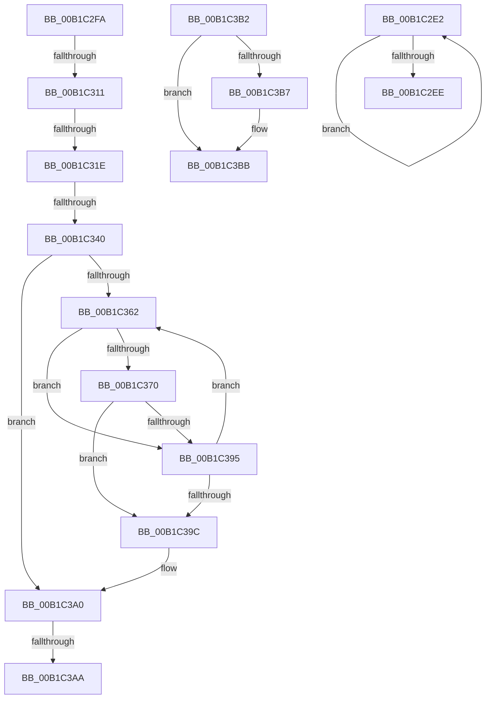

# sub_00B1C2E2

- RVA: `0x00B1C2E2`–`0x00B1C3CD` (길이 `235` bytes)
- VA: `0x0000000140B1C2E2`
- 실행 섹션: `PAGE`
- PDB 이름 있음: `아니요`; PDB Function 태그: `아니요`
- unwind 정보 RVA: `0x000855F4`
- 디코드: `61`개 명령, `235/235` bytes 표시
- 미해석 바이트: `0` (있으면 어셈블리에 `.byte`로 보존)

> 이 문서는 커널 이미지의 기계어와 PDB 기호를 분석해 생성했습니다. 4번과 5번은 함수 원형과 자료형을 바이너리 사용 방식에서 추정한 C 해석이며 원본 소스 복구 결과는 아닙니다.

## 1. Dependencies

- 직접 호출 지점: **1**; 고유 호출 대상: **1**
- 직접 호출자로 확인된 함수: **0**
- RIP 상대 이미지 참조: **0**

### Outgoing calls
- `0x00B1C37F` → [EtwpCovSampHashLookupInTable](../9D/EtwpCovSampHashLookupInTable_function_009D8200.md) (function, `0x009D8200`)

### Direct callers
- 이 함수 시작 RVA로 연결되는 직접 call은 확인되지 않았습니다. 간접 호출은 완전히 역산할 수 없습니다.

### Static image references
- 디코드된 RIP-relative 메모리 참조가 없습니다.

## 2. Other-region calls and transfers

- 다른 실행 섹션으로 향하는 call: **0**
- call이 아닌 외부 분기/꼬리 이동: **7**
  - `0x00B1C2F5` → [EtwpCovSampHashMakeRoomAndAcquireLock + 0x10A](../8D/EtwpCovSampHashMakeRoomAndAcquireLock_function_008D91F8.md) (`tail-transfer`)
  - `0x00B1C30B` → [EtwpCovSampHashMakeRoomAndAcquireLock + 0x1F2](../8D/EtwpCovSampHashMakeRoomAndAcquireLock_function_008D91F8.md) (`tail-transfer`)
  - `0x00B1C318` → [EtwpCovSampHashMakeRoomAndAcquireLock + 0x1F2](../8D/EtwpCovSampHashMakeRoomAndAcquireLock_function_008D91F8.md) (`tail-transfer`)
  - `0x00B1C33A` → [EtwpCovSampHashMakeRoomAndAcquireLock + 0x1F2](../8D/EtwpCovSampHashMakeRoomAndAcquireLock_function_008D91F8.md) (`tail-transfer`)
  - `0x00B1C3A4` → [EtwpCovSampHashMakeRoomAndAcquireLock + 0x98](../8D/EtwpCovSampHashMakeRoomAndAcquireLock_function_008D91F8.md) (`tail-transfer`)
  - `0x00B1C3AD` → [EtwpCovSampHashMakeRoomAndAcquireLock + 0x7E](../8D/EtwpCovSampHashMakeRoomAndAcquireLock_function_008D91F8.md) (`tail-transfer`)
  - `0x00B1C3C8` → [EtwpCovSampHashMakeRoomAndAcquireLock + 0xB7](../8D/EtwpCovSampHashMakeRoomAndAcquireLock_function_008D91F8.md) (`tail-transfer`)

## 3. Assembly (complete function range)

```asm
00B1C2E2  03 C9                           add ecx, ecx
00B1C2E4  6B C1 07                        imul eax, ecx, 7
00B1C2E7  C1 E8 03                        shr eax, 3
00B1C2EA  3B C2                           cmp eax, edx
00B1C2EC  72 F4                           jb 0x140b1c2e2
00B1C2EE  3B CD                           cmp ecx, ebp
00B1C2F0  0F 43 CD                        cmovae ecx, ebp
00B1C2F3  8B E9                           mov ebp, ecx
00B1C2F5  E9 08 D0 DB FF                  jmp 0x1408d9302
00B1C2FA  48 89 BB 80 06 00 00            mov qword ptr [rbx + 0x680], rdi
00B1C301  48 8B FE                        mov rdi, rsi
00B1C304  48 8B 0E                        mov rcx, qword ptr [rsi]
00B1C307  48 39 71 08                     cmp qword ptr [rcx + 8], rsi
00B1C30B  0F 85 D9 D0 DB FF               jne 0x1408d93ea
00B1C311  48 8B 46 08                     mov rax, qword ptr [rsi + 8]
00B1C315  48 39 30                        cmp qword ptr [rax], rsi
00B1C318  0F 85 CC D0 DB FF               jne 0x1408d93ea
00B1C31E  48 89 08                        mov qword ptr [rax], rcx
00B1C321  48 89 41 08                     mov qword ptr [rcx + 8], rax
00B1C325  48 8D 8B 90 06 00 00            lea rcx, [rbx + 0x690]
00B1C32C  48 8B 51 08                     mov rdx, qword ptr [rcx + 8]
00B1C330  48 8B 83 80 06 00 00            mov rax, qword ptr [rbx + 0x680]
00B1C337  48 39 0A                        cmp qword ptr [rdx], rcx
00B1C33A  0F 85 AA D0 DB FF               jne 0x1408d93ea
00B1C340  48 89 08                        mov qword ptr [rax], rcx
00B1C343  33 ED                           xor ebp, ebp
00B1C345  48 89 50 08                     mov qword ptr [rax + 8], rdx
00B1C349  48 89 02                        mov qword ptr [rdx], rax
00B1C34C  48 89 41 08                     mov qword ptr [rcx + 8], rax
00B1C350  48 8B 8B 80 06 00 00            mov rcx, qword ptr [rbx + 0x680]
00B1C357  8B 46 10                        mov eax, dword ptr [rsi + 0x10]
00B1C35A  89 41 10                        mov dword ptr [rcx + 0x10], eax
00B1C35D  39 6E 14                        cmp dword ptr [rsi + 0x14], ebp
00B1C360  76 3E                           jbe 0x140b1c3a0
00B1C362  48 8B 46 18                     mov rax, qword ptr [rsi + 0x18]
00B1C366  4C 8D 34 E8                     lea r14, [rax + rbp*8]
00B1C36A  49 83 3E 00                     cmp qword ptr [r14], 0
00B1C36E  74 25                           je 0x140b1c395
00B1C370  48 8B 8B 80 06 00 00            mov rcx, qword ptr [rbx + 0x680]
00B1C377  4C 8D 44 24 50                  lea r8, [rsp + 0x50]
00B1C37C  49 8B D6                        mov rdx, r14
00B1C37F  E8 7C BE EB FF                  call 0x1409d8200
00B1C384  49 8B 0E                        mov rcx, qword ptr [r14]
00B1C387  48 8B 44 24 50                  mov rax, qword ptr [rsp + 0x50]
00B1C38C  48 89 08                        mov qword ptr [rax], rcx
00B1C38F  83 46 10 FF                     add dword ptr [rsi + 0x10], -1
00B1C393  74 07                           je 0x140b1c39c
00B1C395  FF C5                           inc ebp
00B1C397  3B 6E 14                        cmp ebp, dword ptr [rsi + 0x14]
00B1C39A  72 C6                           jb 0x140b1c362
00B1C39C  49 83 CE FF                     or r14, 0xffffffffffffffff
00B1C3A0  41 83 FF 14                     cmp r15d, 0x14
00B1C3A4  0F 83 E6 CE DB FF               jae 0x1408d9290
00B1C3AA  41 FF C7                        inc r15d
00B1C3AD  E9 C4 CE DB FF                  jmp 0x1408d9276
00B1C3B2  48 85 FF                        test rdi, rdi
00B1C3B5  74 04                           je 0x140b1c3bb
00B1C3B7  C6 47 0A 01                     mov byte ptr [rdi + 0xa], 1
00B1C3BB  65 48 8B 04 25 88 01 00 00      mov rax, qword ptr gs:[0x188]
00B1C3C4  48 89 43 08                     mov qword ptr [rbx + 8], rax
00B1C3C8  E9 E2 CE DB FF                  jmp 0x1408d92af
```

## 4. C-style interpretation (structured pseudocode)

```c
__int64 __fastcall sub_00B1C2E2(int a1, int a2)
{
    __int64 result;
    unsigned __int64 v_stack_p50;

    a1 = (unsigned int)((a1) + (a1));
    result = (unsigned int)((result) * (a1));
    result = (unsigned int)((result) >> (3));
    if (((unsigned int)(result)) < a2) goto loc_00B1C2E2;
    if (a1 >= ((unsigned int)(v_rbp))) { a1 = (unsigned int)(v_rbp); }
}
```

## 5. (Beta) C Style

```c
int64_t sub_00B1C2E2(int32_t Arg1, int32_t Arg2)
{
    int64_t result;
    uint64_t v_stack_p50;

    Arg1 = (uint32_t)((Arg1) + (Arg1));
    result = (uint32_t)((result) * (Arg1));
    result = (uint32_t)((result) >> (3));
    if (((uint32_t)(result)) < Arg2) goto loc_00B1C2E2;
    if (Arg1 >= ((uint32_t)(local_rbp))) { Arg1 = (uint32_t)(local_rbp); }
}
```

## 6. Execution-region graph

[열기: 2D/3D 그래프와 함수 탐색 컨트롤 패널](../../../control-panel.html?section=page&rva=0x00B1C2E2&view=graph)

- 2D 그래프는 위에서 아래로 흐르고, 3D 그래프는 빈 공간을 드래그해 회전합니다. Shift+드래그는 이동, 휠은 확대·축소, 함수 노드 선택은 대상 보고서 이동입니다.

### Static fallback


