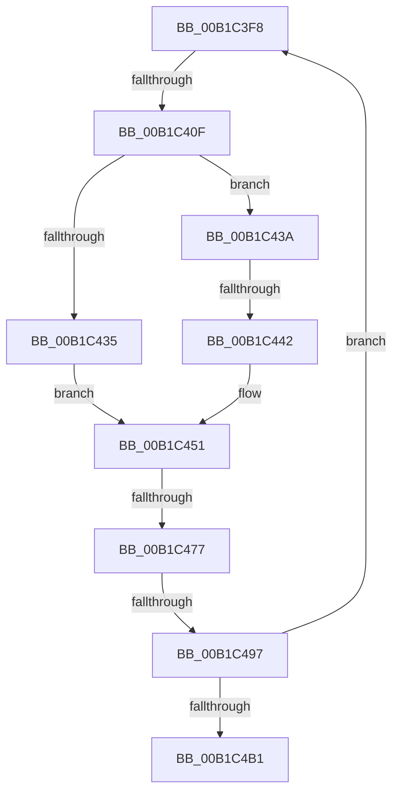

# sub_00B1C3F8

- RVA: `0x00B1C3F8`–`0x00B1C4B6` (길이 `190` bytes)
- VA: `0x0000000140B1C3F8`
- 실행 섹션: `PAGE`
- PDB 이름 있음: `아니요`; PDB Function 태그: `아니요`
- unwind 정보 RVA: `0x00085800`
- 디코드: `49`개 명령, `190/190` bytes 표시
- 미해석 바이트: `0` (있으면 어셈블리에 `.byte`로 보존)

> 이 문서는 커널 이미지의 기계어와 PDB 기호를 분석해 생성했습니다. 4번과 5번은 함수 원형과 자료형을 바이너리 사용 방식에서 추정한 C 해석이며 원본 소스 복구 결과는 아닙니다.

## 1. Dependencies

- 직접 호출 지점: **6**; 고유 호출 대상: **6**
- 직접 호출자로 확인된 함수: **0**
- RIP 상대 이미지 참조: **0**

### Outgoing calls
- `0x00B1C400` → [CmGetDeviceInterfaceClassGuid](../8F/CmGetDeviceInterfaceClassGuid_function_008F3380.md) (function, `0x008F3380`)
- `0x00B1C427` → [CmGetDeviceInterfaceReferenceString](../8F/CmGetDeviceInterfaceReferenceString_function_008F5AF8.md) (function, `0x008F5AF8`)
- `0x00B1C44C` → [RtlInitUnicodeString](../../text/42/RtlInitUnicodeString_function_0042A780.md) (function, `0x0042A780`)
- `0x00B1C468` → [IoRegisterDeviceInterface](../94/IoRegisterDeviceInterface_function_0094F9A0.md) (function, `0x0094F9A0`)
- `0x00B1C488` → [PiSwPropertySet](../8F/PiSwPropertySet_function_008F5EEC.md) (function, `0x008F5EEC`)
- `0x00B1C49E` → [RtlFreeAnsiString](../9C/RtlFreeAnsiString_function_009C0800.md) (function, `0x009C0800`)

### Direct callers
- 이 함수 시작 RVA로 연결되는 직접 call은 확인되지 않았습니다. 간접 호출은 완전히 역산할 수 없습니다.

### Static image references
- 디코드된 RIP-relative 메모리 참조가 없습니다.

## 2. Other-region calls and transfers

- 다른 실행 섹션으로 향하는 call: **1**
  - `0x00B1C44C` → [RtlInitUnicodeString](../../text/42/RtlInitUnicodeString_function_0042A780.md) (`PAGE` → `.text`)
- call이 아닌 외부 분기/꼬리 이동: **5**
  - `0x00B1C409` → [PiSwCompleteCreate + 0x1F3](../8D/PiSwCompleteCreate_function_008DAB90.md) (`tail-transfer`)
  - `0x00B1C43C` → [PiSwCompleteCreate + 0x1F3](../8D/PiSwCompleteCreate_function_008DAB90.md) (`tail-transfer`)
  - `0x00B1C471` → [PiSwCompleteCreate + 0x1F3](../8D/PiSwCompleteCreate_function_008DAB90.md) (`tail-transfer`)
  - `0x00B1C491` → [PiSwCompleteCreate + 0x1F3](../8D/PiSwCompleteCreate_function_008DAB90.md) (`tail-transfer`)
  - `0x00B1C4B1` → [PiSwCompleteCreate + 0x1F3](../8D/PiSwCompleteCreate_function_008DAB90.md) (`tail-transfer`)

## 3. Assembly (complete function range)

```asm
00B1C3F8  48 8B 56 10                     mov rdx, qword ptr [rsi + 0x10]
00B1C3FC  4C 8D 45 D0                     lea r8, [rbp - 0x30]
00B1C400  E8 7B 6F DD FF                  call 0x1408f3380
00B1C405  8B D8                           mov ebx, eax
00B1C407  85 C0                           test eax, eax
00B1C409  0F 88 74 E9 DB FF               js 0x1408dad83
00B1C40F  48 8B 56 10                     mov rdx, qword ptr [rsi + 0x10]
00B1C413  48 8D 44 24 58                  lea rax, [rsp + 0x58]
00B1C418  41 B9 04 01 00 00               mov r9d, 0x104
00B1C41E  48 89 44 24 20                  mov qword ptr [rsp + 0x20], rax
00B1C423  4C 8D 45 E0                     lea r8, [rbp - 0x20]
00B1C427  E8 CC 96 DD FF                  call 0x1408f5af8
00B1C42C  8B D8                           mov ebx, eax
00B1C42E  3D 34 00 00 C0                  cmp eax, 0xc0000034
00B1C433  75 05                           jne 0x140b1c43a
00B1C435  41 8A DD                        mov bl, r13b
00B1C438  EB 17                           jmp 0x140b1c451
00B1C43A  85 C0                           test eax, eax
00B1C43C  0F 88 41 E9 DB FF               js 0x1408dad83
00B1C442  48 8D 55 E0                     lea rdx, [rbp - 0x20]
00B1C446  B3 01                           mov bl, 1
00B1C448  48 8D 4D 90                     lea rcx, [rbp - 0x70]
00B1C44C  E8 2F E3 90 FF                  call 0x14042a780
00B1C451  48 8D 45 90                     lea rax, [rbp - 0x70]
00B1C455  F6 DB                           neg bl
00B1C457  4C 8D 4D 80                     lea r9, [rbp - 0x80]
00B1C45B  49 8B CC                        mov rcx, r12
00B1C45E  4D 1B C0                        sbb r8, r8
00B1C461  48 8D 55 D0                     lea rdx, [rbp - 0x30]
00B1C465  4C 23 C0                        and r8, rax
00B1C468  E8 33 35 E3 FF                  call 0x14094f9a0
00B1C46D  8B D8                           mov ebx, eax
00B1C46F  85 C0                           test eax, eax
00B1C471  0F 88 0C E9 DB FF               js 0x1408dad83
00B1C477  44 8B 4E 20                     mov r9d, dword ptr [rsi + 0x20]
00B1C47B  BA 03 00 00 00                  mov edx, 3
00B1C480  4C 8B 46 18                     mov r8, qword ptr [rsi + 0x18]
00B1C484  48 8B 4E 10                     mov rcx, qword ptr [rsi + 0x10]
00B1C488  E8 5F 9A DD FF                  call 0x1408f5eec
00B1C48D  8B D8                           mov ebx, eax
00B1C48F  85 C0                           test eax, eax
00B1C491  0F 88 EC E8 DB FF               js 0x1408dad83
00B1C497  48 8B 36                        mov rsi, qword ptr [rsi]
00B1C49A  48 8D 4D 80                     lea rcx, [rbp - 0x80]
00B1C49E  E8 5D 43 EA FF                  call 0x1409c0800
00B1C4A3  48 8D 44 24 38                  lea rax, [rsp + 0x38]
00B1C4A8  48 3B F0                        cmp rsi, rax
00B1C4AB  0F 85 47 FF FF FF               jne 0x140b1c3f8
00B1C4B1  E9 CD E8 DB FF                  jmp 0x1408dad83
```

## 4. C-style interpretation (structured pseudocode)

```c
__int64 __fastcall sub_00B1C3F8(__int64 a1, __int64 a2, __int64 a3, __int64 a4, __int64 a5, __int64 a6, __int64 a7, __int64 a8, __int64 a9, __int64 a10, __int64 a11)
{
    __int64 result;
    __int64 v_rbx;
    unsigned __int64 v_stack_p20;

    result = CmGetDeviceInterfaceClassGuid(a1, *(unsigned __int64 *)(v_rsi + 16), v_rbp - 48, a4);
    v_stack_p20 = a11;
    result = CmGetDeviceInterfaceReferenceString(a1, *(unsigned __int64 *)(v_rsi + 16), v_rbp - 32, 260);
    if (((unsigned int)(result)) != 0xC0000034ULL) goto loc_00B1C43A;
    goto loc_00B1C451;
loc_00B1C43A:
    result = RtlInitUnicodeString(v_rbp - 112, v_rbp - 32, v_rbp - 32, 260);
loc_00B1C451:
    v_rbx = (unsigned __int8)(-(1));
    a3 = (v_rbp - 32) & (v_rbp - 112);
    result = IoRegisterDeviceInterface(v_r12, v_rbp - 48, a3, v_rbp - 128);
    result = PiSwPropertySet(*(unsigned __int64 *)(v_rsi + 16), 3, *(unsigned __int64 *)(v_rsi + 24), (unsigned int)(*(unsigned int *)(v_rsi + 32)));
    result = RtlFreeAnsiString(v_rbp - 128, 3, *(unsigned __int64 *)(v_rsi + 24), (unsigned int)(*(unsigned int *)(v_rsi + 32)));
    if ((*(unsigned __int64 *)(v_rsi)) != a7) goto loc_00B1C3F8;
}
```

## 5. (Beta) C Style

```c
int64_t sub_00B1C3F8(int64_t Arg1, int64_t Arg2, int64_t Arg3, int64_t Arg4, uint64_t Arg5, uint64_t Arg6, int64_t Arg7, uint64_t Arg8, uint64_t Arg9, uint64_t Arg10, int64_t Arg11)
{
    int64_t result;
    int64_t local_rbx;
    uint64_t v_stack_p20;

    result = CmGetDeviceInterfaceClassGuid(Arg1, *(uint64_t *)(local_rsi + 0x10), local_rbp - 48, Arg4);
    v_stack_p20 = Arg11;
    result = CmGetDeviceInterfaceReferenceString(Arg1, *(uint64_t *)(local_rsi + 0x10), local_rbp - 32, 260);
    if (((uint32_t)(result)) != 0xC0000034ULL) goto loc_00B1C43A;
    goto loc_00B1C451;
loc_00B1C43A:
    result = RtlInitUnicodeString(local_rbp - 112, local_rbp - 32, local_rbp - 32, 260);
loc_00B1C451:
    local_rbx = (uint8_t)(-(1));
    Arg3 = (local_rbp - 32) & (local_rbp - 112);
    result = IoRegisterDeviceInterface(local_r12, local_rbp - 48, Arg3, local_rbp - 128);
    result = PiSwPropertySet(*(uint64_t *)(local_rsi + 0x10), 3, *(uint64_t *)(local_rsi + 0x18), (uint32_t)(*(uint32_t *)(local_rsi + 0x20)));
    result = RtlFreeAnsiString(local_rbp - 128, 3, *(uint64_t *)(local_rsi + 0x18), (uint32_t)(*(uint32_t *)(local_rsi + 0x20)));
    if ((*(uint64_t *)(local_rsi)) != Arg7) goto loc_00B1C3F8;
}
```

## 6. Execution-region graph

[열기: 2D/3D 그래프와 함수 탐색 컨트롤 패널](../../../control-panel.html?section=page&rva=0x00B1C3F8&view=graph)

- 2D 그래프는 위에서 아래로 흐르고, 3D 그래프는 빈 공간을 드래그해 회전합니다. Shift+드래그는 이동, 휠은 확대·축소, 함수 노드 선택은 대상 보고서 이동입니다.

### Static fallback


