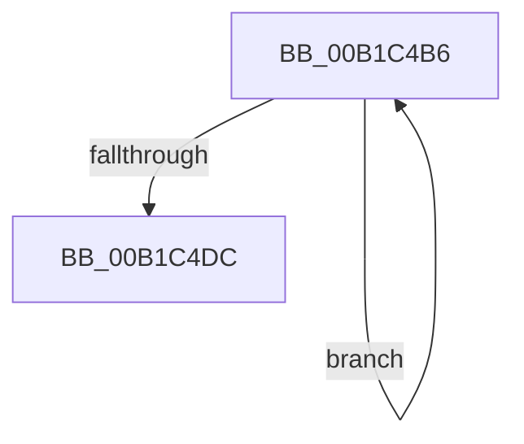

# sub_00B1C4B6

- RVA: `0x00B1C4B6`–`0x00B1C4F5` (길이 `63` bytes)
- VA: `0x0000000140B1C4B6`
- 실행 섹션: `PAGE`
- PDB 이름 있음: `아니요`; PDB Function 태그: `아니요`
- unwind 정보 RVA: `0x00085810`
- 디코드: `16`개 명령, `63/63` bytes 표시
- 미해석 바이트: `0` (있으면 어셈블리에 `.byte`로 보존)

> 이 문서는 커널 이미지의 기계어와 PDB 기호를 분석해 생성했습니다. 4번과 5번은 함수 원형과 자료형을 바이너리 사용 방식에서 추정한 C 해석이며 원본 소스 복구 결과는 아닙니다.

## 1. Dependencies

- 직접 호출 지점: **2**; 고유 호출 대상: **1**
- 직접 호출자로 확인된 함수: **0**
- RIP 상대 이미지 참조: **0**

### Outgoing calls
- `0x00B1C4D1` → [ExFreePoolWithTag](../../poolcode/B8/ExFreePoolWithTag_function_00B82870.md) (function, `0x00B82870`)
- `0x00B1C4E4` → [ExFreePoolWithTag](../../poolcode/B8/ExFreePoolWithTag_function_00B82870.md) (function, `0x00B82870`)

### Direct callers
- 이 함수 시작 RVA로 연결되는 직접 call은 확인되지 않았습니다. 간접 호출은 완전히 역산할 수 없습니다.

### Static image references
- 디코드된 RIP-relative 메모리 참조가 없습니다.

## 2. Other-region calls and transfers

- 다른 실행 섹션으로 향하는 call: **2**
  - `0x00B1C4D1` → [ExFreePoolWithTag](../../poolcode/B8/ExFreePoolWithTag_function_00B82870.md) (`PAGE` → `POOLCODE`)
  - `0x00B1C4E4` → [ExFreePoolWithTag](../../poolcode/B8/ExFreePoolWithTag_function_00B82870.md) (`PAGE` → `POOLCODE`)
- call이 아닌 외부 분기/꼬리 이동: **1**
  - `0x00B1C4F0` → [PnpCopyDevPropertyArray + 0x8E](../8D/PnpCopyDevPropertyArray_function_008DB0F8.md) (`tail-transfer`)

## 3. Assembly (complete function range)

```asm
00B1C4B6  48 8B 0B                        mov rcx, qword ptr [rbx]
00B1C4B9  4C 8D 04 6D 00 00 00 00         lea r8, [rbp*2]
00B1C4C1  4C 03 C5                        add r8, rbp
00B1C4C4  BA 50 6E 70 57                  mov edx, 0x57706e50
00B1C4C9  4D 03 C0                        add r8, r8
00B1C4CC  4A 8B 4C C1 28                  mov rcx, qword ptr [rcx + r8*8 + 0x28]
00B1C4D1  E8 9A 63 06 00                  call 0x140b82870
00B1C4D6  FF C5                           inc ebp
00B1C4D8  3B 2F                           cmp ebp, dword ptr [rdi]
00B1C4DA  72 DA                           jb 0x140b1c4b6
00B1C4DC  48 8B 0B                        mov rcx, qword ptr [rbx]
00B1C4DF  BA 50 6E 70 57                  mov edx, 0x57706e50
00B1C4E4  E8 87 63 06 00                  call 0x140b82870
00B1C4E9  83 27 00                        and dword ptr [rdi], 0
00B1C4EC  48 83 23 00                     and qword ptr [rbx], 0
00B1C4F0  E9 91 EC DB FF                  jmp 0x1408db186
```

## 4. C-style interpretation (structured pseudocode)

```c
__int64 __fastcall sub_00B1C4B6(void)
{
    __int64 result;
    __int64 v_rbp;

    a3 = (v_rbp * 2) + (v_rbp);
    a3 = (a3) + (a3);
    result = ExFreePoolWithTag(*(unsigned __int64 *)(*(unsigned __int64 *)(v_rbx) + a3 * 8 + 40), (unsigned int)(0x57706E50ULL), a3, a4);
    v_rbp = (unsigned int)((v_rbp) + 1);
    if (((unsigned int)(v_rbp)) < (*(unsigned int *)(v_rdi))) goto loc_00B1C4B6;
    result = ExFreePoolWithTag(*(unsigned __int64 *)(v_rbx), (unsigned int)(0x57706E50ULL), a3, a4);
}
```

## 5. (Beta) C Style

```c
void sub_00B1C4B6(void)
{
    int64_t result;
    int64_t local_rbp;

    a3 = (local_rbp * 2) + (local_rbp);
    a3 = (a3) + (a3);
    result = ExFreePoolWithTag(*(uint64_t *)(*(uint64_t *)(local_rbx) + a3 * 8 + 0x28), (uint32_t)(0x57706E50ULL), a3, a4);
    local_rbp = (uint32_t)((local_rbp) + 1);
    if (((uint32_t)(local_rbp)) < (*(uint32_t *)(local_rdi))) goto loc_00B1C4B6;
    result = ExFreePoolWithTag(*(uint64_t *)(local_rbx), (uint32_t)(0x57706E50ULL), a3, a4);
}
```

## 6. Execution-region graph

[열기: 2D/3D 그래프와 함수 탐색 컨트롤 패널](../../../control-panel.html?section=page&rva=0x00B1C4B6&view=graph)

- 2D 그래프는 위에서 아래로 흐르고, 3D 그래프는 빈 공간을 드래그해 회전합니다. Shift+드래그는 이동, 휠은 확대·축소, 함수 노드 선택은 대상 보고서 이동입니다.

### Static fallback


