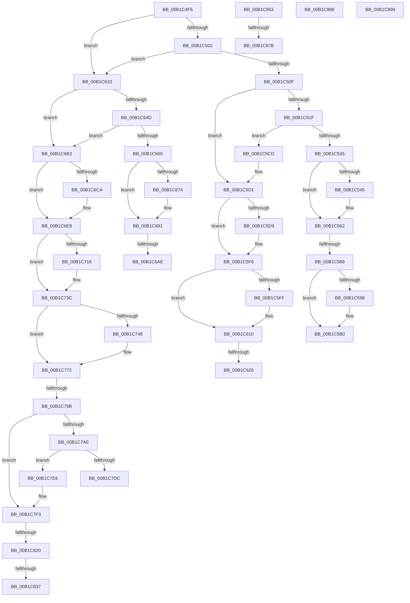

# sub_00B1C4F6

- RVA: `0x00B1C4F6`–`0x00B1C8B6` (길이 `960` bytes)
- VA: `0x0000000140B1C4F6`
- 실행 섹션: `PAGE`
- PDB 이름 있음: `아니요`; PDB Function 태그: `아니요`
- unwind 정보 RVA: `0x0008583C`
- 디코드: `228`개 명령, `960/960` bytes 표시
- 미해석 바이트: `0` (있으면 어셈블리에 `.byte`로 보존)

> 이 문서는 커널 이미지의 기계어와 PDB 기호를 분석해 생성했습니다. 4번과 5번은 함수 원형과 자료형을 바이너리 사용 방식에서 추정한 C 해석이며 원본 소스 복구 결과는 아닙니다.

## 1. Dependencies

- 직접 호출 지점: **31**; 고유 호출 대상: **24**
- 직접 호출자로 확인된 함수: **0**
- RIP 상대 이미지 참조: **5**

### Outgoing calls
- `0x00B1C525` → [PiSwDoesCreateChangesRequireReEnum](../AA/PiSwDoesCreateChangesRequireReEnum_function_00AAE658.md) (function, `0x00AAE658`)
- `0x00B1C55D` → [McTemplateK0zz_EtwWriteTransfer](../../text/5A/McTemplateK0zz_EtwWriteTransfer_function_005A9408.md) (function, `0x005A9408`)
- `0x00B1C576` → [PnpCopyDevPropertyArray](../8D/PnpCopyDevPropertyArray_function_008DB0F8.md) (function, `0x008DB0F8`)
- `0x00B1C5A4` → [PnpFreeDevPropertyArray](../8D/PnpFreeDevPropertyArray_function_008DE78C.md) (function, `0x008DE78C`)
- `0x00B1C5ED` → [McTemplateK0zz_EtwWriteTransfer](../../text/5A/McTemplateK0zz_EtwWriteTransfer_function_005A9408.md) (function, `0x005A9408`)
- `0x00B1C5FF` → [PiSwQueuedCreateInfoFree](../94/PiSwQueuedCreateInfoFree_function_0094D92C.md) (function, `0x0094D92C`)
- `0x00B1C617` → [PiSwQueuedCreateInfoCreate](../73/PiSwQueuedCreateInfoCreate_function_0073B1BC.md) (function, `0x0073B1BC`)
- `0x00B1C63C` → [PnpDeviceObjectFromDeviceInstanceWithTag](../8E/PnpDeviceObjectFromDeviceInstanceWithTag_function_008E7490.md) (function, `0x008E7490`)
- `0x00B1C656` → [PiSwFindPdoAssociation](../A9/PiSwFindPdoAssociation_function_00A90934.md) (function, `0x00A90934`)
- `0x00B1C663` → [ObfDereferenceObject](../../text/2F/ObfDereferenceObject_function_002F9350.md) (function, `0x002F9350`)
- `0x00B1C68C` → [McTemplateK0zz_EtwWriteTransfer](../../text/5A/McTemplateK0zz_EtwWriteTransfer_function_005A9408.md) (function, `0x005A9408`)
- `0x00B1C69C` → [PiSwQueuedCreateInfoCreate](../73/PiSwQueuedCreateInfoCreate_function_0073B1BC.md) (function, `0x0073B1BC`)
- `0x00B1C6BF` → [wcsicmp](../../text/50/wcsicmp_function_00500080.md) (function, `0x00500080`)
- `0x00B1C6D2` → [RtlInitUnicodeString](../../text/42/RtlInitUnicodeString_function_0042A780.md) (function, `0x0042A780`)
- `0x00B1C6E0` → [PnpDeviceObjectFromDeviceInstanceWithTag](../8E/PnpDeviceObjectFromDeviceInstanceWithTag_function_008E7490.md) (function, `0x008E7490`)
- `0x00B1C6F4` → [PiSwBusRelationRemove](../94/PiSwBusRelationRemove_function_0094D9C0.md) (function, `0x0094D9C0`)
- `0x00B1C701` → [PiSwPnPInfoFree](../8D/PiSwPnPInfoFree_function_008DA6F8.md) (function, `0x008DA6F8`)
- `0x00B1C71E` → [ExFreePoolWithTag](../../poolcode/B8/ExFreePoolWithTag_function_00B82870.md) (function, `0x00B82870`)
- `0x00B1C754` → [PnpFreeDevPropertyArray](../8D/PnpFreeDevPropertyArray_function_008DE78C.md) (function, `0x008DE78C`)
- `0x00B1C779` → [PiSwFreeInterfaceList](../8D/PiSwFreeInterfaceList_function_008DAB4C.md) (function, `0x008DAB4C`)
- `0x00B1C789` → [PiSwPnPInfoInit](../8D/PiSwPnPInfoInit_function_008DB2DC.md) (function, `0x008DB2DC`)
- `0x00B1C7BC` → [ExAllocatePool2](../../poolcode/B8/ExAllocatePool2_function_00B820F0.md) (function, `0x00B820F0`)
- `0x00B1C7EE` → [memcpy](../../text/6C/memcpy_function_006C6840.md) (function, `0x006C6840`)
- `0x00B1C811` → [PnpCopyDevPropertyArray](../8D/PnpCopyDevPropertyArray_function_008DB0F8.md) (function, `0x008DB0F8`)
- `0x00B1C828` → [PiSwBusRelationAdd](../8D/PiSwBusRelationAdd_function_008DA994.md) (function, `0x008DA994`)
- `0x00B1C837` → [PsGetCurrentProcessId](../../text/43/PsGetCurrentProcessId_function_00433560.md) (function, `0x00433560`)
- `0x00B1C85E` → [RtlDeleteElementGenericTableAvl](../../text/3E/RtlDeleteElementGenericTableAvl_function_003EE750.md) (function, `0x003EE750`)
- `0x00B1C867` → [PiSwDeviceDereference](../94/PiSwDeviceDereference_function_0094E8A8.md) (function, `0x0094E8A8`)
- `0x00B1C87B` → [PiSwBusRelationRemove](../94/PiSwBusRelationRemove_function_0094D9C0.md) (function, `0x0094D9C0`)
- `0x00B1C88E` → [IofCompleteRequest](../../text/29/IofCompleteRequest_function_0029B5C0.md) (function, `0x0029B5C0`)
- `0x00B1C8AB` → [PiSwIrpCleanup](../73/PiSwIrpCleanup_function_0073AC10.md) (function, `0x0073AC10`)

### Direct callers
- 이 함수 시작 RVA로 연결되는 직접 call은 확인되지 않았습니다. 간접 호출은 완전히 역산할 수 없습니다.

### Static image references
- `0x00B1C535` → RVA `0x00EF012C` (`.data`; reference)
- `0x00B1C549` → RVA `0x00027070` (`.rdata`; read)
- `0x00B1C5DD` → RVA `0x00026FD0` (`.rdata`; read)
- `0x00B1C66B` → RVA `0x00EF012C` (`.data`; read)
- `0x00B1C857` → RVA `0x00F8AAA0` (`.data`; read)

## 2. Other-region calls and transfers

- 다른 실행 섹션으로 향하는 call: **12**
  - `0x00B1C55D` → [McTemplateK0zz_EtwWriteTransfer](../../text/5A/McTemplateK0zz_EtwWriteTransfer_function_005A9408.md) (`PAGE` → `.text`)
  - `0x00B1C5ED` → [McTemplateK0zz_EtwWriteTransfer](../../text/5A/McTemplateK0zz_EtwWriteTransfer_function_005A9408.md) (`PAGE` → `.text`)
  - `0x00B1C663` → [ObfDereferenceObject](../../text/2F/ObfDereferenceObject_function_002F9350.md) (`PAGE` → `.text`)
  - `0x00B1C68C` → [McTemplateK0zz_EtwWriteTransfer](../../text/5A/McTemplateK0zz_EtwWriteTransfer_function_005A9408.md) (`PAGE` → `.text`)
  - `0x00B1C6BF` → [wcsicmp](../../text/50/wcsicmp_function_00500080.md) (`PAGE` → `.text`)
  - `0x00B1C6D2` → [RtlInitUnicodeString](../../text/42/RtlInitUnicodeString_function_0042A780.md) (`PAGE` → `.text`)
  - `0x00B1C71E` → [ExFreePoolWithTag](../../poolcode/B8/ExFreePoolWithTag_function_00B82870.md) (`PAGE` → `POOLCODE`)
  - `0x00B1C7BC` → [ExAllocatePool2](../../poolcode/B8/ExAllocatePool2_function_00B820F0.md) (`PAGE` → `POOLCODE`)
  - `0x00B1C7EE` → [memcpy](../../text/6C/memcpy_function_006C6840.md) (`PAGE` → `.text`)
  - `0x00B1C837` → [PsGetCurrentProcessId](../../text/43/PsGetCurrentProcessId_function_00433560.md) (`PAGE` → `.text`)
  - `0x00B1C85E` → [RtlDeleteElementGenericTableAvl](../../text/3E/RtlDeleteElementGenericTableAvl_function_003EE750.md) (`PAGE` → `.text`)
  - `0x00B1C88E` → [IofCompleteRequest](../../text/29/IofCompleteRequest_function_0029B5C0.md) (`PAGE` → `.text`)
- call이 아닌 외부 분기/꼬리 이동: **15**
  - `0x00B1C582` → [PiSwIrpStartCreateWorker + 0x7D](../8D/PiSwIrpStartCreateWorker_function_008DB398.md) (`tail-transfer`)
  - `0x00B1C5C8` → [PiSwIrpStartCreateWorker + 0x27E](../8D/PiSwIrpStartCreateWorker_function_008DB398.md) (`tail-transfer`)
  - `0x00B1C620` → [PiSwIrpStartCreateWorker + 0x7D](../8D/PiSwIrpStartCreateWorker_function_008DB398.md) (`tail-transfer`)
  - `0x00B1C62E` → [PiSwIrpStartCreateWorker + 0x263](../8D/PiSwIrpStartCreateWorker_function_008DB398.md) (`tail-transfer`)
  - `0x00B1C6A8` → [PiSwIrpStartCreateWorker + 0x7D](../8D/PiSwIrpStartCreateWorker_function_008DB398.md) (`tail-transfer`)
  - `0x00B1C6AE` → [PiSwIrpStartCreateWorker + 0x27B](../8D/PiSwIrpStartCreateWorker_function_008DB398.md) (`tail-transfer`)
  - `0x00B1C795` → [PiSwIrpStartCreateWorker + 0x7D](../8D/PiSwIrpStartCreateWorker_function_008DB398.md) (`tail-transfer`)
  - `0x00B1C7E1` → [PiSwIrpStartCreateWorker + 0x7D](../8D/PiSwIrpStartCreateWorker_function_008DB398.md) (`tail-transfer`)
  - `0x00B1C81A` → [PiSwIrpStartCreateWorker + 0x7D](../8D/PiSwIrpStartCreateWorker_function_008DB398.md) (`tail-transfer`)
  - `0x00B1C831` → [PiSwIrpStartCreateWorker + 0x7D](../8D/PiSwIrpStartCreateWorker_function_008DB398.md) (`tail-transfer`)
  - `0x00B1C84E` → [PiSwIrpStartCreateWorker + 0x278](../8D/PiSwIrpStartCreateWorker_function_008DB398.md) (`tail-transfer`)
  - `0x00B1C875` → [PiSwIrpStartCreateWorker + 0x7D](../8D/PiSwIrpStartCreateWorker_function_008DB398.md) (`tail-transfer`)
  - `0x00B1C881` → [PiSwIrpStartCreateWorker + 0x7D](../8D/PiSwIrpStartCreateWorker_function_008DB398.md) (`tail-transfer`)
  - `0x00B1C894` → [PiSwIrpStartCreateWorker + 0xA9](../8D/PiSwIrpStartCreateWorker_function_008DB398.md) (`tail-transfer`)
  - `0x00B1C8B1` → [PiSwIrpStartCreateWorker + 0xA9](../8D/PiSwIrpStartCreateWorker_function_008DB398.md) (`tail-transfer`)

## 3. Assembly (complete function range)

```asm
00B1C4F6  41 8B 40 04                     mov eax, dword ptr [r8 + 4]
00B1C4FA  A8 02                           test al, 2
00B1C4FC  0F 85 31 01 00 00               jne 0x140b1c633
00B1C502  49 8B 40 78                     mov rax, qword ptr [r8 + 0x78]
00B1C506  48 85 C0                        test rax, rax
00B1C509  0F 84 24 01 00 00               je 0x140b1c633
00B1C50F  48 8B 40 40                     mov rax, qword ptr [rax + 0x40]
00B1C513  8B 48 08                        mov ecx, dword ptr [rax + 8]
00B1C516  F6 C1 02                        test cl, 2
00B1C519  0F 85 B2 00 00 00               jne 0x140b1c5d1
00B1C51F  48 8B D7                        mov rdx, rdi
00B1C522  49 8B C8                        mov rcx, r8
00B1C525  E8 2E 21 F9 FF                  call 0x140aae658
00B1C52A  45 33 DB                        xor r11d, r11d
00B1C52D  84 C0                           test al, al
00B1C52F  0F 85 98 00 00 00               jne 0x140b1c5cd
00B1C535  84 1D F1 3B 3D 00               test byte ptr [rip + 0x3d3bf1], bl
00B1C53B  44 89 5D 50                     mov dword ptr [rbp + 0x50], r11d
00B1C53F  4C 89 5D D8                     mov qword ptr [rbp - 0x28], r11
00B1C543  74 1D                           je 0x140b1c562
00B1C545  4C 8B 4D 58                     mov r9, qword ptr [rbp + 0x58]
00B1C549  48 8D 15 20 AB 50 FF            lea rdx, [rip - 0xaf54e0]
00B1C550  49 8B 41 10                     mov rax, qword ptr [r9 + 0x10]
00B1C554  4D 8B 49 08                     mov r9, qword ptr [r9 + 8]
00B1C558  48 89 44 24 20                  mov qword ptr [rsp + 0x20], rax
00B1C55D  E8 A6 CE A8 FF                  call 0x1405a9408
00B1C562  48 8B 57 70                     mov rdx, qword ptr [rdi + 0x70]
00B1C566  48 8D 45 D8                     lea rax, [rbp - 0x28]
00B1C56A  8B 4F 68                        mov ecx, dword ptr [rdi + 0x68]
00B1C56D  4C 8D 4D 50                     lea r9, [rbp + 0x50]
00B1C571  48 89 44 24 20                  mov qword ptr [rsp + 0x20], rax
00B1C576  E8 7D EB DB FF                  call 0x1408db0f8
00B1C57B  45 33 DB                        xor r11d, r11d
00B1C57E  8B D8                           mov ebx, eax
00B1C580  85 C0                           test eax, eax
00B1C582  0F 88 8D EE DB FF               js 0x1408db415
00B1C588  48 8B 4D 58                     mov rcx, qword ptr [rbp + 0x58]
00B1C58C  48 8B 91 A8 00 00 00            mov rdx, qword ptr [rcx + 0xa8]
00B1C593  48 85 D2                        test rdx, rdx
00B1C596  74 18                           je 0x140b1c5b0
00B1C598  8B 89 B0 00 00 00               mov ecx, dword ptr [rcx + 0xb0]
00B1C59E  41 B8 50 6E 70 57               mov r8d, 0x57706e50
00B1C5A4  E8 E3 21 DC FF                  call 0x1408de78c
00B1C5A9  48 8B 4D 58                     mov rcx, qword ptr [rbp + 0x58]
00B1C5AD  45 33 DB                        xor r11d, r11d
00B1C5B0  8B 45 50                        mov eax, dword ptr [rbp + 0x50]
00B1C5B3  89 81 B0 00 00 00               mov dword ptr [rcx + 0xb0], eax
00B1C5B9  48 8B 4D 58                     mov rcx, qword ptr [rbp + 0x58]
00B1C5BD  48 8B 45 D8                     mov rax, qword ptr [rbp - 0x28]
00B1C5C1  48 89 81 A8 00 00 00            mov qword ptr [rcx + 0xa8], rax
00B1C5C8  E9 49 F0 DB FF                  jmp 0x1408db616
00B1C5CD  4C 8B 45 58                     mov r8, qword ptr [rbp + 0x58]
00B1C5D1  84 1D 55 3B 3D 00               test byte ptr [rip + 0x3d3b55], bl
00B1C5D7  74 1D                           je 0x140b1c5f6
00B1C5D9  49 8B 40 10                     mov rax, qword ptr [r8 + 0x10]
00B1C5DD  48 8D 15 EC A9 50 FF            lea rdx, [rip - 0xaf5614]
00B1C5E4  4D 8B 48 08                     mov r9, qword ptr [r8 + 8]
00B1C5E8  48 89 44 24 20                  mov qword ptr [rsp + 0x20], rax
00B1C5ED  E8 16 CE A8 FF                  call 0x1405a9408
00B1C5F2  4C 8B 45 58                     mov r8, qword ptr [rbp + 0x58]
00B1C5F6  49 8B 48 58                     mov rcx, qword ptr [r8 + 0x58]
00B1C5FA  48 85 C9                        test rcx, rcx
00B1C5FD  74 11                           je 0x140b1c610
00B1C5FF  E8 28 13 E3 FF                  call 0x14094d92c
00B1C604  48 8B 45 58                     mov rax, qword ptr [rbp + 0x58]
00B1C608  4C 21 60 58                     and qword ptr [rax + 0x58], r12
00B1C60C  4C 8B 45 58                     mov r8, qword ptr [rbp + 0x58]
00B1C610  49 8D 48 58                     lea rcx, [r8 + 0x58]
00B1C614  48 8B D7                        mov rdx, rdi
00B1C617  E8 A0 EB C1 FF                  call 0x14073b1bc
00B1C61C  8B D8                           mov ebx, eax
00B1C61E  85 C0                           test eax, eax
00B1C620  0F 88 EF ED DB FF               js 0x1408db415
00B1C626  48 8B 45 58                     mov rax, qword ptr [rbp + 0x58]
00B1C62A  83 48 04 02                     or dword ptr [rax + 4], 2
00B1C62E  E9 C8 EF DB FF                  jmp 0x1408db5fb
00B1C633  49 8B 48 70                     mov rcx, qword ptr [r8 + 0x70]
00B1C637  BA 44 66 6C 74                  mov edx, 0x746c6644
00B1C63C  E8 4F AE DC FF                  call 0x1408e7490
00B1C641  48 8B 5D 58                     mov rbx, qword ptr [rbp + 0x58]
00B1C645  4C 8B F0                        mov r14, rax
00B1C648  48 85 C0                        test rax, rax
00B1C64B  74 66                           je 0x140b1c6b3
00B1C64D  41 B0 01                        mov r8b, 1
00B1C650  48 8B D0                        mov rdx, rax
00B1C653  48 8B CB                        mov rcx, rbx
00B1C656  E8 D9 42 F7 FF                  call 0x140a90934
00B1C65B  48 85 C0                        test rax, rax
00B1C65E  74 53                           je 0x140b1c6b3
00B1C660  48 8B CA                        mov rcx, rdx
00B1C663  E8 E8 CC 7D FF                  call 0x1402f9350
00B1C668  45 33 F6                        xor r14d, r14d
00B1C66B  F6 05 BA 3A 3D 00 40            test byte ptr [rip + 0x3d3aba], 0x40
00B1C672  74 1D                           je 0x140b1c691
00B1C674  4C 8B 4D 58                     mov r9, qword ptr [rbp + 0x58]
00B1C678  48 8D 15 51 A9 50 FF            lea rdx, [rip - 0xaf56af]
00B1C67F  49 8B 41 10                     mov rax, qword ptr [r9 + 0x10]
00B1C683  4D 8B 49 08                     mov r9, qword ptr [r9 + 8]
00B1C687  48 89 44 24 20                  mov qword ptr [rsp + 0x20], rax
00B1C68C  E8 77 CD A8 FF                  call 0x1405a9408
00B1C691  48 8B 4D 58                     mov rcx, qword ptr [rbp + 0x58]
00B1C695  48 8B D7                        mov rdx, rdi
00B1C698  48 83 C1 58                     add rcx, 0x58
00B1C69C  E8 1B EB C1 FF                  call 0x14073b1bc
00B1C6A1  45 33 DB                        xor r11d, r11d
00B1C6A4  8B D8                           mov ebx, eax
00B1C6A6  85 C0                           test eax, eax
00B1C6A8  0F 88 67 ED DB FF               js 0x1408db415
00B1C6AE  E9 60 EF DB FF                  jmp 0x1408db613
00B1C6B3  48 8B 4B 70                     mov rcx, qword ptr [rbx + 0x70]
00B1C6B7  48 8B 57 08                     mov rdx, qword ptr [rdi + 8]
00B1C6BB  48 8B 49 08                     mov rcx, qword ptr [rcx + 8]
00B1C6BF  E8 BC 39 9E FF                  call 0x140500080
00B1C6C4  33 DB                           xor ebx, ebx
00B1C6C6  85 C0                           test eax, eax
00B1C6C8  74 1E                           je 0x140b1c6e8
00B1C6CA  48 8B 57 08                     mov rdx, qword ptr [rdi + 8]
00B1C6CE  48 8D 4D E8                     lea rcx, [rbp - 0x18]
00B1C6D2  E8 A9 E0 90 FF                  call 0x14042a780
00B1C6D7  BA 44 66 6C 74                  mov edx, 0x746c6644
00B1C6DC  48 8D 4D E8                     lea rcx, [rbp - 0x18]
00B1C6E0  E8 AB AD DC FF                  call 0x1408e7490
00B1C6E5  4C 8B E0                        mov r12, rax
00B1C6E8  48 8B 4D 58                     mov rcx, qword ptr [rbp + 0x58]
00B1C6EC  83 61 04 FB                     and dword ptr [rcx + 4], 0xfffffffb
00B1C6F0  48 8B 4D 58                     mov rcx, qword ptr [rbp + 0x58]
00B1C6F4  E8 C7 12 E3 FF                  call 0x14094d9c0
00B1C6F9  48 8B 4D 58                     mov rcx, qword ptr [rbp + 0x58]
00B1C6FD  48 83 C1 18                     add rcx, 0x18
00B1C701  E8 F2 DF DB FF                  call 0x1408da6f8
00B1C706  48 8B 4D 58                     mov rcx, qword ptr [rbp + 0x58]
00B1C70A  4C 8B 81 98 00 00 00            mov r8, qword ptr [rcx + 0x98]
00B1C711  4D 85 C0                        test r8, r8
00B1C714  74 26                           je 0x140b1c73c
00B1C716  BA 50 6E 70 57                  mov edx, 0x57706e50
00B1C71B  49 8B C8                        mov rcx, r8
00B1C71E  E8 4D 61 06 00                  call 0x140b82870
00B1C723  48 8B 45 58                     mov rax, qword ptr [rbp + 0x58]
00B1C727  48 89 98 98 00 00 00            mov qword ptr [rax + 0x98], rbx
00B1C72E  48 8B 45 58                     mov rax, qword ptr [rbp + 0x58]
00B1C732  89 98 A0 00 00 00               mov dword ptr [rax + 0xa0], ebx
00B1C738  48 8B 4D 58                     mov rcx, qword ptr [rbp + 0x58]
00B1C73C  48 8B 91 A8 00 00 00            mov rdx, qword ptr [rcx + 0xa8]
00B1C743  48 85 D2                        test rdx, rdx
00B1C746  74 2A                           je 0x140b1c772
00B1C748  8B 89 B0 00 00 00               mov ecx, dword ptr [rcx + 0xb0]
00B1C74E  41 B8 50 6E 70 57               mov r8d, 0x57706e50
00B1C754  E8 33 20 DC FF                  call 0x1408de78c
00B1C759  48 8B 45 58                     mov rax, qword ptr [rbp + 0x58]
00B1C75D  89 98 B0 00 00 00               mov dword ptr [rax + 0xb0], ebx
00B1C763  48 8B 45 58                     mov rax, qword ptr [rbp + 0x58]
00B1C767  48 89 98 A8 00 00 00            mov qword ptr [rax + 0xa8], rbx
00B1C76E  48 8B 4D 58                     mov rcx, qword ptr [rbp + 0x58]
00B1C772  48 81 C1 B8 00 00 00            add rcx, 0xb8
00B1C779  E8 CE E3 DB FF                  call 0x1408dab4c
00B1C77E  48 8B 4D 58                     mov rcx, qword ptr [rbp + 0x58]
00B1C782  48 8B D7                        mov rdx, rdi
00B1C785  48 83 C1 18                     add rcx, 0x18
00B1C789  E8 4E EB DB FF                  call 0x1408db2dc
00B1C78E  45 33 DB                        xor r11d, r11d
00B1C791  8B D8                           mov ebx, eax
00B1C793  85 C0                           test eax, eax
00B1C795  0F 88 7A EC DB FF               js 0x1408db415
00B1C79B  48 8B 45 58                     mov rax, qword ptr [rbp + 0x58]
00B1C79F  8B 4F 58                        mov ecx, dword ptr [rdi + 0x58]
00B1C7A2  89 88 A0 00 00 00               mov dword ptr [rax + 0xa0], ecx
00B1C7A8  4C 39 5F 60                     cmp qword ptr [rdi + 0x60], r11
00B1C7AC  74 45                           je 0x140b1c7f3
00B1C7AE  8B 57 58                        mov edx, dword ptr [rdi + 0x58]
00B1C7B1  B9 00 01 00 00                  mov ecx, 0x100
00B1C7B6  41 B8 50 6E 70 57               mov r8d, 0x57706e50
00B1C7BC  E8 2F 59 06 00                  call 0x140b820f0
00B1C7C1  48 8B 4D 58                     mov rcx, qword ptr [rbp + 0x58]
00B1C7C5  48 89 81 98 00 00 00            mov qword ptr [rcx + 0x98], rax
00B1C7CC  48 8B 45 58                     mov rax, qword ptr [rbp + 0x58]
00B1C7D0  48 8B 88 98 00 00 00            mov rcx, qword ptr [rax + 0x98]
00B1C7D7  48 85 C9                        test rcx, rcx
00B1C7DA  75 0A                           jne 0x140b1c7e6
00B1C7DC  BB 9A 00 00 C0                  mov ebx, 0xc000009a
00B1C7E1  E9 2F EC DB FF                  jmp 0x1408db415
00B1C7E6  44 8B 47 58                     mov r8d, dword ptr [rdi + 0x58]
00B1C7EA  48 8B 57 60                     mov rdx, qword ptr [rdi + 0x60]
00B1C7EE  E8 4D A0 BA FF                  call 0x1406c6840
00B1C7F3  4C 8B 4D 58                     mov r9, qword ptr [rbp + 0x58]
00B1C7F7  48 8B 57 70                     mov rdx, qword ptr [rdi + 0x70]
00B1C7FB  8B 4F 68                        mov ecx, dword ptr [rdi + 0x68]
00B1C7FE  49 8D 81 A8 00 00 00            lea rax, [r9 + 0xa8]
00B1C805  49 81 C1 B0 00 00 00            add r9, 0xb0
00B1C80C  48 89 44 24 20                  mov qword ptr [rsp + 0x20], rax
00B1C811  E8 E2 E8 DB FF                  call 0x1408db0f8
00B1C816  8B D8                           mov ebx, eax
00B1C818  85 C0                           test eax, eax
00B1C81A  0F 88 F5 EB DB FF               js 0x1408db415
00B1C820  48 8B 55 58                     mov rdx, qword ptr [rbp + 0x58]
00B1C824  48 8B 4F 08                     mov rcx, qword ptr [rdi + 8]
00B1C828  E8 67 E1 DB FF                  call 0x1408da994
00B1C82D  8B D8                           mov ebx, eax
00B1C82F  85 C0                           test eax, eax
00B1C831  0F 88 DE EB DB FF               js 0x1408db415
00B1C837  E8 24 6D 91 FF                  call 0x140433560
00B1C83C  48 8B 4D 58                     mov rcx, qword ptr [rbp + 0x58]
00B1C840  89 81 A4 00 00 00               mov dword ptr [rcx + 0xa4], eax
00B1C846  48 8B 45 58                     mov rax, qword ptr [rbp + 0x58]
00B1C84A  83 60 04 FD                     and dword ptr [rax + 4], 0xfffffffd
00B1C84E  E9 BD ED DB FF                  jmp 0x1408db610
00B1C853  48 8D 55 58                     lea rdx, [rbp + 0x58]
00B1C857  48 8D 0D 42 E2 46 00            lea rcx, [rip + 0x46e242]
00B1C85E  E8 ED 1E 8D FF                  call 0x1403ee750
00B1C863  48 8B 4D 58                     mov rcx, qword ptr [rbp + 0x58]
00B1C867  E8 3C 20 E3 FF                  call 0x14094e8a8
00B1C86C  48 8B 4D 58                     mov rcx, qword ptr [rbp + 0x58]
00B1C870  48 83 79 70 00                  cmp qword ptr [rcx + 0x70], 0
00B1C875  0F 84 9A EB DB FF               je 0x1408db415
00B1C87B  E8 40 11 E3 FF                  call 0x14094d9c0
00B1C880  90                              nop
00B1C881  E9 8F EB DB FF                  jmp 0x1408db415
00B1C886  33 D2                           xor edx, edx
00B1C888  89 5E 30                        mov dword ptr [rsi + 0x30], ebx
00B1C88B  48 8B CE                        mov rcx, rsi
00B1C88E  E8 2D ED 77 FF                  call 0x14029b5c0
00B1C893  90                              nop
00B1C894  E9 A8 EB DB FF                  jmp 0x1408db441
00B1C899  48 8B 45 58                     mov rax, qword ptr [rbp + 0x58]
00B1C89D  C7 80 B4 00 00 00 01 00 00 00   mov dword ptr [rax + 0xb4], 1
00B1C8A7  48 8B 4D 58                     mov rcx, qword ptr [rbp + 0x58]
00B1C8AB  E8 60 E3 C1 FF                  call 0x14073ac10
00B1C8B0  90                              nop
00B1C8B1  E9 8B EB DB FF                  jmp 0x1408db441
```

## 4. C-style interpretation (structured pseudocode)

```c
__int64 __fastcall sub_00B1C4F6(__int64 a1, __int64 a2, __int64 a3)
{
    __int64 result;
    __int64 v_r11;
    __int64 v_r12;
    __int64 v_r14;
    __int64 v_rbx;
    unsigned __int64 v_stack_p20;

    if ((((unsigned __int8)((unsigned int)(*(unsigned int *)(a3 + 4)))) & (2)) != 0) goto loc_00B1C633;
    if (*(unsigned __int64 *)(a3 + 120) == 0) goto loc_00B1C633;
    if ((((unsigned __int8)((unsigned int)(*(unsigned int *)(*(unsigned __int64 *)(*(unsigned __int64 *)(a3 + 120) + 64) + 8)))) & (2)) != 0) goto loc_00B1C5D1;
    result = PiSwDoesCreateChangesRequireReEnum(a3, v_rdi, a3, a4);
    v_r11 = 0;
    if ((unsigned __int8)(result) != 0) goto loc_00B1C5CD;
    *(unsigned int *)(v_rbp + 80) = 0;
    *(unsigned __int64 *)(v_rbp - 40) = 0;
    if (((*(unsigned __int8 *)(v_rip + 4013041)) & ((unsigned __int8)(v_rbx))) != 0) {
        a4 = *(unsigned __int64 *)(v_rbp + 88);
        a2 = v_rip - 11490528;
        result = *(unsigned __int64 *)(a4 + 16);
        a4 = *(unsigned __int64 *)(a4 + 8);
        v_stack_p20 = result;
        result = McTemplateK0zz_EtwWriteTransfer(a3, a2, a3, a4);
    }
    v_stack_p20 = v_rbp - 40;
    result = PnpCopyDevPropertyArray((unsigned int)(*(unsigned int *)(v_rdi + 104)), *(unsigned __int64 *)(v_rdi + 112), a3, v_rbp + 80);
    v_r11 = 0;
    if (*(unsigned __int64 *)(*(unsigned __int64 *)(v_rbp + 88) + 168) != 0) {
        a1 = *(unsigned int *)(*(unsigned __int64 *)(v_rbp + 88) + 176);
        a3 = 0x57706E50ULL;
        result = PnpFreeDevPropertyArray(a1, *(unsigned __int64 *)(*(unsigned __int64 *)(v_rbp + 88) + 168), a3, v_rbp + 80);
        a1 = *(unsigned __int64 *)(v_rbp + 88);
        v_r11 = 0;
    }
    *(unsigned int *)(a1 + 176) = (unsigned int)((unsigned int)(*(unsigned int *)(v_rbp + 80)));
    *(unsigned __int64 *)(*(unsigned __int64 *)(v_rbp + 88) + 168) = *(unsigned __int64 *)(v_rbp - 40);
loc_00B1C5CD:
loc_00B1C5D1:
    result = *(unsigned __int64 *)(v_rbp - 40);
    if (((*(unsigned __int8 *)(v_rip + 4012885)) & ((unsigned __int8)((unsigned int)((unsigned int)(result))))) != 0) {
        result = *(unsigned __int64 *)(*(unsigned __int64 *)(v_rbp + 88) + 16);
        a2 = v_rip - 11490836;
        a4 = *(unsigned __int64 *)(*(unsigned __int64 *)(v_rbp + 88) + 8);
        v_stack_p20 = result;
        result = McTemplateK0zz_EtwWriteTransfer(*(unsigned __int64 *)(v_rbp + 88), a2, *(unsigned __int64 *)(v_rbp + 88), a4);
        a3 = *(unsigned __int64 *)(v_rbp + 88);
    }
    if (*(unsigned __int64 *)(a3 + 88) != 0) {
        result = PiSwQueuedCreateInfoFree(*(unsigned __int64 *)(a3 + 88), a2, a3, a4);
        result = *(unsigned __int64 *)(v_rbp + 88);
        a3 = *(unsigned __int64 *)(v_rbp + 88);
    }
    result = PiSwQueuedCreateInfoCreate(a3 + 88, v_rdi, a3, a4);
loc_00B1C633:
    result = PnpDeviceObjectFromDeviceInstanceWithTag(*(unsigned __int64 *)(a3 + 112), (unsigned int)(0x746C6644ULL), a3, a4);
    if (result == 0) goto loc_00B1C6B3;
    result = PiSwFindPdoAssociation(*(unsigned __int64 *)(v_rbp + 88), result, 1, a4);
    if (result == 0) goto loc_00B1C6B3;
    result = ObfDereferenceObject(result, result, 1, a4);
    v_r14 = 0;
    if (((*(unsigned __int8 *)(v_rip + 4012730)) & (64)) != 0) {
        a4 = *(unsigned __int64 *)(v_rbp + 88);
        a2 = v_rip - 11490991;
        result = *(unsigned __int64 *)(a4 + 16);
        a4 = *(unsigned __int64 *)(a4 + 8);
        v_stack_p20 = result;
        result = McTemplateK0zz_EtwWriteTransfer(result, a2, 1, a4);
    }
    a1 = (*(unsigned __int64 *)(v_rbp + 88)) + (88);
    result = PiSwQueuedCreateInfoCreate(a1, v_rdi, 1, a4);
    v_r11 = 0;
loc_00B1C6B3:
    result = wcsicmp(*(unsigned __int64 *)(*(unsigned __int64 *)((unsigned int)((unsigned int)(result)) + 112) + 8), *(unsigned __int64 *)(v_rdi + 8), 1, a4);
    v_rbx = 0;
    if ((unsigned int)(result) != 0) {
        a2 = *(unsigned __int64 *)(v_rdi + 8);
        a1 = v_rbp - 24;
        result = RtlInitUnicodeString(a1, a2, 1, a4);
        a2 = 0x746C6644ULL;
        a1 = v_rbp - 24;
        result = PnpDeviceObjectFromDeviceInstanceWithTag(a1, a2, 1, a4);
        v_r12 = result;
    }
    result = PiSwBusRelationRemove(*(unsigned __int64 *)(v_rbp + 88), a2, 1, a4);
    a1 = (*(unsigned __int64 *)(v_rbp + 88)) + (24);
    result = PiSwPnPInfoFree(a1, a2, 1, a4);
    if (*(unsigned __int64 *)(*(unsigned __int64 *)(v_rbp + 88) + 152) != 0) {
        a2 = 0x57706E50ULL;
        a1 = *(unsigned __int64 *)(*(unsigned __int64 *)(v_rbp + 88) + 152);
        result = ExFreePoolWithTag(a1, a2, *(unsigned __int64 *)(*(unsigned __int64 *)(v_rbp + 88) + 152), a4);
        result = *(unsigned __int64 *)(v_rbp + 88);
        *(unsigned __int64 *)(result + 152) = 0;
        result = *(unsigned __int64 *)(v_rbp + 88);
        *(unsigned int *)(result + 160) = 0;
        a1 = *(unsigned __int64 *)(v_rbp + 88);
    }
    if (*(unsigned __int64 *)(a1 + 168) != 0) {
        a1 = *(unsigned int *)(a1 + 176);
        a3 = 0x57706E50ULL;
        result = PnpFreeDevPropertyArray(a1, *(unsigned __int64 *)(a1 + 168), a3, a4);
        result = *(unsigned __int64 *)(v_rbp + 88);
        *(unsigned int *)(result + 176) = 0;
        result = *(unsigned __int64 *)(v_rbp + 88);
        *(unsigned __int64 *)(result + 168) = 0;
        a1 = *(unsigned __int64 *)(v_rbp + 88);
    }
    a1 = (a1) + (184);
    result = PiSwFreeInterfaceList(a1, *(unsigned __int64 *)(a1 + 168), a3, a4);
    a1 = (*(unsigned __int64 *)(v_rbp + 88)) + (24);
    result = PiSwPnPInfoInit(a1, v_rdi, a3, a4);
    v_r11 = 0;
    *(unsigned int *)(*(unsigned __int64 *)(v_rbp + 88) + 160) = (unsigned int)((unsigned int)(*(unsigned int *)(v_rdi + 88)));
    if ((*(unsigned __int64 *)(v_rdi + 96)) == 0) goto loc_00B1C7F3;
    result = ExAllocatePool2(256, (unsigned int)(*(unsigned int *)(v_rdi + 88)), (unsigned int)(0x57706E50ULL), a4);
    *(unsigned __int64 *)(*(unsigned __int64 *)(v_rbp + 88) + 152) = result;
    if (*(unsigned __int64 *)(*(unsigned __int64 *)(v_rbp + 88) + 152) != 0) goto loc_00B1C7E6;
loc_00B1C7E6:
    result = memcpy(*(unsigned __int64 *)(*(unsigned __int64 *)(v_rbp + 88) + 152), *(unsigned __int64 *)(v_rdi + 96), (unsigned int)(*(unsigned int *)(v_rdi + 88)), a4);
loc_00B1C7F3:
    a4 = (*(unsigned __int64 *)(v_rbp + 88)) + (176);
    v_stack_p20 = *(unsigned __int64 *)(v_rbp + 88) + 168;
    result = PnpCopyDevPropertyArray((unsigned int)(*(unsigned int *)(v_rdi + 104)), *(unsigned __int64 *)(v_rdi + 112), (unsigned int)(*(unsigned int *)(v_rdi + 88)), a4);
    result = PiSwBusRelationAdd(*(unsigned __int64 *)(v_rdi + 8), *(unsigned __int64 *)(v_rbp + 88), (unsigned int)(*(unsigned int *)(v_rdi + 88)), a4);
    result = PsGetCurrentProcessId(*(unsigned __int64 *)(v_rdi + 8), *(unsigned __int64 *)(v_rbp + 88), (unsigned int)(*(unsigned int *)(v_rdi + 88)), a4);
    *(unsigned int *)(*(unsigned __int64 *)(v_rbp + 88) + 164) = (unsigned int)(result);
}
```

## 5. (Beta) C Style

```c
int64_t sub_00B1C4F6(int64_t Arg1, int64_t Arg2, void *Arg3)
{
    uint8_t *arg3 = (uint8_t *)Arg3;

    int64_t result;
    int64_t local_r11;
    int64_t local_r12;
    int64_t local_r14;
    int64_t local_rbx;
    uint64_t v_stack_p20;

    if ((((uint8_t)((uint32_t)(*(uint32_t *)(arg3 + 0x4)))) & (2)) != 0) goto loc_00B1C633;
    if (*(uint64_t *)(arg3 + 0x78) == 0) goto loc_00B1C633;
    if ((((uint8_t)((uint32_t)(*(uint32_t *)(*(uint64_t *)(*(uint64_t *)(arg3 + 0x78) + 0x40) + 0x8)))) & (2)) != 0) goto loc_00B1C5D1;
    result = PiSwDoesCreateChangesRequireReEnum(Arg3, local_rdi, Arg3, a4);
    local_r11 = 0;
    if ((uint8_t)(result) != 0) goto loc_00B1C5CD;
    *(uint32_t *)(local_rbp + 0x50) = 0;
    *(uint64_t *)(local_rbp - 0x28) = 0;
    if (((*(uint8_t *)(v_rip + 0x3D3BF1)) & ((uint8_t)(local_rbx))) != 0) {
        a4 = *(uint64_t *)(local_rbp + 0x58);
        Arg2 = v_rip - 11490528;
        result = *(uint64_t *)(a4 + 0x10);
        a4 = *(uint64_t *)(a4 + 0x8);
        v_stack_p20 = result;
        result = McTemplateK0zz_EtwWriteTransfer(Arg3, Arg2, Arg3, a4);
    }
    v_stack_p20 = local_rbp - 40;
    result = PnpCopyDevPropertyArray((uint32_t)(*(uint32_t *)(local_rdi + 0x68)), *(uint64_t *)(local_rdi + 0x70), Arg3, local_rbp + 80);
    local_r11 = 0;
    if (*(uint64_t *)(*(uint64_t *)(local_rbp + 0x58) + 0xA8) != 0) {
        Arg1 = *(uint32_t *)(*(uint64_t *)(local_rbp + 0x58) + 0xB0);
        Arg3 = 0x57706E50ULL;
        result = PnpFreeDevPropertyArray(Arg1, *(uint64_t *)(*(uint64_t *)(local_rbp + 0x58) + 0xA8), Arg3, local_rbp + 80);
        Arg1 = *(uint64_t *)(local_rbp + 0x58);
        local_r11 = 0;
    }
    *(uint32_t *)(Arg1 + 0xB0) = (uint32_t)((uint32_t)(*(uint32_t *)(local_rbp + 0x50)));
    *(uint64_t *)(*(uint64_t *)(local_rbp + 0x58) + 0xA8) = *(uint64_t *)(local_rbp - 0x28);
loc_00B1C5CD:
loc_00B1C5D1:
    result = *(uint64_t *)(local_rbp - 0x28);
    if (((*(uint8_t *)(v_rip + 0x3D3B55)) & ((uint8_t)((uint32_t)((uint32_t)(result))))) != 0) {
        result = *(uint64_t *)(*(uint64_t *)(local_rbp + 0x58) + 0x10);
        Arg2 = v_rip - 11490836;
        a4 = *(uint64_t *)(*(uint64_t *)(local_rbp + 0x58) + 0x8);
        v_stack_p20 = result;
        result = McTemplateK0zz_EtwWriteTransfer(*(uint64_t *)(local_rbp + 0x58), Arg2, *(uint64_t *)(local_rbp + 0x58), a4);
        Arg3 = *(uint64_t *)(local_rbp + 0x58);
    }
    if (*(uint64_t *)(arg3 + 0x58) != 0) {
        result = PiSwQueuedCreateInfoFree(*(uint64_t *)(arg3 + 0x58), Arg2, Arg3, a4);
        result = *(uint64_t *)(local_rbp + 0x58);
        Arg3 = *(uint64_t *)(local_rbp + 0x58);
    }
    result = PiSwQueuedCreateInfoCreate(Arg3 + 88, local_rdi, Arg3, a4);
loc_00B1C633:
    result = PnpDeviceObjectFromDeviceInstanceWithTag(*(uint64_t *)(arg3 + 0x70), (uint32_t)(0x746C6644ULL), Arg3, a4);
    if (result == 0) goto loc_00B1C6B3;
    result = PiSwFindPdoAssociation(*(uint64_t *)(local_rbp + 0x58), result, 1, a4);
    if (result == 0) goto loc_00B1C6B3;
    result = ObfDereferenceObject(result, result, 1, a4);
    local_r14 = 0;
    if (((*(uint8_t *)(v_rip + 0x3D3ABA)) & (64)) != 0) {
        a4 = *(uint64_t *)(local_rbp + 0x58);
        Arg2 = v_rip - 11490991;
        result = *(uint64_t *)(a4 + 0x10);
        a4 = *(uint64_t *)(a4 + 0x8);
        v_stack_p20 = result;
        result = McTemplateK0zz_EtwWriteTransfer(result, Arg2, 1, a4);
    }
    Arg1 = (*(uint64_t *)(local_rbp + 0x58)) + (88);
    result = PiSwQueuedCreateInfoCreate(Arg1, local_rdi, 1, a4);
    local_r11 = 0;
loc_00B1C6B3:
    result = wcsicmp(*(uint64_t *)(*(uint64_t *)((uint32_t)((uint32_t)(result)) + 0x70) + 0x8), *(uint64_t *)(local_rdi + 0x8), 1, a4);
    local_rbx = 0;
    if ((uint32_t)(result) != 0) {
        Arg2 = *(uint64_t *)(local_rdi + 0x8);
        Arg1 = local_rbp - 24;
        result = RtlInitUnicodeString(Arg1, Arg2, 1, a4);
        Arg2 = 0x746C6644ULL;
        Arg1 = local_rbp - 24;
        result = PnpDeviceObjectFromDeviceInstanceWithTag(Arg1, Arg2, 1, a4);
        local_r12 = result;
    }
    result = PiSwBusRelationRemove(*(uint64_t *)(local_rbp + 0x58), Arg2, 1, a4);
    Arg1 = (*(uint64_t *)(local_rbp + 0x58)) + (24);
    result = PiSwPnPInfoFree(Arg1, Arg2, 1, a4);
    if (*(uint64_t *)(*(uint64_t *)(local_rbp + 0x58) + 0x98) != 0) {
        Arg2 = 0x57706E50ULL;
        Arg1 = *(uint64_t *)(*(uint64_t *)(local_rbp + 0x58) + 0x98);
        result = ExFreePoolWithTag(Arg1, Arg2, *(uint64_t *)(*(uint64_t *)(local_rbp + 0x58) + 0x98), a4);
        result = *(uint64_t *)(local_rbp + 0x58);
        *(uint64_t *)(result + 0x98) = 0;
        result = *(uint64_t *)(local_rbp + 0x58);
        *(uint32_t *)(result + 0xA0) = 0;
        Arg1 = *(uint64_t *)(local_rbp + 0x58);
    }
    if (*(uint64_t *)(Arg1 + 0xA8) != 0) {
        Arg1 = *(uint32_t *)(Arg1 + 0xB0);
        Arg3 = 0x57706E50ULL;
        result = PnpFreeDevPropertyArray(Arg1, *(uint64_t *)(Arg1 + 0xA8), Arg3, a4);
        result = *(uint64_t *)(local_rbp + 0x58);
        *(uint32_t *)(result + 0xB0) = 0;
        result = *(uint64_t *)(local_rbp + 0x58);
        *(uint64_t *)(result + 0xA8) = 0;
        Arg1 = *(uint64_t *)(local_rbp + 0x58);
    }
    Arg1 = (Arg1) + (184);
    result = PiSwFreeInterfaceList(Arg1, *(uint64_t *)(Arg1 + 0xA8), Arg3, a4);
    Arg1 = (*(uint64_t *)(local_rbp + 0x58)) + (24);
    result = PiSwPnPInfoInit(Arg1, local_rdi, Arg3, a4);
    local_r11 = 0;
    *(uint32_t *)(*(uint64_t *)(local_rbp + 0x58) + 0xA0) = (uint32_t)((uint32_t)(*(uint32_t *)(local_rdi + 0x58)));
    if ((*(uint64_t *)(local_rdi + 0x60)) == 0) goto loc_00B1C7F3;
    result = ExAllocatePool2(256, (uint32_t)(*(uint32_t *)(local_rdi + 0x58)), (uint32_t)(0x57706E50ULL), a4);
    *(uint64_t *)(*(uint64_t *)(local_rbp + 0x58) + 0x98) = result;
    if (*(uint64_t *)(*(uint64_t *)(local_rbp + 0x58) + 0x98) != 0) goto loc_00B1C7E6;
loc_00B1C7E6:
    result = memcpy(*(uint64_t *)(*(uint64_t *)(local_rbp + 0x58) + 0x98), *(uint64_t *)(local_rdi + 0x60), (uint32_t)(*(uint32_t *)(local_rdi + 0x58)), a4);
loc_00B1C7F3:
    a4 = (*(uint64_t *)(local_rbp + 0x58)) + (176);
    v_stack_p20 = *(uint64_t *)(local_rbp + 0x58) + 168;
    result = PnpCopyDevPropertyArray((uint32_t)(*(uint32_t *)(local_rdi + 0x68)), *(uint64_t *)(local_rdi + 0x70), (uint32_t)(*(uint32_t *)(local_rdi + 0x58)), a4);
    result = PiSwBusRelationAdd(*(uint64_t *)(local_rdi + 0x8), *(uint64_t *)(local_rbp + 0x58), (uint32_t)(*(uint32_t *)(local_rdi + 0x58)), a4);
    result = PsGetCurrentProcessId(*(uint64_t *)(local_rdi + 0x8), *(uint64_t *)(local_rbp + 0x58), (uint32_t)(*(uint32_t *)(local_rdi + 0x58)), a4);
    *(uint32_t *)(*(uint64_t *)(local_rbp + 0x58) + 0xA4) = (uint32_t)(result);
}
```

### 관측된 메모리 오프셋

구조체 형식이 확인되지 않은 접근은 인자 기준의 오프셋으로만 기록했습니다.

| 기준 인자 | 오프셋 표현 | 폭 (bit) | 접근 |
|---|---:|---:|---|
| `Arg3` | `+ 0x4` | `32` | `R` |
| `Arg3` | `+ 0x70` | `64` | `R` |
| `Arg3` | `+ 0x78` | `64` | `R` |

## 6. Execution-region graph

[열기: 2D/3D 그래프와 함수 탐색 컨트롤 패널](../../../control-panel.html?section=page&rva=0x00B1C4F6&view=graph)

- 2D 그래프는 위에서 아래로 흐르고, 3D 그래프는 빈 공간을 드래그해 회전합니다. Shift+드래그는 이동, 휠은 확대·축소, 함수 노드 선택은 대상 보고서 이동입니다.

### Static fallback


