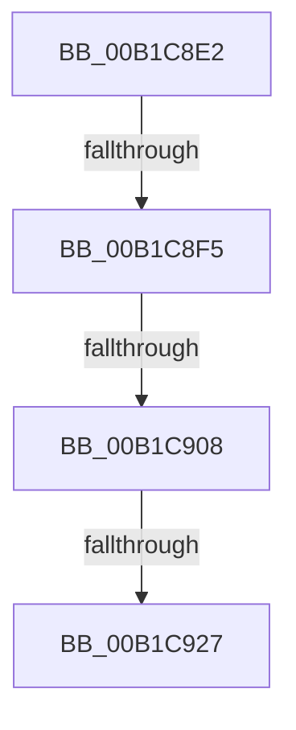

# sub_00B1C8E2

- RVA: `0x00B1C8E2`–`0x00B1C939` (길이 `87` bytes)
- VA: `0x0000000140B1C8E2`
- 실행 섹션: `PAGE`
- PDB 이름 있음: `아니요`; PDB Function 태그: `아니요`
- unwind 정보 RVA: `0x00085904`
- 디코드: `23`개 명령, `87/87` bytes 표시
- 미해석 바이트: `0` (있으면 어셈블리에 `.byte`로 보존)

> 이 문서는 커널 이미지의 기계어와 PDB 기호를 분석해 생성했습니다. 4번과 5번은 함수 원형과 자료형을 바이너리 사용 방식에서 추정한 C 해석이며 원본 소스 복구 결과는 아닙니다.

## 1. Dependencies

- 직접 호출 지점: **1**; 고유 호출 대상: **1**
- 직접 호출자로 확인된 함수: **0**
- RIP 상대 이미지 참조: **0**

### Outgoing calls
- `0x00B1C91A` → [memcmp](../../text/6C/memcmp_function_006C6B10.md) (function, `0x006C6B10`)

### Direct callers
- 이 함수 시작 RVA로 연결되는 직접 call은 확인되지 않았습니다. 간접 호출은 완전히 역산할 수 없습니다.

### Static image references
- 디코드된 RIP-relative 메모리 참조가 없습니다.

## 2. Other-region calls and transfers

- 다른 실행 섹션으로 향하는 call: **1**
  - `0x00B1C91A` → [memcmp](../../text/6C/memcmp_function_006C6B10.md) (`PAGE` → `.text`)
- call이 아닌 외부 분기/꼬리 이동: **4**
  - `0x00B1C8EF` → [ConstraintEval + 0x10F](../8D/ConstraintEval_function_008DC1D0.md) (`tail-transfer`)
  - `0x00B1C902` → [ConstraintEval + 0x10F](../8D/ConstraintEval_function_008DC1D0.md) (`tail-transfer`)
  - `0x00B1C921` → [ConstraintEval + 0x10F](../8D/ConstraintEval_function_008DC1D0.md) (`tail-transfer`)
  - `0x00B1C934` → [ConstraintEval + 0x1F6](../8D/ConstraintEval_function_008DC1D0.md) (`tail-transfer`)

## 3. Assembly (complete function range)

```asm
00B1C8E2  8B C3                           mov eax, ebx
00B1C8E4  48 6B C8 38                     imul rcx, rax, 0x38
00B1C8E8  8B 47 28                        mov eax, dword ptr [rdi + 0x28]
00B1C8EB  39 44 31 28                     cmp dword ptr [rcx + rsi + 0x28], eax
00B1C8EF  0F 85 EA F9 DB FF               jne 0x1408dc2df
00B1C8F5  8B C3                           mov eax, ebx
00B1C8F7  48 6B C8 38                     imul rcx, rax, 0x38
00B1C8FB  8B 44 31 2C                     mov eax, dword ptr [rcx + rsi + 0x2c]
00B1C8FF  3B 47 2C                        cmp eax, dword ptr [rdi + 0x2c]
00B1C902  0F 85 D7 F9 DB FF               jne 0x1408dc2df
00B1C908  48 8B 57 30                     mov rdx, qword ptr [rdi + 0x30]
00B1C90C  44 8B C0                        mov r8d, eax
00B1C90F  8B C3                           mov eax, ebx
00B1C911  48 6B C8 38                     imul rcx, rax, 0x38
00B1C915  48 8B 4C 31 30                  mov rcx, qword ptr [rcx + rsi + 0x30]
00B1C91A  E8 F1 A1 BA FF                  call 0x1406c6b10
00B1C91F  85 C0                           test eax, eax
00B1C921  0F 85 B8 F9 DB FF               jne 0x1408dc2df
00B1C927  45 33 F4                        xor r14d, r12d
00B1C92A  8B C3                           mov eax, ebx
00B1C92C  48 6B C8 38                     imul rcx, rax, 0x38
00B1C930  44 89 34 31                     mov dword ptr [rcx + rsi], r14d
00B1C934  E9 8D FA DB FF                  jmp 0x1408dc3c6
```

## 4. C-style interpretation (structured pseudocode)

```c
__int64 __fastcall sub_00B1C8E2(void)
{
    __int64 result;
    __int64 v_r14;

    a1 = (a1) * ((unsigned int)((unsigned int)(v_rbx)));
    a1 = (a1) * ((unsigned int)((unsigned int)(v_rbx)));
    a1 = (a1) * ((unsigned int)((unsigned int)(v_rbx)));
    result = memcmp(*(unsigned __int64 *)(a1 + v_rsi * 1 + 48), *(unsigned __int64 *)(v_rdi + 48), (unsigned int)((unsigned int)((unsigned int)(*(unsigned int *)(a1 + v_rsi * 1 + 44)))), a4);
    v_r14 = (unsigned int)((v_r14) ^ ((unsigned int)(v_r12)));
    a1 = (*(unsigned __int64 *)(a1 + v_rsi * 1 + 48)) * ((unsigned int)((unsigned int)(v_rbx)));
    *(unsigned int *)(a1 + v_rsi * 1) = (unsigned int)(v_r14);
}
```

## 5. (Beta) C Style

```c
void sub_00B1C8E2(void)
{
    int64_t result;
    int64_t local_r14;

    a1 = (a1) * ((uint32_t)((uint32_t)(local_rbx)));
    a1 = (a1) * ((uint32_t)((uint32_t)(local_rbx)));
    a1 = (a1) * ((uint32_t)((uint32_t)(local_rbx)));
    result = memcmp(*(uint64_t *)(a1 + local_rsi * 1 + 0x30), *(uint64_t *)(local_rdi + 0x30), (uint32_t)((uint32_t)((uint32_t)(*(uint32_t *)(a1 + local_rsi * 1 + 0x2C)))), a4);
    local_r14 = (uint32_t)((local_r14) ^ ((uint32_t)(local_r12)));
    a1 = (*(uint64_t *)(a1 + local_rsi * 1 + 0x30)) * ((uint32_t)((uint32_t)(local_rbx)));
    *(uint32_t *)(a1 + local_rsi * 1) = (uint32_t)(local_r14);
}
```

## 6. Execution-region graph

[열기: 2D/3D 그래프와 함수 탐색 컨트롤 패널](../../../control-panel.html?section=page&rva=0x00B1C8E2&view=graph)

- 2D 그래프는 위에서 아래로 흐르고, 3D 그래프는 빈 공간을 드래그해 회전합니다. Shift+드래그는 이동, 휠은 확대·축소, 함수 노드 선택은 대상 보고서 이동입니다.

### Static fallback


