# sub_00B1C93A

- RVA: `0x00B1C93A`–`0x00B1CD26` (길이 `1,004` bytes)
- VA: `0x0000000140B1C93A`
- 실행 섹션: `PAGE`
- PDB 이름 있음: `아니요`; PDB Function 태그: `아니요`
- unwind 정보 RVA: `0x0008593C`
- 디코드: `269`개 명령, `1,004/1,004` bytes 표시
- 미해석 바이트: `0` (있으면 어셈블리에 `.byte`로 보존)

> 이 문서는 커널 이미지의 기계어와 PDB 기호를 분석해 생성했습니다. 4번과 5번은 함수 원형과 자료형을 바이너리 사용 방식에서 추정한 C 해석이며 원본 소스 복구 결과는 아닙니다.

## 1. Dependencies

- 직접 호출 지점: **27**; 고유 호출 대상: **9**
- 직접 호출자로 확인된 함수: **0**
- RIP 상대 이미지 참조: **4**

### Outgoing calls
- `0x00B1C959` → [PiDqConvertObjectTypeToString](../AA/PiDqConvertObjectTypeToString_function_00AAB7D0.md) (function, `0x00AAB7D0`)
- `0x00B1C9A4` → [ExAllocatePool2](../../poolcode/B8/ExAllocatePool2_function_00B820F0.md) (function, `0x00B820F0`)
- `0x00B1C9D3` → [memcpy](../../text/6C/memcpy_function_006C6840.md) (function, `0x006C6840`)
- `0x00B1CA37` → [ExAllocatePool2](../../poolcode/B8/ExAllocatePool2_function_00B820F0.md) (function, `0x00B820F0`)
- `0x00B1CA51` → [PiDqConvertQueryFlagsToString](../AD/PiDqConvertQueryFlagsToString_function_00AD69EC.md) (function, `0x00AD69EC`)
- `0x00B1CA69` → [ExFreePoolWithTag](../../poolcode/B8/ExFreePoolWithTag_function_00B82870.md) (function, `0x00B82870`)
- `0x00B1CA79` → [ExAllocatePool2](../../poolcode/B8/ExAllocatePool2_function_00B820F0.md) (function, `0x00B820F0`)
- `0x00B1CA94` → [PiDqConvertQueryFlagsToString](../AD/PiDqConvertQueryFlagsToString_function_00AD69EC.md) (function, `0x00AD69EC`)
- `0x00B1CAD7` → [ExAllocatePool2](../../poolcode/B8/ExAllocatePool2_function_00B820F0.md) (function, `0x00B820F0`)
- `0x00B1CAF4` → [memcpy](../../text/6C/memcpy_function_006C6840.md) (function, `0x006C6840`)
- `0x00B1CB44` → [ExAllocatePool2](../../poolcode/B8/ExAllocatePool2_function_00B820F0.md) (function, `0x00B820F0`)
- `0x00B1CB6E` → [PnpConvertDevpropcompkeyArrayToString](../72/PnpConvertDevpropcompkeyArrayToString_function_0072C5F8.md) (function, `0x0072C5F8`)
- `0x00B1CB86` → [ExFreePoolWithTag](../../poolcode/B8/ExFreePoolWithTag_function_00B82870.md) (function, `0x00B82870`)
- `0x00B1CB96` → [ExAllocatePool2](../../poolcode/B8/ExAllocatePool2_function_00B820F0.md) (function, `0x00B820F0`)
- `0x00B1CBBE` → [PnpConvertDevpropcompkeyArrayToString](../72/PnpConvertDevpropcompkeyArrayToString_function_0072C5F8.md) (function, `0x0072C5F8`)
- `0x00B1CBED` → [ExAllocatePool2](../../poolcode/B8/ExAllocatePool2_function_00B820F0.md) (function, `0x00B820F0`)
- `0x00B1CC17` → [FilterConvertToString](../83/FilterConvertToString_function_00835CAC.md) (function, `0x00835CAC`)
- `0x00B1CC2F` → [ExFreePoolWithTag](../../poolcode/B8/ExFreePoolWithTag_function_00B82870.md) (function, `0x00B82870`)
- `0x00B1CC3F` → [ExAllocatePool2](../../poolcode/B8/ExAllocatePool2_function_00B820F0.md) (function, `0x00B820F0`)
- `0x00B1CC67` → [FilterConvertToString](../83/FilterConvertToString_function_00835CAC.md) (function, `0x00835CAC`)
- `0x00B1CC7E` → [PsGetCurrentProcessId](../../text/43/PsGetCurrentProcessId_function_00433560.md) (function, `0x00433560`)
- `0x00B1CCBD` → [McTemplateK0pqzzzzzzz_EtwWriteTransfer](../../text/4B/McTemplateK0pqzzzzzzz_EtwWriteTransfer_function_004BEFF4.md) (function, `0x004BEFF4`)
- `0x00B1CCD1` → [ExFreePoolWithTag](../../poolcode/B8/ExFreePoolWithTag_function_00B82870.md) (function, `0x00B82870`)
- `0x00B1CCE7` → [ExFreePoolWithTag](../../poolcode/B8/ExFreePoolWithTag_function_00B82870.md) (function, `0x00B82870`)
- `0x00B1CCF7` → [ExFreePoolWithTag](../../poolcode/B8/ExFreePoolWithTag_function_00B82870.md) (function, `0x00B82870`)
- `0x00B1CD07` → [ExFreePoolWithTag](../../poolcode/B8/ExFreePoolWithTag_function_00B82870.md) (function, `0x00B82870`)
- `0x00B1CD1B` → [ExFreePoolWithTag](../../poolcode/B8/ExFreePoolWithTag_function_00B82870.md) (function, `0x00B82870`)

### Direct callers
- 이 함수 시작 RVA로 연결되는 직접 call은 확인되지 않았습니다. 간접 호출은 완전히 역산할 수 없습니다.

### Static image references
- `0x00B1C984` → RVA `0x00AFE730` (` ?? ::NNGAKEGL::`string'`; read)
- `0x00B1CA06` → RVA `0x00AFE660` (` ?? ::NNGAKEGL::`string'`; read)
- `0x00B1CA17` → RVA `0x00AFC720` (` ?? ::NNGAKEGL::`string'`; read)
- `0x00B1CC74` → RVA `0x00EF012A` (`.data`; read)

## 2. Other-region calls and transfers

- 다른 실행 섹션으로 향하는 call: **20**
  - `0x00B1C9A4` → [ExAllocatePool2](../../poolcode/B8/ExAllocatePool2_function_00B820F0.md) (`PAGE` → `POOLCODE`)
  - `0x00B1C9D3` → [memcpy](../../text/6C/memcpy_function_006C6840.md) (`PAGE` → `.text`)
  - `0x00B1CA37` → [ExAllocatePool2](../../poolcode/B8/ExAllocatePool2_function_00B820F0.md) (`PAGE` → `POOLCODE`)
  - `0x00B1CA69` → [ExFreePoolWithTag](../../poolcode/B8/ExFreePoolWithTag_function_00B82870.md) (`PAGE` → `POOLCODE`)
  - `0x00B1CA79` → [ExAllocatePool2](../../poolcode/B8/ExAllocatePool2_function_00B820F0.md) (`PAGE` → `POOLCODE`)
  - `0x00B1CAD7` → [ExAllocatePool2](../../poolcode/B8/ExAllocatePool2_function_00B820F0.md) (`PAGE` → `POOLCODE`)
  - `0x00B1CAF4` → [memcpy](../../text/6C/memcpy_function_006C6840.md) (`PAGE` → `.text`)
  - `0x00B1CB44` → [ExAllocatePool2](../../poolcode/B8/ExAllocatePool2_function_00B820F0.md) (`PAGE` → `POOLCODE`)
  - `0x00B1CB86` → [ExFreePoolWithTag](../../poolcode/B8/ExFreePoolWithTag_function_00B82870.md) (`PAGE` → `POOLCODE`)
  - `0x00B1CB96` → [ExAllocatePool2](../../poolcode/B8/ExAllocatePool2_function_00B820F0.md) (`PAGE` → `POOLCODE`)
  - `0x00B1CBED` → [ExAllocatePool2](../../poolcode/B8/ExAllocatePool2_function_00B820F0.md) (`PAGE` → `POOLCODE`)
  - `0x00B1CC2F` → [ExFreePoolWithTag](../../poolcode/B8/ExFreePoolWithTag_function_00B82870.md) (`PAGE` → `POOLCODE`)
  - `0x00B1CC3F` → [ExAllocatePool2](../../poolcode/B8/ExAllocatePool2_function_00B820F0.md) (`PAGE` → `POOLCODE`)
  - `0x00B1CC7E` → [PsGetCurrentProcessId](../../text/43/PsGetCurrentProcessId_function_00433560.md) (`PAGE` → `.text`)
  - `0x00B1CCBD` → [McTemplateK0pqzzzzzzz_EtwWriteTransfer](../../text/4B/McTemplateK0pqzzzzzzz_EtwWriteTransfer_function_004BEFF4.md) (`PAGE` → `.text`)
  - `0x00B1CCD1` → [ExFreePoolWithTag](../../poolcode/B8/ExFreePoolWithTag_function_00B82870.md) (`PAGE` → `POOLCODE`)
  - `0x00B1CCE7` → [ExFreePoolWithTag](../../poolcode/B8/ExFreePoolWithTag_function_00B82870.md) (`PAGE` → `POOLCODE`)
  - `0x00B1CCF7` → [ExFreePoolWithTag](../../poolcode/B8/ExFreePoolWithTag_function_00B82870.md) (`PAGE` → `POOLCODE`)
  - `0x00B1CD07` → [ExFreePoolWithTag](../../poolcode/B8/ExFreePoolWithTag_function_00B82870.md) (`PAGE` → `POOLCODE`)
  - `0x00B1CD1B` → [ExFreePoolWithTag](../../poolcode/B8/ExFreePoolWithTag_function_00B82870.md) (`PAGE` → `POOLCODE`)
- call이 아닌 외부 분기/꼬리 이동: **5**
  - `0x00B1C962` → [PiDqTraceQueryCreate + 0x2C](../8D/PiDqTraceQueryCreate_function_008DC634.md) (`tail-transfer`)
  - `0x00B1C9B6` → [PiDqTraceQueryCreate + 0x2C](../8D/PiDqTraceQueryCreate_function_008DC634.md) (`tail-transfer`)
  - `0x00B1C9C0` → [PiDqTraceQueryCreate + 0x2C](../8D/PiDqTraceQueryCreate_function_008DC634.md) (`tail-transfer`)
  - `0x00B1CD0F` → [PiDqTraceQueryCreate + 0x2C](../8D/PiDqTraceQueryCreate_function_008DC634.md) (`tail-transfer`)
  - `0x00B1CD21` → [PiDqTraceQueryCreate + 0x2C](../8D/PiDqTraceQueryCreate_function_008DC634.md) (`tail-transfer`)

## 3. Assembly (complete function range)

```asm
00B1C93A  48 8B 79 18                     mov rdi, qword ptr [rcx + 0x18]
00B1C93E  48 8D 55 E8                     lea rdx, [rbp - 0x18]
00B1C942  49 8B F6                        mov rsi, r14
00B1C945  4C 89 75 60                     mov qword ptr [rbp + 0x60], r14
00B1C949  4C 89 75 E8                     mov qword ptr [rbp - 0x18], r14
00B1C94D  4D 8B EE                        mov r13, r14
00B1C950  4D 8B FE                        mov r15, r14
00B1C953  4D 8B E6                        mov r12, r14
00B1C956  8B 4F 10                        mov ecx, dword ptr [rdi + 0x10]
00B1C959  E8 72 EE F8 FF                  call 0x140aab7d0
00B1C95E  8B D8                           mov ebx, eax
00B1C960  85 C0                           test eax, eax
00B1C962  0F 88 F8 FC DB FF               js 0x1408dc660
00B1C968  8B 4F 14                        mov ecx, dword ptr [rdi + 0x14]
00B1C96B  85 C9                           test ecx, ecx
00B1C96D  0F 84 A4 00 00 00               je 0x140b1ca17
00B1C973  83 E9 01                        sub ecx, 1
00B1C976  0F 84 86 00 00 00               je 0x140b1ca02
00B1C97C  83 F9 01                        cmp ecx, 1
00B1C97F  75 3A                           jne 0x140b1c9bb
00B1C981  8B 47 18                        mov eax, dword ptr [rdi + 0x18]
00B1C984  48 8D 1D A5 1D FE FF            lea rbx, [rip - 0x1e25b]
00B1C98B  48 89 5D 58                     mov qword ptr [rbp + 0x58], rbx
00B1C98F  83 F8 02                        cmp eax, 2
00B1C992  76 27                           jbe 0x140b1c9bb
00B1C994  8B D0                           mov edx, eax
00B1C996  B9 00 01 00 00                  mov ecx, 0x100
00B1C99B  48 03 D2                        add rdx, rdx
00B1C99E  41 B8 50 6E 70 58               mov r8d, 0x58706e50
00B1C9A4  E8 47 57 06 00                  call 0x140b820f0
00B1C9A9  4C 8B E0                        mov r12, rax
00B1C9AC  48 85 C0                        test rax, rax
00B1C9AF  75 14                           jne 0x140b1c9c5
00B1C9B1  BB 9A 00 00 C0                  mov ebx, 0xc000009a
00B1C9B6  E9 A5 FC DB FF                  jmp 0x1408dc660
00B1C9BB  BB 0D 00 00 C0                  mov ebx, 0xc000000d
00B1C9C0  E9 9B FC DB FF                  jmp 0x1408dc660
00B1C9C5  44 8B 47 18                     mov r8d, dword ptr [rdi + 0x18]
00B1C9C9  49 8B CC                        mov rcx, r12
00B1C9CC  48 8B 57 20                     mov rdx, qword ptr [rdi + 0x20]
00B1C9D0  4D 03 C0                        add r8, r8
00B1C9D3  E8 68 9E BA FF                  call 0x1406c6840
00B1C9D8  8B 4F 18                        mov ecx, dword ptr [rdi + 0x18]
00B1C9DB  83 E9 02                        sub ecx, 2
00B1C9DE  74 1C                           je 0x140b1c9fc
00B1C9E0  49 8D 14 4C                     lea rdx, [r12 + rcx*2]
00B1C9E4  48 89 5D 58                     mov qword ptr [rbp + 0x58], rbx
00B1C9E8  66 44 39 32                     cmp word ptr [rdx], r14w
00B1C9EC  75 05                           jne 0x140b1c9f3
00B1C9EE  66 C7 02 20 00                  mov word ptr [rdx], 0x20
00B1C9F3  48 83 EA 02                     sub rdx, 2
00B1C9F7  83 C1 FF                        add ecx, -1
00B1C9FA  75 EC                           jne 0x140b1c9e8
00B1C9FC  4C 89 65 60                     mov qword ptr [rbp + 0x60], r12
00B1CA00  EB 20                           jmp 0x140b1ca22
00B1CA02  48 8B 47 18                     mov rax, qword ptr [rdi + 0x18]
00B1CA06  48 8D 1D 53 1C FE FF            lea rbx, [rip - 0x1e3ad]
00B1CA0D  48 89 5D 58                     mov qword ptr [rbp + 0x58], rbx
00B1CA11  48 89 45 60                     mov qword ptr [rbp + 0x60], rax
00B1CA15  EB 0B                           jmp 0x140b1ca22
00B1CA17  48 8D 05 02 FD FD FF            lea rax, [rip - 0x202fe]
00B1CA1E  48 89 45 58                     mov qword ptr [rbp + 0x58], rax
00B1CA22  BB 00 02 00 00                  mov ebx, 0x200
00B1CA27  41 B8 50 6E 70 58               mov r8d, 0x58706e50
00B1CA2D  8B D3                           mov edx, ebx
00B1CA2F  89 5D 50                        mov dword ptr [rbp + 0x50], ebx
00B1CA32  B9 00 01 00 00                  mov ecx, 0x100
00B1CA37  E8 B4 56 06 00                  call 0x140b820f0
00B1CA3C  4C 8B F0                        mov r14, rax
00B1CA3F  48 85 C0                        test rax, rax
00B1CA42  74 78                           je 0x140b1cabc
00B1CA44  8B 4F 28                        mov ecx, dword ptr [rdi + 0x28]
00B1CA47  4C 8D 4D 50                     lea r9, [rbp + 0x50]
00B1CA4B  44 8B C3                        mov r8d, ebx
00B1CA4E  48 8B D0                        mov rdx, rax
00B1CA51  E8 96 9F FB FF                  call 0x140ad69ec
00B1CA56  8B D8                           mov ebx, eax
00B1CA58  3D 23 00 00 C0                  cmp eax, 0xc0000023
00B1CA5D  75 3C                           jne 0x140b1ca9b
00B1CA5F  BB 50 6E 70 58                  mov ebx, 0x58706e50
00B1CA64  49 8B CE                        mov rcx, r14
00B1CA67  8B D3                           mov edx, ebx
00B1CA69  E8 02 5E 06 00                  call 0x140b82870
00B1CA6E  8B 55 50                        mov edx, dword ptr [rbp + 0x50]
00B1CA71  44 8B C3                        mov r8d, ebx
00B1CA74  B9 00 01 00 00                  mov ecx, 0x100
00B1CA79  E8 72 56 06 00                  call 0x140b820f0
00B1CA7E  4C 8B F0                        mov r14, rax
00B1CA81  48 85 C0                        test rax, rax
00B1CA84  74 36                           je 0x140b1cabc
00B1CA86  44 8B 45 50                     mov r8d, dword ptr [rbp + 0x50]
00B1CA8A  4C 8D 4D 50                     lea r9, [rbp + 0x50]
00B1CA8E  8B 4F 28                        mov ecx, dword ptr [rdi + 0x28]
00B1CA91  48 8B D0                        mov rdx, rax
00B1CA94  E8 53 9F FB FF                  call 0x140ad69ec
00B1CA99  8B D8                           mov ebx, eax
00B1CA9B  85 DB                           test ebx, ebx
00B1CA9D  0F 88 21 02 00 00               js 0x140b1ccc4
00B1CAA3  8B 47 28                        mov eax, dword ptr [rdi + 0x28]
00B1CAA6  A8 04                           test al, 4
00B1CAA8  74 7A                           je 0x140b1cb24
00B1CAAA  8B 47 30                        mov eax, dword ptr [rdi + 0x30]
00B1CAAD  83 F8 02                        cmp eax, 2
00B1CAB0  77 14                           ja 0x140b1cac6
00B1CAB2  BB 0D 00 00 C0                  mov ebx, 0xc000000d
00B1CAB7  E9 08 02 00 00                  jmp 0x140b1ccc4
00B1CABC  BB 9A 00 00 C0                  mov ebx, 0xc000009a
00B1CAC1  E9 FE 01 00 00                  jmp 0x140b1ccc4
00B1CAC6  48 8B D0                        mov rdx, rax
00B1CAC9  B9 00 01 00 00                  mov ecx, 0x100
00B1CACE  48 03 D2                        add rdx, rdx
00B1CAD1  41 B8 50 6E 70 58               mov r8d, 0x58706e50
00B1CAD7  E8 14 56 06 00                  call 0x140b820f0
00B1CADC  33 DB                           xor ebx, ebx
00B1CADE  4C 8B E8                        mov r13, rax
00B1CAE1  48 85 C0                        test rax, rax
00B1CAE4  74 D6                           je 0x140b1cabc
00B1CAE6  44 8B 47 30                     mov r8d, dword ptr [rdi + 0x30]
00B1CAEA  48 8B C8                        mov rcx, rax
00B1CAED  48 8B 57 38                     mov rdx, qword ptr [rdi + 0x38]
00B1CAF1  4D 03 C0                        add r8, r8
00B1CAF4  E8 47 9D BA FF                  call 0x1406c6840
00B1CAF9  8B 4F 30                        mov ecx, dword ptr [rdi + 0x30]
00B1CAFC  83 E9 02                        sub ecx, 2
00B1CAFF  74 25                           je 0x140b1cb26
00B1CB01  48 8D 14 4D 00 00 00 00         lea rdx, [rcx*2]
00B1CB09  49 03 D5                        add rdx, r13
00B1CB0C  66 39 1A                        cmp word ptr [rdx], bx
00B1CB0F  75 05                           jne 0x140b1cb16
00B1CB11  66 C7 02 20 00                  mov word ptr [rdx], 0x20
00B1CB16  48 83 EA 02                     sub rdx, 2
00B1CB1A  83 C1 FF                        add ecx, -1
00B1CB1D  75 ED                           jne 0x140b1cb0c
00B1CB1F  48 8B F3                        mov rsi, rbx
00B1CB22  EB 02                           jmp 0x140b1cb26
00B1CB24  33 DB                           xor ebx, ebx
00B1CB26  39 5F 40                        cmp dword ptr [rdi + 0x40], ebx
00B1CB29  0F 86 A0 00 00 00               jbe 0x140b1cbcf
00B1CB2F  B8 00 02 00 00                  mov eax, 0x200
00B1CB34  41 B8 50 6E 70 58               mov r8d, 0x58706e50
00B1CB3A  8B D0                           mov edx, eax
00B1CB3C  89 45 50                        mov dword ptr [rbp + 0x50], eax
00B1CB3F  B9 00 01 00 00                  mov ecx, 0x100
00B1CB44  E8 A7 55 06 00                  call 0x140b820f0
00B1CB49  4C 8B F8                        mov r15, rax
00B1CB4C  48 85 C0                        test rax, rax
00B1CB4F  0F 84 67 FF FF FF               je 0x140b1cabc
00B1CB55  8B 57 40                        mov edx, dword ptr [rdi + 0x40]
00B1CB58  48 8D 45 50                     lea rax, [rbp + 0x50]
00B1CB5C  48 8B 4F 48                     mov rcx, qword ptr [rdi + 0x48]
00B1CB60  41 B9 00 02 00 00               mov r9d, 0x200
00B1CB66  4D 8B C7                        mov r8, r15
00B1CB69  48 89 44 24 20                  mov qword ptr [rsp + 0x20], rax
00B1CB6E  E8 85 FA C0 FF                  call 0x14072c5f8
00B1CB73  8B D8                           mov ebx, eax
00B1CB75  3D 23 00 00 C0                  cmp eax, 0xc0000023
00B1CB7A  75 49                           jne 0x140b1cbc5
00B1CB7C  BB 50 6E 70 58                  mov ebx, 0x58706e50
00B1CB81  49 8B CF                        mov rcx, r15
00B1CB84  8B D3                           mov edx, ebx
00B1CB86  E8 E5 5C 06 00                  call 0x140b82870
00B1CB8B  8B 55 50                        mov edx, dword ptr [rbp + 0x50]
00B1CB8E  44 8B C3                        mov r8d, ebx
00B1CB91  B9 00 01 00 00                  mov ecx, 0x100
00B1CB96  E8 55 55 06 00                  call 0x140b820f0
00B1CB9B  4C 8B F8                        mov r15, rax
00B1CB9E  48 85 C0                        test rax, rax
00B1CBA1  0F 84 15 FF FF FF               je 0x140b1cabc
00B1CBA7  44 8B 4D 50                     mov r9d, dword ptr [rbp + 0x50]
00B1CBAB  48 8D 45 50                     lea rax, [rbp + 0x50]
00B1CBAF  8B 57 40                        mov edx, dword ptr [rdi + 0x40]
00B1CBB2  4D 8B C7                        mov r8, r15
00B1CBB5  48 8B 4F 48                     mov rcx, qword ptr [rdi + 0x48]
00B1CBB9  48 89 44 24 20                  mov qword ptr [rsp + 0x20], rax
00B1CBBE  E8 35 FA C0 FF                  call 0x14072c5f8
00B1CBC3  8B D8                           mov ebx, eax
00B1CBC5  85 DB                           test ebx, ebx
00B1CBC7  0F 88 F7 00 00 00               js 0x140b1ccc4
00B1CBCD  33 DB                           xor ebx, ebx
00B1CBCF  39 5F 50                        cmp dword ptr [rdi + 0x50], ebx
00B1CBD2  0F 86 9C 00 00 00               jbe 0x140b1cc74
00B1CBD8  B8 00 02 00 00                  mov eax, 0x200
00B1CBDD  41 B8 50 6E 70 58               mov r8d, 0x58706e50
00B1CBE3  8B D0                           mov edx, eax
00B1CBE5  89 45 50                        mov dword ptr [rbp + 0x50], eax
00B1CBE8  B9 00 01 00 00                  mov ecx, 0x100
00B1CBED  E8 FE 54 06 00                  call 0x140b820f0
00B1CBF2  48 8B F0                        mov rsi, rax
00B1CBF5  48 85 C0                        test rax, rax
00B1CBF8  0F 84 BE FE FF FF               je 0x140b1cabc
00B1CBFE  48 8B 57 58                     mov rdx, qword ptr [rdi + 0x58]
00B1CC02  48 8D 45 50                     lea rax, [rbp + 0x50]
00B1CC06  8B 4F 50                        mov ecx, dword ptr [rdi + 0x50]
00B1CC09  4C 8B CE                        mov r9, rsi
00B1CC0C  41 B8 00 02 00 00               mov r8d, 0x200
00B1CC12  48 89 44 24 20                  mov qword ptr [rsp + 0x20], rax
00B1CC17  E8 90 90 D1 FF                  call 0x140835cac
00B1CC1C  8B D8                           mov ebx, eax
00B1CC1E  3D 23 00 00 C0                  cmp eax, 0xc0000023
00B1CC23  75 49                           jne 0x140b1cc6e
00B1CC25  BB 50 6E 70 58                  mov ebx, 0x58706e50
00B1CC2A  48 8B CE                        mov rcx, rsi
00B1CC2D  8B D3                           mov edx, ebx
00B1CC2F  E8 3C 5C 06 00                  call 0x140b82870
00B1CC34  8B 55 50                        mov edx, dword ptr [rbp + 0x50]
00B1CC37  44 8B C3                        mov r8d, ebx
00B1CC3A  B9 00 01 00 00                  mov ecx, 0x100
00B1CC3F  E8 AC 54 06 00                  call 0x140b820f0
00B1CC44  48 8B F0                        mov rsi, rax
00B1CC47  48 85 C0                        test rax, rax
00B1CC4A  0F 84 6C FE FF FF               je 0x140b1cabc
00B1CC50  44 8B 45 50                     mov r8d, dword ptr [rbp + 0x50]
00B1CC54  48 8D 45 50                     lea rax, [rbp + 0x50]
00B1CC58  48 8B 57 58                     mov rdx, qword ptr [rdi + 0x58]
00B1CC5C  4C 8B CE                        mov r9, rsi
00B1CC5F  8B 4F 50                        mov ecx, dword ptr [rdi + 0x50]
00B1CC62  48 89 44 24 20                  mov qword ptr [rsp + 0x20], rax
00B1CC67  E8 40 90 D1 FF                  call 0x140835cac
00B1CC6C  8B D8                           mov ebx, eax
00B1CC6E  85 DB                           test ebx, ebx
00B1CC70  78 52                           js 0x140b1ccc4
00B1CC72  33 DB                           xor ebx, ebx
00B1CC74  8A 05 B0 34 3D 00               mov al, byte ptr [rip + 0x3d34b0]
00B1CC7A  84 C0                           test al, al
00B1CC7C  79 46                           jns 0x140b1ccc4
00B1CC7E  E8 DD 68 91 FF                  call 0x140433560
00B1CC83  48 8B 4D 60                     mov rcx, qword ptr [rbp + 0x60]
00B1CC87  4C 8B C7                        mov r8, rdi
00B1CC8A  4C 8B 4D 48                     mov r9, qword ptr [rbp + 0x48]
00B1CC8E  48 89 74 24 58                  mov qword ptr [rsp + 0x58], rsi
00B1CC93  4C 89 7C 24 50                  mov qword ptr [rsp + 0x50], r15
00B1CC98  4C 89 6C 24 48                  mov qword ptr [rsp + 0x48], r13
00B1CC9D  4C 89 74 24 40                  mov qword ptr [rsp + 0x40], r14
00B1CCA2  48 89 4C 24 38                  mov qword ptr [rsp + 0x38], rcx
00B1CCA7  48 8B 4D 58                     mov rcx, qword ptr [rbp + 0x58]
00B1CCAB  48 89 4C 24 30                  mov qword ptr [rsp + 0x30], rcx
00B1CCB0  48 8B 4D E8                     mov rcx, qword ptr [rbp - 0x18]
00B1CCB4  48 89 4C 24 28                  mov qword ptr [rsp + 0x28], rcx
00B1CCB9  89 44 24 20                     mov dword ptr [rsp + 0x20], eax
00B1CCBD  E8 32 23 9A FF                  call 0x1404beff4
00B1CCC2  8B D8                           mov ebx, eax
00B1CCC4  4D 85 E4                        test r12, r12
00B1CCC7  74 0D                           je 0x140b1ccd6
00B1CCC9  BA 50 6E 70 58                  mov edx, 0x58706e50
00B1CCCE  49 8B CC                        mov rcx, r12
00B1CCD1  E8 9A 5B 06 00                  call 0x140b82870
00B1CCD6  41 BC 50 6E 70 58               mov r12d, 0x58706e50
00B1CCDC  4D 85 F6                        test r14, r14
00B1CCDF  74 0B                           je 0x140b1ccec
00B1CCE1  41 8B D4                        mov edx, r12d
00B1CCE4  49 8B CE                        mov rcx, r14
00B1CCE7  E8 84 5B 06 00                  call 0x140b82870
00B1CCEC  4D 85 ED                        test r13, r13
00B1CCEF  74 0B                           je 0x140b1ccfc
00B1CCF1  41 8B D4                        mov edx, r12d
00B1CCF4  49 8B CD                        mov rcx, r13
00B1CCF7  E8 74 5B 06 00                  call 0x140b82870
00B1CCFC  4D 85 FF                        test r15, r15
00B1CCFF  74 0B                           je 0x140b1cd0c
00B1CD01  41 8B D4                        mov edx, r12d
00B1CD04  49 8B CF                        mov rcx, r15
00B1CD07  E8 64 5B 06 00                  call 0x140b82870
00B1CD0C  48 85 F6                        test rsi, rsi
00B1CD0F  0F 84 4B F9 DB FF               je 0x1408dc660
00B1CD15  41 8B D4                        mov edx, r12d
00B1CD18  48 8B CE                        mov rcx, rsi
00B1CD1B  E8 50 5B 06 00                  call 0x140b82870
00B1CD20  90                              nop
00B1CD21  E9 3A F9 DB FF                  jmp 0x1408dc660
```

## 4. C-style interpretation (structured pseudocode)

```c
__int64 __fastcall sub_00B1C93A(__int64 a1)
{
    __int64 result;
    __int64 v_rbx;
    unsigned __int64 v_stack_p20;
    unsigned __int64 v_stack_p28;
    unsigned __int64 v_stack_p30;
    unsigned __int64 v_stack_p38;
    unsigned __int64 v_stack_p40;
    unsigned __int64 v_stack_p48;
    unsigned __int64 v_stack_p50;
    unsigned __int64 v_stack_p58;

    *(unsigned __int64 *)(v_rbp + 96) = v_r14;
    *(unsigned __int64 *)(v_rbp - 24) = v_r14;
    result = PiDqConvertObjectTypeToString((unsigned int)(*(unsigned int *)(*(unsigned __int64 *)(a1 + 24) + 16)), v_rbp - 24, a3, a4);
    if ((unsigned int)((unsigned int)(*(unsigned int *)(*(unsigned __int64 *)(a1 + 24) + 20))) == 0) goto loc_00B1CA17;
    a1 = (unsigned int)(((unsigned int)(*(unsigned int *)(*(unsigned __int64 *)(a1 + 24) + 20))) - (1));
    if (condition_is_equal) goto loc_00B1CA02;
    if (((unsigned int)(a1)) != 1) goto loc_00B1C9BB;
    *(unsigned __int64 *)(v_rbp + 88) = v_rip - 123483;
    if (((unsigned int)((unsigned int)(*(unsigned int *)(*(unsigned __int64 *)(a1 + 24) + 24)))) <= 2) goto loc_00B1C9BB;
    a2 = ((unsigned int)((unsigned int)((unsigned int)(*(unsigned int *)(*(unsigned __int64 *)(a1 + 24) + 24))))) + ((unsigned int)((unsigned int)((unsigned int)(*(unsigned int *)(*(unsigned __int64 *)(a1 + 24) + 24)))));
    result = ExAllocatePool2(256, a2, (unsigned int)(0x58706E50ULL), a4);
    if (result != 0) goto loc_00B1C9C5;
loc_00B1C9BB:
loc_00B1C9C5:
    a3 = ((unsigned int)(*(unsigned int *)(*(unsigned __int64 *)(a1 + 24) + 24))) + ((unsigned int)(*(unsigned int *)(*(unsigned __int64 *)(a1 + 24) + 24)));
    result = memcpy(result, *(unsigned __int64 *)(*(unsigned __int64 *)(a1 + 24) + 32), a3, a4);
    a1 = (unsigned int)(((unsigned int)(*(unsigned int *)(*(unsigned __int64 *)(a1 + 24) + 24))) - (2));
    if (condition_is_equal) goto loc_00B1C9FC;
    *(unsigned __int64 *)(v_rbp + 88) = (unsigned int)(0xC000000DULL);
loc_00B1C9E8:
    if ((*(unsigned __int16 *)(result + a1 * 2)) == ((unsigned __int16)(v_r14))) {
        *(unsigned __int16 *)(result + a1 * 2) = 32;
    }
    a2 = (result + a1 * 2) - (2);
    a1 = (unsigned int)((a1) + (-1));
    if (condition_is_not_equal) goto loc_00B1C9E8;
loc_00B1C9FC:
    *(unsigned __int64 *)(v_rbp + 96) = result;
    goto loc_00B1CA22;
loc_00B1CA02:
    *(unsigned __int64 *)(v_rbp + 88) = v_rip - 123821;
    *(unsigned __int64 *)(v_rbp + 96) = *(unsigned __int64 *)(*(unsigned __int64 *)(a1 + 24) + 24);
    goto loc_00B1CA22;
loc_00B1CA17:
    *(unsigned __int64 *)(v_rbp + 88) = v_rip - 131838;
loc_00B1CA22:
    *(unsigned int *)(v_rbp + 80) = 512;
    result = ExAllocatePool2(256, 512, (unsigned int)(0x58706E50ULL), a4);
    if (result == 0) goto loc_00B1CABC;
    result = PiDqConvertQueryFlagsToString((unsigned int)(*(unsigned int *)(*(unsigned __int64 *)(a1 + 24) + 40)), result, 512, v_rbp + 80);
    if (((unsigned int)(result)) != 0xC0000023ULL) goto loc_00B1CA9B;
    result = ExFreePoolWithTag(result, (unsigned int)((unsigned int)((unsigned int)(0x58706E50ULL))), 512, v_rbp + 80);
    result = ExAllocatePool2(256, (unsigned int)(*(unsigned int *)(v_rbp + 80)), (unsigned int)((unsigned int)((unsigned int)(0x58706E50ULL))), v_rbp + 80);
    if (result == 0) goto loc_00B1CABC;
    result = PiDqConvertQueryFlagsToString((unsigned int)(*(unsigned int *)(*(unsigned __int64 *)(a1 + 24) + 40)), result, (unsigned int)(*(unsigned int *)(v_rbp + 80)), v_rbp + 80);
loc_00B1CA9B:
    if (sign_flag) goto loc_00B1CCC4;
    if ((((unsigned __int8)((unsigned int)(*(unsigned int *)(*(unsigned __int64 *)(a1 + 24) + 40)))) & (4)) == 0) goto loc_00B1CB24;
    if (((unsigned int)((unsigned int)(*(unsigned int *)(*(unsigned __int64 *)(a1 + 24) + 48)))) > 2) goto loc_00B1CAC6;
    goto loc_00B1CCC4;
loc_00B1CABC:
    goto loc_00B1CCC4;
loc_00B1CAC6:
    a2 = ((unsigned int)(*(unsigned int *)(*(unsigned __int64 *)(a1 + 24) + 48))) + ((unsigned int)(*(unsigned int *)(*(unsigned __int64 *)(a1 + 24) + 48)));
    result = ExAllocatePool2(256, a2, (unsigned int)(0x58706E50ULL), v_rbp + 80);
    v_rbx = 0;
    if (result == 0) goto loc_00B1CABC;
    a3 = ((unsigned int)(*(unsigned int *)(*(unsigned __int64 *)(a1 + 24) + 48))) + ((unsigned int)(*(unsigned int *)(*(unsigned __int64 *)(a1 + 24) + 48)));
    result = memcpy(result, *(unsigned __int64 *)(*(unsigned __int64 *)(a1 + 24) + 56), a3, v_rbp + 80);
    a1 = (unsigned int)(((unsigned int)(*(unsigned int *)(*(unsigned __int64 *)(a1 + 24) + 48))) - (2));
    if (condition_is_equal) goto loc_00B1CB26;
    a2 = (a1 * 2) + (result);
loc_00B1CB0C:
    if ((*(unsigned __int16 *)(a2)) == 0) {
        *(unsigned __int16 *)(a2) = 32;
    }
    a2 = (a2) - (2);
    a1 = (unsigned int)((a1) + (-1));
    if (condition_is_not_equal) goto loc_00B1CB0C;
    goto loc_00B1CB26;
loc_00B1CB24:
    v_rbx = 0;
loc_00B1CB26:
    if ((*(unsigned int *)(*(unsigned __int64 *)(a1 + 24) + 64)) <= 0) goto loc_00B1CBCF;
    *(unsigned int *)(v_rbp + 80) = 512;
    result = ExAllocatePool2(256, 512, (unsigned int)(0x58706E50ULL), v_rbp + 80);
    if (result == 0) goto loc_00B1CABC;
    v_stack_p20 = v_rbp + 80;
    result = PnpConvertDevpropcompkeyArrayToString(*(unsigned __int64 *)(*(unsigned __int64 *)(a1 + 24) + 72), (unsigned int)(*(unsigned int *)(*(unsigned __int64 *)(a1 + 24) + 64)), result, 512);
    if (((unsigned int)(result)) != 0xC0000023ULL) goto loc_00B1CBC5;
    result = ExFreePoolWithTag(result, (unsigned int)((unsigned int)((unsigned int)(0x58706E50ULL))), result, 512);
    result = ExAllocatePool2(256, (unsigned int)(*(unsigned int *)(v_rbp + 80)), (unsigned int)((unsigned int)((unsigned int)(0x58706E50ULL))), 512);
    if (result == 0) goto loc_00B1CABC;
    v_stack_p20 = v_rbp + 80;
    result = PnpConvertDevpropcompkeyArrayToString(*(unsigned __int64 *)(*(unsigned __int64 *)(a1 + 24) + 72), (unsigned int)(*(unsigned int *)(*(unsigned __int64 *)(a1 + 24) + 64)), result, (unsigned int)(*(unsigned int *)(v_rbp + 80)));
loc_00B1CBC5:
    if (sign_flag) goto loc_00B1CCC4;
    v_rbx = 0;
loc_00B1CBCF:
    if ((*(unsigned int *)(*(unsigned __int64 *)(a1 + 24) + 80)) <= 0) goto loc_00B1CC74;
    *(unsigned int *)(v_rbp + 80) = 512;
    result = ExAllocatePool2(256, 512, (unsigned int)(0x58706E50ULL), (unsigned int)(*(unsigned int *)(v_rbp + 80)));
    if (result == 0) goto loc_00B1CABC;
    v_stack_p20 = v_rbp + 80;
    result = FilterConvertToString((unsigned int)(*(unsigned int *)(*(unsigned __int64 *)(a1 + 24) + 80)), *(unsigned __int64 *)(*(unsigned __int64 *)(a1 + 24) + 88), 512, result);
    if (((unsigned int)(result)) != 0xC0000023ULL) goto loc_00B1CC6E;
    result = ExFreePoolWithTag(result, (unsigned int)((unsigned int)((unsigned int)(0x58706E50ULL))), 512, result);
    result = ExAllocatePool2(256, (unsigned int)(*(unsigned int *)(v_rbp + 80)), (unsigned int)((unsigned int)((unsigned int)(0x58706E50ULL))), result);
    if (result == 0) goto loc_00B1CABC;
    v_stack_p20 = v_rbp + 80;
    result = FilterConvertToString((unsigned int)(*(unsigned int *)(*(unsigned __int64 *)(a1 + 24) + 80)), *(unsigned __int64 *)(*(unsigned __int64 *)(a1 + 24) + 88), (unsigned int)(*(unsigned int *)(v_rbp + 80)), result);
loc_00B1CC6E:
    if (sign_flag) goto loc_00B1CCC4;
    v_rbx = 0;
loc_00B1CC74:
    result = *(unsigned __int8 *)(v_rip + 4011184);
    if (sign_flag) {
        result = PsGetCurrentProcessId((unsigned int)(*(unsigned int *)(*(unsigned __int64 *)(a1 + 24) + 80)), *(unsigned __int64 *)(*(unsigned __int64 *)(a1 + 24) + 88), (unsigned int)(*(unsigned int *)(v_rbp + 80)), result);
        a1 = *(unsigned __int64 *)(v_rbp + 96);
        a3 = *(unsigned __int64 *)(a1 + 24);
        a4 = *(unsigned __int64 *)(v_rbp + 72);
        v_stack_p58 = result;
        v_stack_p50 = result;
        v_stack_p48 = result;
        v_stack_p40 = result;
        v_stack_p38 = a1;
        a1 = *(unsigned __int64 *)(v_rbp + 88);
        v_stack_p30 = a1;
        a1 = *(unsigned __int64 *)(v_rbp - 24);
        v_stack_p28 = a1;
        v_stack_p20 = (unsigned int)(result);
        result = McTemplateK0pqzzzzzzz_EtwWriteTransfer(a1, *(unsigned __int64 *)(*(unsigned __int64 *)(a1 + 24) + 88), a3, a4);
        v_rbx = (unsigned int)(result);
    }
    if (result != 0) {
        a2 = 0x58706E50ULL;
        a1 = result;
        result = ExFreePoolWithTag(a1, a2, a3, a4);
    }
    if (result != 0) {
        a2 = (unsigned int)((unsigned int)(0x58706E50ULL));
        a1 = result;
        result = ExFreePoolWithTag(a1, a2, a3, a4);
    }
    if (result != 0) {
        a2 = (unsigned int)((unsigned int)(0x58706E50ULL));
        a1 = result;
        result = ExFreePoolWithTag(a1, a2, a3, a4);
    }
    if (result != 0) {
        a2 = (unsigned int)((unsigned int)(0x58706E50ULL));
        a1 = result;
        result = ExFreePoolWithTag(a1, a2, a3, a4);
    }
    result = ExFreePoolWithTag(result, (unsigned int)((unsigned int)((unsigned int)(0x58706E50ULL))), a3, a4);
}
```

## 5. (Beta) C Style

```c
int64_t sub_00B1C93A(void *Arg1)
{
    uint8_t *arg1 = (uint8_t *)Arg1;

    int64_t result;
    int64_t local_rbx;
    uint64_t v_stack_p20;
    uint64_t v_stack_p28;
    uint64_t v_stack_p30;
    uint64_t v_stack_p38;
    uint64_t v_stack_p40;
    uint64_t v_stack_p48;
    uint64_t v_stack_p50;
    uint64_t v_stack_p58;

    *(uint64_t *)(local_rbp + 0x60) = local_r14;
    *(uint64_t *)(local_rbp - 0x18) = local_r14;
    result = PiDqConvertObjectTypeToString((uint32_t)(*(uint32_t *)(*(uint64_t *)(arg1 + 0x18) + 0x10)), local_rbp - 24, a3, a4);
    if ((uint32_t)((uint32_t)(*(uint32_t *)(*(uint64_t *)(arg1 + 0x18) + 0x14))) == 0) goto loc_00B1CA17;
    Arg1 = (uint32_t)(((uint32_t)(*(uint32_t *)(*(uint64_t *)(arg1 + 0x18) + 0x14))) - (1));
    if (condition_is_equal) goto loc_00B1CA02;
    if (((uint32_t)(Arg1)) != 1) goto loc_00B1C9BB;
    *(uint64_t *)(local_rbp + 0x58) = v_rip - 123483;
    if (((uint32_t)((uint32_t)(*(uint32_t *)(*(uint64_t *)(arg1 + 0x18) + 0x18)))) <= 2) goto loc_00B1C9BB;
    a2 = ((uint32_t)((uint32_t)((uint32_t)(*(uint32_t *)(*(uint64_t *)(arg1 + 0x18) + 0x18))))) + ((uint32_t)((uint32_t)((uint32_t)(*(uint32_t *)(*(uint64_t *)(arg1 + 0x18) + 0x18)))));
    result = ExAllocatePool2(256, a2, (uint32_t)(0x58706E50ULL), a4);
    if (result != 0) goto loc_00B1C9C5;
loc_00B1C9BB:
loc_00B1C9C5:
    a3 = ((uint32_t)(*(uint32_t *)(*(uint64_t *)(arg1 + 0x18) + 0x18))) + ((uint32_t)(*(uint32_t *)(*(uint64_t *)(arg1 + 0x18) + 0x18)));
    result = memcpy(result, *(uint64_t *)(*(uint64_t *)(arg1 + 0x18) + 0x20), a3, a4);
    Arg1 = (uint32_t)(((uint32_t)(*(uint32_t *)(*(uint64_t *)(arg1 + 0x18) + 0x18))) - (2));
    if (condition_is_equal) goto loc_00B1C9FC;
    *(uint64_t *)(local_rbp + 0x58) = (uint32_t)(0xC000000DULL);
loc_00B1C9E8:
    if ((*(uint16_t *)(result + arg1 * 2)) == ((uint16_t)(local_r14))) {
        *(uint16_t *)(result + arg1 * 2) = 32;
    }
    a2 = (result + Arg1 * 2) - (2);
    Arg1 = (uint32_t)((Arg1) + (-1));
    if (condition_is_not_equal) goto loc_00B1C9E8;
loc_00B1C9FC:
    *(uint64_t *)(local_rbp + 0x60) = result;
    goto loc_00B1CA22;
loc_00B1CA02:
    *(uint64_t *)(local_rbp + 0x58) = v_rip - 123821;
    *(uint64_t *)(local_rbp + 0x60) = *(uint64_t *)(*(uint64_t *)(arg1 + 0x18) + 0x18);
    goto loc_00B1CA22;
loc_00B1CA17:
    *(uint64_t *)(local_rbp + 0x58) = v_rip - 131838;
loc_00B1CA22:
    *(uint32_t *)(local_rbp + 0x50) = 512;
    result = ExAllocatePool2(256, 512, (uint32_t)(0x58706E50ULL), a4);
    if (result == 0) goto loc_00B1CABC;
    result = PiDqConvertQueryFlagsToString((uint32_t)(*(uint32_t *)(*(uint64_t *)(arg1 + 0x18) + 0x28)), result, 512, local_rbp + 80);
    if (((uint32_t)(result)) != 0xC0000023ULL) goto loc_00B1CA9B;
    result = ExFreePoolWithTag(result, (uint32_t)((uint32_t)((uint32_t)(0x58706E50ULL))), 512, local_rbp + 80);
    result = ExAllocatePool2(256, (uint32_t)(*(uint32_t *)(local_rbp + 0x50)), (uint32_t)((uint32_t)((uint32_t)(0x58706E50ULL))), local_rbp + 80);
    if (result == 0) goto loc_00B1CABC;
    result = PiDqConvertQueryFlagsToString((uint32_t)(*(uint32_t *)(*(uint64_t *)(arg1 + 0x18) + 0x28)), result, (uint32_t)(*(uint32_t *)(local_rbp + 0x50)), local_rbp + 80);
loc_00B1CA9B:
    if (sign_flag) goto loc_00B1CCC4;
    if ((((uint8_t)((uint32_t)(*(uint32_t *)(*(uint64_t *)(arg1 + 0x18) + 0x28)))) & (4)) == 0) goto loc_00B1CB24;
    if (((uint32_t)((uint32_t)(*(uint32_t *)(*(uint64_t *)(arg1 + 0x18) + 0x30)))) > 2) goto loc_00B1CAC6;
    goto loc_00B1CCC4;
loc_00B1CABC:
    goto loc_00B1CCC4;
loc_00B1CAC6:
    a2 = ((uint32_t)(*(uint32_t *)(*(uint64_t *)(arg1 + 0x18) + 0x30))) + ((uint32_t)(*(uint32_t *)(*(uint64_t *)(arg1 + 0x18) + 0x30)));
    result = ExAllocatePool2(256, a2, (uint32_t)(0x58706E50ULL), local_rbp + 80);
    local_rbx = 0;
    if (result == 0) goto loc_00B1CABC;
    a3 = ((uint32_t)(*(uint32_t *)(*(uint64_t *)(arg1 + 0x18) + 0x30))) + ((uint32_t)(*(uint32_t *)(*(uint64_t *)(arg1 + 0x18) + 0x30)));
    result = memcpy(result, *(uint64_t *)(*(uint64_t *)(arg1 + 0x18) + 0x38), a3, local_rbp + 80);
    Arg1 = (uint32_t)(((uint32_t)(*(uint32_t *)(*(uint64_t *)(arg1 + 0x18) + 0x30))) - (2));
    if (condition_is_equal) goto loc_00B1CB26;
    a2 = (Arg1 * 2) + (result);
loc_00B1CB0C:
    if ((*(uint16_t *)(a2)) == 0) {
        *(uint16_t *)(a2) = 32;
    }
    a2 = (a2) - (2);
    Arg1 = (uint32_t)((Arg1) + (-1));
    if (condition_is_not_equal) goto loc_00B1CB0C;
    goto loc_00B1CB26;
loc_00B1CB24:
    local_rbx = 0;
loc_00B1CB26:
    if ((*(uint32_t *)(*(uint64_t *)(arg1 + 0x18) + 0x40)) <= 0) goto loc_00B1CBCF;
    *(uint32_t *)(local_rbp + 0x50) = 512;
    result = ExAllocatePool2(256, 512, (uint32_t)(0x58706E50ULL), local_rbp + 80);
    if (result == 0) goto loc_00B1CABC;
    v_stack_p20 = local_rbp + 80;
    result = PnpConvertDevpropcompkeyArrayToString(*(uint64_t *)(*(uint64_t *)(arg1 + 0x18) + 0x48), (uint32_t)(*(uint32_t *)(*(uint64_t *)(arg1 + 0x18) + 0x40)), result, 512);
    if (((uint32_t)(result)) != 0xC0000023ULL) goto loc_00B1CBC5;
    result = ExFreePoolWithTag(result, (uint32_t)((uint32_t)((uint32_t)(0x58706E50ULL))), result, 512);
    result = ExAllocatePool2(256, (uint32_t)(*(uint32_t *)(local_rbp + 0x50)), (uint32_t)((uint32_t)((uint32_t)(0x58706E50ULL))), 512);
    if (result == 0) goto loc_00B1CABC;
    v_stack_p20 = local_rbp + 80;
    result = PnpConvertDevpropcompkeyArrayToString(*(uint64_t *)(*(uint64_t *)(arg1 + 0x18) + 0x48), (uint32_t)(*(uint32_t *)(*(uint64_t *)(arg1 + 0x18) + 0x40)), result, (uint32_t)(*(uint32_t *)(local_rbp + 0x50)));
loc_00B1CBC5:
    if (sign_flag) goto loc_00B1CCC4;
    local_rbx = 0;
loc_00B1CBCF:
    if ((*(uint32_t *)(*(uint64_t *)(arg1 + 0x18) + 0x50)) <= 0) goto loc_00B1CC74;
    *(uint32_t *)(local_rbp + 0x50) = 512;
    result = ExAllocatePool2(256, 512, (uint32_t)(0x58706E50ULL), (uint32_t)(*(uint32_t *)(local_rbp + 0x50)));
    if (result == 0) goto loc_00B1CABC;
    v_stack_p20 = local_rbp + 80;
    result = FilterConvertToString((uint32_t)(*(uint32_t *)(*(uint64_t *)(arg1 + 0x18) + 0x50)), *(uint64_t *)(*(uint64_t *)(arg1 + 0x18) + 0x58), 512, result);
    if (((uint32_t)(result)) != 0xC0000023ULL) goto loc_00B1CC6E;
    result = ExFreePoolWithTag(result, (uint32_t)((uint32_t)((uint32_t)(0x58706E50ULL))), 512, result);
    result = ExAllocatePool2(256, (uint32_t)(*(uint32_t *)(local_rbp + 0x50)), (uint32_t)((uint32_t)((uint32_t)(0x58706E50ULL))), result);
    if (result == 0) goto loc_00B1CABC;
    v_stack_p20 = local_rbp + 80;
    result = FilterConvertToString((uint32_t)(*(uint32_t *)(*(uint64_t *)(arg1 + 0x18) + 0x50)), *(uint64_t *)(*(uint64_t *)(arg1 + 0x18) + 0x58), (uint32_t)(*(uint32_t *)(local_rbp + 0x50)), result);
loc_00B1CC6E:
    if (sign_flag) goto loc_00B1CCC4;
    local_rbx = 0;
loc_00B1CC74:
    result = *(uint8_t *)(v_rip + 0x3D34B0);
    if (sign_flag) {
        result = PsGetCurrentProcessId((uint32_t)(*(uint32_t *)(*(uint64_t *)(arg1 + 0x18) + 0x50)), *(uint64_t *)(*(uint64_t *)(arg1 + 0x18) + 0x58), (uint32_t)(*(uint32_t *)(local_rbp + 0x50)), result);
        Arg1 = *(uint64_t *)(local_rbp + 0x60);
        a3 = *(uint64_t *)(arg1 + 0x18);
        a4 = *(uint64_t *)(local_rbp + 0x48);
        v_stack_p58 = result;
        v_stack_p50 = result;
        v_stack_p48 = result;
        v_stack_p40 = result;
        v_stack_p38 = Arg1;
        Arg1 = *(uint64_t *)(local_rbp + 0x58);
        v_stack_p30 = Arg1;
        Arg1 = *(uint64_t *)(local_rbp - 0x18);
        v_stack_p28 = Arg1;
        v_stack_p20 = (uint32_t)(result);
        result = McTemplateK0pqzzzzzzz_EtwWriteTransfer(Arg1, *(uint64_t *)(*(uint64_t *)(arg1 + 0x18) + 0x58), a3, a4);
        local_rbx = (uint32_t)(result);
    }
    if (result != 0) {
        a2 = 0x58706E50ULL;
        Arg1 = result;
        result = ExFreePoolWithTag(Arg1, a2, a3, a4);
    }
    if (result != 0) {
        a2 = (uint32_t)((uint32_t)(0x58706E50ULL));
        Arg1 = result;
        result = ExFreePoolWithTag(Arg1, a2, a3, a4);
    }
    if (result != 0) {
        a2 = (uint32_t)((uint32_t)(0x58706E50ULL));
        Arg1 = result;
        result = ExFreePoolWithTag(Arg1, a2, a3, a4);
    }
    if (result != 0) {
        a2 = (uint32_t)((uint32_t)(0x58706E50ULL));
        Arg1 = result;
        result = ExFreePoolWithTag(Arg1, a2, a3, a4);
    }
    result = ExFreePoolWithTag(result, (uint32_t)((uint32_t)((uint32_t)(0x58706E50ULL))), a3, a4);
}
```

### 관측된 메모리 오프셋

구조체 형식이 확인되지 않은 접근은 인자 기준의 오프셋으로만 기록했습니다.

| 기준 인자 | 오프셋 표현 | 폭 (bit) | 접근 |
|---|---:|---:|---|
| `Arg1` | `+ 0x18` | `64` | `R` |

## 6. Execution-region graph

[열기: 2D/3D 그래프와 함수 탐색 컨트롤 패널](../../../control-panel.html?section=page&rva=0x00B1C93A&view=graph)

- 2D 그래프는 위에서 아래로 흐르고, 3D 그래프는 빈 공간을 드래그해 회전합니다. Shift+드래그는 이동, 휠은 확대·축소, 함수 노드 선택은 대상 보고서 이동입니다.

### Static fallback

```mermaid
flowchart TD
  bb_00B1C93A[BB_00B1C93A]
  bb_00B1C968[BB_00B1C968]
  bb_00B1C973[BB_00B1C973]
  bb_00B1C97C[BB_00B1C97C]
  bb_00B1C981[BB_00B1C981]
  bb_00B1C994[BB_00B1C994]
  bb_00B1C9B1[BB_00B1C9B1]
  bb_00B1C9BB[BB_00B1C9BB]
  bb_00B1C9C5[BB_00B1C9C5]
  bb_00B1C9E0[BB_00B1C9E0]
  bb_00B1C9E8[BB_00B1C9E8]
  bb_00B1C9EE[BB_00B1C9EE]
  bb_00B1C9F3[BB_00B1C9F3]
  bb_00B1C9FC[BB_00B1C9FC]
  bb_00B1CA02[BB_00B1CA02]
  bb_00B1CA17[BB_00B1CA17]
  bb_00B1CA22[BB_00B1CA22]
  bb_00B1CA44[BB_00B1CA44]
  bb_00B1CA5F[BB_00B1CA5F]
  bb_00B1CA86[BB_00B1CA86]
  bb_00B1CA9B[BB_00B1CA9B]
  bb_00B1CAA3[BB_00B1CAA3]
  bb_00B1CAAA[BB_00B1CAAA]
  bb_00B1CAB2[BB_00B1CAB2]
  bb_00B1CABC[BB_00B1CABC]
  bb_00B1CAC6[BB_00B1CAC6]
  bb_00B1CAE6[BB_00B1CAE6]
  bb_00B1CB01[BB_00B1CB01]
  bb_00B1CB0C[BB_00B1CB0C]
  bb_00B1CB11[BB_00B1CB11]
  bb_00B1CB16[BB_00B1CB16]
  bb_00B1CB1F[BB_00B1CB1F]
  bb_00B1CB24[BB_00B1CB24]
  bb_00B1CB26[BB_00B1CB26]
  bb_00B1CB2F[BB_00B1CB2F]
  bb_00B1CB55[BB_00B1CB55]
  bb_00B1CB7C[BB_00B1CB7C]
  bb_00B1CBA7[BB_00B1CBA7]
  bb_00B1CBC5[BB_00B1CBC5]
  bb_00B1CBCD[BB_00B1CBCD]
  bb_00B1CBCF[BB_00B1CBCF]
  bb_00B1CBD8[BB_00B1CBD8]
  bb_00B1CBFE[BB_00B1CBFE]
  bb_00B1CC25[BB_00B1CC25]
  bb_00B1CC50[BB_00B1CC50]
  bb_00B1CC6E[BB_00B1CC6E]
  bb_00B1CC72[BB_00B1CC72]
  bb_00B1CC74[BB_00B1CC74]
  bb_00B1CC7E[BB_00B1CC7E]
  bb_00B1CCC4[BB_00B1CCC4]
  bb_00B1CCC9[BB_00B1CCC9]
  bb_00B1CCD6[BB_00B1CCD6]
  bb_00B1CCE1[BB_00B1CCE1]
  bb_00B1CCEC[BB_00B1CCEC]
  bb_00B1CCF1[BB_00B1CCF1]
  bb_00B1CCFC[BB_00B1CCFC]
  bb_00B1CD01[BB_00B1CD01]
  bb_00B1CD0C[BB_00B1CD0C]
  bb_00B1CD15[BB_00B1CD15]
  bb_00B1C93A -->|fallthrough| bb_00B1C968
  bb_00B1C968 -->|branch| bb_00B1CA17
  bb_00B1C968 -->|fallthrough| bb_00B1C973
  bb_00B1C973 -->|branch| bb_00B1CA02
  bb_00B1C973 -->|fallthrough| bb_00B1C97C
  bb_00B1C97C -->|branch| bb_00B1C9BB
  bb_00B1C97C -->|fallthrough| bb_00B1C981
  bb_00B1C981 -->|branch| bb_00B1C9BB
  bb_00B1C981 -->|fallthrough| bb_00B1C994
  bb_00B1C994 -->|branch| bb_00B1C9C5
  bb_00B1C994 -->|fallthrough| bb_00B1C9B1
  bb_00B1C9C5 -->|branch| bb_00B1C9FC
  bb_00B1C9C5 -->|fallthrough| bb_00B1C9E0
  bb_00B1C9E0 -->|flow| bb_00B1C9E8
  bb_00B1C9E8 -->|branch| bb_00B1C9F3
  bb_00B1C9E8 -->|fallthrough| bb_00B1C9EE
  bb_00B1C9EE -->|flow| bb_00B1C9F3
  bb_00B1C9F3 -->|branch| bb_00B1C9E8
  bb_00B1C9F3 -->|fallthrough| bb_00B1C9FC
  bb_00B1C9FC -->|branch| bb_00B1CA22
  bb_00B1CA02 -->|branch| bb_00B1CA22
  bb_00B1CA17 -->|flow| bb_00B1CA22
  bb_00B1CA22 -->|branch| bb_00B1CABC
  bb_00B1CA22 -->|fallthrough| bb_00B1CA44
  bb_00B1CA44 -->|branch| bb_00B1CA9B
  bb_00B1CA44 -->|fallthrough| bb_00B1CA5F
  bb_00B1CA5F -->|branch| bb_00B1CABC
  bb_00B1CA5F -->|fallthrough| bb_00B1CA86
  bb_00B1CA86 -->|flow| bb_00B1CA9B
  bb_00B1CA9B -->|branch| bb_00B1CCC4
  bb_00B1CA9B -->|fallthrough| bb_00B1CAA3
  bb_00B1CAA3 -->|branch| bb_00B1CB24
  bb_00B1CAA3 -->|fallthrough| bb_00B1CAAA
  bb_00B1CAAA -->|branch| bb_00B1CAC6
  bb_00B1CAAA -->|fallthrough| bb_00B1CAB2
  bb_00B1CAB2 -->|branch| bb_00B1CCC4
  bb_00B1CABC -->|branch| bb_00B1CCC4
  bb_00B1CAC6 -->|branch| bb_00B1CABC
  bb_00B1CAC6 -->|fallthrough| bb_00B1CAE6
  bb_00B1CAE6 -->|branch| bb_00B1CB26
  bb_00B1CAE6 -->|fallthrough| bb_00B1CB01
  bb_00B1CB01 -->|flow| bb_00B1CB0C
  bb_00B1CB0C -->|branch| bb_00B1CB16
  bb_00B1CB0C -->|fallthrough| bb_00B1CB11
  bb_00B1CB11 -->|flow| bb_00B1CB16
  bb_00B1CB16 -->|branch| bb_00B1CB0C
  bb_00B1CB16 -->|fallthrough| bb_00B1CB1F
  bb_00B1CB1F -->|branch| bb_00B1CB26
  bb_00B1CB24 -->|flow| bb_00B1CB26
  bb_00B1CB26 -->|branch| bb_00B1CBCF
  bb_00B1CB26 -->|fallthrough| bb_00B1CB2F
  bb_00B1CB2F -->|branch| bb_00B1CABC
  bb_00B1CB2F -->|fallthrough| bb_00B1CB55
  bb_00B1CB55 -->|branch| bb_00B1CBC5
  bb_00B1CB55 -->|fallthrough| bb_00B1CB7C
  bb_00B1CB7C -->|branch| bb_00B1CABC
  bb_00B1CB7C -->|fallthrough| bb_00B1CBA7
  bb_00B1CBA7 -->|flow| bb_00B1CBC5
  bb_00B1CBC5 -->|branch| bb_00B1CCC4
  bb_00B1CBC5 -->|fallthrough| bb_00B1CBCD
  bb_00B1CBCD -->|flow| bb_00B1CBCF
  bb_00B1CBCF -->|branch| bb_00B1CC74
  bb_00B1CBCF -->|fallthrough| bb_00B1CBD8
  bb_00B1CBD8 -->|branch| bb_00B1CABC
  bb_00B1CBD8 -->|fallthrough| bb_00B1CBFE
  bb_00B1CBFE -->|branch| bb_00B1CC6E
  bb_00B1CBFE -->|fallthrough| bb_00B1CC25
  bb_00B1CC25 -->|branch| bb_00B1CABC
  bb_00B1CC25 -->|fallthrough| bb_00B1CC50
  bb_00B1CC50 -->|flow| bb_00B1CC6E
  bb_00B1CC6E -->|branch| bb_00B1CCC4
  bb_00B1CC6E -->|fallthrough| bb_00B1CC72
  bb_00B1CC72 -->|flow| bb_00B1CC74
  bb_00B1CC74 -->|branch| bb_00B1CCC4
  bb_00B1CC74 -->|fallthrough| bb_00B1CC7E
  bb_00B1CC7E -->|flow| bb_00B1CCC4
  bb_00B1CCC4 -->|branch| bb_00B1CCD6
  bb_00B1CCC4 -->|fallthrough| bb_00B1CCC9
  bb_00B1CCC9 -->|flow| bb_00B1CCD6
  bb_00B1CCD6 -->|branch| bb_00B1CCEC
  bb_00B1CCD6 -->|fallthrough| bb_00B1CCE1
  bb_00B1CCE1 -->|flow| bb_00B1CCEC
  bb_00B1CCEC -->|branch| bb_00B1CCFC
  bb_00B1CCEC -->|fallthrough| bb_00B1CCF1
  bb_00B1CCF1 -->|flow| bb_00B1CCFC
  bb_00B1CCFC -->|branch| bb_00B1CD0C
  bb_00B1CCFC -->|fallthrough| bb_00B1CD01
  bb_00B1CD01 -->|flow| bb_00B1CD0C
  bb_00B1CD0C -->|fallthrough| bb_00B1CD15
```


