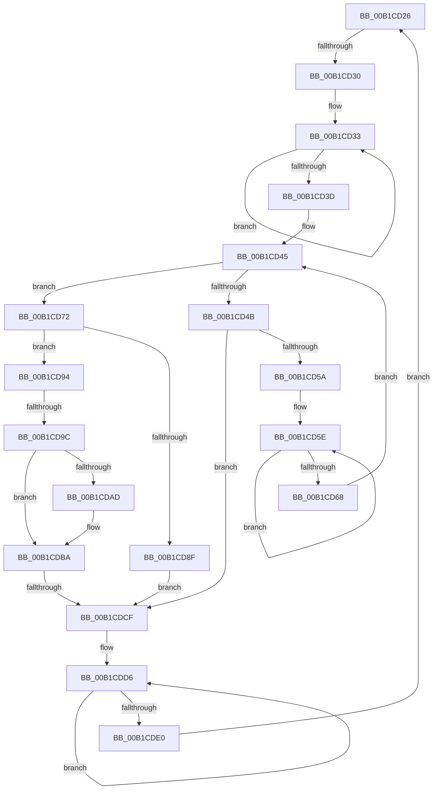

# sub_00B1CD26

- RVA: `0x00B1CD26`–`0x00B1CDED` (길이 `199` bytes)
- VA: `0x0000000140B1CD26`
- 실행 섹션: `PAGE`
- PDB 이름 있음: `아니요`; PDB Function 태그: `아니요`
- unwind 정보 RVA: `0x00085A2C`
- 디코드: `55`개 명령, `199/199` bytes 표시
- 미해석 바이트: `0` (있으면 어셈블리에 `.byte`로 보존)

> 이 문서는 커널 이미지의 기계어와 PDB 기호를 분석해 생성했습니다. 4번과 5번은 함수 원형과 자료형을 바이너리 사용 방식에서 추정한 C 해석이며 원본 소스 복구 결과는 아닙니다.

## 1. Dependencies

- 직접 호출 지점: **5**; 고유 호출 대상: **5**
- 직접 호출자로 확인된 함수: **0**
- RIP 상대 이미지 참조: **0**

### Outgoing calls
- `0x00B1CD51` → [wcsicmp](../../text/50/wcsicmp_function_00500080.md) (function, `0x00500080`)
- `0x00B1CD81` → [PiDmGetObject](../8D/PiDmGetObject_function_008DFAE0.md) (function, `0x008DFAE0`)
- `0x00B1CDA4` → [PiDmObjectIsEnumerable](../8E/PiDmObjectIsEnumerable_function_008E6458.md) (function, `0x008E6458`)
- `0x00B1CDB3` → [PiDqQueryEnumObject](../8D/PiDqQueryEnumObject_function_008DF424.md) (function, `0x008DF424`)
- `0x00B1CDBD` → [PiDmObjectRelease](../8E/PiDmObjectRelease_function_008E4F70.md) (function, `0x008E4F70`)

### Direct callers
- 이 함수 시작 RVA로 연결되는 직접 call은 확인되지 않았습니다. 간접 호출은 완전히 역산할 수 없습니다.

### Static image references
- 디코드된 RIP-relative 메모리 참조가 없습니다.

## 2. Other-region calls and transfers

- 다른 실행 섹션으로 향하는 call: **1**
  - `0x00B1CD51` → [wcsicmp](../../text/50/wcsicmp_function_00500080.md) (`PAGE` → `.text`)
- call이 아닌 외부 분기/꼬리 이동: **3**
  - `0x00B1CD2A` → [PiDqObjectManagerEnumerateAndRegisterQuery + 0xE1](../8D/PiDqObjectManagerEnumerateAndRegisterQuery_function_008DCF74.md) (`tail-transfer`)
  - `0x00B1CD96` → [PiDqObjectManagerEnumerateAndRegisterQuery + 0x124](../8D/PiDqObjectManagerEnumerateAndRegisterQuery_function_008DCF74.md) (`tail-transfer`)
  - `0x00B1CDC9` → [PiDqObjectManagerEnumerateAndRegisterQuery + 0x124](../8D/PiDqObjectManagerEnumerateAndRegisterQuery_function_008DCF74.md) (`tail-transfer`)

## 3. Assembly (complete function range)

```asm
00B1CD26  66 44 39 2E                     cmp word ptr [rsi], r13w
00B1CD2A  0F 84 25 03 DC FF               je 0x1408dd055
00B1CD30  49 8B C7                        mov rax, r15
00B1CD33  48 FF C0                        inc rax
00B1CD36  66 44 39 2C 46                  cmp word ptr [rsi + rax*2], r13w
00B1CD3B  75 F6                           jne 0x140b1cd33
00B1CD3D  4C 8D 78 01                     lea r15, [rax + 1]
00B1CD41  4E 8D 3C 7E                     lea r15, [rsi + r15*2]
00B1CD45  66 45 39 2F                     cmp word ptr [r15], r13w
00B1CD49  74 27                           je 0x140b1cd72
00B1CD4B  49 8B D7                        mov rdx, r15
00B1CD4E  48 8B CE                        mov rcx, rsi
00B1CD51  E8 2A 33 9E FF                  call 0x140500080
00B1CD56  85 C0                           test eax, eax
00B1CD58  74 75                           je 0x140b1cdcf
00B1CD5A  48 83 C8 FF                     or rax, 0xffffffffffffffff
00B1CD5E  48 FF C0                        inc rax
00B1CD61  66 45 39 2C 47                  cmp word ptr [r15 + rax*2], r13w
00B1CD66  75 F6                           jne 0x140b1cd5e
00B1CD68  4D 8D 3C 47                     lea r15, [r15 + rax*2]
00B1CD6C  49 83 C7 02                     add r15, 2
00B1CD70  EB D3                           jmp 0x140b1cd45
00B1CD72  41 8B 8E E8 00 00 00            mov ecx, dword ptr [r14 + 0xe8]
00B1CD79  4C 8D 44 24 38                  lea r8, [rsp + 0x38]
00B1CD7E  48 8B D6                        mov rdx, rsi
00B1CD81  E8 5A 2D DC FF                  call 0x1408dfae0
00B1CD86  8B D8                           mov ebx, eax
00B1CD88  3D 34 00 00 C0                  cmp eax, 0xc0000034
00B1CD8D  75 05                           jne 0x140b1cd94
00B1CD8F  41 8B DD                        mov ebx, r13d
00B1CD92  EB 3B                           jmp 0x140b1cdcf
00B1CD94  85 C0                           test eax, eax
00B1CD96  0F 88 FC 02 DC FF               js 0x1408dd098
00B1CD9C  4C 8B 7C 24 38                  mov r15, qword ptr [rsp + 0x38]
00B1CDA1  49 8B CF                        mov rcx, r15
00B1CDA4  E8 AF 96 DC FF                  call 0x1408e6458
00B1CDA9  84 C0                           test al, al
00B1CDAB  74 0D                           je 0x140b1cdba
00B1CDAD  49 8B D7                        mov rdx, r15
00B1CDB0  48 8B CF                        mov rcx, rdi
00B1CDB3  E8 6C 26 DC FF                  call 0x1408df424
00B1CDB8  8B D8                           mov ebx, eax
00B1CDBA  49 8B CF                        mov rcx, r15
00B1CDBD  E8 AE 81 DC FF                  call 0x1408e4f70
00B1CDC2  4C 89 6C 24 38                  mov qword ptr [rsp + 0x38], r13
00B1CDC7  85 DB                           test ebx, ebx
00B1CDC9  0F 88 C9 02 DC FF               js 0x1408dd098
00B1CDCF  49 83 CF FF                     or r15, 0xffffffffffffffff
00B1CDD3  49 8B C7                        mov rax, r15
00B1CDD6  48 FF C0                        inc rax
00B1CDD9  66 44 39 2C 46                  cmp word ptr [rsi + rax*2], r13w
00B1CDDE  75 F6                           jne 0x140b1cdd6
00B1CDE0  48 8D 34 46                     lea rsi, [rsi + rax*2]
00B1CDE4  48 83 C6 02                     add rsi, 2
00B1CDE8  E9 39 FF FF FF                  jmp 0x140b1cd26
```

## 4. C-style interpretation (structured pseudocode)

```c
__int64 __fastcall sub_00B1CD26(__int64 a1, __int64 a2, __int64 a3, __int64 a4, __int64 a5, __int64 a6, __int64 a7)
{
    __int64 result;
    __int64 v_r15;
    __int64 v_rbx;
    __int64 v_rsi;
    unsigned __int64 v_stack_p38;

loc_00B1CD33:
    result = (v_r15) + 1;
    if ((*(unsigned __int16 *)(v_rsi + result * 2)) != ((unsigned __int16)(v_r13))) goto loc_00B1CD33;
loc_00B1CD45:
    if ((*(unsigned __int16 *)(v_rsi + result + 1 * 2)) == ((unsigned __int16)(v_r13))) goto loc_00B1CD72;
    result = wcsicmp(v_rsi, v_rsi + result + 1 * 2, a3, a4);
    if ((unsigned int)(result) == 0) goto loc_00B1CDCF;
    result = (result) | (-1);
loc_00B1CD5E:
    result = (result) + 1;
    if ((*(unsigned __int16 *)(v_rsi + result + 1 * 2 + result * 2)) != ((unsigned __int16)(v_r13))) goto loc_00B1CD5E;
    v_r15 = (v_rsi + result + 1 * 2 + result * 2) + (2);
    goto loc_00B1CD45;
loc_00B1CD72:
    result = PiDmGetObject((unsigned int)(*(unsigned int *)(v_r14 + 232)), v_rsi, a7, a4);
    if (((unsigned int)(result)) != 0xC0000034ULL) goto loc_00B1CD94;
    goto loc_00B1CDCF;
loc_00B1CD94:
    result = PiDmObjectIsEnumerable(a7, v_rsi, a7, a4);
    v_rbx = (unsigned int)((unsigned int)(v_r13));
    if ((unsigned __int8)(result) != 0) {
        a2 = a7;
        a1 = v_rdi;
        result = PiDqQueryEnumObject(a1, a2, a7, a4);
        v_rbx = (unsigned int)(result);
    }
    result = PiDmObjectRelease(a7, a2, a7, a4);
    v_stack_p38 = v_r13;
loc_00B1CDCF:
    v_r15 = (a7) | (-1);
loc_00B1CDD6:
    result = (v_r15) + 1;
    if ((*(unsigned __int16 *)(v_rsi + result * 2)) != ((unsigned __int16)(v_r13))) goto loc_00B1CDD6;
    v_rsi = (v_rsi + result * 2) + (2);
    goto loc_00B1CD26;
}
```

## 5. (Beta) C Style

```c
int64_t sub_00B1CD26(int64_t Arg1, int64_t Arg2, int64_t Arg3, int64_t Arg4, uint64_t Arg5, uint64_t Arg6, int64_t Arg7)
{
    int64_t result;
    int64_t local_r15;
    int64_t local_rbx;
    int64_t local_rsi;
    uint64_t v_stack_p38;

loc_00B1CD33:
    result = (local_r15) + 1;
    if ((*(uint16_t *)(local_rsi + result * 2)) != ((uint16_t)(local_r13))) goto loc_00B1CD33;
loc_00B1CD45:
    if ((*(uint16_t *)(local_rsi + result + 0x1 * 2)) == ((uint16_t)(local_r13))) goto loc_00B1CD72;
    result = wcsicmp(local_rsi, local_rsi + result + 1 * 2, Arg3, Arg4);
    if ((uint32_t)(result) == 0) goto loc_00B1CDCF;
    result = (result) | (-1);
loc_00B1CD5E:
    result = (result) + 1;
    if ((*(uint16_t *)(local_rsi + result + 0x1 * 2 + result * 2)) != ((uint16_t)(local_r13))) goto loc_00B1CD5E;
    local_r15 = (local_rsi + result + 1 * 2 + result * 2) + (2);
    goto loc_00B1CD45;
loc_00B1CD72:
    result = PiDmGetObject((uint32_t)(*(uint32_t *)(local_r14 + 0xE8)), local_rsi, Arg7, Arg4);
    if (((uint32_t)(result)) != 0xC0000034ULL) goto loc_00B1CD94;
    goto loc_00B1CDCF;
loc_00B1CD94:
    result = PiDmObjectIsEnumerable(Arg7, local_rsi, Arg7, Arg4);
    local_rbx = (uint32_t)((uint32_t)(local_r13));
    if ((uint8_t)(result) != 0) {
        Arg2 = Arg7;
        Arg1 = local_rdi;
        result = PiDqQueryEnumObject(Arg1, Arg2, Arg7, Arg4);
        local_rbx = (uint32_t)(result);
    }
    result = PiDmObjectRelease(Arg7, Arg2, Arg7, Arg4);
    v_stack_p38 = local_r13;
loc_00B1CDCF:
    local_r15 = (Arg7) | (-1);
loc_00B1CDD6:
    result = (local_r15) + 1;
    if ((*(uint16_t *)(local_rsi + result * 2)) != ((uint16_t)(local_r13))) goto loc_00B1CDD6;
    local_rsi = (local_rsi + result * 2) + (2);
    goto loc_00B1CD26;
}
```

## 6. Execution-region graph

[열기: 2D/3D 그래프와 함수 탐색 컨트롤 패널](../../../control-panel.html?section=page&rva=0x00B1CD26&view=graph)

- 2D 그래프는 위에서 아래로 흐르고, 3D 그래프는 빈 공간을 드래그해 회전합니다. Shift+드래그는 이동, 휠은 확대·축소, 함수 노드 선택은 대상 보고서 이동입니다.

### Static fallback


