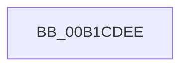

# sub_00B1CDEE

- RVA: `0x00B1CDEE`–`0x00B1CE1D` (길이 `47` bytes)
- VA: `0x0000000140B1CDEE`
- 실행 섹션: `PAGE`
- PDB 이름 있음: `아니요`; PDB Function 태그: `아니요`
- unwind 정보 RVA: `0x00085A94`
- 디코드: `11`개 명령, `47/47` bytes 표시
- 미해석 바이트: `0` (있으면 어셈블리에 `.byte`로 보존)

> 이 문서는 커널 이미지의 기계어와 PDB 기호를 분석해 생성했습니다. 4번과 5번은 함수 원형과 자료형을 바이너리 사용 방식에서 추정한 C 해석이며 원본 소스 복구 결과는 아닙니다.

## 1. Dependencies

- 직접 호출 지점: **4**; 고유 호출 대상: **4**
- 직접 호출자로 확인된 함수: **0**
- RIP 상대 이미지 참조: **0**

### Outgoing calls
- `0x00B1CDF1` → [PiDqQueryLock](../8D/PiDqQueryLock_function_008DDA0C.md) (function, `0x008DDA0C`)
- `0x00B1CE00` → [PiDqQueryFreeActiveData](../8D/PiDqQueryFreeActiveData_function_008DE4FC.md) (function, `0x008DE4FC`)
- `0x00B1CE08` → [PiDqQueryCompletePendedIrp](../8D/PiDqQueryCompletePendedIrp_function_008DE594.md) (function, `0x008DE594`)
- `0x00B1CE10` → [PiDqQueryUnlock](../8D/PiDqQueryUnlock_function_008DDA6C.md) (function, `0x008DDA6C`)

### Direct callers
- 이 함수 시작 RVA로 연결되는 직접 call은 확인되지 않았습니다. 간접 호출은 완전히 역산할 수 없습니다.

### Static image references
- 디코드된 RIP-relative 메모리 참조가 없습니다.

## 2. Other-region calls and transfers

- 다른 실행 섹션으로 향하는 call: **0**
- call이 아닌 외부 분기/꼬리 이동: **1**
  - `0x00B1CE18` → [PiDqObjectManagerServiceActionQueue + 0xD3](../8D/PiDqObjectManagerServiceActionQueue_function_008DD640.md) (`tail-transfer`)

## 3. Assembly (complete function range)

```asm
00B1CDEE  48 8B CB                        mov rcx, rbx
00B1CDF1  E8 16 0C DC FF                  call 0x1408dda0c
00B1CDF6  83 8B D8 00 00 00 01            or dword ptr [rbx + 0xd8], 1
00B1CDFD  48 8B CB                        mov rcx, rbx
00B1CE00  E8 F7 16 DC FF                  call 0x1408de4fc
00B1CE05  48 8B CB                        mov rcx, rbx
00B1CE08  E8 87 17 DC FF                  call 0x1408de594
00B1CE0D  48 8B CB                        mov rcx, rbx
00B1CE10  E8 57 0C DC FF                  call 0x1408dda6c
00B1CE15  48 8B 1B                        mov rbx, qword ptr [rbx]
00B1CE18  E9 F6 08 DC FF                  jmp 0x1408dd713
```

## 4. C-style interpretation (structured pseudocode)

```c
__int64 __fastcall sub_00B1CDEE(void)
{
    __int64 result;

    result = PiDqQueryLock(v_rbx, a2, a3, a4);
    result = PiDqQueryFreeActiveData(v_rbx, a2, a3, a4);
    result = PiDqQueryCompletePendedIrp(v_rbx, a2, a3, a4);
    result = PiDqQueryUnlock(v_rbx, a2, a3, a4);
}
```

## 5. (Beta) C Style

```c
void sub_00B1CDEE(void)
{
    int64_t result;

    result = PiDqQueryLock(local_rbx, a2, a3, a4);
    result = PiDqQueryFreeActiveData(local_rbx, a2, a3, a4);
    result = PiDqQueryCompletePendedIrp(local_rbx, a2, a3, a4);
    result = PiDqQueryUnlock(local_rbx, a2, a3, a4);
}
```

## 6. Execution-region graph

[열기: 2D/3D 그래프와 함수 탐색 컨트롤 패널](../../../control-panel.html?section=page&rva=0x00B1CDEE&view=graph)

- 2D 그래프는 위에서 아래로 흐르고, 3D 그래프는 빈 공간을 드래그해 회전합니다. Shift+드래그는 이동, 휠은 확대·축소, 함수 노드 선택은 대상 보고서 이동입니다.

### Static fallback


