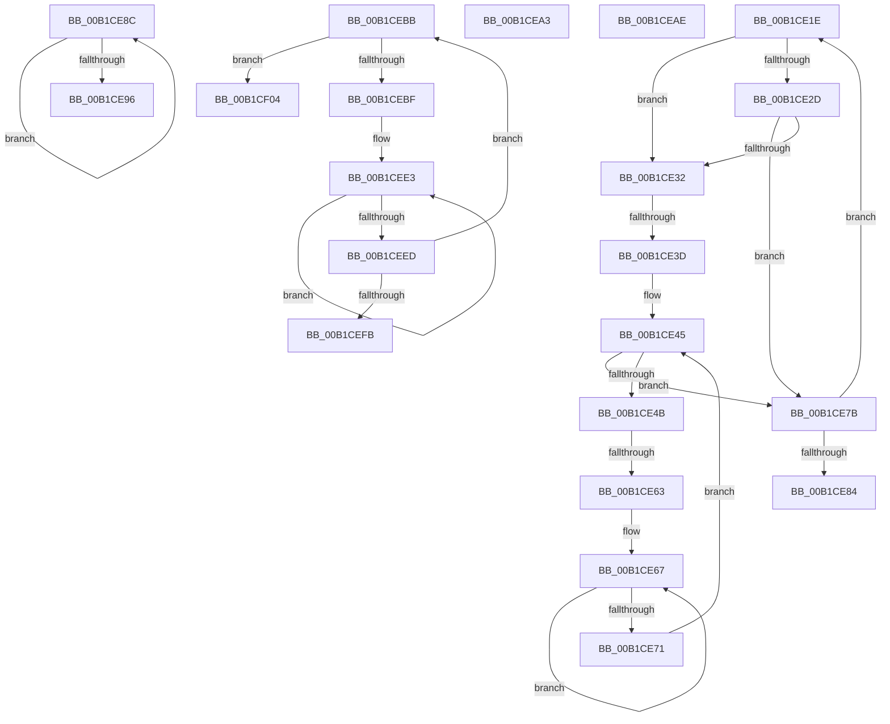

# sub_00B1CE1E

- RVA: `0x00B1CE1E`–`0x00B1CF0D` (길이 `239` bytes)
- VA: `0x0000000140B1CE1E`
- 실행 섹션: `PAGE`
- PDB 이름 있음: `아니요`; PDB Function 태그: `아니요`
- unwind 정보 RVA: `0x00085AC0`
- 디코드: `67`개 명령, `239/239` bytes 표시
- 미해석 바이트: `0` (있으면 어셈블리에 `.byte`로 보존)

> 이 문서는 커널 이미지의 기계어와 PDB 기호를 분석해 생성했습니다. 4번과 5번은 함수 원형과 자료형을 바이너리 사용 방식에서 추정한 C 해석이며 원본 소스 복구 결과는 아닙니다.

## 1. Dependencies

- 직접 호출 지점: **2**; 고유 호출 대상: **1**
- 직접 호출자로 확인된 함수: **0**
- RIP 상대 이미지 참조: **0**

### Outgoing calls
- `0x00B1CE53` → [wcsicmp](../../text/50/wcsicmp_function_00500080.md) (function, `0x00500080`)
- `0x00B1CECD` → [wcsicmp](../../text/50/wcsicmp_function_00500080.md) (function, `0x00500080`)

### Direct callers
- 이 함수 시작 RVA로 연결되는 직접 call은 확인되지 않았습니다. 간접 호출은 완전히 역산할 수 없습니다.

### Static image references
- 디코드된 RIP-relative 메모리 참조가 없습니다.

## 2. Other-region calls and transfers

- 다른 실행 섹션으로 향하는 call: **2**
  - `0x00B1CE53` → [wcsicmp](../../text/50/wcsicmp_function_00500080.md) (`PAGE` → `.text`)
  - `0x00B1CECD` → [wcsicmp](../../text/50/wcsicmp_function_00500080.md) (`PAGE` → `.text`)
- call이 아닌 외부 분기/꼬리 이동: **8**
  - `0x00B1CE37` → [PiDqQueryApplyObjectEvent + 0x4C9](../8D/PiDqQueryApplyObjectEvent_function_008DDACC.md) (`tail-transfer`)
  - `0x00B1CE5D` → [PiDqQueryApplyObjectEvent + 0x4C9](../8D/PiDqQueryApplyObjectEvent_function_008DDACC.md) (`tail-transfer`)
  - `0x00B1CE87` → [PiDqQueryApplyObjectEvent + 0x176](../8D/PiDqQueryApplyObjectEvent_function_008DDACC.md) (`tail-transfer`)
  - `0x00B1CE9E` → [PiDqQueryApplyObjectEvent + 0x48C](../8D/PiDqQueryApplyObjectEvent_function_008DDACC.md) (`tail-transfer`)
  - `0x00B1CEA9` → [PiDqQueryApplyObjectEvent + 0x15C](../8D/PiDqQueryApplyObjectEvent_function_008DDACC.md) (`tail-transfer`)
  - `0x00B1CEB6` → [PiDqQueryApplyObjectEvent + 0x176](../8D/PiDqQueryApplyObjectEvent_function_008DDACC.md) (`tail-transfer`)
  - `0x00B1CEFF` → [PiDqQueryApplyObjectEvent + 0x335](../8D/PiDqQueryApplyObjectEvent_function_008DDACC.md) (`tail-transfer`)
  - `0x00B1CF08` → [PiDqQueryApplyObjectEvent + 0x33D](../8D/PiDqQueryApplyObjectEvent_function_008DDACC.md) (`tail-transfer`)

## 3. Assembly (complete function range)

```asm
00B1CE1E  41 8B FF                        mov edi, r15d
00B1CE21  48 C1 E7 05                     shl rdi, 5
00B1CE25  42 83 7C 37 64 01               cmp dword ptr [rdi + r14 + 0x64], 1
00B1CE2B  75 05                           jne 0x140b1ce32
00B1CE2D  45 84 ED                        test r13b, r13b
00B1CE30  74 49                           je 0x140b1ce7b
00B1CE32  4E 39 54 37 68                  cmp qword ptr [rdi + r14 + 0x68], r10
00B1CE37  0F 84 58 11 DC FF               je 0x1408ddf95
00B1CE3D  48 8B 46 18                     mov rax, qword ptr [rsi + 0x18]
00B1CE41  48 8B 58 38                     mov rbx, qword ptr [rax + 0x38]
00B1CE45  66 44 39 13                     cmp word ptr [rbx], r10w
00B1CE49  74 30                           je 0x140b1ce7b
00B1CE4B  4A 8B 4C 37 68                  mov rcx, qword ptr [rdi + r14 + 0x68]
00B1CE50  48 8B D3                        mov rdx, rbx
00B1CE53  E8 28 32 9E FF                  call 0x140500080
00B1CE58  45 33 D2                        xor r10d, r10d
00B1CE5B  85 C0                           test eax, eax
00B1CE5D  0F 84 32 11 DC FF               je 0x1408ddf95
00B1CE63  48 83 C8 FF                     or rax, 0xffffffffffffffff
00B1CE67  48 FF C0                        inc rax
00B1CE6A  66 44 39 14 43                  cmp word ptr [rbx + rax*2], r10w
00B1CE6F  75 F6                           jne 0x140b1ce67
00B1CE71  48 8D 1C 43                     lea rbx, [rbx + rax*2]
00B1CE75  48 83 C3 02                     add rbx, 2
00B1CE79  EB CA                           jmp 0x140b1ce45
00B1CE7B  41 FF C7                        inc r15d
00B1CE7E  45 3B 7E 4C                     cmp r15d, dword ptr [r14 + 0x4c]
00B1CE82  72 9A                           jb 0x140b1ce1e
00B1CE84  41 8A DC                        mov bl, r12b
00B1CE87  E9 B6 0D DC FF                  jmp 0x1408ddc42
00B1CE8C  48 FF C0                        inc rax
00B1CE8F  66 44 39 14 43                  cmp word ptr [rbx + rax*2], r10w
00B1CE94  75 F6                           jne 0x140b1ce8c
00B1CE96  48 8D 1C 43                     lea rbx, [rbx + rax*2]
00B1CE9A  48 83 C3 02                     add rbx, 2
00B1CE9E  E9 B5 10 DC FF                  jmp 0x1408ddf58
00B1CEA3  41 8A DA                        mov bl, r10b
00B1CEA6  88 5D 48                        mov byte ptr [rbp + 0x48], bl
00B1CEA9  E9 7A 0D DC FF                  jmp 0x1408ddc28
00B1CEAE  B3 01                           mov bl, 1
00B1CEB0  45 8A E2                        mov r12b, r10b
00B1CEB3  88 5D 48                        mov byte ptr [rbp + 0x48], bl
00B1CEB6  E9 87 0D DC FF                  jmp 0x1408ddc42
00B1CEBB  84 C0                           test al, al
00B1CEBD  75 45                           jne 0x140b1cf04
00B1CEBF  49 8D 7E 08                     lea rdi, [r14 + 8]
00B1CEC3  48 8B CB                        mov rcx, rbx
00B1CEC6  48 8B 17                        mov rdx, qword ptr [rdi]
00B1CEC9  48 8B 52 10                     mov rdx, qword ptr [rdx + 0x10]
00B1CECD  E8 AE 31 9E FF                  call 0x140500080
00B1CED2  45 33 D2                        xor r10d, r10d
00B1CED5  85 C0                           test eax, eax
00B1CED7  0F 94 C1                        sete cl
00B1CEDA  48 83 CA FF                     or rdx, 0xffffffffffffffff
00B1CEDE  8A C1                           mov al, cl
00B1CEE0  88 4D 50                        mov byte ptr [rbp + 0x50], cl
00B1CEE3  48 FF C2                        inc rdx
00B1CEE6  66 44 39 14 53                  cmp word ptr [rbx + rdx*2], r10w
00B1CEEB  75 F6                           jne 0x140b1cee3
00B1CEED  48 8D 1C 53                     lea rbx, [rbx + rdx*2]
00B1CEF1  48 83 C3 02                     add rbx, 2
00B1CEF5  66 44 39 13                     cmp word ptr [rbx], r10w
00B1CEF9  75 C0                           jne 0x140b1cebb
00B1CEFB  48 8D 5E 18                     lea rbx, [rsi + 0x18]
00B1CEFF  E9 FD 0E DC FF                  jmp 0x1408dde01
00B1CF04  48 8D 5E 18                     lea rbx, [rsi + 0x18]
00B1CF08  E9 FC 0E DC FF                  jmp 0x1408dde09
```

## 4. C-style interpretation (structured pseudocode)

```c
__int64 __fastcall sub_00B1CE1E(void)
{
    __int64 result;
    __int64 v_r10;
    __int64 v_r15;
    __int64 v_rbx;
    __int64 v_rdi;

    v_rdi = ((unsigned int)((unsigned int)(v_r15))) << (5);
    if ((*(unsigned int *)(v_rdi + v_r14 * 1 + 100)) != 1) goto loc_00B1CE32;
    if ((unsigned __int8)(v_r13) == 0) goto loc_00B1CE7B;
loc_00B1CE32:
loc_00B1CE45:
    if ((*(unsigned __int16 *)(*(unsigned __int64 *)(*(unsigned __int64 *)(v_rsi + 24) + 56))) == ((unsigned __int16)(v_r10))) goto loc_00B1CE7B;
    result = wcsicmp(*(unsigned __int64 *)(v_rdi + v_r14 * 1 + 104), *(unsigned __int64 *)(*(unsigned __int64 *)(v_rsi + 24) + 56), a3, a4);
    v_r10 = 0;
    result = (result) | (-1);
loc_00B1CE67:
    result = (result) + 1;
    if ((*(unsigned __int16 *)(*(unsigned __int64 *)(*(unsigned __int64 *)(v_rsi + 24) + 56) + result * 2)) != 0) goto loc_00B1CE67;
    v_rbx = (*(unsigned __int64 *)(*(unsigned __int64 *)(v_rsi + 24) + 56) + result * 2) + (2);
    goto loc_00B1CE45;
loc_00B1CE7B:
    v_r15 = (unsigned int)((v_r15) + 1);
    if (((unsigned int)(v_r15)) < (*(unsigned int *)(v_r14 + 76))) goto loc_00B1CE1E;
}
```

## 5. (Beta) C Style

```c
void sub_00B1CE1E(void)
{
    int64_t result;
    int64_t local_r10;
    int64_t local_r15;
    int64_t local_rbx;
    int64_t local_rdi;

    local_rdi = ((uint32_t)((uint32_t)(local_r15))) << (5);
    if ((*(uint32_t *)(local_rdi + local_r14 * 1 + 0x64)) != 1) goto loc_00B1CE32;
    if ((uint8_t)(local_r13) == 0) goto loc_00B1CE7B;
loc_00B1CE32:
loc_00B1CE45:
    if ((*(uint16_t *)(*(uint64_t *)(*(uint64_t *)(local_rsi + 0x18) + 0x38))) == ((uint16_t)(local_r10))) goto loc_00B1CE7B;
    result = wcsicmp(*(uint64_t *)(local_rdi + local_r14 * 1 + 0x68), *(uint64_t *)(*(uint64_t *)(local_rsi + 0x18) + 0x38), a3, a4);
    local_r10 = 0;
    result = (result) | (-1);
loc_00B1CE67:
    result = (result) + 1;
    if ((*(uint16_t *)(*(uint64_t *)(*(uint64_t *)(local_rsi + 0x18) + 0x38) + result * 2)) != 0) goto loc_00B1CE67;
    local_rbx = (*(uint64_t *)(*(uint64_t *)(local_rsi + 0x18) + 0x38) + result * 2) + (2);
    goto loc_00B1CE45;
loc_00B1CE7B:
    local_r15 = (uint32_t)((local_r15) + 1);
    if (((uint32_t)(local_r15)) < (*(uint32_t *)(local_r14 + 0x4C))) goto loc_00B1CE1E;
}
```

## 6. Execution-region graph

[열기: 2D/3D 그래프와 함수 탐색 컨트롤 패널](../../../control-panel.html?section=page&rva=0x00B1CE1E&view=graph)

- 2D 그래프는 위에서 아래로 흐르고, 3D 그래프는 빈 공간을 드래그해 회전합니다. Shift+드래그는 이동, 휠은 확대·축소, 함수 노드 선택은 대상 보고서 이동입니다.

### Static fallback


