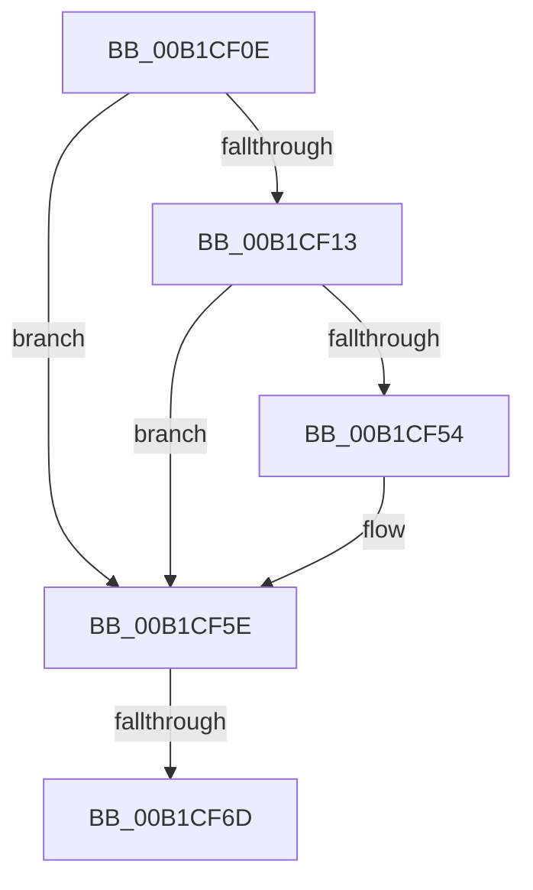

# sub_00B1CF0E

- RVA: `0x00B1CF0E`–`0x00B1CF95` (길이 `135` bytes)
- VA: `0x0000000140B1CF0E`
- 실행 섹션: `PAGE`
- PDB 이름 있음: `아니요`; PDB Function 태그: `아니요`
- unwind 정보 RVA: `0x00085BF8`
- 디코드: `35`개 명령, `135/135` bytes 표시
- 미해석 바이트: `0` (있으면 어셈블리에 `.byte`로 보존)

> 이 문서는 커널 이미지의 기계어와 PDB 기호를 분석해 생성했습니다. 4번과 5번은 함수 원형과 자료형을 바이너리 사용 방식에서 추정한 C 해석이며 원본 소스 복구 결과는 아닙니다.

## 1. Dependencies

- 직접 호출 지점: **2**; 고유 호출 대상: **2**
- 직접 호출자로 확인된 함수: **0**
- RIP 상대 이미지 참조: **0**

### Outgoing calls
- `0x00B1CF22` → [PiDqGetPnpObjectType](../8D/PiDqGetPnpObjectType_function_008DF790.md) (function, `0x008DF790`)
- `0x00B1CF46` → [PiDqOpenObjectRegKey](../98/PiDqOpenObjectRegKey_function_0098FF30.md) (function, `0x0098FF30`)

### Direct callers
- 이 함수 시작 RVA로 연결되는 직접 call은 확인되지 않았습니다. 간접 호출은 완전히 역산할 수 없습니다.

### Static image references
- 디코드된 RIP-relative 메모리 참조가 없습니다.

## 2. Other-region calls and transfers

- 다른 실행 섹션으로 향하는 call: **0**
- call이 아닌 외부 분기/꼬리 이동: **2**
  - `0x00B1CF67` → [PiDqPropertyCallback + 0x1B1](../8D/PiDqPropertyCallback_function_008DF580.md) (`tail-transfer`)
  - `0x00B1CF90` → [PiDqPropertyCallback + 0x1F2](../8D/PiDqPropertyCallback_function_008DF580.md) (`tail-transfer`)

## 3. Assembly (complete function range)

```asm
00B1CF0E  48 39 2B                        cmp qword ptr [rbx], rbp
00B1CF11  75 4B                           jne 0x140b1cf5e
00B1CF13  48 8B 4B 28                     mov rcx, qword ptr [rbx + 0x28]
00B1CF17  4C 8D 49 20                     lea r9, [rcx + 0x20]
00B1CF1B  48 8B 49 18                     mov rcx, qword ptr [rcx + 0x18]
00B1CF1F  8B 49 10                        mov ecx, dword ptr [rcx + 0x10]
00B1CF22  E8 69 28 DC FF                  call 0x1408df790
00B1CF27  48 8B 53 20                     mov rdx, qword ptr [rbx + 0x20]
00B1CF2B  44 8B C0                        mov r8d, eax
00B1CF2E  48 89 5C 24 30                  mov qword ptr [rsp + 0x30], rbx
00B1CF33  4C 89 4C 24 28                  mov qword ptr [rsp + 0x28], r9
00B1CF38  41 B9 01 00 00 00               mov r9d, 1
00B1CF3E  41 8B C9                        mov ecx, r9d
00B1CF41  40 88 6C 24 20                  mov byte ptr [rsp + 0x20], bpl
00B1CF46  E8 E5 2F E7 FF                  call 0x14098ff30
00B1CF4B  8B F8                           mov edi, eax
00B1CF4D  3D 34 00 00 C0                  cmp eax, 0xc0000034
00B1CF52  75 0A                           jne 0x140b1cf5e
00B1CF54  48 83 0B FF                     or qword ptr [rbx], 0xffffffffffffffff
00B1CF58  49 8D 76 14                     lea rsi, [r14 + 0x14]
00B1CF5C  8B FD                           mov edi, ebp
00B1CF5E  4C 8B 2B                        mov r13, qword ptr [rbx]
00B1CF61  8B C7                           mov eax, edi
00B1CF63  49 83 FD FF                     cmp r13, -1
00B1CF67  0F 85 C4 27 DC FF               jne 0x1408df731
00B1CF6D  8B 43 18                        mov eax, dword ptr [rbx + 0x18]
00B1CF70  41 0F 10 06                     movups xmm0, xmmword ptr [r14]
00B1CF74  48 8D 0C 40                     lea rcx, [rax + rax*2]
00B1CF78  48 8B 43 10                     mov rax, qword ptr [rbx + 0x10]
00B1CF7C  48 03 C9                        add rcx, rcx
00B1CF7F  0F 11 04 C8                     movups xmmword ptr [rax + rcx*8], xmm0
00B1CF83  41 0F 10 4E 10                  movups xmm1, xmmword ptr [r14 + 0x10]
00B1CF88  0F 11 4C C8 10                  movups xmmword ptr [rax + rcx*8 + 0x10], xmm1
00B1CF8D  FF 43 18                        inc dword ptr [rbx + 0x18]
00B1CF90  E9 DD 27 DC FF                  jmp 0x1408df772
```

## 4. C-style interpretation (structured pseudocode)

```c
__int64 __fastcall sub_00B1CF0E(void)
{
    __int64 result;
    __int64 v_rdi;
    __int64 v_rsi;
    unsigned __int8 v_stack_p20;
    unsigned __int64 v_stack_p28;
    unsigned __int64 v_stack_p30;

    if ((*(unsigned __int64 *)(v_rbx)) != v_rbp) goto loc_00B1CF5E;
    result = PiDqGetPnpObjectType((unsigned int)(*(unsigned int *)(*(unsigned __int64 *)(*(unsigned __int64 *)(v_rbx + 40) + 24) + 16)), a2, a3, *(unsigned __int64 *)(v_rbx + 40) + 32);
    v_stack_p30 = v_rbx;
    v_stack_p28 = *(unsigned __int64 *)(v_rbx + 40) + 32;
    v_stack_p20 = (unsigned __int8)(v_rbp);
    result = PiDqOpenObjectRegKey(1, *(unsigned __int64 *)(v_rbx + 32), (unsigned int)((unsigned int)(result)), 1);
    v_rdi = (unsigned int)((unsigned int)(result));
    if (((unsigned int)(result)) == 0xC0000034ULL) {
        v_rsi = v_r14 + 20;
        v_rdi = (unsigned int)(v_rbp);
    }
    a1 = ((unsigned int)(*(unsigned int *)(v_rbx + 24)) + (unsigned int)(*(unsigned int *)(v_rbx + 24)) * 2) + ((unsigned int)(*(unsigned int *)(v_rbx + 24)) + (unsigned int)(*(unsigned int *)(v_rbx + 24)) * 2);
    *(unsigned __int64 *)(*(unsigned __int64 *)(v_rbx + 16) + a1 * 8) = v_xmm0;
    *(unsigned __int64 *)(*(unsigned __int64 *)(v_rbx + 16) + a1 * 8 + 16) = v_xmm1;
}
```

## 5. (Beta) C Style

```c
void sub_00B1CF0E(void)
{
    int64_t result;
    int64_t local_rdi;
    int64_t local_rsi;
    uint8_t v_stack_p20;
    uint64_t v_stack_p28;
    uint64_t v_stack_p30;

    if ((*(uint64_t *)(local_rbx)) != local_rbp) goto loc_00B1CF5E;
    result = PiDqGetPnpObjectType((uint32_t)(*(uint32_t *)(*(uint64_t *)(*(uint64_t *)(local_rbx + 0x28) + 0x18) + 0x10)), a2, a3, *(uint64_t *)(local_rbx + 0x28) + 32);
    v_stack_p30 = local_rbx;
    v_stack_p28 = *(uint64_t *)(local_rbx + 0x28) + 32;
    v_stack_p20 = (uint8_t)(local_rbp);
    result = PiDqOpenObjectRegKey(1, *(uint64_t *)(local_rbx + 0x20), (uint32_t)((uint32_t)(result)), 1);
    local_rdi = (uint32_t)((uint32_t)(result));
    if (((uint32_t)(result)) == 0xC0000034ULL) {
        local_rsi = local_r14 + 20;
        local_rdi = (uint32_t)(local_rbp);
    }
    a1 = ((uint32_t)(*(uint32_t *)(local_rbx + 0x18)) + (uint32_t)(*(uint32_t *)(local_rbx + 0x18)) * 2) + ((uint32_t)(*(uint32_t *)(local_rbx + 0x18)) + (uint32_t)(*(uint32_t *)(local_rbx + 0x18)) * 2);
    *(uint64_t *)(*(uint64_t *)(local_rbx + 0x10) + a1 * 8) = v_xmm0;
    *(uint64_t *)(*(uint64_t *)(local_rbx + 0x10) + a1 * 8 + 0x10) = v_xmm1;
}
```

## 6. Execution-region graph

[열기: 2D/3D 그래프와 함수 탐색 컨트롤 패널](../../../control-panel.html?section=page&rva=0x00B1CF0E&view=graph)

- 2D 그래프는 위에서 아래로 흐르고, 3D 그래프는 빈 공간을 드래그해 회전합니다. Shift+드래그는 이동, 휠은 확대·축소, 함수 노드 선택은 대상 보고서 이동입니다.

### Static fallback


