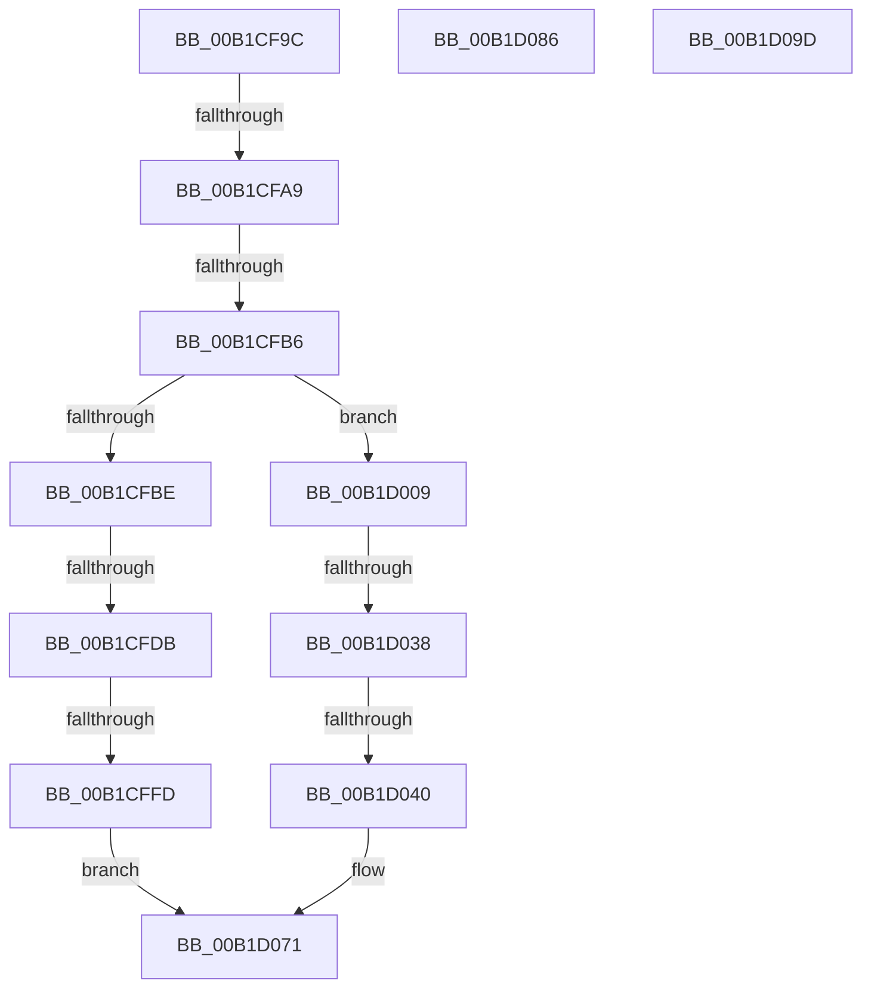

# sub_00B1CF9C

- RVA: `0x00B1CF9C`–`0x00B1D0A9` (길이 `269` bytes)
- VA: `0x0000000140B1CF9C`
- 실행 섹션: `PAGE`
- PDB 이름 있음: `아니요`; PDB Function 태그: `아니요`
- unwind 정보 RVA: `0x00085DC8`
- 디코드: `68`개 명령, `269/269` bytes 표시
- 미해석 바이트: `0` (있으면 어셈블리에 `.byte`로 보존)

> 이 문서는 커널 이미지의 기계어와 PDB 기호를 분석해 생성했습니다. 4번과 5번은 함수 원형과 자료형을 바이너리 사용 방식에서 추정한 C 해석이며 원본 소스 복구 결과는 아닙니다.

## 1. Dependencies

- 직접 호출 지점: **4**; 고유 호출 대상: **4**
- 직접 호출자로 확인된 함수: **0**
- RIP 상대 이미지 참조: **0**

### Outgoing calls
- `0x00B1CFC7` → [FindFilterOperatorClose](../9F/FindFilterOperatorClose_function_009F53D0.md) (function, `0x009F53D0`)
- `0x00B1CFEE` → [FilterEvalStrict](../8E/FilterEvalStrict_function_008E0ADC.md) (function, `0x008E0ADC`)
- `0x00B1D026` → [guard_dispatch_icall](../../text/6B/guard_dispatch_icall_function_006BAAD0.md) (function, `0x006BAAD0`)
- `0x00B1D06A` → [PropertyEval](../9C/PropertyEval_function_009CB300.md) (function, `0x009CB300`)

### Direct callers
- 이 함수 시작 RVA로 연결되는 직접 call은 확인되지 않았습니다. 간접 호출은 완전히 역산할 수 없습니다.

### Static image references
- 디코드된 RIP-relative 메모리 참조가 없습니다.

## 2. Other-region calls and transfers

- 다른 실행 섹션으로 향하는 call: **1**
  - `0x00B1D026` → [guard_dispatch_icall](../../text/6B/guard_dispatch_icall_function_006BAAD0.md) (`PAGE` → `.text`)
- call이 아닌 외부 분기/꼬리 이동: **9**
  - `0x00B1CFA3` → [FilterEvalStrict + 0xB1](../8E/FilterEvalStrict_function_008E0ADC.md) (`tail-transfer`)
  - `0x00B1CFB0` → [FilterEvalStrict + 0x26D](../8E/FilterEvalStrict_function_008E0ADC.md) (`tail-transfer`)
  - `0x00B1CFD5` → [FilterEvalStrict + 0x19C](../8E/FilterEvalStrict_function_008E0ADC.md) (`tail-transfer`)
  - `0x00B1CFF7` → [FilterEvalStrict + 0x19C](../8E/FilterEvalStrict_function_008E0ADC.md) (`tail-transfer`)
  - `0x00B1D032` → [FilterEvalStrict + 0x199](../8E/FilterEvalStrict_function_008E0ADC.md) (`tail-transfer`)
  - `0x00B1D03A` → [FilterEvalStrict + 0x19C](../8E/FilterEvalStrict_function_008E0ADC.md) (`tail-transfer`)
  - `0x00B1D081` → [FilterEvalStrict + 0x209](../8E/FilterEvalStrict_function_008E0ADC.md) (`tail-transfer`)
  - `0x00B1D098` → [FilterEvalStrict + 0x116](../8E/FilterEvalStrict_function_008E0ADC.md) (`tail-transfer`)
  - `0x00B1D0A4` → [FilterEvalStrict + 0x188](../8E/FilterEvalStrict_function_008E0ADC.md) (`tail-transfer`)

## 3. Assembly (complete function range)

```asm
00B1CF9C  41 81 FE 00 00 10 00            cmp r14d, 0x100000
00B1CFA3  0F 84 E4 3B DC FF               je 0x1408e0b8d
00B1CFA9  41 81 FE 00 00 50 00            cmp r14d, 0x500000
00B1CFB0  0F 85 93 3D DC FF               jne 0x1408e0d49
00B1CFB6  F7 07 00 00 F0 0F               test dword ptr [rdi], 0xff00000
00B1CFBC  74 4B                           je 0x140b1d009
00B1CFBE  4C 8D 45 50                     lea r8, [rbp + 0x50]
00B1CFC2  48 8B D7                        mov rdx, rdi
00B1CFC5  8B CE                           mov ecx, esi
00B1CFC7  E8 04 84 ED FF                  call 0x1409f53d0
00B1CFCC  44 8B 6D 50                     mov r13d, dword ptr [rbp + 0x50]
00B1CFD0  41 FF C5                        inc r13d
00B1CFD3  85 C0                           test eax, eax
00B1CFD5  0F 85 9D 3C DC FF               jne 0x1408e0c78
00B1CFDB  48 8B 55 48                     mov rdx, qword ptr [rbp + 0x48]
00B1CFDF  4C 8B CF                        mov r9, rdi
00B1CFE2  48 8B 4D 40                     mov rcx, qword ptr [rbp + 0x40]
00B1CFE6  45 8B C5                        mov r8d, r13d
00B1CFE9  4C 89 64 24 20                  mov qword ptr [rsp + 0x20], r12
00B1CFEE  E8 E9 3A DC FF                  call 0x1408e0adc
00B1CFF3  8B D8                           mov ebx, eax
00B1CFF5  85 C0                           test eax, eax
00B1CFF7  0F 85 7B 3C DC FF               jne 0x1408e0c78
00B1CFFD  41 2B F5                        sub esi, r13d
00B1D000  41 8B C5                        mov eax, r13d
00B1D003  4C 6B E8 38                     imul r13, rax, 0x38
00B1D007  EB 68                           jmp 0x140b1d071
00B1D009  48 8B 4D 48                     mov rcx, qword ptr [rbp + 0x48]
00B1D00D  48 8D 45 E8                     lea rax, [rbp - 0x18]
00B1D011  48 89 44 24 20                  mov qword ptr [rsp + 0x20], rax
00B1D016  48 8D 57 08                     lea rdx, [rdi + 8]
00B1D01A  48 8B 45 40                     mov rax, qword ptr [rbp + 0x40]
00B1D01E  4C 8D 4D D4                     lea r9, [rbp - 0x2c]
00B1D022  4C 8D 45 D0                     lea r8, [rbp - 0x30]
00B1D026  E8 A5 DA B9 FF                  call 0x1406baad0
00B1D02B  8B D8                           mov ebx, eax
00B1D02D  3D 25 02 00 C0                  cmp eax, 0xc0000225
00B1D032  0F 84 3D 3C DC FF               je 0x1408e0c75
00B1D038  85 C0                           test eax, eax
00B1D03A  0F 85 38 3C DC FF               jne 0x1408e0c78
00B1D040  8B 47 2C                        mov eax, dword ptr [rdi + 0x2c]
00B1D043  44 8B 0F                        mov r9d, dword ptr [rdi]
00B1D046  44 8B 45 D4                     mov r8d, dword ptr [rbp - 0x2c]
00B1D04A  48 8B 55 E8                     mov rdx, qword ptr [rbp - 0x18]
00B1D04E  8B 4D D0                        mov ecx, dword ptr [rbp - 0x30]
00B1D051  4C 89 64 24 38                  mov qword ptr [rsp + 0x38], r12
00B1D056  89 44 24 30                     mov dword ptr [rsp + 0x30], eax
00B1D05A  48 8B 47 30                     mov rax, qword ptr [rdi + 0x30]
00B1D05E  48 89 44 24 28                  mov qword ptr [rsp + 0x28], rax
00B1D063  8B 47 28                        mov eax, dword ptr [rdi + 0x28]
00B1D066  89 44 24 20                     mov dword ptr [rsp + 0x20], eax
00B1D06A  E8 91 E2 EA FF                  call 0x1409cb300
00B1D06F  FF CE                           dec esi
00B1D071  33 C0                           xor eax, eax
00B1D073  41 39 04 24                     cmp dword ptr [r12], eax
00B1D077  0F 94 C0                        sete al
00B1D07A  49 03 FD                        add rdi, r13
00B1D07D  41 89 04 24                     mov dword ptr [r12], eax
00B1D081  E9 5F 3C DC FF                  jmp 0x1408e0ce5
00B1D086  33 C9                           xor ecx, ecx
00B1D088  45 33 C0                        xor r8d, r8d
00B1D08B  33 D2                           xor edx, edx
00B1D08D  89 4D D0                        mov dword ptr [rbp - 0x30], ecx
00B1D090  48 89 55 E8                     mov qword ptr [rbp - 0x18], rdx
00B1D094  44 89 45 D4                     mov dword ptr [rbp - 0x2c], r8d
00B1D098  E9 55 3B DC FF                  jmp 0x1408e0bf2
00B1D09D  41 81 FE 00 00 10 00            cmp r14d, 0x100000
00B1D0A4  E9 BB 3B DC FF                  jmp 0x1408e0c64
```

## 4. C-style interpretation (structured pseudocode)

```c
__int64 __fastcall sub_00B1CF9C(void)
{
    __int64 result;
    __int64 v_r13;
    __int64 v_rdi;
    __int64 v_rsi;
    unsigned __int64 v_stack_p20;
    unsigned __int64 v_stack_p28;
    unsigned int v_stack_p30;
    unsigned __int64 v_stack_p38;

    if (((*(unsigned int *)(v_rdi)) & (0xFF00000ULL)) == 0) goto loc_00B1D009;
    result = FindFilterOperatorClose((unsigned int)((unsigned int)(v_rsi)), v_rdi, v_rbp + 80, a4);
    v_r13 = (unsigned int)(((unsigned int)(*(unsigned int *)(v_rbp + 80))) + 1);
    v_stack_p20 = v_r12;
    result = FilterEvalStrict(*(unsigned __int64 *)(v_rbp + 64), *(unsigned __int64 *)(v_rbp + 72), (unsigned int)((unsigned int)(v_r13)), v_rdi);
    v_rsi = (unsigned int)((v_rsi) - ((unsigned int)(v_r13)));
    v_r13 = (v_r13) * ((unsigned int)((unsigned int)(v_r13)));
    goto loc_00B1D071;
loc_00B1D009:
    v_stack_p20 = v_rbp - 24;
    result = guard_dispatch_icall(*(unsigned __int64 *)(v_rbp + 72), v_rdi + 8, v_rbp - 48, v_rbp - 44);
    v_stack_p38 = v_r12;
    v_stack_p30 = (unsigned int)((unsigned int)(*(unsigned int *)(v_rdi + 44)));
    v_stack_p28 = *(unsigned __int64 *)(v_rdi + 48);
    v_stack_p20 = (unsigned int)((unsigned int)(*(unsigned int *)(v_rdi + 40)));
    result = PropertyEval((unsigned int)(*(unsigned int *)(v_rbp - 48)), *(unsigned __int64 *)(v_rbp - 24), (unsigned int)(*(unsigned int *)(v_rbp - 44)), (unsigned int)(*(unsigned int *)(v_rdi)));
    v_rsi = (unsigned int)((v_rsi) - 1);
loc_00B1D071:
    result = 0;
    result = ((*(unsigned int *)(v_r12)) == 0) ? 1 : 0;
    v_rdi = (v_rdi) + (v_r13);
    *(unsigned int *)(v_r12) = (unsigned int)(result);
}
```

## 5. (Beta) C Style

```c
void sub_00B1CF9C(void)
{
    int64_t result;
    int64_t local_r13;
    int64_t local_rdi;
    int64_t local_rsi;
    uint64_t v_stack_p20;
    uint64_t v_stack_p28;
    uint32_t v_stack_p30;
    uint64_t v_stack_p38;

    if (((*(uint32_t *)(local_rdi)) & (0xFF00000ULL)) == 0) goto loc_00B1D009;
    result = FindFilterOperatorClose((uint32_t)((uint32_t)(local_rsi)), local_rdi, local_rbp + 80, a4);
    local_r13 = (uint32_t)(((uint32_t)(*(uint32_t *)(local_rbp + 0x50))) + 1);
    v_stack_p20 = local_r12;
    result = FilterEvalStrict(*(uint64_t *)(local_rbp + 0x40), *(uint64_t *)(local_rbp + 0x48), (uint32_t)((uint32_t)(local_r13)), local_rdi);
    local_rsi = (uint32_t)((local_rsi) - ((uint32_t)(local_r13)));
    local_r13 = (local_r13) * ((uint32_t)((uint32_t)(local_r13)));
    goto loc_00B1D071;
loc_00B1D009:
    v_stack_p20 = local_rbp - 24;
    result = guard_dispatch_icall(*(uint64_t *)(local_rbp + 0x48), local_rdi + 8, local_rbp - 48, local_rbp - 44);
    v_stack_p38 = local_r12;
    v_stack_p30 = (uint32_t)((uint32_t)(*(uint32_t *)(local_rdi + 0x2C)));
    v_stack_p28 = *(uint64_t *)(local_rdi + 0x30);
    v_stack_p20 = (uint32_t)((uint32_t)(*(uint32_t *)(local_rdi + 0x28)));
    result = PropertyEval((uint32_t)(*(uint32_t *)(local_rbp - 0x30)), *(uint64_t *)(local_rbp - 0x18), (uint32_t)(*(uint32_t *)(local_rbp - 0x2C)), (uint32_t)(*(uint32_t *)(local_rdi)));
    local_rsi = (uint32_t)((local_rsi) - 1);
loc_00B1D071:
    result = 0;
    result = ((*(uint32_t *)(local_r12)) == 0) ? 1 : 0;
    local_rdi = (local_rdi) + (local_r13);
    *(uint32_t *)(local_r12) = (uint32_t)(result);
}
```

## 6. Execution-region graph

[열기: 2D/3D 그래프와 함수 탐색 컨트롤 패널](../../../control-panel.html?section=page&rva=0x00B1CF9C&view=graph)

- 2D 그래프는 위에서 아래로 흐르고, 3D 그래프는 빈 공간을 드래그해 회전합니다. Shift+드래그는 이동, 휠은 확대·축소, 함수 노드 선택은 대상 보고서 이동입니다.

### Static fallback


