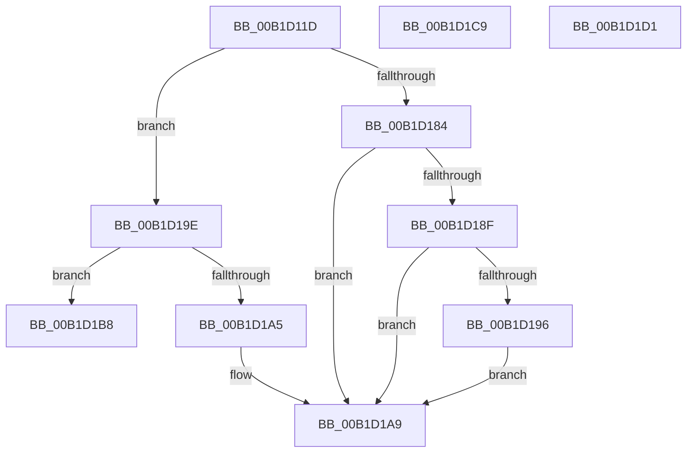

# sub_00B1D11D

- RVA: `0x00B1D11D`–`0x00B1D1D9` (길이 `188` bytes)
- VA: `0x0000000140B1D11D`
- 실행 섹션: `PAGE`
- PDB 이름 있음: `아니요`; PDB Function 태그: `아니요`
- unwind 정보 RVA: `0x00086104`
- 디코드: `45`개 명령, `188/188` bytes 표시
- 미해석 바이트: `0` (있으면 어셈블리에 `.byte`로 보존)

> 이 문서는 커널 이미지의 기계어와 PDB 기호를 분석해 생성했습니다. 4번과 5번은 함수 원형과 자료형을 바이너리 사용 방식에서 추정한 C 해석이며 원본 소스 복구 결과는 아닙니다.

## 1. Dependencies

- 직접 호출 지점: **1**; 고유 호출 대상: **1**
- 직접 호출자로 확인된 함수: **0**
- RIP 상대 이미지 참조: **2**

### Outgoing calls
- `0x00B1D17B` → [PnpGetObjectProperty](../8E/PnpGetObjectProperty_function_008E2180.md) (function, `0x008E2180`)

### Direct callers
- 이 함수 시작 RVA로 연결되는 직접 call은 확인되지 않았습니다. 간접 호출은 완전히 역산할 수 없습니다.

### Static image references
- `0x00B1D174` → RVA `0x00E66398` (`.data`; read)
- `0x00B1D1AC` → RVA `0x00000000` (`image boundary/outside`; read)

## 2. Other-region calls and transfers

- 다른 실행 섹션으로 향하는 call: **0**
- call이 아닌 외부 분기/꼬리 이동: **4**
  - `0x00B1D1B3` → [sub_008E359C + 0xE9](../8E/Unknown_function_008E359C.md) (`tail-transfer`)
  - `0x00B1D1C4` → [sub_008E28A3 + 0x143](../8E/Unknown_function_008E28A3.md) (`tail-transfer`)
  - `0x00B1D1CC` → [sub_008E314B + 0xFE](../8E/Unknown_function_008E314B.md) (`tail-transfer`)
  - `0x00B1D1D4` → [sub_008E314B + 0x232](../8E/Unknown_function_008E314B.md) (`tail-transfer`)

## 3. Assembly (complete function range)

```asm
00B1D11D  49 63 47 28                     movsxd rax, dword ptr [r15 + 0x28]
00B1D121  49 8B D6                        mov rdx, r14
00B1D124  45 33 C9                        xor r9d, r9d
00B1D127  48 8D 0C 80                     lea rcx, [rax + rax*4]
00B1D12B  49 2B 94 C8 B8 18 00 00         sub rdx, qword ptr [r8 + rcx*8 + 0x18b8]
00B1D133  48 8D 45 B0                     lea rax, [rbp - 0x50]
00B1D137  33 C9                           xor ecx, ecx
00B1D139  89 4C 24 50                     mov dword ptr [rsp + 0x50], ecx
00B1D13D  48 89 44 24 48                  mov qword ptr [rsp + 0x48], rax
00B1D142  48 8D 44 24 68                  lea rax, [rsp + 0x68]
00B1D147  44 8B 42 1C                     mov r8d, dword ptr [rdx + 0x1c]
00B1D14B  48 8B 52 10                     mov rdx, qword ptr [rdx + 0x10]
00B1D14F  C7 44 24 40 01 00 00 00         mov dword ptr [rsp + 0x40], 1
00B1D157  48 89 44 24 38                  mov qword ptr [rsp + 0x38], rax
00B1D15C  48 8D 44 24 70                  lea rax, [rsp + 0x70]
00B1D161  48 89 44 24 30                  mov qword ptr [rsp + 0x30], rax
00B1D166  49 8B 47 08                     mov rax, qword ptr [r15 + 8]
00B1D16A  48 89 44 24 28                  mov qword ptr [rsp + 0x28], rax
00B1D16F  48 89 4C 24 20                  mov qword ptr [rsp + 0x20], rcx
00B1D174  48 8B 0D 1D 92 34 00            mov rcx, qword ptr [rip + 0x34921d]
00B1D17B  E8 00 50 DC FF                  call 0x1408e2180
00B1D180  85 C0                           test eax, eax
00B1D182  78 1A                           js 0x140b1d19e
00B1D184  83 7C 24 70 11                  cmp dword ptr [rsp + 0x70], 0x11
00B1D189  8B 44 24 60                     mov eax, dword ptr [rsp + 0x60]
00B1D18D  75 1A                           jne 0x140b1d1a9
00B1D18F  80 7C 24 68 FF                  cmp byte ptr [rsp + 0x68], 0xff
00B1D194  75 13                           jne 0x140b1d1a9
00B1D196  FF C0                           inc eax
00B1D198  89 44 24 60                     mov dword ptr [rsp + 0x60], eax
00B1D19C  EB 0B                           jmp 0x140b1d1a9
00B1D19E  3D 25 02 00 C0                  cmp eax, 0xc0000225
00B1D1A3  75 13                           jne 0x140b1d1b8
00B1D1A5  8B 44 24 60                     mov eax, dword ptr [rsp + 0x60]
00B1D1A9  4D 8B 36                        mov r14, qword ptr [r14]
00B1D1AC  4C 8D 05 4D 2E 4E FF            lea r8, [rip - 0xb1d1b3]
00B1D1B3  E9 CD 64 DC FF                  jmp 0x1408e3685
00B1D1B8  45 33 FF                        xor r15d, r15d
00B1D1BB  41 BD 16 00 00 C0               mov r13d, 0xc0000016
00B1D1C1  44 8B E0                        mov r12d, eax
00B1D1C4  E9 1D 58 DC FF                  jmp 0x1408e29e6
00B1D1C9  41 8B C7                        mov eax, r15d
00B1D1CC  E9 78 60 DC FF                  jmp 0x1408e3249
00B1D1D1  41 8B C6                        mov eax, r14d
00B1D1D4  E9 A4 61 DC FF                  jmp 0x1408e337d
```

## 4. C-style interpretation (structured pseudocode)

```c
__int64 __fastcall sub_00B1D11D(__int64 a1, __int64 a2, __int64 a3, int a4, __int64 a5, __int64 a6, __int64 a7, __int64 a8, __int64 a9, __int64 a10, __int64 a11, unsigned int a12, unsigned __int8 a13, unsigned int a14)
{
    __int64 result;
    __int64 v_r15;
    unsigned __int64 v_stack_p20;
    unsigned __int64 v_stack_p28;
    unsigned __int64 v_stack_p30;
    unsigned __int64 v_stack_p38;
    unsigned int v_stack_p40;
    unsigned __int64 v_stack_p48;
    unsigned int v_stack_p50;
    unsigned int v_stack_p60;

    a4 = 0;
    a2 = (v_r14) - (*(unsigned __int64 *)(a3 + (int)(*(unsigned int *)(v_r15 + 40)) + (int)(*(unsigned int *)(v_r15 + 40)) * 4 * 8 + 6328));
    a1 = 0;
    v_stack_p50 = 0;
    v_stack_p48 = v_rbp - 80;
    v_stack_p40 = 1;
    v_stack_p38 = a13;
    v_stack_p30 = a14;
    v_stack_p28 = *(unsigned __int64 *)(v_r15 + 8);
    v_stack_p20 = 0;
    result = PnpGetObjectProperty(*(unsigned __int64 *)(v_rip + 3445277), *(unsigned __int64 *)(a2 + 16), (unsigned int)(*(unsigned int *)(a2 + 28)), a4);
    if (sign_flag) goto loc_00B1D19E;
    if (a14 != 17) goto loc_00B1D1A9;
    if (a13 != 255) goto loc_00B1D1A9;
    result = (unsigned int)(((unsigned int)(a12)) + 1);
    v_stack_p60 = (unsigned int)(result);
    goto loc_00B1D1A9;
loc_00B1D19E:
    if (((unsigned int)(result)) != 0xC0000225ULL) goto loc_00B1D1B8;
loc_00B1D1A9:
loc_00B1D1B8:
    v_r15 = 0;
}
```

## 5. (Beta) C Style

```c
int64_t sub_00B1D11D(int64_t Arg1, int64_t Arg2, void *Arg3, int32_t Arg4, uint64_t Arg5, uint64_t Arg6, uint64_t Arg7, uint64_t Arg8, uint64_t Arg9, uint64_t Arg10, uint64_t Arg11, uint32_t Arg12, uint8_t Arg13, uint32_t Arg14)
{
    uint8_t *arg3 = (uint8_t *)Arg3;

    int64_t result;
    int64_t local_r15;
    uint64_t v_stack_p20;
    uint64_t v_stack_p28;
    uint64_t v_stack_p30;
    uint64_t v_stack_p38;
    uint32_t v_stack_p40;
    uint64_t v_stack_p48;
    uint32_t v_stack_p50;
    uint32_t v_stack_p60;

    Arg4 = 0;
    Arg2 = (local_r14) - (*(uint64_t *)(arg3 + (int32_t)(*(uint32_t *)(local_r15 + 0x28)) + (int32_t)(*(uint32_t *)(local_r15 + 0x28)) * 4 * 8 + 0x18B8));
    Arg1 = 0;
    v_stack_p50 = 0;
    v_stack_p48 = local_rbp - 80;
    v_stack_p40 = 1;
    v_stack_p38 = Arg13;
    v_stack_p30 = Arg14;
    v_stack_p28 = *(uint64_t *)(local_r15 + 0x8);
    v_stack_p20 = 0;
    result = PnpGetObjectProperty(*(uint64_t *)(v_rip + 0x34921D), *(uint64_t *)(Arg2 + 0x10), (uint32_t)(*(uint32_t *)(Arg2 + 0x1C)), Arg4);
    if (sign_flag) goto loc_00B1D19E;
    if (Arg14 != 17) goto loc_00B1D1A9;
    if (Arg13 != 255) goto loc_00B1D1A9;
    result = (uint32_t)(((uint32_t)(Arg12)) + 1);
    v_stack_p60 = (uint32_t)(result);
    goto loc_00B1D1A9;
loc_00B1D19E:
    if (((uint32_t)(result)) != 0xC0000225ULL) goto loc_00B1D1B8;
loc_00B1D1A9:
loc_00B1D1B8:
    local_r15 = 0;
}
```

### 관측된 메모리 오프셋

구조체 형식이 확인되지 않은 접근은 인자 기준의 오프셋으로만 기록했습니다.

| 기준 인자 | 오프셋 표현 | 폭 (bit) | 접근 |
|---|---:|---:|---|
| `Arg3` | `+ 0x18B8 + rcx*8` | `64` | `R` |

## 6. Execution-region graph

[열기: 2D/3D 그래프와 함수 탐색 컨트롤 패널](../../../control-panel.html?section=page&rva=0x00B1D11D&view=graph)

- 2D 그래프는 위에서 아래로 흐르고, 3D 그래프는 빈 공간을 드래그해 회전합니다. Shift+드래그는 이동, 휠은 확대·축소, 함수 노드 선택은 대상 보고서 이동입니다.

### Static fallback


