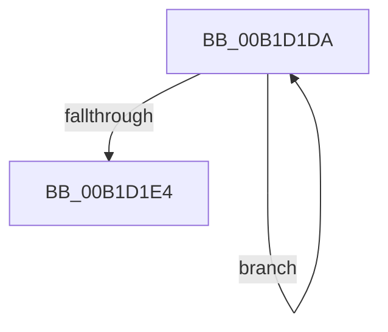

# sub_00B1D1DA

- RVA: `0x00B1D1DA`–`0x00B1D1F5` (길이 `27` bytes)
- VA: `0x0000000140B1D1DA`
- 실행 섹션: `PAGE`
- PDB 이름 있음: `아니요`; PDB Function 태그: `아니요`
- unwind 정보 RVA: `0x00086160`
- 디코드: `9`개 명령, `27/27` bytes 표시
- 미해석 바이트: `0` (있으면 어셈블리에 `.byte`로 보존)

> 이 문서는 커널 이미지의 기계어와 PDB 기호를 분석해 생성했습니다. 4번과 5번은 함수 원형과 자료형을 바이너리 사용 방식에서 추정한 C 해석이며 원본 소스 복구 결과는 아닙니다.

## 1. Dependencies

- 직접 호출 지점: **1**; 고유 호출 대상: **1**
- 직접 호출자로 확인된 함수: **0**
- RIP 상대 이미지 참조: **0**

### Outgoing calls
- `0x00B1D1EA` → [PiDmObjectReleaseLock](../8E/PiDmObjectReleaseLock_function_008E5584.md) (function, `0x008E5584`)

### Direct callers
- 이 함수 시작 RVA로 연결되는 직접 call은 확인되지 않았습니다. 간접 호출은 완전히 역산할 수 없습니다.

### Static image references
- 디코드된 RIP-relative 메모리 참조가 없습니다.

## 2. Other-region calls and transfers

- 다른 실행 섹션으로 향하는 call: **0**
- call이 아닌 외부 분기/꼬리 이동: **1**
  - `0x00B1D1F0` → [PiDmListEnumObjectsWithCallback + 0xD7](../8E/PiDmListEnumObjectsWithCallback_function_008E3B60.md) (`tail-transfer`)

## 3. Assembly (complete function range)

```asm
00B1D1DA  48 8B 00                        mov rax, qword ptr [rax]
00B1D1DD  FF C1                           inc ecx
00B1D1DF  48 3B C7                        cmp rax, rdi
00B1D1E2  75 F6                           jne 0x140b1d1da
00B1D1E4  89 4F 10                        mov dword ptr [rdi + 0x10], ecx
00B1D1E7  48 8B CD                        mov rcx, rbp
00B1D1EA  E8 95 83 DC FF                  call 0x1408e5584
00B1D1EF  90                              nop
00B1D1F0  E9 42 6A DC FF                  jmp 0x1408e3c37
```

## 4. C-style interpretation (structured pseudocode)

```c
__int64 __fastcall sub_00B1D1DA(int a1)
{
    __int64 result;

    a1 = (unsigned int)((a1) + 1);
    if ((*(unsigned __int64 *)(result)) != v_rdi) goto loc_00B1D1DA;
    *(unsigned int *)(v_rdi + 16) = a1;
    result = PiDmObjectReleaseLock(v_rbp, a2, a3, a4);
}
```

## 5. (Beta) C Style

```c
int64_t sub_00B1D1DA(int32_t Arg1)
{
    int64_t result;

    Arg1 = (uint32_t)((Arg1) + 1);
    if ((*(uint64_t *)(result)) != local_rdi) goto loc_00B1D1DA;
    *(uint32_t *)(local_rdi + 0x10) = Arg1;
    result = PiDmObjectReleaseLock(local_rbp, a2, a3, a4);
}
```

## 6. Execution-region graph

[열기: 2D/3D 그래프와 함수 탐색 컨트롤 패널](../../../control-panel.html?section=page&rva=0x00B1D1DA&view=graph)

- 2D 그래프는 위에서 아래로 흐르고, 3D 그래프는 빈 공간을 드래그해 회전합니다. Shift+드래그는 이동, 휠은 확대·축소, 함수 노드 선택은 대상 보고서 이동입니다.

### Static fallback


