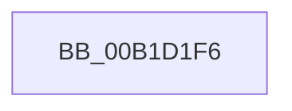

# sub_00B1D1F6

- RVA: `0x00B1D1F6`–`0x00B1D212` (길이 `28` bytes)
- VA: `0x0000000140B1D1F6`
- 실행 섹션: `PAGE`
- PDB 이름 있음: `아니요`; PDB Function 태그: `아니요`
- unwind 정보 RVA: `0x00086568`
- 디코드: `7`개 명령, `28/28` bytes 표시
- 미해석 바이트: `0` (있으면 어셈블리에 `.byte`로 보존)

> 이 문서는 커널 이미지의 기계어와 PDB 기호를 분석해 생성했습니다. 4번과 5번은 함수 원형과 자료형을 바이너리 사용 방식에서 추정한 C 해석이며 원본 소스 복구 결과는 아닙니다.

## 1. Dependencies

- 직접 호출 지점: **1**; 고유 호출 대상: **1**
- 직접 호출자로 확인된 함수: **0**
- RIP 상대 이미지 참조: **0**

### Outgoing calls
- `0x00B1D203` → [PiDmGetCacheKeys](../9F/PiDmGetCacheKeys_function_009F6654.md) (function, `0x009F6654`)

### Direct callers
- 이 함수 시작 RVA로 연결되는 직접 call은 확인되지 않았습니다. 간접 호출은 완전히 역산할 수 없습니다.

### Static image references
- 디코드된 RIP-relative 메모리 참조가 없습니다.

## 2. Other-region calls and transfers

- 다른 실행 섹션으로 향하는 call: **0**
- call이 아닌 외부 분기/꼬리 이동: **1**
  - `0x00B1D210` → [sub_00B1D23F](Unknown_function_00B1D23F.md) (`tail-transfer`)

## 3. Assembly (complete function range)

```asm
00B1D1F6  8B 4B 1C                        mov ecx, dword ptr [rbx + 0x1c]
00B1D1F9  4C 8D 44 24 30                  lea r8, [rsp + 0x30]
00B1D1FE  48 8D 54 24 38                  lea rdx, [rsp + 0x38]
00B1D203  E8 4C 94 ED FF                  call 0x1409f6654
00B1D208  44 8B 44 24 30                  mov r8d, dword ptr [rsp + 0x30]
00B1D20D  45 85 C0                        test r8d, r8d
00B1D210  74 2D                           je 0x140b1d23f
```

## 4. C-style interpretation (structured pseudocode)

```c
__int64 __fastcall sub_00B1D1F6(__int64 a1, __int64 a2, __int64 a3, __int64 a4, __int64 a5, unsigned int a6, __int64 a7)
{
    __int64 result;

    result = PiDmGetCacheKeys((unsigned int)(*(unsigned int *)(v_rbx + 28)), a7, a6, a4);
}
```

## 5. (Beta) C Style

```c
int64_t sub_00B1D1F6(int64_t Arg1, int64_t Arg2, int64_t Arg3, int64_t Arg4, uint64_t Arg5, uint32_t Arg6, int64_t Arg7)
{
    int64_t result;

    result = PiDmGetCacheKeys((uint32_t)(*(uint32_t *)(local_rbx + 0x1C)), Arg7, Arg6, Arg4);
}
```

## 6. Execution-region graph

[열기: 2D/3D 그래프와 함수 탐색 컨트롤 패널](../../../control-panel.html?section=page&rva=0x00B1D1F6&view=graph)

- 2D 그래프는 위에서 아래로 흐르고, 3D 그래프는 빈 공간을 드래그해 회전합니다. Shift+드래그는 이동, 휠은 확대·축소, 함수 노드 선택은 대상 보고서 이동입니다.

### Static fallback


