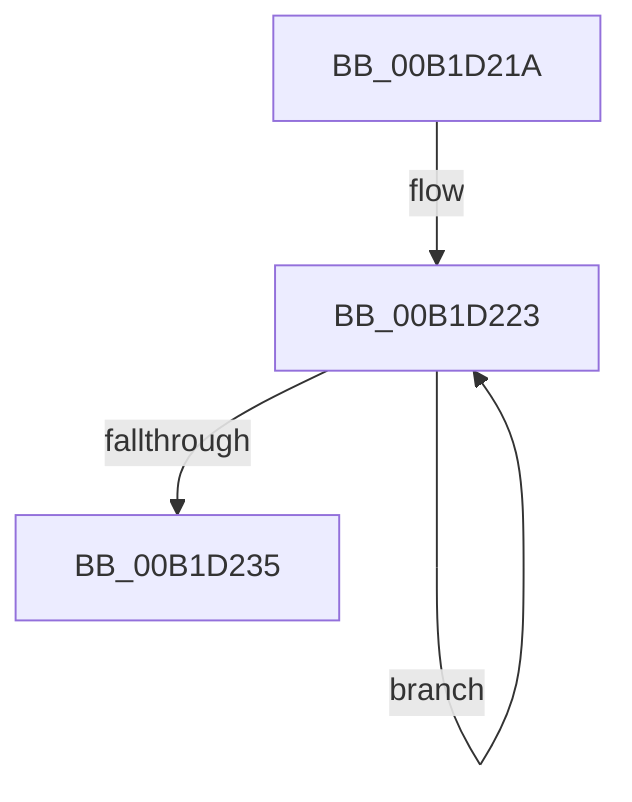

# sub_00B1D21A

- RVA: `0x00B1D21A`–`0x00B1D23F` (길이 `37` bytes)
- VA: `0x0000000140B1D21A`
- 실행 섹션: `PAGE`
- PDB 이름 있음: `아니요`; PDB Function 태그: `아니요`
- unwind 정보 RVA: `0x0008658C`
- 디코드: `9`개 명령, `37/37` bytes 표시
- 미해석 바이트: `0` (있으면 어셈블리에 `.byte`로 보존)

> 이 문서는 커널 이미지의 기계어와 PDB 기호를 분석해 생성했습니다. 4번과 5번은 함수 원형과 자료형을 바이너리 사용 방식에서 추정한 C 해석이며 원본 소스 복구 결과는 아닙니다.

## 1. Dependencies

- 직접 호출 지점: **1**; 고유 호출 대상: **1**
- 직접 호출자로 확인된 함수: **0**
- RIP 상대 이미지 참조: **0**

### Outgoing calls
- `0x00B1D226` → [PiDmCacheDataFree](../8F/PiDmCacheDataFree_function_008F9C48.md) (function, `0x008F9C48`)

### Direct callers
- 이 함수 시작 RVA로 연결되는 직접 call은 확인되지 않았습니다. 간접 호출은 완전히 역산할 수 없습니다.

### Static image references
- 디코드된 RIP-relative 메모리 참조가 없습니다.

## 2. Other-region calls and transfers

- 다른 실행 섹션으로 향하는 call: **0**
- 별도 외부 분기/꼬리 이동을 확인하지 못했습니다.

## 3. Assembly (complete function range)

```asm
00B1D21A  48 89 7C 24 48                  mov qword ptr [rsp + 0x48], rdi
00B1D21F  48 8D 7B 70                     lea rdi, [rbx + 0x70]
00B1D223  48 8B CF                        mov rcx, rdi
00B1D226  E8 1D CA DD FF                  call 0x1408f9c48
00B1D22B  48 83 C7 18                     add rdi, 0x18
00B1D22F  48 83 EE 01                     sub rsi, 1
00B1D233  75 EE                           jne 0x140b1d223
00B1D235  48 8B 7C 24 48                  mov rdi, qword ptr [rsp + 0x48]
00B1D23A  48 8B 74 24 40                  mov rsi, qword ptr [rsp + 0x40]
```

## 4. C-style interpretation (structured pseudocode)

```c
__int64 __fastcall sub_00B1D21A(__int64 a1, __int64 a2, __int64 a3, __int64 a4, __int64 a5, __int64 a6, __int64 a7, __int64 a8, __int64 a9)
{
    __int64 result;
    __int64 v_rdi;
    __int64 v_rsi;
    unsigned __int64 v_stack_p48;

    v_stack_p48 = v_rdi;
loc_00B1D223:
    result = PiDmCacheDataFree(v_rbx + 112, a2, a3, a4);
    v_rdi = (v_rbx + 112) + (24);
    v_rsi = (v_rsi) - (1);
    if (condition_is_not_equal) goto loc_00B1D223;
    return result;
}
```

## 5. (Beta) C Style

```c
int64_t sub_00B1D21A(int64_t Arg1, int64_t Arg2, int64_t Arg3, int64_t Arg4, uint64_t Arg5, uint64_t Arg6, uint64_t Arg7, int64_t Arg8, int64_t Arg9)
{
    int64_t result;
    int64_t local_rdi;
    int64_t local_rsi;
    uint64_t v_stack_p48;

    v_stack_p48 = local_rdi;
loc_00B1D223:
    result = PiDmCacheDataFree(local_rbx + 112, Arg2, Arg3, Arg4);
    local_rdi = (local_rbx + 112) + (24);
    local_rsi = (local_rsi) - (1);
    if (condition_is_not_equal) goto loc_00B1D223;
    return result;
}
```

## 6. Execution-region graph

[열기: 2D/3D 그래프와 함수 탐색 컨트롤 패널](../../../control-panel.html?section=page&rva=0x00B1D21A&view=graph)

- 2D 그래프는 위에서 아래로 흐르고, 3D 그래프는 빈 공간을 드래그해 회전합니다. Shift+드래그는 이동, 휠은 확대·축소, 함수 노드 선택은 대상 보고서 이동입니다.

### Static fallback


