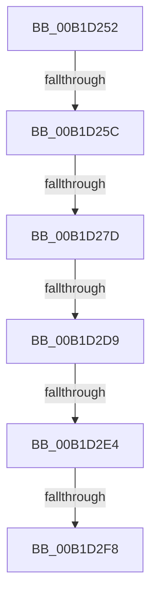

# sub_00B1D252

- RVA: `0x00B1D252`–`0x00B1D2FD` (길이 `171` bytes)
- VA: `0x0000000140B1D252`
- 실행 섹션: `PAGE`
- PDB 이름 있음: `아니요`; PDB Function 태그: `아니요`
- unwind 정보 RVA: `0x000865D4`
- 디코드: `34`개 명령, `171/171` bytes 표시
- 미해석 바이트: `0` (있으면 어셈블리에 `.byte`로 보존)

> 이 문서는 커널 이미지의 기계어와 PDB 기호를 분석해 생성했습니다. 4번과 5번은 함수 원형과 자료형을 바이너리 사용 방식에서 추정한 C 해석이며 원본 소스 복구 결과는 아닙니다.

## 1. Dependencies

- 직접 호출 지점: **3**; 고유 호출 대상: **3**
- 직접 호출자로 확인된 함수: **0**
- RIP 상대 이미지 참조: **2**

### Outgoing calls
- `0x00B1D26C` → [ExAllocatePool2](../../poolcode/B8/ExAllocatePool2_function_00B820F0.md) (function, `0x00B820F0`)
- `0x00B1D2CC` → [PnpGetObjectProperty](../8E/PnpGetObjectProperty_function_008E2180.md) (function, `0x008E2180`)
- `0x00B1D2EB` → [wcsicmp](../../text/50/wcsicmp_function_00500080.md) (function, `0x00500080`)

### Direct callers
- 이 함수 시작 RVA로 연결되는 직접 call은 확인되지 않았습니다. 간접 호출은 완전히 역산할 수 없습니다.

### Static image references
- `0x00B1D27D` → RVA `0x00E66398` (`.data`; read)
- `0x00B1D2B7` → RVA `0x00011490` (`.rdata`; read)

## 2. Other-region calls and transfers

- 다른 실행 섹션으로 향하는 call: **2**
  - `0x00B1D26C` → [ExAllocatePool2](../../poolcode/B8/ExAllocatePool2_function_00B820F0.md) (`PAGE` → `POOLCODE`)
  - `0x00B1D2EB` → [wcsicmp](../../text/50/wcsicmp_function_00500080.md) (`PAGE` → `.text`)
- call이 아닌 외부 분기/꼬리 이동: **6**
  - `0x00B1D256` → [PiPnpRtlInterfaceFilterCallback + 0x63](../8E/PiPnpRtlInterfaceFilterCallback_function_008E4FC0.md) (`tail-transfer`)
  - `0x00B1D277` → [PiPnpRtlInterfaceFilterCallback + 0xB5](../8E/PiPnpRtlInterfaceFilterCallback_function_008E4FC0.md) (`tail-transfer`)
  - `0x00B1D2D3` → [PiPnpRtlInterfaceFilterCallback + 0x30F](../8E/PiPnpRtlInterfaceFilterCallback_function_008E4FC0.md) (`tail-transfer`)
  - `0x00B1D2DE` → [PiPnpRtlInterfaceFilterCallback + 0x30F](../8E/PiPnpRtlInterfaceFilterCallback_function_008E4FC0.md) (`tail-transfer`)
  - `0x00B1D2F2` → [PiPnpRtlInterfaceFilterCallback + 0x30F](../8E/PiPnpRtlInterfaceFilterCallback_function_008E4FC0.md) (`tail-transfer`)
  - `0x00B1D2F8` → [PiPnpRtlInterfaceFilterCallback + 0x63](../8E/PiPnpRtlInterfaceFilterCallback_function_008E4FC0.md) (`tail-transfer`)

## 3. Assembly (complete function range)

```asm
00B1D252  66 44 39 38                     cmp word ptr [rax], r15w
00B1D256  0F 84 C7 7D DC FF               je 0x1408e5023
00B1D25C  BA 90 01 00 00                  mov edx, 0x190
00B1D261  B9 00 01 00 00                  mov ecx, 0x100
00B1D266  41 B8 50 6E 70 47               mov r8d, 0x47706e50
00B1D26C  E8 7F 4E 06 00                  call 0x140b820f0
00B1D271  4C 8B F8                        mov r15, rax
00B1D274  48 85 C0                        test rax, rax
00B1D277  0F 84 F8 7D DC FF               je 0x1408e5075
00B1D27D  48 8B 0D 14 91 34 00            mov rcx, qword ptr [rip + 0x349114]
00B1D284  48 8D 44 24 68                  lea rax, [rsp + 0x68]
00B1D289  C7 44 24 50 00 00 00 00         mov dword ptr [rsp + 0x50], 0
00B1D291  45 33 C9                        xor r9d, r9d
00B1D294  48 89 44 24 48                  mov qword ptr [rsp + 0x48], rax
00B1D299  49 8B D6                        mov rdx, r14
00B1D29C  C7 44 24 40 90 01 00 00         mov dword ptr [rsp + 0x40], 0x190
00B1D2A4  48 8D 44 24 64                  lea rax, [rsp + 0x64]
00B1D2A9  4C 89 7C 24 38                  mov qword ptr [rsp + 0x38], r15
00B1D2AE  48 89 44 24 30                  mov qword ptr [rsp + 0x30], rax
00B1D2B3  45 8D 41 03                     lea r8d, [r9 + 3]
00B1D2B7  48 8D 05 D2 41 4F FF            lea rax, [rip - 0xb0be2e]
00B1D2BE  48 89 44 24 28                  mov qword ptr [rsp + 0x28], rax
00B1D2C3  48 C7 44 24 20 00 00 00 00      mov qword ptr [rsp + 0x20], 0
00B1D2CC  E8 AF 4E DC FF                  call 0x1408e2180
00B1D2D1  85 C0                           test eax, eax
00B1D2D3  0F 88 F6 7F DC FF               js 0x1408e52cf
00B1D2D9  83 7C 24 64 12                  cmp dword ptr [rsp + 0x64], 0x12
00B1D2DE  0F 85 EB 7F DC FF               jne 0x1408e52cf
00B1D2E4  48 8B 4F 08                     mov rcx, qword ptr [rdi + 8]
00B1D2E8  49 8B D7                        mov rdx, r15
00B1D2EB  E8 90 2D 9E FF                  call 0x140500080
00B1D2F0  85 C0                           test eax, eax
00B1D2F2  0F 85 D7 7F DC FF               jne 0x1408e52cf
00B1D2F8  E9 26 7D DC FF                  jmp 0x1408e5023
```

## 4. C-style interpretation (structured pseudocode)

```c
__int64 __fastcall sub_00B1D252(__int64 a1, __int64 a2, __int64 a3, int a4, __int64 a5, __int64 a6, __int64 a7, __int64 a8, __int64 a9, __int64 a10, __int64 a11, __int64 a12, __int64 a13)
{
    __int64 result;
    unsigned __int64 v_stack_p20;
    unsigned __int64 v_stack_p28;
    unsigned __int64 v_stack_p30;
    unsigned __int64 v_stack_p38;
    unsigned int v_stack_p40;
    unsigned __int64 v_stack_p48;
    unsigned int v_stack_p50;
    unsigned __int64 v_stack_p64;

    result = ExAllocatePool2(256, 400, (unsigned int)(0x47706E50ULL), a4);
    v_stack_p50 = 0;
    a4 = 0;
    v_stack_p48 = a13;
    v_stack_p40 = 400;
    v_stack_p38 = result;
    v_stack_p30 = v_stack_p64;
    v_stack_p28 = v_rip - 11583022;
    v_stack_p20 = 0;
    result = PnpGetObjectProperty(*(unsigned __int64 *)(v_rip + 3445012), v_r14, a4 + 3, a4);
    result = wcsicmp(*(unsigned __int64 *)(v_rdi + 8), result, a4 + 3, a4);
}
```

## 5. (Beta) C Style

```c
int64_t sub_00B1D252(int64_t Arg1, int64_t Arg2, int64_t Arg3, int32_t Arg4, uint64_t Arg5, uint64_t Arg6, uint64_t Arg7, uint64_t Arg8, uint64_t Arg9, uint64_t Arg10, uint64_t Arg11, uint64_t Arg12, int64_t Arg13)
{
    int64_t result;
    uint64_t v_stack_p20;
    uint64_t v_stack_p28;
    uint64_t v_stack_p30;
    uint64_t v_stack_p38;
    uint32_t v_stack_p40;
    uint64_t v_stack_p48;
    uint32_t v_stack_p50;
    uint64_t v_stack_p64;

    result = ExAllocatePool2(256, 400, (uint32_t)(0x47706E50ULL), Arg4);
    v_stack_p50 = 0;
    Arg4 = 0;
    v_stack_p48 = Arg13;
    v_stack_p40 = 400;
    v_stack_p38 = result;
    v_stack_p30 = v_stack_p64;
    v_stack_p28 = v_rip - 11583022;
    v_stack_p20 = 0;
    result = PnpGetObjectProperty(*(uint64_t *)(v_rip + 0x349114), local_r14, Arg4 + 3, Arg4);
    result = wcsicmp(*(uint64_t *)(local_rdi + 0x8), result, Arg4 + 3, Arg4);
}
```

## 6. Execution-region graph

[열기: 2D/3D 그래프와 함수 탐색 컨트롤 패널](../../../control-panel.html?section=page&rva=0x00B1D252&view=graph)

- 2D 그래프는 위에서 아래로 흐르고, 3D 그래프는 빈 공간을 드래그해 회전합니다. Shift+드래그는 이동, 휠은 확대·축소, 함수 노드 선택은 대상 보고서 이동입니다.

### Static fallback


