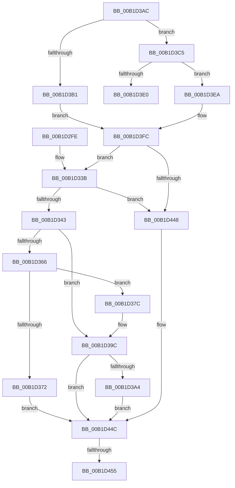

# sub_00B1D2FE

- RVA: `0x00B1D2FE`–`0x00B1D463` (길이 `357` bytes)
- VA: `0x0000000140B1D2FE`
- 실행 섹션: `PAGE`
- PDB 이름 있음: `아니요`; PDB Function 태그: `아니요`
- unwind 정보 RVA: `0x000866A0`
- 디코드: `95`개 명령, `357/357` bytes 표시
- 미해석 바이트: `0` (있으면 어셈블리에 `.byte`로 보존)

> 이 문서는 커널 이미지의 기계어와 PDB 기호를 분석해 생성했습니다. 4번과 5번은 함수 원형과 자료형을 바이너리 사용 방식에서 추정한 C 해석이며 원본 소스 복구 결과는 아닙니다.

## 1. Dependencies

- 직접 호출 지점: **11**; 고유 호출 대상: **8**
- 직접 호출자로 확인된 함수: **0**
- RIP 상대 이미지 참조: **0**

### Outgoing calls
- `0x00B1D307` → [KeInitializeEvent](../../text/40/KeInitializeEvent_function_0040DD10.md) (function, `0x0040DD10`)
- `0x00B1D334` → [PnpRequestDeviceAction](../../text/47/PnpRequestDeviceAction_function_00477FF8.md) (function, `0x00477FF8`)
- `0x00B1D354` → [KeWaitForSingleObject](../../text/20/KeWaitForSingleObject_function_0020E6B0.md) (function, `0x0020E6B0`)
- `0x00B1D369` → [PnpRemoveDeviceActionRequestFromQueue](../../text/5A/PnpRemoveDeviceActionRequestFromQueue_function_005A83E0.md) (function, `0x005A83E0`)
- `0x00B1D37F` → [PnpCancelDeviceActionRequest](../../text/5A/PnpCancelDeviceActionRequest_function_005A8330.md) (function, `0x005A8330`)
- `0x00B1D395` → [KeWaitForSingleObject](../../text/20/KeWaitForSingleObject_function_0020E6B0.md) (function, `0x0020E6B0`)
- `0x00B1D3BA` → [KeInitializeEvent](../../text/40/KeInitializeEvent_function_0040DD10.md) (function, `0x0040DD10`)
- `0x00B1D3D3` → [ExAllocatePool2](../../poolcode/B8/ExAllocatePool2_function_00B820F0.md) (function, `0x00B820F0`)
- `0x00B1D3F3` → [memcpy](../../text/6C/memcpy_function_006C6840.md) (function, `0x006C6840`)
- `0x00B1D438` → [PnpRequestDeviceAction](../../text/47/PnpRequestDeviceAction_function_00477FF8.md) (function, `0x00477FF8`)
- `0x00B1D458` → [PnpDeleteDeviceActionRequest](../95/PnpDeleteDeviceActionRequest_function_00955284.md) (function, `0x00955284`)

### Direct callers
- 이 함수 시작 RVA로 연결되는 직접 call은 확인되지 않았습니다. 간접 호출은 완전히 역산할 수 없습니다.

### Static image references
- 디코드된 RIP-relative 메모리 참조가 없습니다.

## 2. Other-region calls and transfers

- 다른 실행 섹션으로 향하는 call: **10**
  - `0x00B1D307` → [KeInitializeEvent](../../text/40/KeInitializeEvent_function_0040DD10.md) (`PAGE` → `.text`)
  - `0x00B1D334` → [PnpRequestDeviceAction](../../text/47/PnpRequestDeviceAction_function_00477FF8.md) (`PAGE` → `.text`)
  - `0x00B1D354` → [KeWaitForSingleObject](../../text/20/KeWaitForSingleObject_function_0020E6B0.md) (`PAGE` → `.text`)
  - `0x00B1D369` → [PnpRemoveDeviceActionRequestFromQueue](../../text/5A/PnpRemoveDeviceActionRequestFromQueue_function_005A83E0.md) (`PAGE` → `.text`)
  - `0x00B1D37F` → [PnpCancelDeviceActionRequest](../../text/5A/PnpCancelDeviceActionRequest_function_005A8330.md) (`PAGE` → `.text`)
  - `0x00B1D395` → [KeWaitForSingleObject](../../text/20/KeWaitForSingleObject_function_0020E6B0.md) (`PAGE` → `.text`)
  - `0x00B1D3BA` → [KeInitializeEvent](../../text/40/KeInitializeEvent_function_0040DD10.md) (`PAGE` → `.text`)
  - `0x00B1D3D3` → [ExAllocatePool2](../../poolcode/B8/ExAllocatePool2_function_00B820F0.md) (`PAGE` → `POOLCODE`)
  - `0x00B1D3F3` → [memcpy](../../text/6C/memcpy_function_006C6840.md) (`PAGE` → `.text`)
  - `0x00B1D438` → [PnpRequestDeviceAction](../../text/47/PnpRequestDeviceAction_function_00477FF8.md) (`PAGE` → `.text`)
- call이 아닌 외부 분기/꼬리 이동: **3**
  - `0x00B1D3E5` → [sub_008E5659 + 0xFB](../8E/Unknown_function_008E5659.md) (`tail-transfer`)
  - `0x00B1D44F` → [sub_008E5659 + 0xFB](../8E/Unknown_function_008E5659.md) (`tail-transfer`)
  - `0x00B1D45E` → [sub_008E5659 + 0xFB](../8E/Unknown_function_008E5659.md) (`tail-transfer`)

## 3. Assembly (complete function range)

```asm
00B1D2FE  45 33 C0                        xor r8d, r8d
00B1D301  48 8D 4D 1F                     lea rcx, [rbp + 0x1f]
00B1D305  33 D2                           xor edx, edx
00B1D307  E8 04 0A 8F FF                  call 0x14040dd10
00B1D30C  48 8D 45 E7                     lea rax, [rbp - 0x19]
00B1D310  45 33 C9                        xor r9d, r9d
00B1D313  48 89 44 24 30                  mov qword ptr [rsp + 0x30], rax
00B1D318  45 33 C0                        xor r8d, r8d
00B1D31B  48 8D 45 6F                     lea rax, [rbp + 0x6f]
00B1D31F  48 8B CB                        mov rcx, rbx
00B1D322  48 89 44 24 28                  mov qword ptr [rsp + 0x28], rax
00B1D327  48 8D 45 1F                     lea rax, [rbp + 0x1f]
00B1D32B  41 8D 51 01                     lea edx, [r9 + 1]
00B1D32F  48 89 44 24 20                  mov qword ptr [rsp + 0x20], rax
00B1D334  E8 BF AC 95 FF                  call 0x140477ff8
00B1D339  8B F8                           mov edi, eax
00B1D33B  85 C0                           test eax, eax
00B1D33D  0F 88 05 01 00 00               js 0x140b1d448
00B1D343  41 B1 01                        mov r9b, 1
00B1D346  4C 89 6C 24 20                  mov qword ptr [rsp + 0x20], r13
00B1D34B  45 33 C0                        xor r8d, r8d
00B1D34E  48 8D 4D 1F                     lea rcx, [rbp + 0x1f]
00B1D352  33 D2                           xor edx, edx
00B1D354  E8 57 13 6F FF                  call 0x14020e6b0
00B1D359  48 8B 75 E7                     mov rsi, qword ptr [rbp - 0x19]
00B1D35D  8B F8                           mov edi, eax
00B1D35F  3D 01 01 00 00                  cmp eax, 0x101
00B1D364  75 36                           jne 0x140b1d39c
00B1D366  48 8B CE                        mov rcx, rsi
00B1D369  E8 72 B0 A8 FF                  call 0x1405a83e0
00B1D36E  85 C0                           test eax, eax
00B1D370  74 0A                           je 0x140b1d37c
00B1D372  BF 20 01 00 C0                  mov edi, 0xc0000120
00B1D377  E9 D0 00 00 00                  jmp 0x140b1d44c
00B1D37C  48 8B CE                        mov rcx, rsi
00B1D37F  E8 AC AF A8 FF                  call 0x1405a8330
00B1D384  45 33 C9                        xor r9d, r9d
00B1D387  4C 89 6C 24 20                  mov qword ptr [rsp + 0x20], r13
00B1D38C  45 33 C0                        xor r8d, r8d
00B1D38F  48 8D 4D 1F                     lea rcx, [rbp + 0x1f]
00B1D393  33 D2                           xor edx, edx
00B1D395  E8 16 13 6F FF                  call 0x14020e6b0
00B1D39A  8B F8                           mov edi, eax
00B1D39C  85 FF                           test edi, edi
00B1D39E  0F 85 A8 00 00 00               jne 0x140b1d44c
00B1D3A4  8B 7D 6F                        mov edi, dword ptr [rbp + 0x6f]
00B1D3A7  E9 A0 00 00 00                  jmp 0x140b1d44c
00B1D3AC  45 85 F6                        test r14d, r14d
00B1D3AF  75 14                           jne 0x140b1d3c5
00B1D3B1  45 33 C0                        xor r8d, r8d
00B1D3B4  48 8D 4D 1F                     lea rcx, [rbp + 0x1f]
00B1D3B8  33 D2                           xor edx, edx
00B1D3BA  E8 51 09 8F FF                  call 0x14040dd10
00B1D3BF  48 89 75 07                     mov qword ptr [rbp + 7], rsi
00B1D3C3  EB 37                           jmp 0x140b1d3fc
00B1D3C5  41 B8 50 6E 70 55               mov r8d, 0x55706e50
00B1D3CB  49 8B D7                        mov rdx, r15
00B1D3CE  B9 00 01 00 00                  mov ecx, 0x100
00B1D3D3  E8 18 4D 06 00                  call 0x140b820f0
00B1D3D8  4C 8B E0                        mov r12, rax
00B1D3DB  48 85 C0                        test rax, rax
00B1D3DE  75 0A                           jne 0x140b1d3ea
00B1D3E0  BF 9A 00 00 C0                  mov edi, 0xc000009a
00B1D3E5  E9 6A 83 DC FF                  jmp 0x1408e5754
00B1D3EA  4D 8B C7                        mov r8, r15
00B1D3ED  48 8B D6                        mov rdx, rsi
00B1D3F0  49 8B CC                        mov rcx, r12
00B1D3F3  E8 48 94 BA FF                  call 0x1406c6840
00B1D3F8  4C 89 65 07                     mov qword ptr [rbp + 7], r12
00B1D3FC  45 85 F6                        test r14d, r14d
00B1D3FF  4C 89 6D FF                     mov qword ptr [rbp - 1], r13
00B1D403  48 8D 55 E7                     lea rdx, [rbp - 0x19]
00B1D407  49 0F 45 D5                     cmovne rdx, r13
00B1D40B  48 8D 4D 6F                     lea rcx, [rbp + 0x6f]
00B1D40F  49 0F 45 CD                     cmovne rcx, r13
00B1D413  48 89 54 24 30                  mov qword ptr [rsp + 0x30], rdx
00B1D418  48 89 4C 24 28                  mov qword ptr [rsp + 0x28], rcx
00B1D41D  48 8D 45 1F                     lea rax, [rbp + 0x1f]
00B1D421  49 0F 45 C5                     cmovne rax, r13
00B1D425  4C 8D 4D FF                     lea r9, [rbp - 1]
00B1D429  45 33 C0                        xor r8d, r8d
00B1D42C  48 89 44 24 20                  mov qword ptr [rsp + 0x20], rax
00B1D431  48 8B CB                        mov rcx, rbx
00B1D434  41 8D 50 0F                     lea edx, [r8 + 0xf]
00B1D438  E8 BB AB 95 FF                  call 0x140477ff8
00B1D43D  8B F8                           mov edi, eax
00B1D43F  45 85 F6                        test r14d, r14d
00B1D442  0F 84 F3 FE FF FF               je 0x140b1d33b
00B1D448  48 8B 75 E7                     mov rsi, qword ptr [rbp - 0x19]
00B1D44C  48 85 F6                        test rsi, rsi
00B1D44F  0F 84 FF 82 DC FF               je 0x1408e5754
00B1D455  48 8B CE                        mov rcx, rsi
00B1D458  E8 27 7E E3 FF                  call 0x140955284
00B1D45D  90                              nop
00B1D45E  E9 F1 82 DC FF                  jmp 0x1408e5754
```

## 4. C-style interpretation (structured pseudocode)

```c
__int64 __fastcall sub_00B1D2FE(__int64 a1, int a2, int a3, int a4)
{
    __int64 result;
    unsigned __int64 v_stack_p20;
    unsigned __int64 v_stack_p28;
    unsigned __int64 v_stack_p30;

    a3 = 0;
    a2 = 0;
    result = KeInitializeEvent(v_rbp + 31, a2, a3, a4);
    a4 = 0;
    v_stack_p30 = v_rbp - 25;
    a3 = 0;
    v_stack_p28 = v_rbp + 111;
    v_stack_p20 = v_rbp + 31;
    result = PnpRequestDeviceAction(v_rbx, a4 + 1, a3, a4);
loc_00B1D33B:
    if (sign_flag) goto loc_00B1D448;
    v_stack_p20 = v_r13;
    a3 = 0;
    a2 = 0;
    result = KeWaitForSingleObject(v_rbp + 31, a2, a3, 1);
    if (((unsigned int)(result)) != 257) goto loc_00B1D39C;
    result = PnpRemoveDeviceActionRequestFromQueue(*(unsigned __int64 *)(v_rbp - 25), a2, a3, 1);
    if ((unsigned int)(result) == 0) goto loc_00B1D37C;
    goto loc_00B1D44C;
loc_00B1D37C:
    result = PnpCancelDeviceActionRequest(*(unsigned __int64 *)(v_rbp - 25), a2, a3, 1);
    a4 = 0;
    v_stack_p20 = v_r13;
    a3 = 0;
    a2 = 0;
    result = KeWaitForSingleObject(v_rbp + 31, a2, a3, a4);
loc_00B1D39C:
    if ((unsigned int)((unsigned int)((unsigned int)(result))) != 0) goto loc_00B1D44C;
    goto loc_00B1D44C;
loc_00B1D448:
loc_00B1D44C:
    result = PnpDeleteDeviceActionRequest(*(unsigned __int64 *)(v_rbp - 25), a2, a3, a4);
}
```

## 5. (Beta) C Style

```c
int64_t sub_00B1D2FE(int64_t Arg1, int32_t Arg2, int32_t Arg3, int32_t Arg4)
{
    int64_t result;
    uint64_t v_stack_p20;
    uint64_t v_stack_p28;
    uint64_t v_stack_p30;

    Arg3 = 0;
    Arg2 = 0;
    result = KeInitializeEvent(local_rbp + 31, Arg2, Arg3, Arg4);
    Arg4 = 0;
    v_stack_p30 = local_rbp - 25;
    Arg3 = 0;
    v_stack_p28 = local_rbp + 111;
    v_stack_p20 = local_rbp + 31;
    result = PnpRequestDeviceAction(local_rbx, Arg4 + 1, Arg3, Arg4);
loc_00B1D33B:
    if (sign_flag) goto loc_00B1D448;
    v_stack_p20 = local_r13;
    Arg3 = 0;
    Arg2 = 0;
    result = KeWaitForSingleObject(local_rbp + 31, Arg2, Arg3, 1);
    if (((uint32_t)(result)) != 257) goto loc_00B1D39C;
    result = PnpRemoveDeviceActionRequestFromQueue(*(uint64_t *)(local_rbp - 0x19), Arg2, Arg3, 1);
    if ((uint32_t)(result) == 0) goto loc_00B1D37C;
    goto loc_00B1D44C;
loc_00B1D37C:
    result = PnpCancelDeviceActionRequest(*(uint64_t *)(local_rbp - 0x19), Arg2, Arg3, 1);
    Arg4 = 0;
    v_stack_p20 = local_r13;
    Arg3 = 0;
    Arg2 = 0;
    result = KeWaitForSingleObject(local_rbp + 31, Arg2, Arg3, Arg4);
loc_00B1D39C:
    if ((uint32_t)((uint32_t)((uint32_t)(result))) != 0) goto loc_00B1D44C;
    goto loc_00B1D44C;
loc_00B1D448:
loc_00B1D44C:
    result = PnpDeleteDeviceActionRequest(*(uint64_t *)(local_rbp - 0x19), Arg2, Arg3, Arg4);
}
```

## 6. Execution-region graph

[열기: 2D/3D 그래프와 함수 탐색 컨트롤 패널](../../../control-panel.html?section=page&rva=0x00B1D2FE&view=graph)

- 2D 그래프는 위에서 아래로 흐르고, 3D 그래프는 빈 공간을 드래그해 회전합니다. Shift+드래그는 이동, 휠은 확대·축소, 함수 노드 선택은 대상 보고서 이동입니다.

### Static fallback


