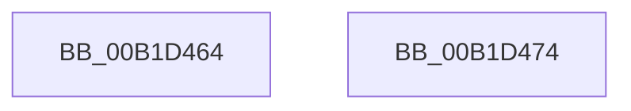

# sub_00B1D464

- RVA: `0x00B1D464`–`0x00B1D4A4` (길이 `64` bytes)
- VA: `0x0000000140B1D464`
- 실행 섹션: `PAGE`
- PDB 이름 있음: `아니요`; PDB Function 태그: `아니요`
- unwind 정보 RVA: `0x00086754`
- 디코드: `15`개 명령, `64/64` bytes 표시
- 미해석 바이트: `0` (있으면 어셈블리에 `.byte`로 보존)

> 이 문서는 커널 이미지의 기계어와 PDB 기호를 분석해 생성했습니다. 4번과 5번은 함수 원형과 자료형을 바이너리 사용 방식에서 추정한 C 해석이며 원본 소스 복구 결과는 아닙니다.

## 1. Dependencies

- 직접 호출 지점: **1**; 고유 호출 대상: **1**
- 직접 호출자로 확인된 함수: **0**
- RIP 상대 이미지 참조: **1**

### Outgoing calls
- `0x00B1D499` → [ZwUpdateWnfStateData](../../text/6B/ZwUpdateWnfStateData_function_006B0D10.md) (function, `0x006B0D10`)

### Direct callers
- 이 함수 시작 RVA로 연결되는 직접 call은 확인되지 않았습니다. 간접 호출은 완전히 역산할 수 없습니다.

### Static image references
- `0x00B1D483` → RVA `0x0001E318` (`.rdata`; read)

## 2. Other-region calls and transfers

- 다른 실행 섹션으로 향하는 call: **1**
  - `0x00B1D499` → [ZwUpdateWnfStateData](../../text/6B/ZwUpdateWnfStateData_function_006B0D10.md) (`PAGE` → `.text`)
- call이 아닌 외부 분기/꼬리 이동: **2**
  - `0x00B1D46F` → [PiUEventNotifyTargetDeviceChange + 0x114](../8E/PiUEventNotifyTargetDeviceChange_function_008E65B0.md) (`tail-transfer`)
  - `0x00B1D49F` → [PiUEventNotifyTargetDeviceChange + 0x124](../8E/PiUEventNotifyTargetDeviceChange_function_008E65B0.md) (`tail-transfer`)

## 3. Assembly (complete function range)

```asm
00B1D464  40 B6 01                        mov sil, 1
00B1D467  40 88 B4 24 88 00 00 00         mov byte ptr [rsp + 0x88], sil
00B1D46F  E9 50 92 DC FF                  jmp 0x1408e66c4
00B1D474  8D 45 FF                        lea eax, [rbp - 1]
00B1D477  41 B8 00 10 00 00               mov r8d, 0x1000
00B1D47D  89 07                           mov dword ptr [rdi], eax
00B1D47F  89 5C 24 30                     mov dword ptr [rsp + 0x30], ebx
00B1D483  48 8D 0D 8E 0E 50 FF            lea rcx, [rip - 0xaff172]
00B1D48A  89 5C 24 28                     mov dword ptr [rsp + 0x28], ebx
00B1D48E  45 33 C9                        xor r9d, r9d
00B1D491  48 8B D7                        mov rdx, rdi
00B1D494  48 89 5C 24 20                  mov qword ptr [rsp + 0x20], rbx
00B1D499  E8 72 38 B9 FF                  call 0x1406b0d10
00B1D49E  90                              nop
00B1D49F  E9 30 92 DC FF                  jmp 0x1408e66d4
```

## 4. C-style interpretation (structured pseudocode)

```c
__int64 __fastcall sub_00B1D464(__int64 a1, __int64 a2, __int64 a3, int a4)
{
    unsigned __int64 v_stack_p20;
    unsigned int v_stack_p28;
    unsigned int v_stack_p30;
    unsigned __int8 v_stack_p88;

    v_stack_p88 = 1;
}
```

## 5. (Beta) C Style

```c
int64_t sub_00B1D464(int64_t Arg1, int64_t Arg2, int64_t Arg3, int32_t Arg4)
{
    uint64_t v_stack_p20;
    uint32_t v_stack_p28;
    uint32_t v_stack_p30;
    uint8_t v_stack_p88;

    v_stack_p88 = 1;
}
```

## 6. Execution-region graph

[열기: 2D/3D 그래프와 함수 탐색 컨트롤 패널](../../../control-panel.html?section=page&rva=0x00B1D464&view=graph)

- 2D 그래프는 위에서 아래로 흐르고, 3D 그래프는 빈 공간을 드래그해 회전합니다. Shift+드래그는 이동, 휠은 확대·축소, 함수 노드 선택은 대상 보고서 이동입니다.

### Static fallback


