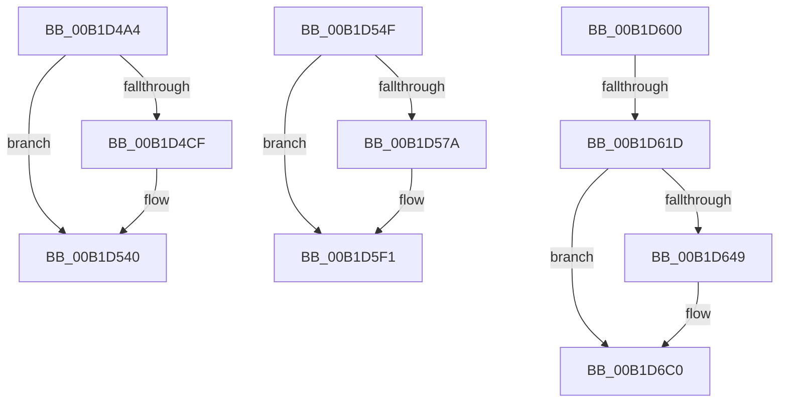

# sub_00B1D4A4

- RVA: `0x00B1D4A4`–`0x00B1D6CF` (길이 `555` bytes)
- VA: `0x0000000140B1D4A4`
- 실행 섹션: `PAGE`
- PDB 이름 있음: `아니요`; PDB Function 태그: `아니요`
- unwind 정보 RVA: `0x000867EC`
- 디코드: `126`개 명령, `555/555` bytes 표시
- 미해석 바이트: `0` (있으면 어셈블리에 `.byte`로 보존)

> 이 문서는 커널 이미지의 기계어와 PDB 기호를 분석해 생성했습니다. 4번과 5번은 함수 원형과 자료형을 바이너리 사용 방식에서 추정한 C 해석이며 원본 소스 복구 결과는 아닙니다.

## 1. Dependencies

- 직접 호출 지점: **13**; 고유 호출 대상: **6**
- 직접 호출자로 확인된 함수: **0**
- RIP 상대 이미지 참조: **5**

### Outgoing calls
- `0x00B1D4B3` → [PiUEventGatherEventData](../A6/PiUEventGatherEventData_function_00A6EBAC.md) (function, `0x00A6EBAC`)
- `0x00B1D4C0` → [PiUEventGetProcessImagePath](../AB/PiUEventGetProcessImagePath_function_00AB76F0.md) (function, `0x00AB76F0`)
- `0x00B1D53B` → [McTemplateK0qqzqqjqzjztx_EtwWriteTransfer](../../text/5A/McTemplateK0qqzqqjqzjztx_EtwWriteTransfer_function_005A7548.md) (function, `0x005A7548`)
- `0x00B1D544` → [PiUEventFreeProcessImagePath](../AC/PiUEventFreeProcessImagePath_function_00AC8C44.md) (function, `0x00AC8C44`)
- `0x00B1D55F` → [PiUEventGatherEventData](../A6/PiUEventGatherEventData_function_00A6EBAC.md) (function, `0x00A6EBAC`)
- `0x00B1D56C` → [PiUEventGetProcessImagePath](../AB/PiUEventGetProcessImagePath_function_00AB76F0.md) (function, `0x00AB76F0`)
- `0x00B1D5EC` → [McTemplateK0qqzqqjqzjztd_EtwWriteTransfer](../../text/5A/McTemplateK0qqzqqjqzjztd_EtwWriteTransfer_function_005A7388.md) (function, `0x005A7388`)
- `0x00B1D5F5` → [PiUEventFreeProcessImagePath](../AC/PiUEventFreeProcessImagePath_function_00AC8C44.md) (function, `0x00AC8C44`)
- `0x00B1D60A` → [ExReleaseFastMutex](../../text/25/ExReleaseFastMutex_function_002519C0.md) (function, `0x002519C0`)
- `0x00B1D62D` → [PiUEventGatherEventData](../A6/PiUEventGatherEventData_function_00A6EBAC.md) (function, `0x00A6EBAC`)
- `0x00B1D63A` → [PiUEventGetProcessImagePath](../AB/PiUEventGetProcessImagePath_function_00AB76F0.md) (function, `0x00AB76F0`)
- `0x00B1D6BB` → [McTemplateK0qqzqqjqzjztd_EtwWriteTransfer](../../text/5A/McTemplateK0qqzqqjqzjztd_EtwWriteTransfer_function_005A7388.md) (function, `0x005A7388`)
- `0x00B1D6C4` → [PiUEventFreeProcessImagePath](../AC/PiUEventFreeProcessImagePath_function_00AC8C44.md) (function, `0x00AC8C44`)

### Direct callers
- 이 함수 시작 RVA로 연결되는 직접 call은 확인되지 않았습니다. 간접 호출은 완전히 역산할 수 없습니다.

### Static image references
- `0x00B1D4C5` → RVA `0x00EF012C` (`.data`; read)
- `0x00B1D4DD` → RVA `0x00027440` (`.rdata`; read)
- `0x00B1D571` → RVA `0x00EF012D` (`.data`; read)
- `0x00B1D5CC` → RVA `0x00027520` (`.rdata`; read)
- `0x00B1D69B` → RVA `0x000275B0` (`.rdata`; read)

## 2. Other-region calls and transfers

- 다른 실행 섹션으로 향하는 call: **4**
  - `0x00B1D53B` → [McTemplateK0qqzqqjqzjztx_EtwWriteTransfer](../../text/5A/McTemplateK0qqzqqjqzjztx_EtwWriteTransfer_function_005A7548.md) (`PAGE` → `.text`)
  - `0x00B1D5EC` → [McTemplateK0qqzqqjqzjztd_EtwWriteTransfer](../../text/5A/McTemplateK0qqzqqjqzjztd_EtwWriteTransfer_function_005A7388.md) (`PAGE` → `.text`)
  - `0x00B1D60A` → [ExReleaseFastMutex](../../text/25/ExReleaseFastMutex_function_002519C0.md) (`PAGE` → `.text`)
  - `0x00B1D6BB` → [McTemplateK0qqzqqjqzjztd_EtwWriteTransfer](../../text/5A/McTemplateK0qqzqqjqzjztd_EtwWriteTransfer_function_005A7388.md) (`PAGE` → `.text`)
- call이 아닌 외부 분기/꼬리 이동: **4**
  - `0x00B1D54A` → [PiUEventNotifyClient + 0x47](../8E/PiUEventNotifyClient_function_008E6BEC.md) (`tail-transfer`)
  - `0x00B1D5FB` → [PiUEventNotifyClient + 0x118](../8E/PiUEventNotifyClient_function_008E6BEC.md) (`tail-transfer`)
  - `0x00B1D617` → [PiUEventNotifyClient + 0xC3](../8E/PiUEventNotifyClient_function_008E6BEC.md) (`tail-transfer`)
  - `0x00B1D6CA` → [PiUEventNotifyClient + 0xC3](../8E/PiUEventNotifyClient_function_008E6BEC.md) (`tail-transfer`)

## 3. Assembly (complete function range)

```asm
00B1D4A4  4C 8D 4D 77                     lea r9, [rbp + 0x77]
00B1D4A8  49 8B CE                        mov rcx, r14
00B1D4AB  4C 8D 45 7F                     lea r8, [rbp + 0x7f]
00B1D4AF  48 8D 55 27                     lea rdx, [rbp + 0x27]
00B1D4B3  E8 F4 16 F5 FF                  call 0x140a6ebac
00B1D4B8  48 8B 4B 30                     mov rcx, qword ptr [rbx + 0x30]
00B1D4BC  48 8D 55 6F                     lea rdx, [rbp + 0x6f]
00B1D4C0  E8 2B A2 F9 FF                  call 0x140ab76f0
00B1D4C5  8A 05 61 2C 3D 00               mov al, byte ptr [rip + 0x3d2c61]
00B1D4CB  84 C0                           test al, al
00B1D4CD  79 71                           jns 0x140b1d540
00B1D4CF  48 21 7C 24 70                  and qword ptr [rsp + 0x70], rdi
00B1D4D4  49 8D 4E 50                     lea rcx, [r14 + 0x50]
00B1D4D8  41 0F B6 46 4C                  movzx eax, byte ptr [r14 + 0x4c]
00B1D4DD  48 8D 15 5C 9F 50 FF            lea rdx, [rip - 0xaf60a4]
00B1D4E4  44 8B 8B 84 00 00 00            mov r9d, dword ptr [rbx + 0x84]
00B1D4EB  89 44 24 68                     mov dword ptr [rsp + 0x68], eax
00B1D4EF  48 8B 45 77                     mov rax, qword ptr [rbp + 0x77]
00B1D4F3  48 89 44 24 60                  mov qword ptr [rsp + 0x60], rax
00B1D4F8  48 8B 45 7F                     mov rax, qword ptr [rbp + 0x7f]
00B1D4FC  48 89 44 24 58                  mov qword ptr [rsp + 0x58], rax
00B1D501  48 8B 45 27                     mov rax, qword ptr [rbp + 0x27]
00B1D505  48 89 44 24 50                  mov qword ptr [rsp + 0x50], rax
00B1D50A  41 8B 46 60                     mov eax, dword ptr [r14 + 0x60]
00B1D50E  89 44 24 48                     mov dword ptr [rsp + 0x48], eax
00B1D512  8B 83 88 00 00 00               mov eax, dword ptr [rbx + 0x88]
00B1D518  48 89 4C 24 40                  mov qword ptr [rsp + 0x40], rcx
00B1D51D  89 44 24 38                     mov dword ptr [rsp + 0x38], eax
00B1D521  8B 83 80 00 00 00               mov eax, dword ptr [rbx + 0x80]
00B1D527  89 44 24 30                     mov dword ptr [rsp + 0x30], eax
00B1D52B  48 8B 45 6F                     mov rax, qword ptr [rbp + 0x6f]
00B1D52F  48 89 44 24 28                  mov qword ptr [rsp + 0x28], rax
00B1D534  8B 43 30                        mov eax, dword ptr [rbx + 0x30]
00B1D537  89 44 24 20                     mov dword ptr [rsp + 0x20], eax
00B1D53B  E8 08 A0 A8 FF                  call 0x1405a7548
00B1D540  48 8D 4D 6F                     lea rcx, [rbp + 0x6f]
00B1D544  E8 FB B6 FA FF                  call 0x140ac8c44
00B1D549  90                              nop
00B1D54A  E9 E4 96 DC FF                  jmp 0x1408e6c33
00B1D54F  49 8B 4E 18                     mov rcx, qword ptr [r14 + 0x18]
00B1D553  4C 8D 4D 77                     lea r9, [rbp + 0x77]
00B1D557  4C 8D 45 7F                     lea r8, [rbp + 0x7f]
00B1D55B  48 8D 55 27                     lea rdx, [rbp + 0x27]
00B1D55F  E8 48 16 F5 FF                  call 0x140a6ebac
00B1D564  48 8B 4B 30                     mov rcx, qword ptr [rbx + 0x30]
00B1D568  48 8D 55 6F                     lea rdx, [rbp + 0x6f]
00B1D56C  E8 7F A1 F9 FF                  call 0x140ab76f0
00B1D571  F6 05 B5 2B 3D 00 01            test byte ptr [rip + 0x3d2bb5], 1
00B1D578  74 77                           je 0x140b1d5f1
00B1D57A  49 8B 4E 18                     mov rcx, qword ptr [r14 + 0x18]
00B1D57E  44 8B 83 88 00 00 00            mov r8d, dword ptr [rbx + 0x88]
00B1D585  44 8B 8B 84 00 00 00            mov r9d, dword ptr [rbx + 0x84]
00B1D58C  41 FF C0                        inc r8d
00B1D58F  89 7C 24 70                     mov dword ptr [rsp + 0x70], edi
00B1D593  0F B6 41 4C                     movzx eax, byte ptr [rcx + 0x4c]
00B1D597  48 8D 51 50                     lea rdx, [rcx + 0x50]
00B1D59B  89 44 24 68                     mov dword ptr [rsp + 0x68], eax
00B1D59F  48 8B 45 77                     mov rax, qword ptr [rbp + 0x77]
00B1D5A3  48 89 44 24 60                  mov qword ptr [rsp + 0x60], rax
00B1D5A8  48 8B 45 7F                     mov rax, qword ptr [rbp + 0x7f]
00B1D5AC  48 89 44 24 58                  mov qword ptr [rsp + 0x58], rax
00B1D5B1  48 8B 45 27                     mov rax, qword ptr [rbp + 0x27]
00B1D5B5  48 89 44 24 50                  mov qword ptr [rsp + 0x50], rax
00B1D5BA  8B 41 60                        mov eax, dword ptr [rcx + 0x60]
00B1D5BD  89 44 24 48                     mov dword ptr [rsp + 0x48], eax
00B1D5C1  8B 83 80 00 00 00               mov eax, dword ptr [rbx + 0x80]
00B1D5C7  48 89 54 24 40                  mov qword ptr [rsp + 0x40], rdx
00B1D5CC  48 8D 15 4D 9F 50 FF            lea rdx, [rip - 0xaf60b3]
00B1D5D3  44 89 44 24 38                  mov dword ptr [rsp + 0x38], r8d
00B1D5D8  89 44 24 30                     mov dword ptr [rsp + 0x30], eax
00B1D5DC  48 8B 45 6F                     mov rax, qword ptr [rbp + 0x6f]
00B1D5E0  48 89 44 24 28                  mov qword ptr [rsp + 0x28], rax
00B1D5E5  8B 43 30                        mov eax, dword ptr [rbx + 0x30]
00B1D5E8  89 44 24 20                     mov dword ptr [rsp + 0x20], eax
00B1D5EC  E8 97 9D A8 FF                  call 0x1405a7388
00B1D5F1  48 8D 4D 6F                     lea rcx, [rbp + 0x6f]
00B1D5F5  E8 4A B6 FA FF                  call 0x140ac8c44
00B1D5FA  90                              nop
00B1D5FB  E9 04 97 DC FF                  jmp 0x1408e6d04
00B1D600  48 8B 4B 10                     mov rcx, qword ptr [rbx + 0x10]
00B1D604  FF 83 88 00 00 00               inc dword ptr [rbx + 0x88]
00B1D60A  E8 B1 43 73 FF                  call 0x1402519c0
00B1D60F  8A 05 17 2B 3D 00               mov al, byte ptr [rip + 0x3d2b17]
00B1D615  84 C0                           test al, al
00B1D617  0F 89 92 96 DC FF               jns 0x1408e6caf
00B1D61D  48 8B 4E 18                     mov rcx, qword ptr [rsi + 0x18]
00B1D621  4C 8D 4D 77                     lea r9, [rbp + 0x77]
00B1D625  4C 8D 45 7F                     lea r8, [rbp + 0x7f]
00B1D629  48 8D 55 27                     lea rdx, [rbp + 0x27]
00B1D62D  E8 7A 15 F5 FF                  call 0x140a6ebac
00B1D632  48 8B 4B 30                     mov rcx, qword ptr [rbx + 0x30]
00B1D636  48 8D 55 6F                     lea rdx, [rbp + 0x6f]
00B1D63A  E8 B1 A0 F9 FF                  call 0x140ab76f0
00B1D63F  8A 05 E7 2A 3D 00               mov al, byte ptr [rip + 0x3d2ae7]
00B1D645  84 C0                           test al, al
00B1D647  79 77                           jns 0x140b1d6c0
00B1D649  48 8B 4E 18                     mov rcx, qword ptr [rsi + 0x18]
00B1D64D  44 8B 83 88 00 00 00            mov r8d, dword ptr [rbx + 0x88]
00B1D654  44 8B 8B 84 00 00 00            mov r9d, dword ptr [rbx + 0x84]
00B1D65B  41 FF C0                        inc r8d
00B1D65E  89 7C 24 70                     mov dword ptr [rsp + 0x70], edi
00B1D662  0F B6 41 4C                     movzx eax, byte ptr [rcx + 0x4c]
00B1D666  48 8D 51 50                     lea rdx, [rcx + 0x50]
00B1D66A  89 44 24 68                     mov dword ptr [rsp + 0x68], eax
00B1D66E  48 8B 45 77                     mov rax, qword ptr [rbp + 0x77]
00B1D672  48 89 44 24 60                  mov qword ptr [rsp + 0x60], rax
00B1D677  48 8B 45 7F                     mov rax, qword ptr [rbp + 0x7f]
00B1D67B  48 89 44 24 58                  mov qword ptr [rsp + 0x58], rax
00B1D680  48 8B 45 27                     mov rax, qword ptr [rbp + 0x27]
00B1D684  48 89 44 24 50                  mov qword ptr [rsp + 0x50], rax
00B1D689  8B 41 60                        mov eax, dword ptr [rcx + 0x60]
00B1D68C  89 44 24 48                     mov dword ptr [rsp + 0x48], eax
00B1D690  8B 83 80 00 00 00               mov eax, dword ptr [rbx + 0x80]
00B1D696  48 89 54 24 40                  mov qword ptr [rsp + 0x40], rdx
00B1D69B  48 8D 15 0E 9F 50 FF            lea rdx, [rip - 0xaf60f2]
00B1D6A2  44 89 44 24 38                  mov dword ptr [rsp + 0x38], r8d
00B1D6A7  89 44 24 30                     mov dword ptr [rsp + 0x30], eax
00B1D6AB  48 8B 45 6F                     mov rax, qword ptr [rbp + 0x6f]
00B1D6AF  48 89 44 24 28                  mov qword ptr [rsp + 0x28], rax
00B1D6B4  8B 43 30                        mov eax, dword ptr [rbx + 0x30]
00B1D6B7  89 44 24 20                     mov dword ptr [rsp + 0x20], eax
00B1D6BB  E8 C8 9C A8 FF                  call 0x1405a7388
00B1D6C0  48 8D 4D 6F                     lea rcx, [rbp + 0x6f]
00B1D6C4  E8 7B B5 FA FF                  call 0x140ac8c44
00B1D6C9  90                              nop
00B1D6CA  E9 E0 95 DC FF                  jmp 0x1408e6caf
```

## 4. C-style interpretation (structured pseudocode)

```c
__int64 __fastcall sub_00B1D4A4(__int64 a1, __int64 a2, __int64 a3, __int64 a4, __int64 a5, __int64 a6, __int64 a7, __int64 a8, __int64 a9, __int64 a10, __int64 a11, __int64 a12, __int64 a13, __int64 a14)
{
    __int64 result;
    unsigned int v_stack_p20;
    unsigned __int64 v_stack_p28;
    unsigned int v_stack_p30;
    unsigned int v_stack_p38;
    unsigned __int64 v_stack_p40;
    unsigned int v_stack_p48;
    unsigned __int64 v_stack_p50;
    unsigned __int64 v_stack_p58;
    unsigned __int64 v_stack_p60;
    unsigned int v_stack_p68;
    unsigned int v_stack_p70;

    result = PiUEventGatherEventData(v_r14, v_rbp + 39, v_rbp + 127, v_rbp + 119);
    result = PiUEventGetProcessImagePath(*(unsigned __int64 *)(v_rbx + 48), v_rbp + 111, v_rbp + 127, v_rbp + 119);
    result = *(unsigned __int8 *)(v_rip + 4009057);
    if (sign_flag) {
        a1 = v_r14 + 80;
        result = *(unsigned __int8 *)(v_r14 + 76);
        a2 = v_rip - 11493540;
        a4 = *(unsigned int *)(v_rbx + 132);
        v_stack_p68 = (unsigned int)(result);
        result = *(unsigned __int64 *)(v_rbp + 119);
        v_stack_p60 = result;
        result = *(unsigned __int64 *)(v_rbp + 127);
        v_stack_p58 = result;
        result = *(unsigned __int64 *)(v_rbp + 39);
        v_stack_p50 = result;
        result = *(unsigned int *)(v_r14 + 96);
        v_stack_p48 = (unsigned int)(result);
        result = *(unsigned int *)(v_rbx + 136);
        v_stack_p40 = a1;
        v_stack_p38 = (unsigned int)(result);
        result = *(unsigned int *)(v_rbx + 128);
        v_stack_p30 = (unsigned int)(result);
        result = *(unsigned __int64 *)(v_rbp + 111);
        v_stack_p28 = result;
        result = *(unsigned int *)(v_rbx + 48);
        v_stack_p20 = (unsigned int)(result);
        result = McTemplateK0qqzqqjqzjztx_EtwWriteTransfer(a1, a2, v_rbp + 127, a4);
    }
    result = PiUEventFreeProcessImagePath(v_rbp + 111, a2, v_rbp + 127, a4);
}
```

## 5. (Beta) C Style

```c
int64_t sub_00B1D4A4(int64_t Arg1, int64_t Arg2, int64_t Arg3, int64_t Arg4, uint64_t Arg5, uint64_t Arg6, uint64_t Arg7, uint64_t Arg8, uint64_t Arg9, uint64_t Arg10, uint64_t Arg11, uint64_t Arg12, uint64_t Arg13, int64_t Arg14)
{
    int64_t result;
    uint32_t v_stack_p20;
    uint64_t v_stack_p28;
    uint32_t v_stack_p30;
    uint32_t v_stack_p38;
    uint64_t v_stack_p40;
    uint32_t v_stack_p48;
    uint64_t v_stack_p50;
    uint64_t v_stack_p58;
    uint64_t v_stack_p60;
    uint32_t v_stack_p68;
    uint32_t v_stack_p70;

    result = PiUEventGatherEventData(local_r14, local_rbp + 39, local_rbp + 127, local_rbp + 119);
    result = PiUEventGetProcessImagePath(*(uint64_t *)(local_rbx + 0x30), local_rbp + 111, local_rbp + 127, local_rbp + 119);
    result = *(uint8_t *)(v_rip + 0x3D2C61);
    if (sign_flag) {
        Arg1 = local_r14 + 80;
        result = *(uint8_t *)(local_r14 + 0x4C);
        Arg2 = v_rip - 11493540;
        Arg4 = *(uint32_t *)(local_rbx + 0x84);
        v_stack_p68 = (uint32_t)(result);
        result = *(uint64_t *)(local_rbp + 0x77);
        v_stack_p60 = result;
        result = *(uint64_t *)(local_rbp + 0x7F);
        v_stack_p58 = result;
        result = *(uint64_t *)(local_rbp + 0x27);
        v_stack_p50 = result;
        result = *(uint32_t *)(local_r14 + 0x60);
        v_stack_p48 = (uint32_t)(result);
        result = *(uint32_t *)(local_rbx + 0x88);
        v_stack_p40 = Arg1;
        v_stack_p38 = (uint32_t)(result);
        result = *(uint32_t *)(local_rbx + 0x80);
        v_stack_p30 = (uint32_t)(result);
        result = *(uint64_t *)(local_rbp + 0x6F);
        v_stack_p28 = result;
        result = *(uint32_t *)(local_rbx + 0x30);
        v_stack_p20 = (uint32_t)(result);
        result = McTemplateK0qqzqqjqzjztx_EtwWriteTransfer(Arg1, Arg2, local_rbp + 127, Arg4);
    }
    result = PiUEventFreeProcessImagePath(local_rbp + 111, Arg2, local_rbp + 127, Arg4);
}
```

## 6. Execution-region graph

[열기: 2D/3D 그래프와 함수 탐색 컨트롤 패널](../../../control-panel.html?section=page&rva=0x00B1D4A4&view=graph)

- 2D 그래프는 위에서 아래로 흐르고, 3D 그래프는 빈 공간을 드래그해 회전합니다. Shift+드래그는 이동, 휠은 확대·축소, 함수 노드 선택은 대상 보고서 이동입니다.

### Static fallback


