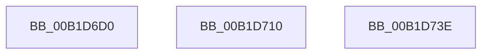

# sub_00B1D6D0

- RVA: `0x00B1D6D0`–`0x00B1D74C` (길이 `124` bytes)
- VA: `0x0000000140B1D6D0`
- 실행 섹션: `PAGE`
- PDB 이름 있음: `아니요`; PDB Function 태그: `아니요`
- unwind 정보 RVA: `0x00086820`
- 디코드: `30`개 명령, `124/124` bytes 표시
- 미해석 바이트: `0` (있으면 어셈블리에 `.byte`로 보존)

> 이 문서는 커널 이미지의 기계어와 PDB 기호를 분석해 생성했습니다. 4번과 5번은 함수 원형과 자료형을 바이너리 사용 방식에서 추정한 C 해석이며 원본 소스 복구 결과는 아닙니다.

## 1. Dependencies

- 직접 호출 지점: **3**; 고유 호출 대상: **3**
- 직접 호출자로 확인된 함수: **0**
- RIP 상대 이미지 참조: **0**

### Outgoing calls
- `0x00B1D705` → [DrvDbGetDriverDatabaseMappedProperty](../92/DrvDbGetDriverDatabaseMappedProperty_function_0092EE28.md) (function, `0x0092EE28`)
- `0x00B1D733` → [DrvDbGetDriverDatabaseMappedPropertyKeys](../83/DrvDbGetDriverDatabaseMappedPropertyKeys_function_0083355C.md) (function, `0x0083355C`)
- `0x00B1D741` → [DrvDbDestroyDatabaseNode](../83/DrvDbDestroyDatabaseNode_function_00835674.md) (function, `0x00835674`)

### Direct callers
- 이 함수 시작 RVA로 연결되는 직접 call은 확인되지 않았습니다. 간접 호출은 완전히 역산할 수 없습니다.

### Static image references
- 디코드된 RIP-relative 메모리 참조가 없습니다.

## 2. Other-region calls and transfers

- 다른 실행 섹션으로 향하는 call: **0**
- call이 아닌 외부 분기/꼬리 이동: **3**
  - `0x00B1D70B` → [DrvDbDispatchDriverDatabase + 0x77](../8E/DrvDbDispatchDriverDatabase_function_008E6EC0.md) (`tail-transfer`)
  - `0x00B1D739` → [DrvDbDispatchDriverDatabase + 0x77](../8E/DrvDbDispatchDriverDatabase_function_008E6EC0.md) (`tail-transfer`)
  - `0x00B1D747` → [DrvDbDispatchDriverDatabase + 0x77](../8E/DrvDbDispatchDriverDatabase_function_008E6EC0.md) (`tail-transfer`)

## 3. Assembly (complete function range)

```asm
00B1D6D0  4C 8B 84 24 80 00 00 00         mov r8, qword ptr [rsp + 0x80]
00B1D6D8  48 8B CB                        mov rcx, rbx
00B1D6DB  49 8B 40 30                     mov rax, qword ptr [r8 + 0x30]
00B1D6DF  4D 8B 48 10                     mov r9, qword ptr [r8 + 0x10]
00B1D6E3  48 89 44 24 38                  mov qword ptr [rsp + 0x38], rax
00B1D6E8  41 8B 40 28                     mov eax, dword ptr [r8 + 0x28]
00B1D6EC  89 44 24 30                     mov dword ptr [rsp + 0x30], eax
00B1D6F0  49 8B 40 20                     mov rax, qword ptr [r8 + 0x20]
00B1D6F4  48 89 44 24 28                  mov qword ptr [rsp + 0x28], rax
00B1D6F9  49 8B 40 18                     mov rax, qword ptr [r8 + 0x18]
00B1D6FD  4D 8B 00                        mov r8, qword ptr [r8]
00B1D700  48 89 44 24 20                  mov qword ptr [rsp + 0x20], rax
00B1D705  E8 1E 17 E1 FF                  call 0x14092ee28
00B1D70A  90                              nop
00B1D70B  E9 27 98 DC FF                  jmp 0x1408e6f37
00B1D710  4C 8B 84 24 80 00 00 00         mov r8, qword ptr [rsp + 0x80]
00B1D718  48 8B CB                        mov rcx, rbx
00B1D71B  49 8B 40 28                     mov rax, qword ptr [r8 + 0x28]
00B1D71F  4D 8B 48 18                     mov r9, qword ptr [r8 + 0x18]
00B1D723  48 89 44 24 28                  mov qword ptr [rsp + 0x28], rax
00B1D728  41 8B 40 20                     mov eax, dword ptr [r8 + 0x20]
00B1D72C  4D 8B 00                        mov r8, qword ptr [r8]
00B1D72F  89 44 24 20                     mov dword ptr [rsp + 0x20], eax
00B1D733  E8 24 5E D1 FF                  call 0x14083355c
00B1D738  90                              nop
00B1D739  E9 F9 97 DC FF                  jmp 0x1408e6f37
00B1D73E  48 8B CB                        mov rcx, rbx
00B1D741  E8 2E 7F D1 FF                  call 0x140835674
00B1D746  90                              nop
00B1D747  E9 EB 97 DC FF                  jmp 0x1408e6f37
```

## 4. C-style interpretation (structured pseudocode)

```c
__int64 __fastcall sub_00B1D6D0(__int64 a1, __int64 a2, __int64 a3, __int64 a4, __int64 a5, __int64 a6, __int64 a7, __int64 a8, __int64 a9, __int64 a10, __int64 a11, __int64 a12, __int64 a13, __int64 a14, __int64 a15, __int64 a16)
{
    __int64 result;
    unsigned __int64 v_stack_p20;
    unsigned __int64 v_stack_p28;
    unsigned int v_stack_p30;
    unsigned __int64 v_stack_p38;
    unsigned __int64 v_stack_p80;

    v_stack_p38 = *(unsigned __int64 *)(a16 + 48);
    v_stack_p30 = (unsigned int)((unsigned int)(*(unsigned int *)(a16 + 40)));
    v_stack_p28 = *(unsigned __int64 *)(a16 + 32);
    v_stack_p20 = *(unsigned __int64 *)(a16 + 24);
    result = DrvDbGetDriverDatabaseMappedProperty(v_rbx, a2, *(unsigned __int64 *)(a16), *(unsigned __int64 *)(a16 + 16));
}
```

## 5. (Beta) C Style

```c
int64_t sub_00B1D6D0(int64_t Arg1, int64_t Arg2, int64_t Arg3, int64_t Arg4, uint64_t Arg5, uint64_t Arg6, uint64_t Arg7, uint64_t Arg8, uint64_t Arg9, uint64_t Arg10, uint64_t Arg11, uint64_t Arg12, uint64_t Arg13, uint64_t Arg14, uint64_t Arg15, void *Arg16)
{
    uint8_t *arg16 = (uint8_t *)Arg16;

    int64_t result;
    uint64_t v_stack_p20;
    uint64_t v_stack_p28;
    uint32_t v_stack_p30;
    uint64_t v_stack_p38;
    uint64_t v_stack_p80;

    v_stack_p38 = *(uint64_t *)(arg16 + 0x30);
    v_stack_p30 = (uint32_t)((uint32_t)(*(uint32_t *)(arg16 + 0x28)));
    v_stack_p28 = *(uint64_t *)(arg16 + 0x20);
    v_stack_p20 = *(uint64_t *)(arg16 + 0x18);
    result = DrvDbGetDriverDatabaseMappedProperty(local_rbx, Arg2, *(uint64_t *)(arg16), *(uint64_t *)(arg16 + 0x10));
}
```

### 관측된 메모리 오프셋

구조체 형식이 확인되지 않은 접근은 인자 기준의 오프셋으로만 기록했습니다.

| 기준 인자 | 오프셋 표현 | 폭 (bit) | 접근 |
|---|---:|---:|---|
| `Arg16` | `+ 0x0` | `64` | `R` |
| `Arg16` | `+ 0x10` | `64` | `R` |
| `Arg16` | `+ 0x18` | `64` | `R` |
| `Arg16` | `+ 0x20` | `64` | `R` |
| `Arg16` | `+ 0x28` | `32` | `R` |
| `Arg16` | `+ 0x30` | `64` | `R` |

## 6. Execution-region graph

[열기: 2D/3D 그래프와 함수 탐색 컨트롤 패널](../../../control-panel.html?section=page&rva=0x00B1D6D0&view=graph)

- 2D 그래프는 위에서 아래로 흐르고, 3D 그래프는 빈 공간을 드래그해 회전합니다. Shift+드래그는 이동, 휠은 확대·축소, 함수 노드 선택은 대상 보고서 이동입니다.

### Static fallback


