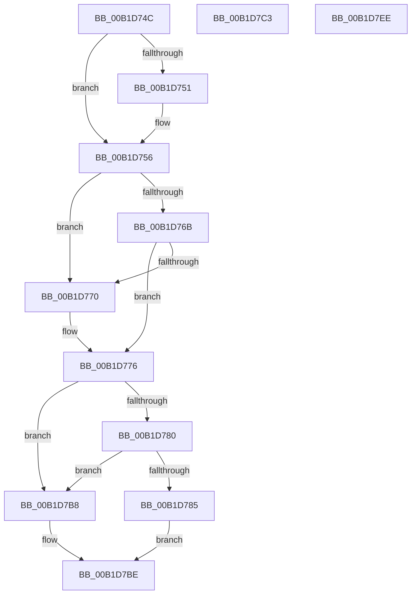

# sub_00B1D74C

- RVA: `0x00B1D74C`–`0x00B1D805` (길이 `185` bytes)
- VA: `0x0000000140B1D74C`
- 실행 섹션: `PAGE`
- PDB 이름 있음: `아니요`; PDB Function 태그: `아니요`
- unwind 정보 RVA: `0x000869E4`
- 디코드: `49`개 명령, `185/185` bytes 표시
- 미해석 바이트: `0` (있으면 어셈블리에 `.byte`로 보존)

> 이 문서는 커널 이미지의 기계어와 PDB 기호를 분석해 생성했습니다. 4번과 5번은 함수 원형과 자료형을 바이너리 사용 방식에서 추정한 C 해석이며 원본 소스 복구 결과는 아닙니다.

## 1. Dependencies

- 직접 호출 지점: **1**; 고유 호출 대상: **1**
- 직접 호출자로 확인된 함수: **0**
- RIP 상대 이미지 참조: **0**

### Outgoing calls
- `0x00B1D751` → [ExRaiseDatatypeMisalignment](../89/ExRaiseDatatypeMisalignment_function_00899FD0.md) (function, `0x00899FD0`)

### Direct callers
- 이 함수 시작 RVA로 연결되는 직접 call은 확인되지 않았습니다. 간접 호출은 완전히 역산할 수 없습니다.

### Static image references
- 디코드된 RIP-relative 메모리 참조가 없습니다.

## 2. Other-region calls and transfers

- 다른 실행 섹션으로 향하는 call: **0**
- call이 아닌 외부 분기/꼬리 이동: **3**
  - `0x00B1D7BE` → [PiCMCaptureObjectInputData + 0xEF](../8E/PiCMCaptureObjectInputData_function_008E8220.md) (`tail-transfer`)
  - `0x00B1D7E9` → [PiCMCaptureObjectInputData + 0xEF](../8E/PiCMCaptureObjectInputData_function_008E8220.md) (`tail-transfer`)
  - `0x00B1D800` → [PiCMCaptureObjectInputData + 0x15E](../8E/PiCMCaptureObjectInputData_function_008E8220.md) (`tail-transfer`)

## 3. Assembly (complete function range)

```asm
00B1D74C  F6 C1 03                        test cl, 3
00B1D74F  74 05                           je 0x140b1d756
00B1D751  E8 7A C8 D7 FF                  call 0x140899fd0
00B1D756  44 8B C2                        mov r8d, edx
00B1D759  4C 03 C1                        add r8, rcx
00B1D75C  48 B8 00 00 FF FF FF 7F 00 00   movabs rax, 0x7fffffff0000
00B1D766  4C 3B C0                        cmp r8, rax
00B1D769  77 05                           ja 0x140b1d770
00B1D76B  4C 3B C1                        cmp r8, rcx
00B1D76E  73 06                           jae 0x140b1d776
00B1D770  8A 00                           mov al, byte ptr [rax]
00B1D772  8B 5C 24 34                     mov ebx, dword ptr [rsp + 0x34]
00B1D776  BE 0D 00 00 C0                  mov esi, 0xc000000d
00B1D77B  83 FA 1C                        cmp edx, 0x1c
00B1D77E  72 38                           jb 0x140b1d7b8
00B1D780  83 39 1C                        cmp dword ptr [rcx], 0x1c
00B1D783  75 33                           jne 0x140b1d7b8
00B1D785  41 C7 01 28 00 00 00            mov dword ptr [r9], 0x28
00B1D78C  8B 41 04                        mov eax, dword ptr [rcx + 4]
00B1D78F  41 89 41 04                     mov dword ptr [r9 + 4], eax
00B1D793  8B 41 08                        mov eax, dword ptr [rcx + 8]
00B1D796  41 89 41 08                     mov dword ptr [r9 + 8], eax
00B1D79A  8B 41 0C                        mov eax, dword ptr [rcx + 0xc]
00B1D79D  49 89 41 10                     mov qword ptr [r9 + 0x10], rax
00B1D7A1  8B 41 10                        mov eax, dword ptr [rcx + 0x10]
00B1D7A4  41 89 41 18                     mov dword ptr [r9 + 0x18], eax
00B1D7A8  8B 41 14                        mov eax, dword ptr [rcx + 0x14]
00B1D7AB  41 89 41 1C                     mov dword ptr [r9 + 0x1c], eax
00B1D7AF  8B 41 18                        mov eax, dword ptr [rcx + 0x18]
00B1D7B2  41 89 41 20                     mov dword ptr [r9 + 0x20], eax
00B1D7B6  EB 06                           jmp 0x140b1d7be
00B1D7B8  8B DE                           mov ebx, esi
00B1D7BA  89 5C 24 34                     mov dword ptr [rsp + 0x34], ebx
00B1D7BE  E9 4C AB DC FF                  jmp 0x1408e830f
00B1D7C3  8B D8                           mov ebx, eax
00B1D7C5  89 44 24 34                     mov dword ptr [rsp + 0x34], eax
00B1D7C9  33 FF                           xor edi, edi
00B1D7CB  BE 0D 00 00 C0                  mov esi, 0xc000000d
00B1D7D0  4C 8B B4 24 98 00 00 00         mov r14, qword ptr [rsp + 0x98]
00B1D7D8  89 7C 24 38                     mov dword ptr [rsp + 0x38], edi
00B1D7DC  44 8A 64 24 30                  mov r12b, byte ptr [rsp + 0x30]
00B1D7E1  44 88 A4 24 80 00 00 00         mov byte ptr [rsp + 0x80], r12b
00B1D7E9  E9 21 AB DC FF                  jmp 0x1408e830f
00B1D7EE  0F 57 C0                        xorps xmm0, xmm0
00B1D7F1  33 C0                           xor eax, eax
00B1D7F3  41 0F 11 06                     movups xmmword ptr [r14], xmm0
00B1D7F7  41 0F 11 46 10                  movups xmmword ptr [r14 + 0x10], xmm0
00B1D7FC  49 89 46 20                     mov qword ptr [r14 + 0x20], rax
00B1D800  E9 79 AB DC FF                  jmp 0x1408e837e
```

## 4. C-style interpretation (structured pseudocode)

```c
__int64 __fastcall sub_00B1D74C(__int64 a1, int a2, __int64 a3, __int64 a4)
{
    __int64 result;
    __int64 v_rbx;
    unsigned __int8 v_stack_p30;
    unsigned int v_stack_p34;
    unsigned int v_stack_p38;
    unsigned __int8 v_stack_p80;
    unsigned __int64 v_stack_p98;

    if ((((unsigned __int8)(a1)) & (3)) != 0) {
        result = ExRaiseDatatypeMisalignment(a1, a2, a3, a4);
    }
    a3 = ((unsigned int)(a2)) + (a1);
    if (a3 > result) goto loc_00B1D770;
    if (a3 < a1) {
        result = *(unsigned __int8 *)(result);
        v_rbx = v_stack_p34;
    }
    if (a2 < 28) goto loc_00B1D7B8;
    if ((*(unsigned int *)(a1)) != 28) goto loc_00B1D7B8;
    *(unsigned int *)(a4) = 40;
    *(unsigned int *)(a4 + 4) = (unsigned int)((unsigned int)(*(unsigned int *)(a1 + 4)));
    *(unsigned int *)(a4 + 8) = (unsigned int)((unsigned int)(*(unsigned int *)(a1 + 8)));
    *(unsigned __int64 *)(a4 + 16) = (unsigned int)(*(unsigned int *)(a1 + 12));
    *(unsigned int *)(a4 + 24) = (unsigned int)((unsigned int)(*(unsigned int *)(a1 + 16)));
    *(unsigned int *)(a4 + 28) = (unsigned int)((unsigned int)(*(unsigned int *)(a1 + 20)));
    *(unsigned int *)(a4 + 32) = (unsigned int)((unsigned int)(*(unsigned int *)(a1 + 24)));
    goto loc_00B1D7BE;
loc_00B1D7B8:
    v_stack_p34 = (unsigned int)((unsigned int)((unsigned int)((unsigned int)(0xC000000DULL))));
loc_00B1D7BE:
}
```

## 5. (Beta) C Style

```c
int64_t sub_00B1D74C(int64_t Arg1, int32_t Arg2, int64_t Arg3, int64_t Arg4)
{
    int64_t result;
    int64_t local_rbx;
    uint8_t v_stack_p30;
    uint32_t v_stack_p34;
    uint32_t v_stack_p38;
    uint8_t v_stack_p80;
    uint64_t v_stack_p98;

    if ((((uint8_t)(Arg1)) & (3)) != 0) {
        result = ExRaiseDatatypeMisalignment(Arg1, Arg2, Arg3, Arg4);
    }
    Arg3 = ((uint32_t)(Arg2)) + (Arg1);
    if (Arg3 > result) goto loc_00B1D770;
    if (Arg3 < Arg1) {
        result = *(uint8_t *)(result);
        local_rbx = v_stack_p34;
    }
    if (Arg2 < 28) goto loc_00B1D7B8;
    if ((*(uint32_t *)(Arg1)) != 28) goto loc_00B1D7B8;
    *(uint32_t *)(Arg4) = 40;
    *(uint32_t *)(Arg4 + 0x4) = (uint32_t)((uint32_t)(*(uint32_t *)(Arg1 + 0x4)));
    *(uint32_t *)(Arg4 + 0x8) = (uint32_t)((uint32_t)(*(uint32_t *)(Arg1 + 0x8)));
    *(uint64_t *)(Arg4 + 0x10) = (uint32_t)(*(uint32_t *)(Arg1 + 0xC));
    *(uint32_t *)(Arg4 + 0x18) = (uint32_t)((uint32_t)(*(uint32_t *)(Arg1 + 0x10)));
    *(uint32_t *)(Arg4 + 0x1C) = (uint32_t)((uint32_t)(*(uint32_t *)(Arg1 + 0x14)));
    *(uint32_t *)(Arg4 + 0x20) = (uint32_t)((uint32_t)(*(uint32_t *)(Arg1 + 0x18)));
    goto loc_00B1D7BE;
loc_00B1D7B8:
    v_stack_p34 = (uint32_t)((uint32_t)((uint32_t)((uint32_t)(0xC000000DULL))));
loc_00B1D7BE:
}
```

## 6. Execution-region graph

[열기: 2D/3D 그래프와 함수 탐색 컨트롤 패널](../../../control-panel.html?section=page&rva=0x00B1D74C&view=graph)

- 2D 그래프는 위에서 아래로 흐르고, 3D 그래프는 빈 공간을 드래그해 회전합니다. Shift+드래그는 이동, 휠은 확대·축소, 함수 노드 선택은 대상 보고서 이동입니다.

### Static fallback


